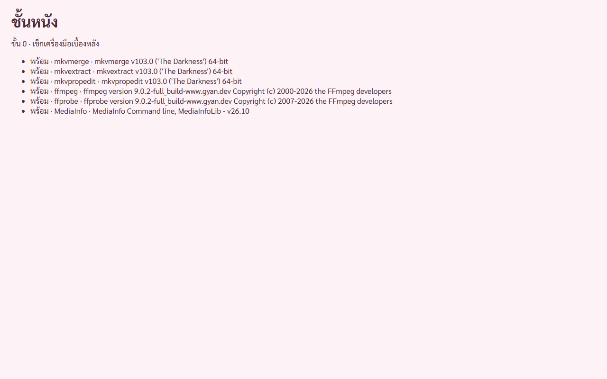

# รายงานขั้น 0 · เตรียมเครื่องและโครงโปรแกรม

6 พ.ย. 2569 · commit `2a2ff9f` (ไม่ push)

## คำสั่งของพี่กัน
- *"วางแผน"* แล้วอนุมัติแผน 9 ขั้น · *"ลืมบอก commit ทุกเฟสด้วย"* · *"ทำต่อ จนเสร็จ"*

## เสร็จตามเงื่อนไขของแผน

| เงื่อนไข | ผล | หลักฐาน |
|---|---|---|
| หน้าต่างชั้นหนังเปิดได้ | ✅ | ภาพข้างล่าง |
| เครื่องมือ 6 ตัวตอบเลขรุ่น และเป็นรุ่นที่แนบจริง | ✅ | เทส `all_six_tools_answer_their_version` |
| เรียกเครื่องมือกับชื่อไฟล์ภาษาไทยแล้วผลไม่เพี้ยน | ✅ | เทส `tools_read_thai_file_names` |
| hash ของเครื่องมือตรงกับ vendor/README.md | ✅ | `fetch-tools.ps1` เช็กก่อนแตก · ตาราง hash ของ 7 ไฟล์ที่แตกแล้วใน vendor/README.md |

ภาพจากหน้าต่างโปรแกรมจริงผ่านพอร์ตดีบัก ขึ้นพร้อมครบ 6 ตัว พร้อมเลขรุ่น · หน้านี้เป็นหน้าชั่วคราว ขั้น 1 แทนด้วยกรอบหน้าต่างจริง

## ผลเทสฝั่ง Rust · 5 ข้อผ่านหมด

| เทส | ตรวจอะไร |
|---|---|
| `all_six_tools_answer_their_version` | 6 ตัวตอบ และเป็นรุ่น 103.0 · 9.0.2 · 26.10 |
| `exit_codes_are_read_per_tool` | MKVToolNix รหัส 1 = สำเร็จแต่มีคำเตือน · ffmpeg รหัส 1 = พัง |
| `timeout_kills_a_hung_tool` | เครื่องมือค้างโดนตัดใน 2 วินาที |
| `tools_read_thai_file_names` | อ่านเขียนไฟล์ชื่อไทย ชื่อที่อ่านกลับมาตรงทุกตัวอักษร · ลองซ่อนไฟล์ทดสอบแล้วเทสล้มจริง |
| `tools_run_from_a_thai_folder` | เครื่องมือ 7 ไฟล์เปิดได้จากโฟลเดอร์ `...\ชั้นหนัง\tools` แบบหลังติดตั้ง |

## ลองหลุมทางเทคนิคจริง

| เรื่อง | ผล |
|---|---|
| เปลี่ยนปกในไฟล์ 4.10 GiB ด้วยรูปที่ใหญ่กว่าเดิม 15 เท่า | 277 มิลลิวินาที ดึงกลับมาตรงทุกไบต์ เล่นได้ทั้งต้นและท้ายเรื่อง |
| โปรแกรมอื่นเปิดไฟล์ค้างแบบห้ามเขียน | mkvpropedit พัง ไฟล์ไม่ถูกแตะ |
| โปรแกรมอื่นเปิดไฟล์ค้างแบบยอมให้เขียน | 🔴 mkvpropedit เขียนได้ · โปรแกรมต้องเช็กเองก่อนแก้ทุกครั้ง จดเป็นกติกาใน TECH-REVIEW แล้ว |
| ความเร็ว SHA-256 | 410 MB ต่อวินาทีบน SSD · เครื่องนี้ไม่มีฮาร์ดดิสก์ |
| HEIC จากไอโฟน | ความละเอียดเต็ม 5712 × 4284 · เรื่องหมุนยังพิสูจน์ไม่ได้ รูปไม่มีข้อมูลการหมุน |
| เสียง WMA ใส่ MP4 | ใส่ไม่ได้จริง ใช้เป็นไฟล์เทสข้อความเตือนขั้น 4 |

## ผลตรวจของผู้ช่วย
ผู้ช่วยสองตัวตรวจขั้น 0 ไปหนึ่งรอบ (แคลร์ตีความผิดว่าให้รันทุกขั้น พี่กันแก้แล้วว่าครั้งเดียวตอนจบทั้งหมด)
แคลร์ตรวจซ้ำทุกข้อแล้วแก้ ผลอยู่ใน `docs/review/ขั้น0-สเปก.md` กับ `docs/review/ขั้น0-โค้ด.md`

## ยังไม่ได้ทำ ยกไปขั้นที่เกี่ยว
- ตัวกันปิดโปรแกรมตอนงานรัน → ขั้น 1
- ผูกเครื่องมือให้ตายตามโปรแกรม → ขั้น 2
- ถังขยะกับ USB · ไอคอน Explorer ของ MP4 → ขั้น 4 · เครื่องนี้ไม่มีไดรฟ์ USB
- ที่อยู่เครื่องมือหลังติดตั้งจริง → ขั้น 8
