# รายงานขั้น 1 · กรอบหน้าต่างและชิ้นส่วนกลาง

6 พ.ย. 2569 · เทสในหน้าต่างโปรแกรมจริงผ่านพอร์ตดีบัก ผ่าน 53 จาก 53 ข้อ (`scripts/check-stage1.mjs` ผลอยู่ `report-2026-11-06/ขั้น1/ผลเทส.json`) · เทส Rust 12 ข้อผ่านหมด

## คำสั่งของพี่กัน
- *"ทำต่อ จนเสร็จ"* (ทำตามแผน 9 ขั้นต่อจากขั้น 0)

## 1. กรอบหน้าต่าง · แถบชื่อทำเอง เมนูซ้าย 4 หน้า

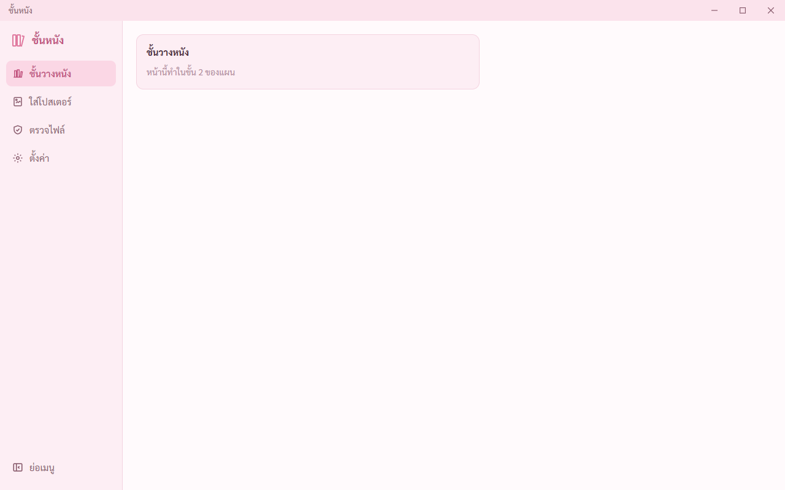

แถบชื่อสูง 34 · ปุ่มย่อ ขยาย ปิด กว้าง 46 · เมนูซ้ายกว้าง 200 · ทุกค่าวัดจากหน้าต่างจริงตรงต้นแบบ · หน้าแต่ละหน้าทำในขั้นของมัน (ชั้นวาง ขั้น 2 · ใส่โปสเตอร์ ขั้น 4 · ตรวจไฟล์ ขั้น 6 · ตั้งค่า ขั้น 7)

## 2. ชิ้นส่วนกลางทุกแบบ วัดเทียบต้นแบบ

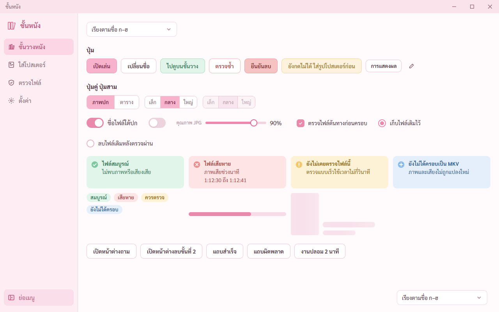

หน้านี้มีเฉพาะตอนทดสอบ ตัวติดตั้งจริงไม่มี · ปุ่ม 6 แบบ สูง 38 โค้ง 9 สีตรงต้นแบบทุกค่า · ปุ่มเล็ก 32 · ปุ่มไอคอน 32 · ปุ่มคู่ 34 ปุ่มสามแบบเล็ก 30 · ปุ่มที่กดไม่ได้บอกเหตุผลตอนชี้ · สวิตช์ 44 × 26 · การ์ดสถานะ 4 สี · โครงจางมีคลื่น

## 3. ทุกปุ่มเปลี่ยนสีตอนชี้ ในโทนของปุ่มนั้น

| ก่อนชี้ | ตอนชี้ |
|---|---|
| 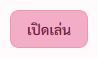 | 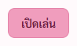 |
| 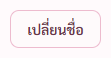 | 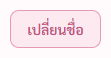 |
| 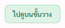 | 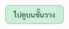 |
| 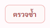 | 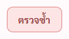 |
| 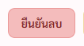 | 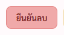 |
| 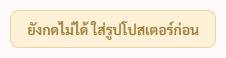 | 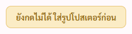 |

ตัวเทสชี้ด้วยเมาส์จำลองแล้วอ่านสีที่เบราว์เซอร์คำนวณ ตรงค่าตอนชี้ในต้นแบบทุกปุ่ม · ไม่มีปุ่มไหนในหน้าที่ไม่มีกฎตอนชี้ · ปุ่มปิดหน้าต่างชี้แล้วเป็นแดงจาง

## 4. รายการกางวัดที่ว่างก่อนกาง

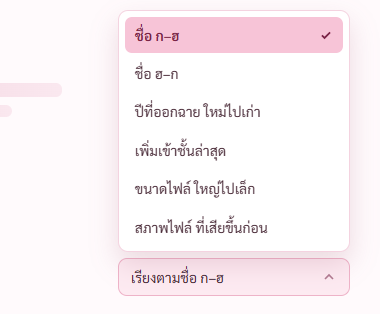

ใกล้ขอบล่างพลิกขึ้น ไม่จมใต้ขอบจอ · มีที่ว่างด้านล่างกางลง · ลูกศรกับ Enter เลือกได้ Esc ปิด
- เจอและแก้ระหว่างเทส: ข้อความบนปุ่มรายการอยู่กลางปุ่ม ต้นแบบชิดซ้าย (ปุ่มของระบบจัดกลางเป็นค่าตั้งต้น) · แก้ใน `app.css`

## 5. หน้าต่างซ้อน

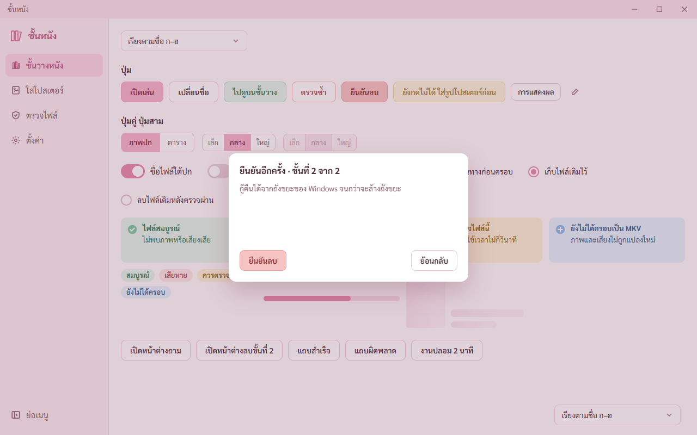

โค้ง 14 พื้นหลังชมพูเข้มโปร่ง · หน้าต่างที่มีงานกดข้างนอกไม่ปิด Esc ปิดได้ · ปุ่มยืนยันลบอยู่ซ้าย ย้อนกลับอยู่ขวา โฟกัสแรกอยู่ที่ย้อนกลับ · Enter กับ Space กดปุ่มที่โฟกัสอยู่ได้
- เจอและแก้ระหว่างเทส: หน้าต่างเตี้ยกว่าต้นแบบ เพิ่มความสูงขั้นต่ำ 236 ตามต้นแบบ หน้าต่างลบขั้น 1 กับขั้น 2 สูงเท่ากัน ปุ่มไม่กระโดด

## 6. แถบแจ้งผล

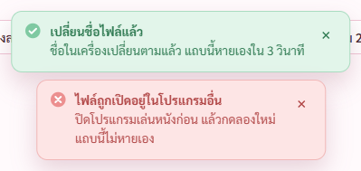

แถบสำเร็จหายเองใน 3 วินาที · แถบผิดพลาดไม่หายเอง กดปิดได้

## 7. เมนูย่อ และจำค่าไว้

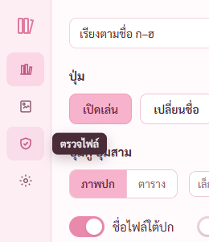

ย่อเหลือ 64 ชี้ไอคอนขึ้นชื่อเมนูทางขวา · ปิดโปรแกรมแล้วเปิดใหม่ เมนูยังย่ออยู่

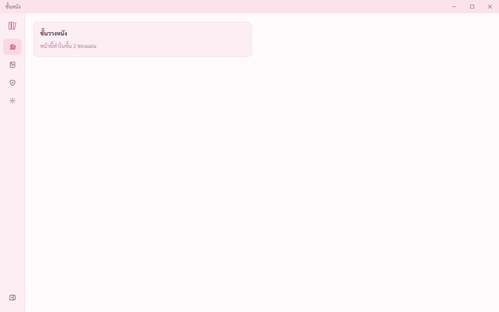

## 8. ปิดโปรแกรมตอนงานรันอยู่ต้องถามก่อน

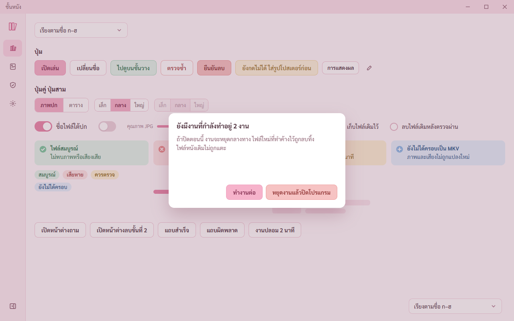

ใช้งานปลอม (มีเฉพาะตอนทดสอบ) แทนงานจริง · กดปิดแล้วขึ้นหน้าต่างถาม · กดทำงานต่อ โปรแกรมยังอยู่ งานยังรัน · กดหยุดงานแล้วปิดโปรแกรม โปรแกรมปิดจริง ไม่มีโปรเซสค้าง
- หน้าจอไม่มีสิทธิ์ทำลายหน้าต่างแล้ว ทางเดียวที่ปิดตอนมีงานได้คือคำสั่งฝั่ง Rust ที่เช็กงานก่อน · กันทั้งตอนกดปิดหน้าต่างและตอนโปรแกรมจะออก

## 9. ไฟล์ตั้งค่าเสียครึ่งไฟล์ ใช้ชุดสำรองแทน

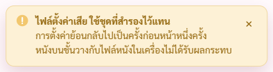

ไฟล์ตั้งค่า (`settings.json`) คือไฟล์ที่โปรแกรมจำการตั้งค่าของพี่กัน เช่น ย่อเมนูไว้ไหม ขนาดปก · ปิดโปรแกรม ตัดไฟล์เหลือครึ่งไฟล์ แล้วเปิดใหม่ โปรแกรมใช้ชุดสำรอง เมนูกลับเป็นค่าในชุดสำรอง และขึ้นแถบเหลืองบอก
- เจอและแก้ระหว่างเทส: ① แถบขึ้นซ้ำสองแถบ เพราะโหมดทดสอบของ React สั่งอ่านสองรอบ แก้ให้ผลของรอบที่ถูกยกเลิกถูกทิ้ง ② ไอคอนเป็นเครื่องหมายบวกซึ่งต้นแบบใช้กับ ยังไม่ได้ครอบ เพิ่มแถบแบบเตือนสีเหลือง ③ คำว่า ค่าตั้ง เปลี่ยนเป็น การตั้งค่า
- เจอและแก้ในโค้ด: ถ้าไฟล์หลักเสียแล้วโปรแกรมใช้ชุดสำรอง พอบันทึกครั้งถัดไป ไฟล์ที่เสียจะถูกคัดลอกไปทับชุดสำรองที่ดี · แก้ให้คัดลอกเป็นสำรองเฉพาะตอนไฟล์หลักอ่านได้ เทสแล้วว่าใส่บั๊กกลับเทสล้มจริง

## 10. ปิดภาพเคลื่อนไหวในเครื่อง
เปิดโหมดลดภาพเคลื่อนไหวของ Windows แล้ว เมนูย่อไม่เลื่อน โครงจางไม่กะพริบ

## ยังไม่ได้ทำ ยกไปขั้นที่เกี่ยว
- จุดเลขนับบนเมนูตอนย่อ ขึ้นเมื่อมีหนังบนชั้น → ขั้น 2
- คลังหนังเขียนแบบปลอดภัยมีสำรอง → ขั้น 2 (ใช้ตัวเขียนไฟล์ตัวเดียวกับไฟล์ตั้งค่า)
