# รายงานขั้น 2 · ชั้นวาง

6 พ.ย. 2569 · เทสในหน้าต่างโปรแกรมจริงผ่านพอร์ตดีบัก ผ่าน 39 จาก 39 ข้อ สองรอบติด (`scripts/check-stage2.mjs` ผลอยู่ `report-2026-11-06/ขั้น2/ผลเทส.json`) · เทสกับโปรแกรมที่สร้างจริง ผ่าน 6 จาก 6 (`scripts/check-built.mjs`) · เทส Rust 18 ข้อผ่านหมด

## คำสั่งของพี่กัน
- *"ทำต่อ จนเสร็จ"* (ทำตามแผน 9 ขั้นต่อจากขั้น 1)

## ไฟล์ที่ใช้เทส
`node scripts/make-shelf-test.mjs` สร้างโฟลเดอร์ทดสอบในไดรฟ์ D ไม่แตะไฟล์ใน test-media
- `หนัง` 19 เรื่อง ทุกชนิดที่รับ 12 ชนิด · มีโฟลเดอร์ย่อยลึกสองชั้น · มีโฟลเดอร์ `ไฟล์เดิม` กับ `ดาวเหนือ (2023) แยกไฟล์` ที่ต้องไม่ขึ้นชั้น · มีไฟล์ .txt ที่ไม่ใช่หนัง
- `500เรื่อง` หนังสั้น 500 ไฟล์ มีปกครึ่งหนึ่ง ไว้เทสว่าชั้นไม่ค้าง

## 1. ชั้นว่าง ตอนยังไม่ได้เลือกโฟลเดอร์

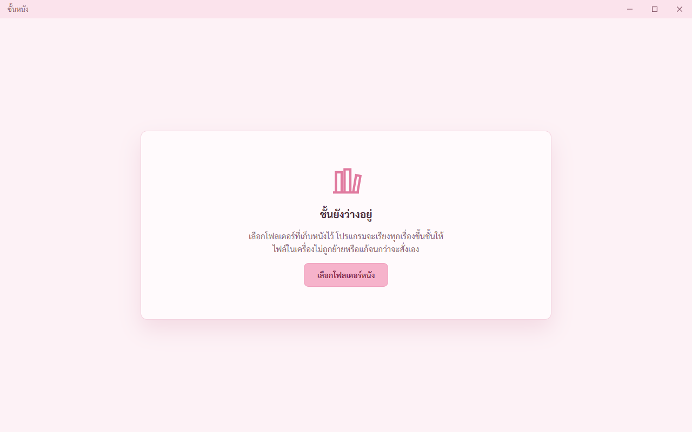

ไม่มีเมนูซ้าย · กด `เลือกโฟลเดอร์หนัง` แล้วขึ้นหน้าต่างเลือกโฟลเดอร์ของ Windows เลือกแล้วชั้นอ่านโฟลเดอร์ทันที
- เจอและแก้ระหว่างเทส: ข้อความตัดบรรทัดกลางวลี `ไฟล์ใน | เครื่อง` แก้ให้ขึ้นบรรทัดใหม่ตรงเว้นวรรค (ดูข้อ 4)

## 2. กำลังอ่านโฟลเดอร์ ปกขึ้นทีละเรื่อง

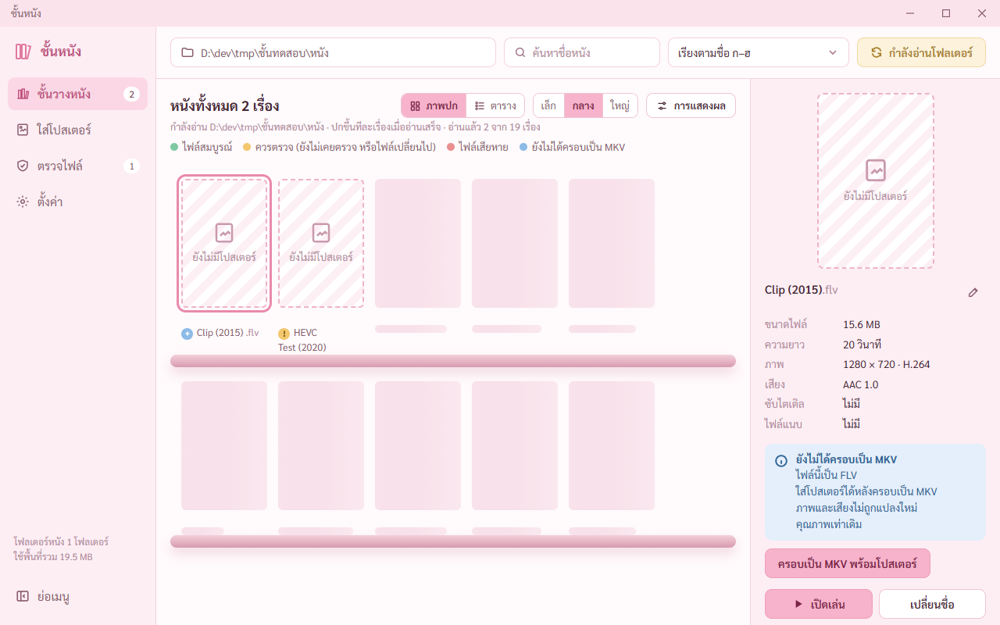

ปุ่มบนขวาเป็น `กำลังอ่านโฟลเดอร์` กดซ้ำไม่ได้ · บอก `อ่านแล้ว 3 จาก 19 เรื่อง` ตัวเลขตรงกับปกที่ขึ้นชั้นตอนนั้น · เรื่องที่ยังอ่านไม่เสร็จเป็นโครงจางต่อท้ายชั้น
- เจอและแก้ระหว่างเทส: ① มีหนังขึ้นชั้นแล้วบางเรื่อง โครงจางหายหมด เหลือที่ว่างเปล่า เพิ่มโครงจางต่อท้ายชั้นเต็มแถวที่ค้างกับอีกหนึ่งแถว ② ชั้นขึ้น 12 เรื่อง คำบอกยังเป็น 9 เพราะฝั่ง Rust ส่งความคืบหน้าไม่เกิน 10 ครั้งต่อวินาที (กติกา TECH-REVIEW ข้อ 8) แก้ให้หน้าจอนับเพิ่มเองทีละเรื่อง มีข้อเทสเช็กว่าตัวเลขตรงกับจำนวนปกในจังหวะเดียวกัน

## 3. ชั้นวาง ป้ายสี เมนูซ้ายนับ

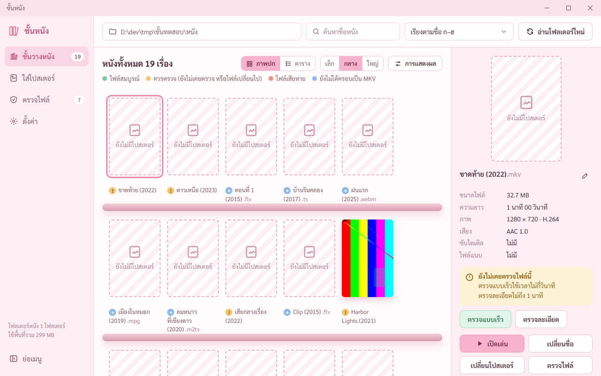

ขึ้นชั้นครบ 19 เรื่องตรงกับไฟล์ในโฟลเดอร์ · ไฟล์ในโฟลเดอร์ `ไฟล์เดิม` กับ `แยกไฟล์` ไม่ขึ้น · ไฟล์ในโฟลเดอร์ย่อยขึ้น · ปกของ Harbor Lights ดึงจากไฟล์แนบใน MKV ย่อเหลือ 300 × 450 · ค่า hash ของปกที่โปรแกรมจดตรงกับที่ดึงด้วย mkvextract เอง (เทส Rust) · เรื่องที่ไม่มีปกเป็นกรอบประลาย · ชี้ปกแล้วลอยขึ้น 6 · เมนูซ้ายนับ 19 เรื่องบนชั้น 7 เรื่องที่ควรตรวจ · ท้ายเมนูบอกพื้นที่รวม 299 MB
- อ่านครั้งแรก 19 เรื่อง 0.3 วินาที · อ่านซ้ำอ่านเฉพาะไฟล์ใหม่หรือไฟล์ที่เปลี่ยน 0.3 วินาที · เปลี่ยนชื่อไฟล์ใน Explorer แล้วสถานะตรวจตามไป (จำด้วยเลขประจำไฟล์ของ Windows เทส Rust)
- เจอและแก้ระหว่างเทส: ต้นแบบจัดขอบล่างของหนังในแถวให้ตรงกัน ชื่อยาวสามบรรทัดดันปกขึ้นไม่ตรงแถว แก้ให้ขอบบนปกตรงกัน (จดในสเปกข้อ 1 ว่าต่างจากต้นแบบ)

## 4. ชื่อและข้อความไทยขึ้นบรรทัดใหม่ตรงเว้นวรรค

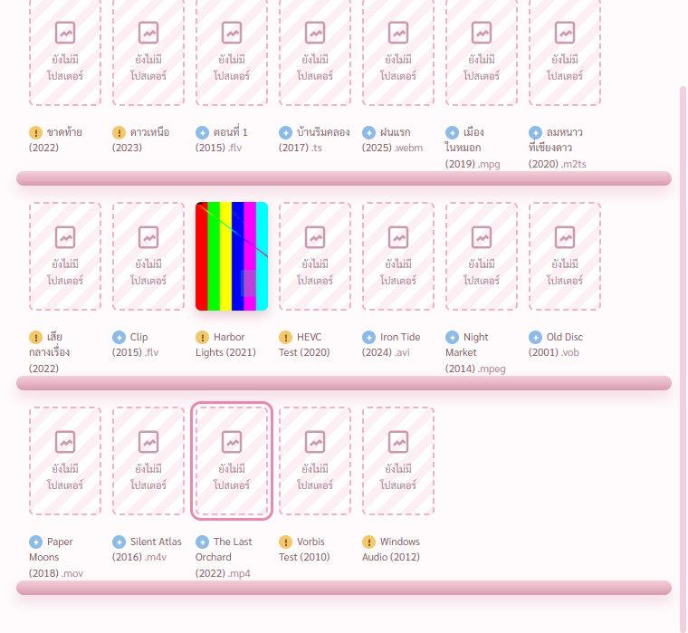

เจอระหว่างตรวจภาพ ชื่อหนังตัดกลางวลี `ขาด | ท้าย (2022)` `ดาว | เหนือ (2023)` · การ์ดตัด `คุณภาพเท่า | เดิม` · จุดสีค้างอยู่บรรทัดเดียวโดด ๆ
- ต้นเหตุ เบราว์เซอร์ตัดคำไทยตามพจนานุกรม ตัดกลางวลีได้ และตัวจัดบรรทัดให้ยาวเท่ากัน (text-wrap: balance) เลือกจุดกลางวลีบ่อยขึ้น · ลอง `word-break: keep-all` ในหน้าต่างจริงแล้ว ไม่มีผลกับภาษาไทย
- แก้ ทำชิ้นส่วนกลาง `Phrases` ใน `src/components/ui.tsx` แต่ละวลีเป็นกล่องที่ห้ามตัดข้างใน บรรทัดจึงขึ้นใหม่เฉพาะตรงเว้นวรรค วลีที่ยาวกว่าช่องเองค่อยตัดข้างใน · ไม้ยมก ๆ ติดวลีหน้าเสมอ · จุดสีติดกับวลีแรกของชื่อ · ใช้กับชื่อบนชั้น ตาราง แผงขวา การ์ดสถานะ แถบแจ้งผล หน้าชั้นว่าง
- ตอนนี้ `ขาดท้าย | (2022)` · `เสีย | กลางเรื่อง | (2022)` ในปกเล็กเป็นกรณีวลียาวกว่าช่อง 80 จุด จึงตัดข้างในวลี

## 5. แผงรายละเอียด การ์ดสถานะ

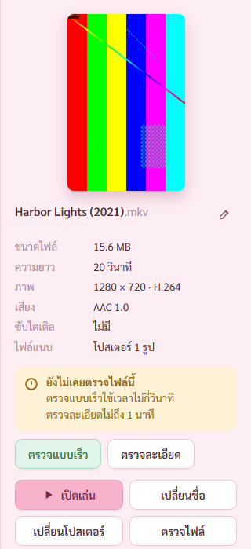

กดปกแล้วแผงขวาขึ้นเรื่องนั้น · โปสเตอร์ใหญ่โหลดได้ · ขนาด ความยาว ภาพ เสียง ซับ ไฟล์แนบ อ่านจากไฟล์จริงด้วย ffprobe · การ์ด `ยังไม่เคยตรวจไฟล์นี้` เวลาตรวจคิดจากขนาดและความยาวของไฟล์จริง

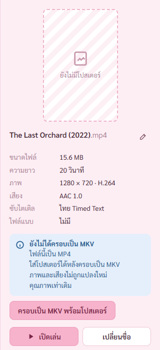

ไฟล์ MP4 ขึ้นการ์ดฟ้า `ยังไม่ได้ครอบเป็น MKV` ชื่อชนิดไฟล์เปลี่ยนตามไฟล์จริง · ปุ่ม `ครอบเป็น MKV พร้อมโปสเตอร์` ตามที่พี่กันเคาะ (สเปกข้อ 12)
- เจอและแก้ระหว่างเทส: สลับเรื่องแล้วปุ่มในแผงค่อย ๆ เปลี่ยนสีจากชมพูเป็นเขียว เพราะหน้าจอใช้ปุ่มเดิมซ้ำ ภาพถ่ายติดสีเทาตอนกลางทาง · แก้ให้สร้างแผงใหม่ทุกครั้งที่สลับเรื่อง
- การ์ดแบบอื่นที่ทำไว้แล้ว `ไฟล์เสียหาย` `ไฟล์สมบูรณ์` `ไฟล์ถูกเปลี่ยนตั้งแต่ตรวจครั้งก่อน` `ถึงเวลาตรวจซ้ำ` `หาไฟล์ไม่เจอ` `อ่านข้อมูลไฟล์ไม่ได้` · สองอันแรกจะเห็นจริงเมื่อทำหน้าตรวจไฟล์ ขั้น 6

## 6. ขนาดปก 3 ขนาด และกล่องการแสดงผล

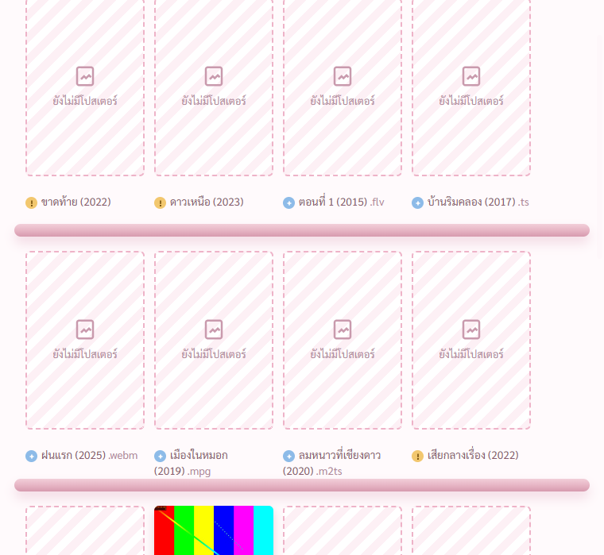

เล็ก 80 · กลาง 110 · ใหญ่ 150 · แถวละกี่เรื่องคิดจากความกว้างจริง หน้าต่าง 1280 ได้ 7 · 5 · 4 · จำค่าไว้

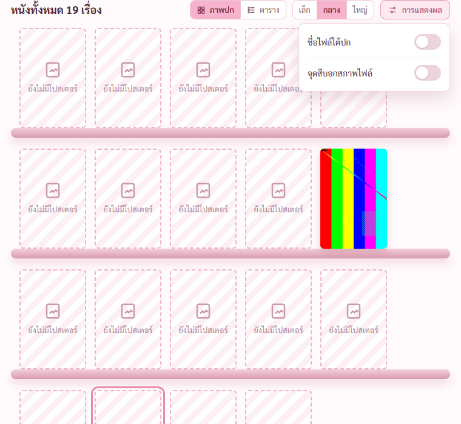

ปิดสวิตช์แล้วชั้นเปลี่ยนทันที · Esc ปิดกล่อง · ปิดชื่อแล้วชี้ปกขึ้นชื่อเต็มพร้อมนามสกุล
- เจอและแก้ระหว่างเทส: ชื่อที่ขึ้นตอนชี้มีบรรทัดว่างต่อท้าย แก้แล้ว ตัวเทสเช็กทุกเรื่อง

## 7. มุมมองตาราง

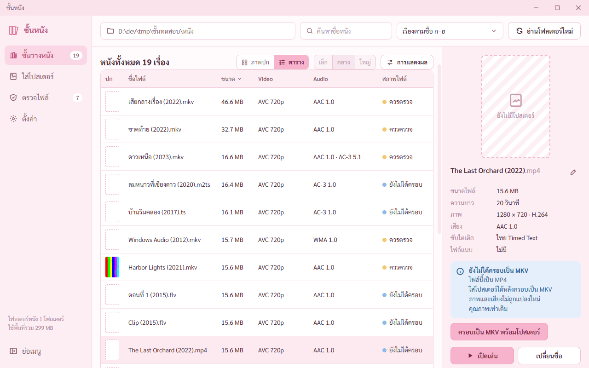

19 แถวครบ · กดหัวคอลัมน์ `ขนาด` เรียงใหญ่ไปเล็กพร้อมลูกศร · ปุ่มขนาดปกกดไม่ได้ ชี้แล้วบอกเหตุผล

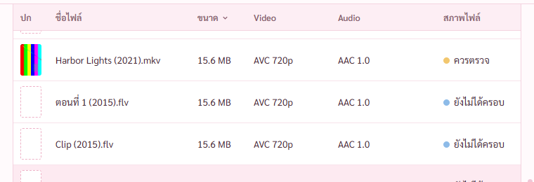

- เจอและแก้ระหว่างเทส: ① หัวตารางไม่ตรึงตอนเลื่อน (สกิล web-craft บังคับ) แก้ตามสูตรในสกิล หัวชิดขอบบนระยะ 0 พอดี เส้นใต้หัวไม่หาย · ใส่บั๊กกลับสองแบบ (ไม่ตรึง กับตรึงแต่มีร่อง 18) ตัวเทสล้มทั้งสองแบบ ② สลับเป็นตารางแล้วหัวชั้นโดนตัดครึ่ง เพราะระยะเลื่อนของภาพปกค้างมา แก้ให้เลื่อนกลับบนสุดทุกครั้งที่สลับ

## 8. ค้นหา

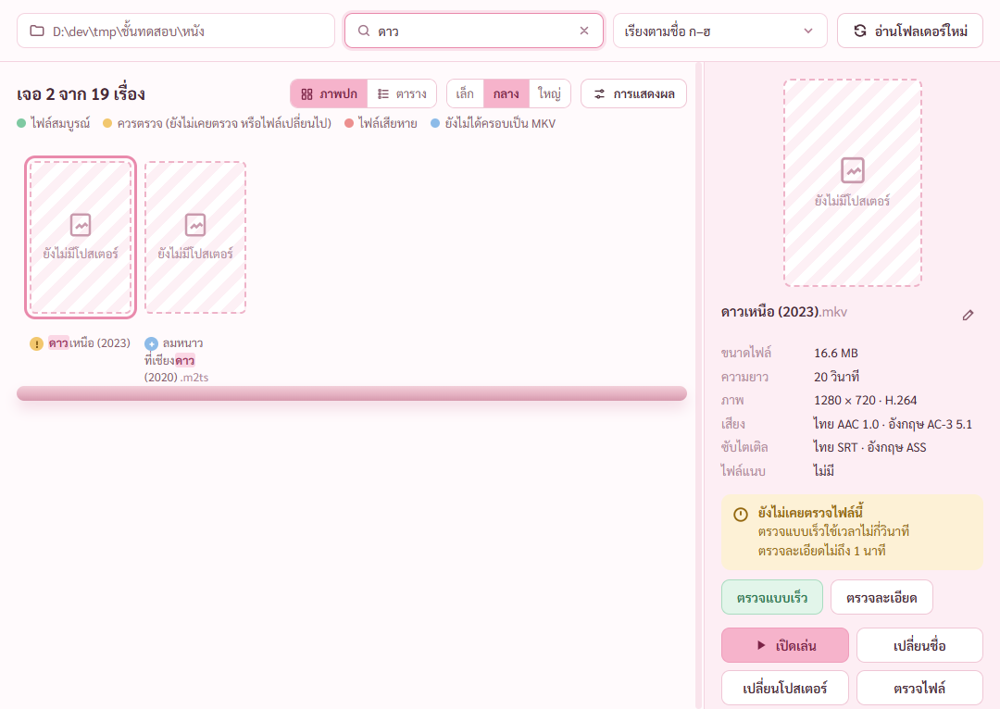

พิมพ์ `ดาว` เจอ 2 เรื่อง ไฮไลต์คำที่เจอ หัวชั้นบอก `เจอ 2 จาก 19 เรื่อง`

พิมพ์ `รพนื` (ลืมสลับเป็นแป้นอังกฤษ) เจอ Iron Tide ขึ้นป้าย `ค้นว่า iron`

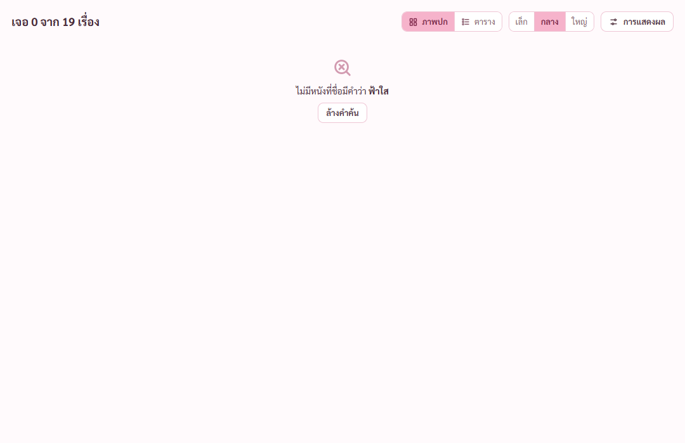

ค้นไม่เจอขึ้นคำบอกพร้อมปุ่มล้างคำค้น · กดล้างแล้วชั้นกลับมาครบ · Esc ในช่องค้นหาล้างคำ

## 9. เรียง 6 แบบ

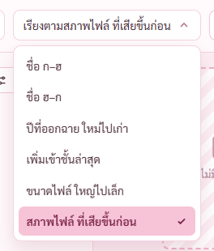

ทั้ง 6 แบบลำดับถูก ตัวเทสเทียบกับข้อมูลในคลัง · จำค่าไว้

## 10. ไดรฟ์ถอดออก

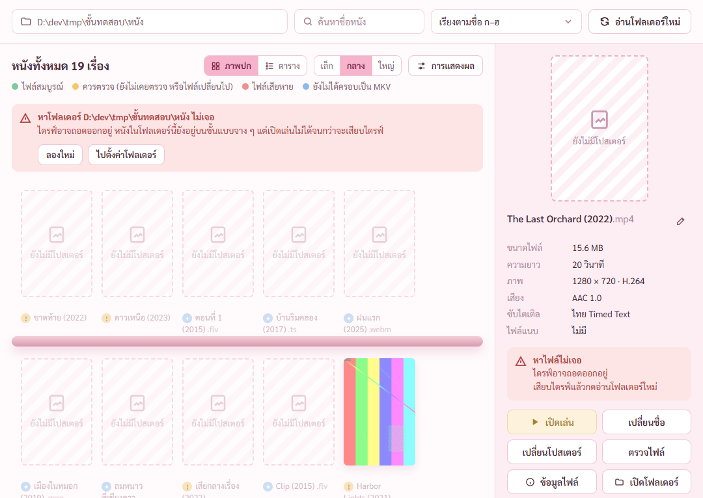

ตัวเทสเปลี่ยนชื่อโฟลเดอร์ทดสอบแทนการถอดไดรฟ์ · ขึ้นการ์ดแดงพร้อมปุ่ม `ลองใหม่` `ไปตั้งค่าโฟลเดอร์` · หนังยังอยู่บนชั้นแบบจาง · ปุ่มเปิดเล่นเป็นแบบกดไม่ได้ · เปลี่ยนชื่อกลับแล้วกด `ลองใหม่` การ์ดหาย หนังกลับมาปกติ · ภาพเล็กของไดรฟ์ที่ถอดออกไม่ถูกลบ (เทส Rust)

## 11. หนัง 519 เรื่อง

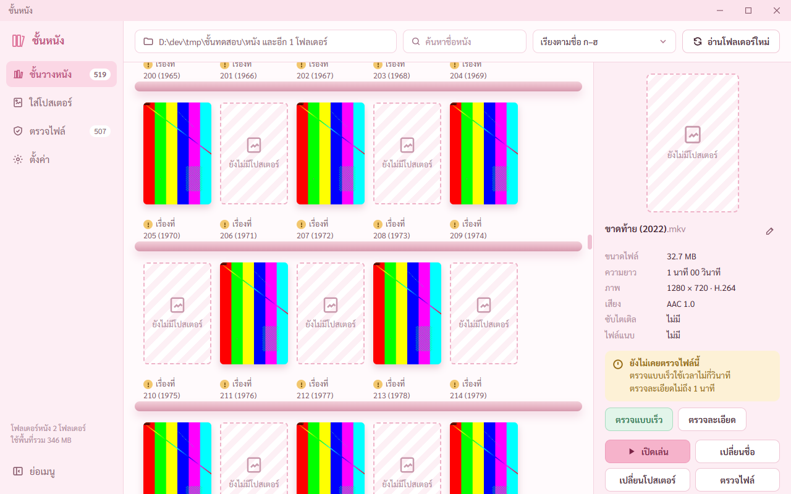

อ่านครั้งแรก 35 วินาที (ไฟล์ใหม่ทั้งหมด ดึงปก 250 รูป) · เลื่อนชั้น 1.5 วินาทีได้ 91 เฟรม เฟรมช้าสุด 17 มิลลิวินาที ลื่นเท่าจอ 60 เฟรมต่อวินาที · เอาโฟลเดอร์ออกแล้วหนังของโฟลเดอร์นั้นหายจากชั้น ภาพเล็กของมันถูกลบ (เทส Rust เพิ่มตอนเขียนรายงาน ใส่บั๊กไม่ลบกลับแล้วเทสล้มจริง)

## 12. โปรแกรมที่สร้างจริง

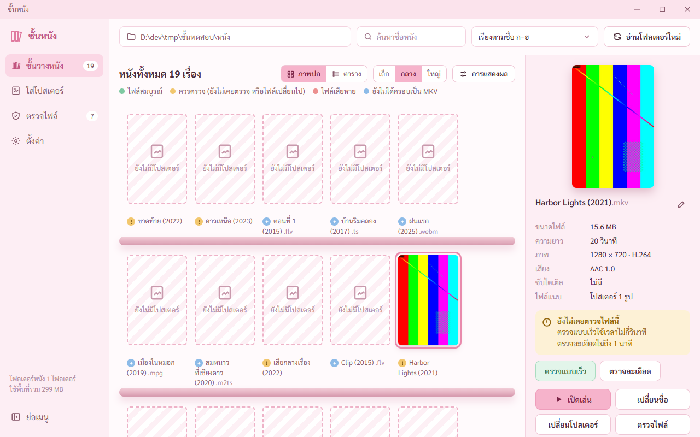

`tauri dev` ไม่ใช้กติกาความปลอดภัย (CSP) ตัวจริง รูปขึ้นในตัวทดสอบไม่ได้แปลว่าขึ้นในตัวจริง (TECH-REVIEW ข้อ 5) · สร้างโปรแกรมจริงด้วย `scripts/dev-app.ps1 -Built` แล้วเทส
- หน้าโหลดจากตัวโปรแกรม `http://tauri.localhost` · ปกบนชั้นกับโปสเตอร์ในแผงขวาโหลดได้ · ฟอนต์ Sarabun ที่ฝังในโปรแกรมโหลดได้ · ไม่มีของโดนกติกากัน
- ลองโหลดรูปจากเน็ต โดนกัน = กติกาบังคับจริง

## 13. เปิดเล่น เปิดโฟลเดอร์
- ไฟล์ที่หาไม่เจอ ขึ้น `หาไฟล์ไม่เจอ ไดรฟ์อาจถอดออกอยู่` · โปรแกรมเล่นที่ตั้งไว้หายไป ขึ้น `หาโปรแกรมเล่นหนัง … ไม่เจอ · ตั้งใหม่ได้ที่หน้าตั้งค่า` (ตัวเทสเช็กแล้ว)
- 🔴 **ยังไม่ได้เทส** ทางที่สำเร็จ คือเปิดโปรแกรมเล่นหนังจริงกับเปิด Explorer จริง เพราะจะเด้งหน้าต่างขึ้นมาบังจอพี่กัน · เทสตอนทำเปิดเล่นที่นาทีที่เสีย ขั้น 6 และกับไฟล์จริงขั้น 8

## แก้ระหว่างเทสที่ไม่มีภาพ
- แถบเตือน `ไฟล์ตั้งค่าเสีย ใช้ชุดที่สำรองไว้แทน` ขึ้นซ้ำทุกครั้งที่หน้าโหลดใหม่ แม้บันทึกการตั้งค่าทับไฟล์เสียไปแล้ว · แก้ให้เลิกเตือนหลังบันทึกสำเร็จ (`store.rs`) ใส่บั๊กกลับแล้วเทส Rust ล้มจริง
- ชื่อไฟล์แนบปกขึ้นเป็น `ภาพปก.jpg` แทน `cover.jpg` เพราะ ffmpeg รุ่น 9 รายงานไฟล์แนบรูปใน MKV เป็นภาพปก แก้ให้อ่านชื่อไฟล์จากข้อมูลไฟล์แนบ (`probe.rs`)
- ตัวเทส ภาพปกลอยค้างเพราะเมาส์ค้างอยู่บนปก · ภาพกล่องการแสดงผลกับรายการเรียงโดนตัด · แก้ให้เลื่อนเมาส์ออกก่อนถ่าย และถ่ายตามขนาดกล่องจริง

## ทำในขั้นอื่น
- ปุ่ม `เปลี่ยนชื่อ` → ขั้น 3 · `ข้อมูลไฟล์` → ขั้น 5 · ตรวจไฟล์ → ขั้น 6 · ตอนนี้กดแล้วขึ้นแถบบอกว่าทำในขั้นไหน
- ความเร็วอ่านโฟลเดอร์บนฮาร์ดดิสก์ เครื่องนี้มีแต่ SSD เทสไม่ได้ → ขั้น 8 กับเครื่องพี่กัน
