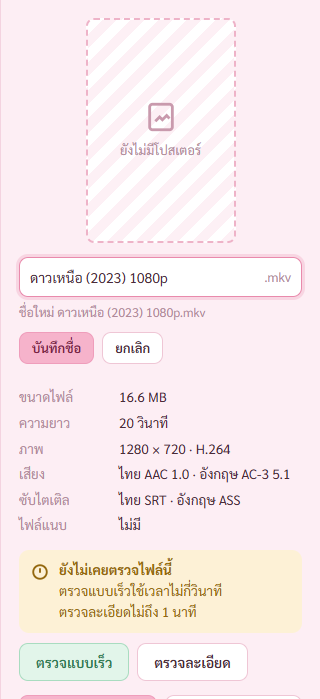
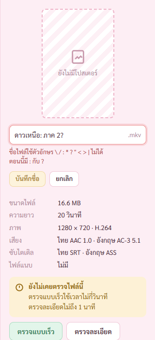
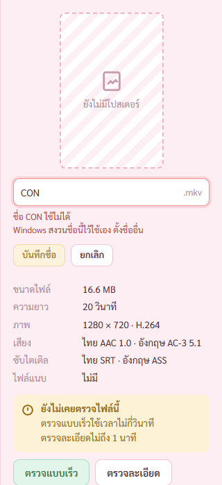
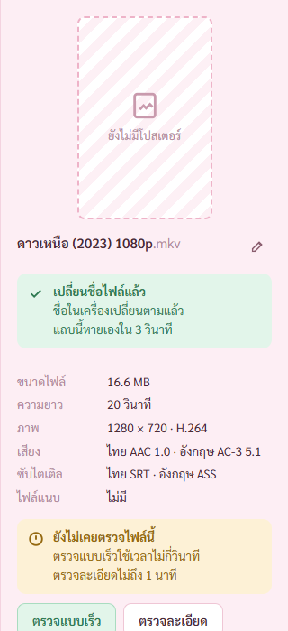
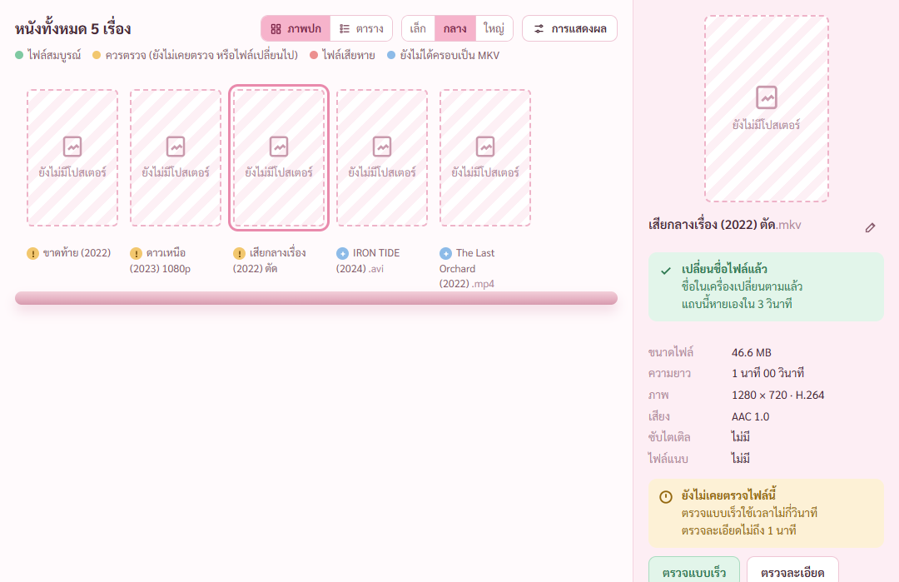

# รายงานขั้น 3 · เปลี่ยนชื่อไฟล์

6 พ.ย. 2569 · เทสในหน้าต่างโปรแกรมจริงผ่านพอร์ตดีบัก ผ่าน 17 จาก 17 ข้อ (`scripts/check-stage3.mjs` ผลอยู่ `report-2026-11-06/ขั้น3/ผลเทส.json`) · เทส Rust 23 ข้อผ่านหมด (เพิ่มของขั้นนี้ 5 ข้อ) · เทสขั้น 2 รันซ้ำยังผ่าน 39 จาก 39

## คำสั่งของพี่กัน
- *"ทำต่อ จนเสร็จ"* (ทำตามแผน 9 ขั้นต่อจากขั้น 2)

## ไฟล์ที่ใช้เทส
ตัวเทสสร้างโฟลเดอร์ `D:\dev\tmp\ชั้นเปลี่ยนชื่อ` ใหม่ทุกครั้ง คัดลอกหนังทดสอบ 5 เรื่อง (MKV 3 · AVI · MP4) กับไฟล์ซับ `ดาวเหนือ (2023).srt` ที่ต้องไม่โดนแตะ · ไม่แตะไฟล์ใน test-media

## ① ก่อนกด · ชี้ดินสอแล้วเปลี่ยนสี

พื้นปุ่มดินสอจากโปร่งเป็นชมพูจาง `#fbdde8` ตอนชี้

## ② กำลังพิมพ์

กดดินสอหรือปุ่ม `เปลี่ยนชื่อ` ชื่อกลายเป็นช่องพิมพ์ตรงที่เดิม ขีดพิมพ์อยู่ท้ายชื่อ · `.mkv` ล็อกไว้นอกช่องพิมพ์ พิมพ์ทับไม่ได้ · ใต้ช่องบอก `ชื่อใหม่ ดาวเหนือ (2023) 1080p.mkv` · ช่องพิมพ์ทำสามชั้นแบบช่องค้นหา สระบนวรรณยุกต์ไม่โดนตัด

## ③ ชื่อซ้ำกับไฟล์ที่มีอยู่

ช่องแดง `ในโฟลเดอร์นี้มีไฟล์ชื่อนี้อยู่แล้ว ตั้งชื่ออื่น` · ปุ่มบันทึกชื่อกดไม่ได้ · กด Enter แล้วไม่เกิดอะไร ไฟล์ยังชื่อเดิม

## ④ ตัวอักษรที่ Windows ห้ามใช้

บอกตัวที่มีจริง `ตอนนี้มี : กับ ?` · ปุ่มบันทึกกดไม่ได้

แบบอื่นที่สเปกข้อ 12 ให้บันทึกไม่ได้ ข้อความแบบเดียวกับ ④ · ตัวเทสลองครบทุกแบบในหน้าต่างจริง
- ชื่อว่าง → `ชื่อไฟล์ว่างไม่ได้`
- ลงท้ายด้วยจุด → `ชื่อไฟล์ลงท้ายด้วยจุดหรือเว้นวรรคไม่ได้`
- `CON` กับ `lpt1.ภาค 2` → `ชื่อ CON ใช้ไม่ได้` `Windows สงวนชื่อนี้ไว้ใช้เอง ตั้งชื่ออื่น` · ชื่อสงวนมี 30 ชื่อ เช็กแม้มีจุดต่อท้าย
- ชื่อ 260 ตัว → `ชื่อไฟล์ยาวเกินไป` `ยาวได้ไม่เกิน 255 ตัวอักษร ตอนนี้ 264 ตัว`
- ชื่อ 250 ตัว → `ชื่อยาวเกินไป` `ที่อยู่ไฟล์ยาวได้ไม่เกิน 259 ตัวอักษร ต้องสั้นลงอีก 22 ตัว` (ชื่อไม่ถึง 255 แต่ที่อยู่ทั้งหมดเกิน Explorer กับโปรแกรมเล่นหนังหลายตัวเปิดไม่ได้)
- ตัวอักษรที่มองไม่เห็น (ตัวควบคุม ตัวกลับทิศทางข้อความ) → `ชื่อไฟล์มีตัวอักษรที่มองไม่เห็น` (เทส Rust)

Esc ยกเลิก ช่องพิมพ์ปิด ชื่อเดิม ไฟล์ไม่ถูกแตะ

## ⑤ เปลี่ยนชื่อสำเร็จ

กด Enter แล้วไฟล์ในเครื่องเปลี่ยนชื่อ ชื่อบนชั้นกับแผงขวาเปลี่ยนตาม เรื่องเดิมยังถูกเลือก · การ์ดเขียวหายเองใน 3 วินาที (ตัวเทสรอแล้วเช็กว่าหาย) · เลขประจำไฟล์เดิม ประวัติตรวจไฟล์ตามชื่อใหม่ (เทส Rust ใส่สถานะตรวจกับค่า hash ไว้ก่อนเปลี่ยนชื่อ แล้วเช็กว่ายังอยู่)
- เจอและแก้ระหว่างตรวจภาพ: ① ข้อความตัด `เปลี่ยนตาม | แล้ว` แก้ให้ขึ้นบรรทัดใหม่ตรงเว้นวรรค และเลขกับหน่วย `3 วินาที` ไม่แยกบรรทัด ② ไอคอนเป็นโล่แบบ ไฟล์สมบูรณ์ ต้นแบบใช้เครื่องหมายถูกเปล่า แก้ให้ตรงต้นแบบ

## เปลี่ยนแค่ตัวพิมพ์เล็กใหญ่

`Iron Tide (2024).avi` → `IRON TIDE (2024).avi` ชื่อในเครื่องเป็นตัวพิมพ์ใหม่ · ตัวเช็กดูว่าเป็นไฟล์เดียวกัน (เลขประจำไฟล์เดียวกัน) จึงไม่นับว่าชื่อซ้ำ

## ⑥ ไฟล์ถูกเปิดอยู่ในโปรแกรมอื่น

ตัวเทสเปิดไฟล์ค้างไว้จริงแบบที่โปรแกรมเล่นหนังทำ (ยอมให้อ่าน ไม่ยอมให้เปลี่ยนชื่อ) แล้วสั่งเปลี่ยนชื่อ · ขึ้นการ์ดแดง `ไฟล์ถูกเปิดอยู่ในโปรแกรมอื่น` `ปิดโปรแกรมเล่นหนังก่อน แล้วกดลองใหม่` / `แถบนี้ไม่หายเอง` ปุ่ม `ลองใหม่` `ยกเลิก` · โฟกัสอยู่ที่ปุ่มลองใหม่ กด Enter ลองได้ทันที · รอ 3.5 วินาทีการ์ดยังอยู่ · ไฟล์ยังชื่อเดิม · ปิดโปรแกรมที่เปิดไฟล์แล้วกด `ลองใหม่` เปลี่ยนชื่อสำเร็จ

## ไม่มีไฟล์ไหนโดนทับ

- ตัวเทสหน้าจอ hash ทุกไฟล์ในโฟลเดอร์ก่อนเริ่มกับหลังจบ ชุดเดียวกันทุกไบต์ จำนวนไฟล์เท่าเดิม ไฟล์ที่เปลี่ยนชื่อ hash ตรงกับไฟล์เดิมของมัน ไฟล์ซับไม่ถูกแตะ
- ย้ายด้วยคำสั่ง Windows ที่ไม่ยอมเขียนทับ (MoveFileExW ไม่ใส่ตัวเลือกแทนที่) · คำสั่งย้ายของ Rust เองเขียนทับเงียบ ห้ามใช้ (TECH-REVIEW ข้อ 1) · ปลายทางโผล่มาหลังเช็กชื่อ Windows ก็ปฏิเสธเอง
- ใส่บั๊กกลับสองแบบ เทส Rust ล้มทั้งคู่ ① ย้ายแบบเขียนทับได้ ② นับเปลี่ยนแค่ตัวพิมพ์เป็นชื่อซ้ำ

## เจอและแก้ระหว่างเทส (บั๊กจริง)
- **เปลี่ยนชื่อเสร็จแล้วหน้าจอค้างว่ากำลังอ่านโฟลเดอร์** ปุ่มดินสอกับปุ่มอ่านโฟลเดอร์ใหม่กดไม่ได้ตลอดจนปิดโปรแกรม · ต้นเหตุ ตัวรับเหตุการณ์ "หนังเรื่องนี้อัปเดต" ตั้งสถานะกำลังอ่านทุกครั้ง พอการเปลี่ยนชื่อส่งเหตุการณ์เดียวกัน สถานะค้าง · แก้ให้สถานะกำลังอ่านมาจากเหตุการณ์เริ่มอ่านโฟลเดอร์เท่านั้น (`src/lib/library.tsx`) · เพิ่มข้อเทสกันไว้

## ระหว่างอ่านโฟลเดอร์ เปลี่ยนชื่อไม่ได้
ผลอ่านโฟลเดอร์จะเขียนทับคลังด้วยชื่อเก่า จึงกันไว้ทั้งสองฝั่ง · หน้าจอ ปุ่มดินสอกับปุ่มเปลี่ยนชื่อกดไม่ได้ ชี้แล้วบอก `กำลังอ่านโฟลเดอร์อยู่ รอให้เสร็จก่อน` (ตัวเทสเช็กแล้ว) · ฝั่ง Rust เปลี่ยนชื่อจองคลังไว้ ระหว่างนั้นอ่านโฟลเดอร์ไม่เริ่ม (เทส Rust)

## ทำในขั้นอื่น
- ตัวย้ายแบบไม่เขียนทับกับตัวเช็กความยาวที่อยู่ ใช้ซ้ำในขั้น 4 (เปลี่ยน .partial เป็นไฟล์จริง ย้ายเข้าโฟลเดอร์ไฟล์เดิม) และขั้น 5 (แยกไฟล์) · จดเป็นกติกาใน TECH-REVIEW ข้อ 1 กับ 16 แล้ว
