# รายงานขั้น 4 · ใส่โปสเตอร์

6 พ.ย. 2569 · เทสในหน้าต่างโปรแกรมจริงผ่านพอร์ตดีบัก ผ่าน 57 จาก 57 ข้อ (`scripts/check-stage4.mjs` ผลอยู่ `report-2026-11-06/ขั้น4/ผลเทส.json`) · เทสกับโปรแกรมที่สร้างจริง ผ่าน 7 จาก 7 (`scripts/check-built.mjs`) · เทส Rust 29 ข้อผ่านหมด (เพิ่มตัวแปลงรูป 6 ข้อ)

## คำสั่งของพี่กัน
- *"ทำต่อ จนเสร็จ"* (ทำตามแผน 9 ขั้นต่อจากขั้น 3)
- *"เราให้เธอทำถึง 23.55 เเล้วให้เธอ commit สิ่งที่ทำล่าสุดนะ เเล้วพักไว้ตรงนั้น"* · *"ถึงไหน commit ตอนนั้น ไม่จำเป้นว่าจะต้องเสร้จขั้นนั้นๆ"*

## ไฟล์ที่ใช้เทส
ตัวเทสสร้างโฟลเดอร์ `D:\dev\tmp\ชั้นโปสเตอร์` ใหม่ทุกครั้ง คัดลอกหนังทดสอบทุกชนิด 19 ไฟล์ คลิปอัดหน้าจอของพี่กัน (MP4 ของจริง) และไฟล์ยาว 1.63 GB ที่ต่อจากคลิปเดิมแบบไม่แปลงใหม่ (ไว้กดหยุดกลางทาง) · รูปใช้จาก test-media ตรง ๆ แบบอ่านอย่างเดียว · รูป HEIC ของพี่กันใช้เทสด้วย ไม่ขึ้น git

## ผลตามตารางวิธีเทสขั้น 4 ในแผน

| เรื่อง | ผล |
|---|---|
| ใส่ปกให้ MKV | ✅ ไฟล์แนบ cover.jpg image/jpeg อันเดียว · ดึงออกมาแล้ว hash ตรงกับรูปที่โปรแกรมทำ · ภาพ เสียง 2 ซับ 2 บท เท่าเดิม · เล่น 10 วินาทีแรกไม่มีข้อผิดพลาด |
| เปลี่ยนปก JPG เป็น PNG | ✅ เหลือ cover.png image/png อันเดียว ปกเก่าหาย · MKV ที่มีปกอยู่แล้วเปลี่ยนแล้วเหลือปกเดียว |
| ครอบไฟล์อื่นเป็น MKV | ✅ 12 ไฟล์ทุกชนิด FLV AVI MPEG VOB MOV M4V MP4 TS WebM M2TS MPG และคลิปของพี่กัน · แทร็กชนิดเดิมจำนวนเท่าเดิม · ความยาวต่างกันมากสุด 0.032 วินาที · ปกตรงทุกไบต์ · ไฟล์เดิมอยู่ในโฟลเดอร์ ไฟล์เดิม hash เท่าก่อนครอบ · ไม่มี .partial ค้าง |
| ส่งออก MP4 | ✅ ปกติดป้ายภาพปก · ภาพเสียงไม่ได้แปลงใหม่ · ซับ SRT กับ ASS เป็น mov_text ครบ · ไฟล์ที่มีเสียง Windows Media ขึ้นเตือน ยังไม่ทำจนกว่าจะเลือก กดทิ้งแล้วไฟล์ใหม่ไม่มีแทร็กนั้น · 🔴 ภาพไอคอนใน Explorer ยังไม่ได้ถ่าย (ต้องเปิด Explorer บนจอพี่กัน) |
| กดหยุดกลางทาง | ✅ ไฟล์ 1.63 GB กดหยุดตอนกำลังครอบ ไฟล์ที่ทำค้างถูกลบ ไฟล์เดิม hash เท่าเดิม |
| ไฟล์ปลายทางมีชื่อซ้ำ | ✅ ไม่เขียนทับ ขึ้น `มีไฟล์ชื่อนี้อยู่แล้ว ไม่เขียนทับ` ไฟล์ที่ชื่อชน hash เท่าเดิม |
| ไฟล์ถูกเปิดอยู่ | ✅ เปิดค้างแบบยอมให้อ่านอย่างเดียว ขึ้น `ไฟล์ถูกเปิดอยู่ในโปรแกรมอื่น` ไฟล์ไม่ถูกแตะ |
| ที่ว่างในไดรฟ์ไม่พอ | ✅ ตัวเทสหลอกว่าเหลือ 10 MB ขึ้น `ต้องการ … แต่เหลือ 10 MB` ไม่เริ่มงาน |
| แปลงรูปและครอป | ✅ ได้ 1000 × 1500 พอดีทุกแบบ · HEIC ได้ 5712 × 4284 เต็ม แปลงสี Display P3 เป็น sRGB · รูปแนวนอนตัดได้กลางภาพ เติมขอบสีตรงที่เลือก · หมุนและพลิกแล้วสีสี่มุมไปถูกที่ (เทส Rust) · คุณภาพยิ่งต่ำไฟล์ยิ่งเล็ก ขนาดบนจอมาจากการเข้ารหัสจริง · รูปต้นฉบับทุกรูป hash เท่าเดิม · 🔴 HEIC แนวตั้งยังไม่มีรูปลองว่าหมุนถูก |
| หน้าจอ | ✅ ถ่ายทุกสถานะในสเปกข้อ 7 ข้างล่าง · 🔴 ลากไฟล์จาก Explorer จริงยังไม่ได้ลอง ตัวเทสเรียกตัวรับไฟล์ตรง ๆ แทน (ตัวจำลองเมาส์ไม่ผ่านตัวรับไฟล์ของ Windows) ขอพี่กันลากหนึ่งครั้ง |

## หน้าจอทุกสถานะ

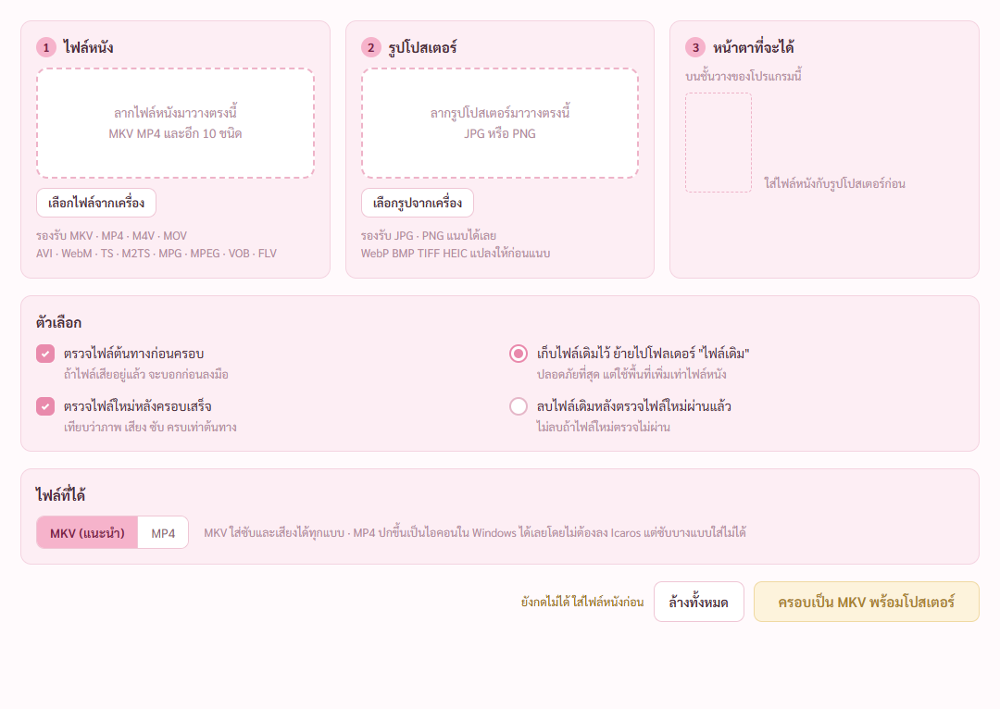

ยังไม่ได้ใส่อะไร ปุ่มกดไม่ได้ บอก `ยังกดไม่ได้ ใส่ไฟล์หนังก่อน`

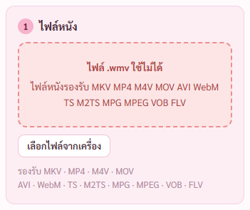

วางไฟล์ผิดชนิด ช่องแดง `ไฟล์ .wmv ใช้ไม่ได้` ค้างจนกว่าจะวางใหม่ · เจอและแก้ ข้อความเคยขึ้นบรรทัดละคำ และรายชื่อชนิดไฟล์ขาด MPEG VOB

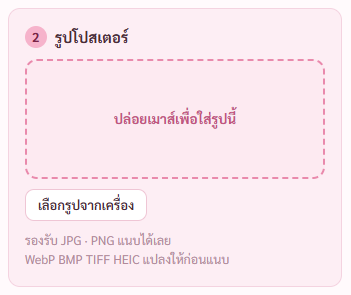

ลากค้างเหนือช่อง ช่องชมพู `ปล่อยเมาส์เพื่อใส่รูปนี้`

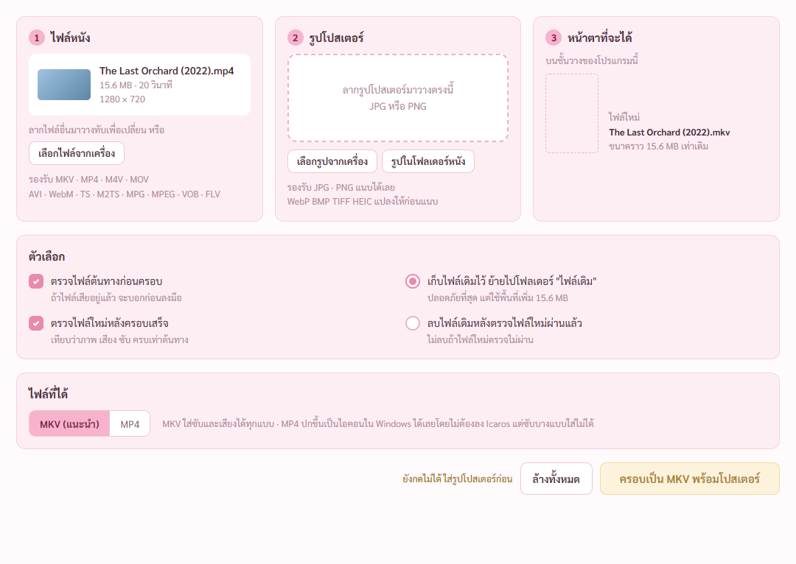

ใส่ไฟล์หนังแล้ว การ์ด 1 บอกชื่อ ขนาด ความยาว ความละเอียด · ปุ่มบอก `ยังกดไม่ได้ ใส่รูปโปสเตอร์ก่อน`

วางรูปแล้วหน้าต่างครอปขึ้นเอง · กรอบ 2 : 3 อยู่กลาง · ตัวอย่าง 3 จุด · ตารางคุณภาพ 4 ระดับ ขนาดจริงจากการเข้ารหัส · ตัวเทสลากกรอบ ลากมุม หมุนล้อเมาส์ ด้วยเมาส์จำลองแล้ว
- เจอและแก้ ① คิดขนาดไฟล์ช้า 1.5 วินาทีต่อครั้ง เหลือ 0.19 (ตั้งให้ตัวโปรแกรมเร่งความเร็วในโหมดทดสอบด้วย) ② มุมจับบนล่างโดนขอบภาพตัดครึ่ง เว้นขอบรอบภาพ 10 จุด ③ ตอนเติมขอบหน้าต่างสูงเกินจอ ปุ่มใช้รูปนี้ตกลงไป ย้ายตารางไปฝั่งซ้าย ปุ่มล่างติดขอบล่างเสมอ

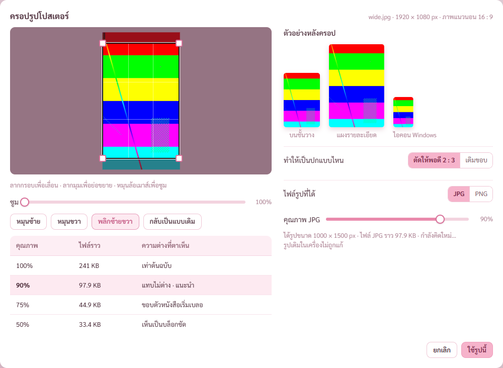

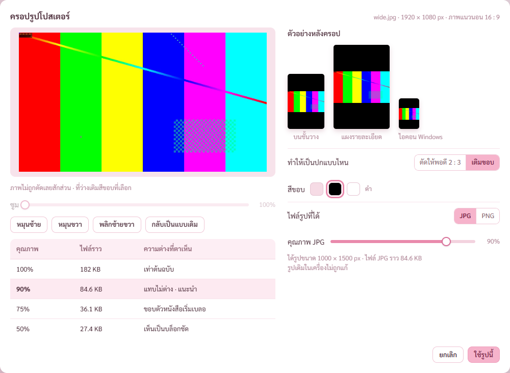

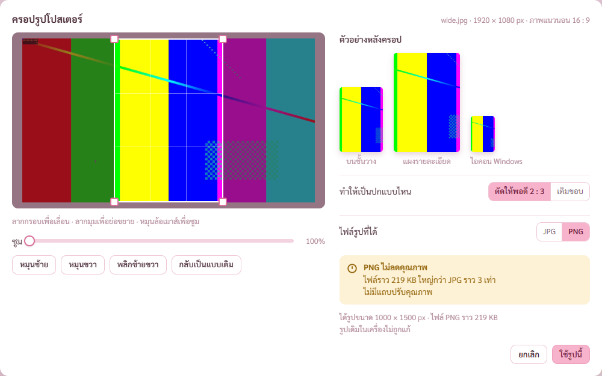

PNG บอกว่าไม่ลดคุณภาพ ไฟล์ใหญ่กว่า JPG กี่เท่า (คิดจากขนาดจริง) ไม่มีแถบคุณภาพ

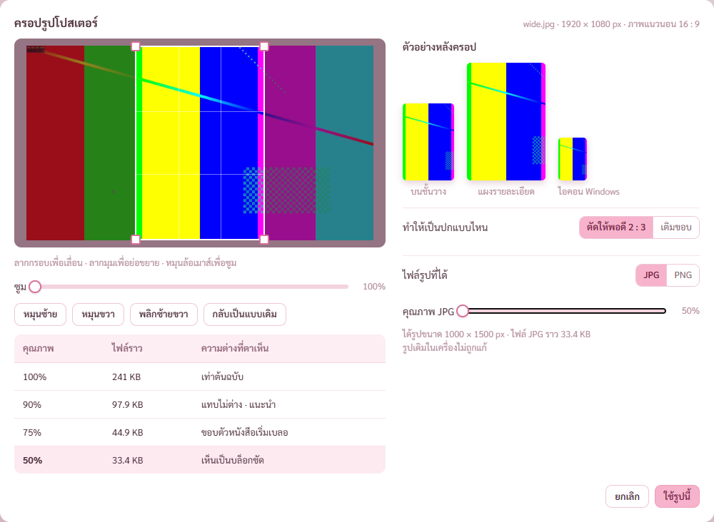

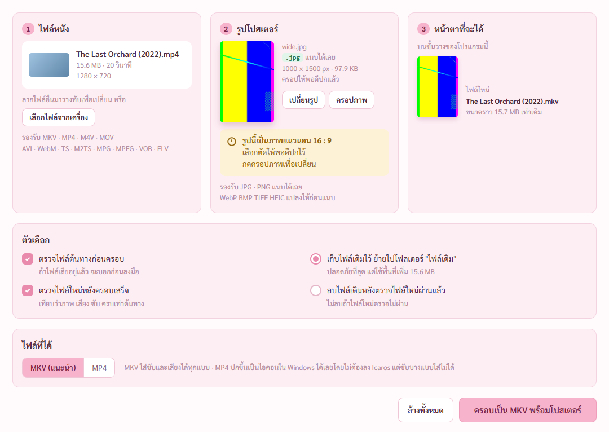

กดใช้รูปนี้ · การ์ด 2 ขึ้นรูปที่จะแนบจริง · `รูปนี้เป็นภาพแนวนอน 16 : 9` · การ์ด 3 ขึ้นชื่อไฟล์ใหม่ ขนาดราวเท่าเดิม

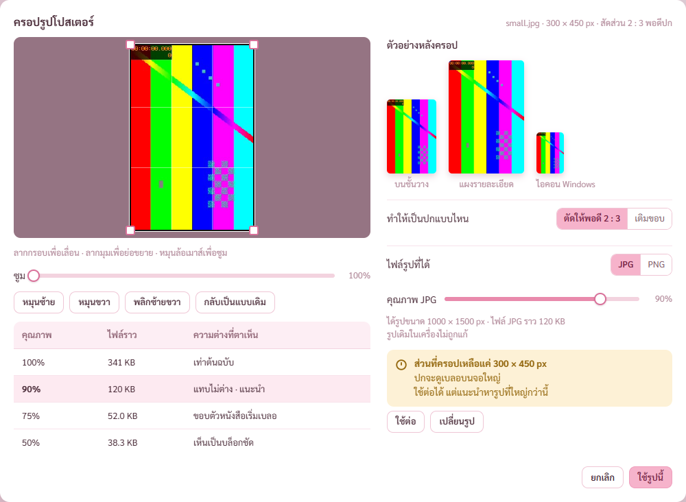

ภาพ `12-HEIC.png` (รูป HEIC ของพี่กันในหน้าต่างครอป) เก็บไว้ในเครื่องเท่านั้น ไม่ขึ้น git เพราะมีรูปถ่ายส่วนตัว ที่เก็บบน GitHub เป็นแบบสาธารณะ · ผล ความละเอียดเต็ม 5712 × 4284 สีไม่ซีด ป้าย `.heic→.jpg`

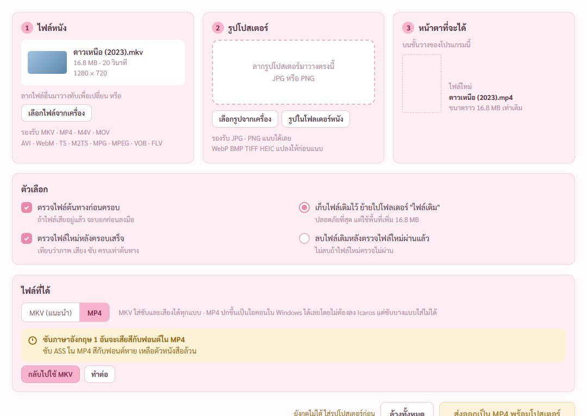

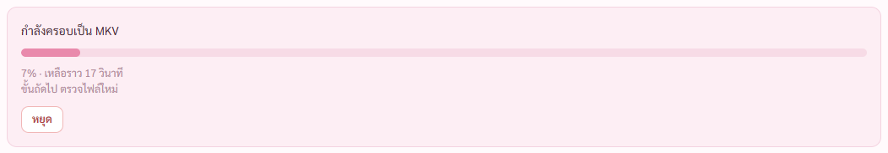

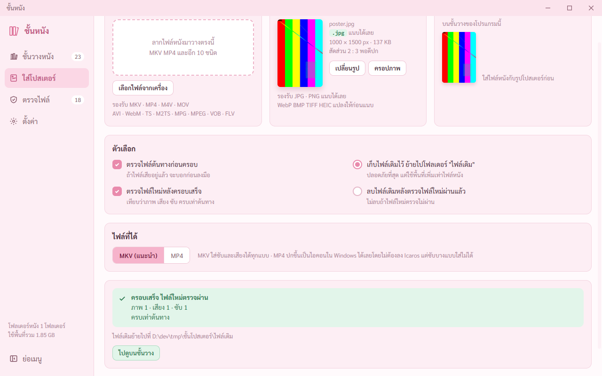

`ครอบเสร็จ ไฟล์ใหม่ตรวจผ่าน` `ภาพ 1 · เสียง 1 · ซับ 1` `ครบเท่าต้นทาง` · `ไฟล์เดิมย้ายไปที่ …\ไฟล์เดิม` · เจอและแก้ การ์ดผลอยู่ล่างจอต้องเลื่อนหา แก้ให้เลื่อนมาให้เห็นเอง (สกิล save-status)

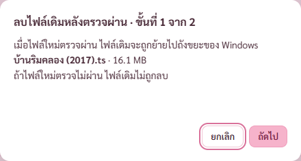

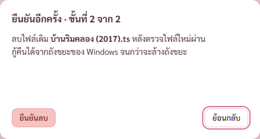

ขั้นที่ 2 ปุ่มยืนยันลบอยู่ซ้าย โฟกัสแรกอยู่ที่ย้อนกลับ · ตัวเทสกดยกเลิก ไม่ลงถังขยะจริง

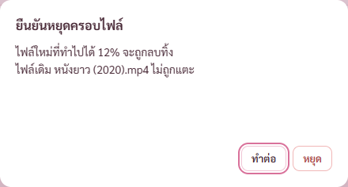

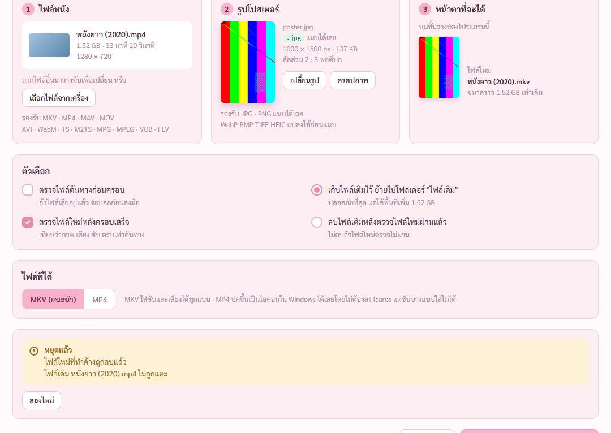

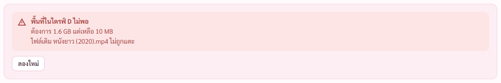

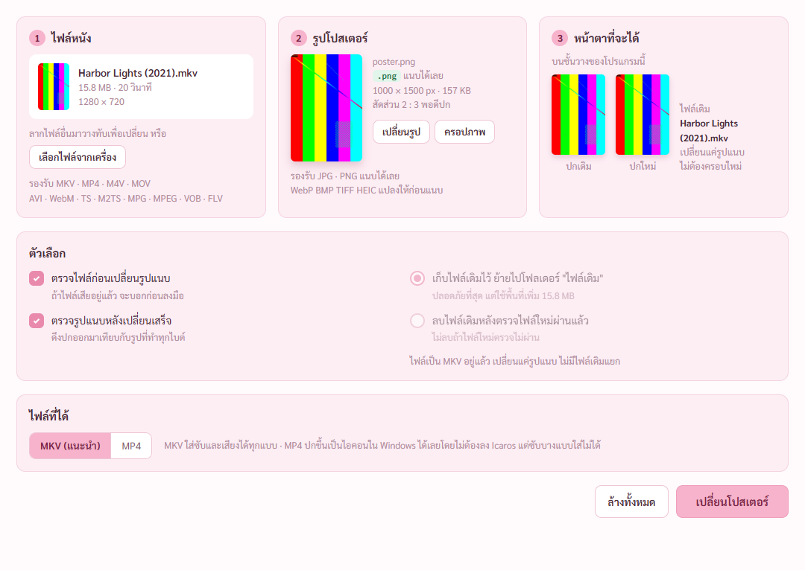

มาจากปุ่มเปลี่ยนโปสเตอร์บนชั้นวาง · ปกเดิม → ปกใหม่ · เปลี่ยนแค่รูปแนบ ไม่ต้องครอบใหม่

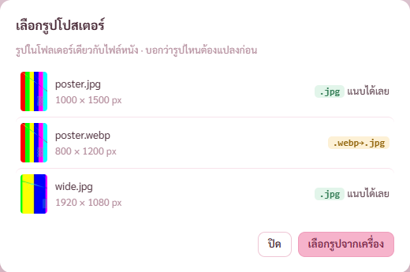

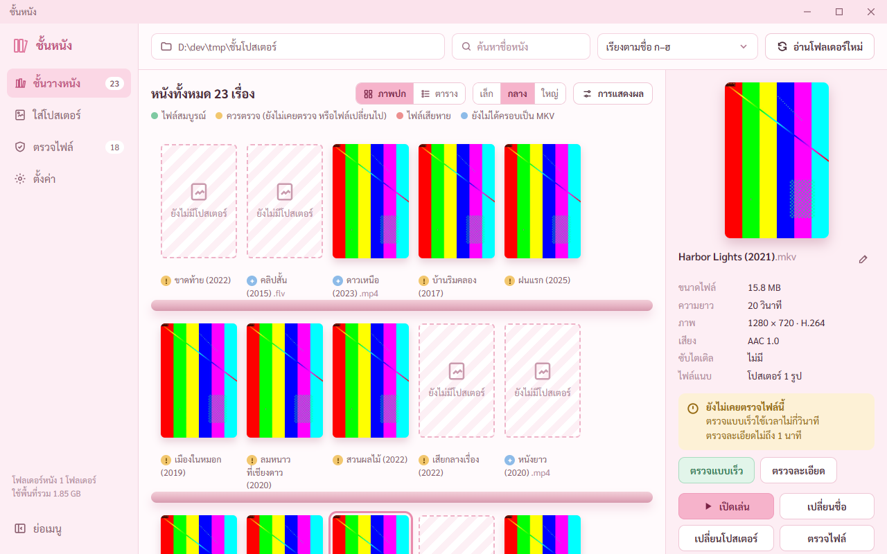

## เจอและแก้ระหว่างเทส (นอกจากที่เขียนใต้ภาพ)
- **ตรวจไฟล์ต้นทางเข้มเกิน** ไฟล์ VOB ที่ดีโดนว่าเสีย เพราะคำเตือนเรื่องลำดับเวลาของตัวเขียนทดสอบ ไม่ใช่ไฟล์เสีย · กรองคำเตือนแบบนั้นออก ไฟล์ที่เสียกลางเรื่องยังจับได้
- **ตรวจไฟล์ใหม่ไม่ผ่านกับ MP4 ที่มีซับ** mkvmerge เก็บซับของ MP4 เป็น SRT ตามมาตรฐาน MKV ตัวเทียบนับว่าไม่ตรง · แก้ให้นับว่าเท่ากัน ข้อความไม่ผ่านบอกชนิดทุกแทร็กของทั้งสองฝั่ง
- โปรแกรมแก้ไฟล์ MKV เอง ประวัติตรวจคงเดิม ค่า hash ที่จดไว้คิดใหม่จากไฟล์จริง อ่านโฟลเดอร์ใหม่ก็ไม่ขึ้นว่าไฟล์ถูกเปลี่ยน (เทสแล้ว)

## ยังไม่ได้ทำ
- ลากไฟล์จาก Explorer จริง · ไอคอน MP4 ใน Explorer · ลงถังขยะจริง → ขอพี่กันลองตอนจบขั้น หรือขั้น 8
- HEIC แนวตั้ง ยังไม่มีรูปลองว่าหมุนถูก
