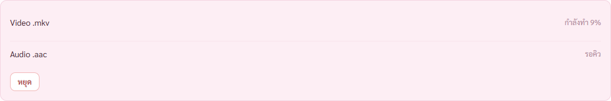
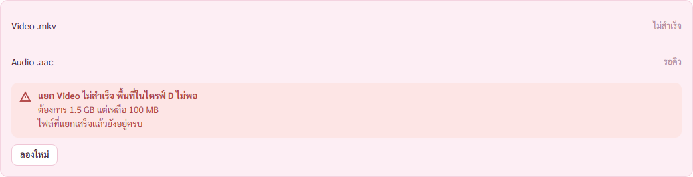
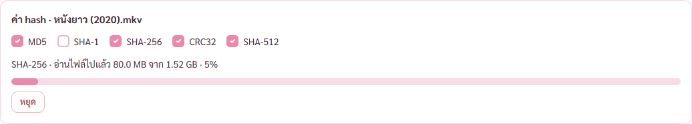
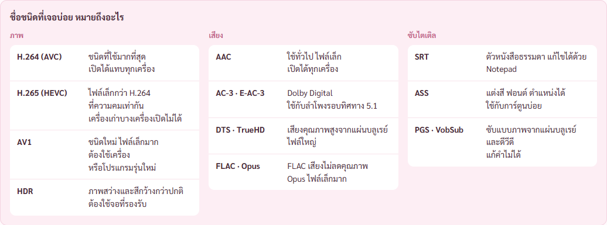
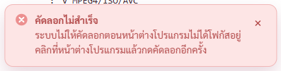
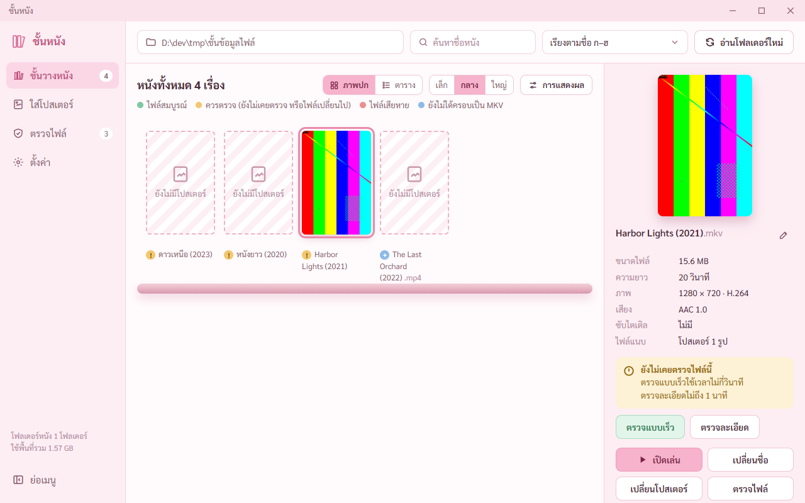

# รายงานขั้น 5 · ข้อมูลไฟล์ แยกไฟล์ ค่า hash (ทำค้าง พักไว้ตามที่พี่กันสั่ง)

6 พ.ย. 2569 · **ขั้นนี้ยังไม่เสร็จ** พักไว้ตอนเกือบเที่ยงคืนตามคำสั่ง · เทสในหน้าต่างจริงผ่าน 16 จาก 16 ข้อที่มี (`scripts/check-stage5.mjs`) · เทส Rust 37 ข้อผ่านหมด (เพิ่ม 8) · เทสขั้น 2 กับขั้น 3 รันซ้ำยังผ่านหมด

## คำสั่งของพี่กัน
- *"ทำต่อ จนเสร็จ"*
- *"เราให้เธอทำถึง 23.55 เเล้วให้เธอ commit สิ่งที่ทำล่าสุดนะ เเล้วพักไว้ตรงนั้น ค่อยมาทำวันต่อไป"*
- *"ถึงไหน commit ตอนนั้น ไม่จำเป้นว่าจะต้องเสร้จขั้นนั้นๆ ทำไปเลย จนถึง 23.55"*

## ทำแล้ว

กดปุ่ม `ข้อมูลไฟล์` ในแผงขวาของชั้นวาง · ข้อความ MediaInfo ภาษาอังกฤษ ตัวอักษรความกว้างคงที่ สามคอลัมน์ · **ตรงกับรัน MediaInfo เองทุกบรรทัด** (97 บรรทัด ตัวเทสเทียบทีละบรรทัด) · หัวข้อที่แยกได้มีช่องติ๊ก บอก `แยกเป็น .ac3` · ไฟล์แนบใน MKV ขึ้นเป็นหัวข้อ Attachment (MediaInfo ไม่แยกให้ อ่านจาก mkvmerge)

ติ๊ก 3 อย่างแล้วแยก ได้ `ดาวเหนือ (2023).Audio2.en.ac3` `ดาวเหนือ (2023).Text1.th.srt` `ดาวเหนือ (2023).chapters.xml` ในโฟลเดอร์ `ดาวเหนือ (2023) แยกไฟล์` · ไฟล์ที่แยกตรงกับที่ดึงด้วย mkvextract เองทุกไบต์ (เทส Rust) · แยกภาพได้ .mkv ที่มีแทร็กภาพอย่างเดียว · ไฟล์แนบได้ `.cover.jpg` · ไฟล์ MP4 แยกเสียงเป็น .aac ด้วย ffmpeg · ไฟล์หนังเดิม hash เท่าเดิม

แยกซ้ำ ชื่อชน บอก `มีไฟล์ชื่อเดียวกันอยู่แล้ว` `โปรแกรมไม่เขียนทับไฟล์เดิม` ไฟล์เดิม hash เท่าเดิม · กด `ตั้งชื่อใหม่ต่อท้ายเลข 2` ได้ไฟล์ใหม่ · แยกภาพจากไฟล์ใหญ่ 1.6 GB แล้วกดหยุด ไฟล์ที่ทำค้างถูกลบ

ค่า hash ตรงกับตัวคำนวณของ Windows (Get-FileHash) ทุกแบบ · ค่ามาตรฐานของข้อความ abc ตรงทั้ง 5 แบบ · CRC32 ตัวพิมพ์ใหญ่ · SHA-256 จดลงคลังใช้ตอนตรวจแบบเร็ว · วางค่าที่ต่างตัวท้าย บอก `ไม่ตรงกับ SHA-256 ของไฟล์นี้` `ต่างกันที่ 2 ตัวท้าย` · บันทึก .sha256 แบบที่ sha256sum อ่านได้ กดซ้ำไม่ทับ ได้ไฟล์ (2) · คิด hash ไฟล์ใหญ่แล้วกดหยุดได้

กำลังแยก แถวละชิ้น `Video .mkv` `กำลังทำ 9%` · `Audio .aac` `รอคิว` · ปุ่มหยุด · กดหยุดแล้วไฟล์ที่ทำค้างถูกลบ

ตัวเทสหลอกว่าเหลือ 100 MB · `แยก Video ไม่สำเร็จ พื้นที่ในไดรฟ์ D ไม่พอ` `ต้องการ 1.5 GB แต่เหลือ 100 MB` `ไฟล์ที่แยกเสร็จแล้วยังอยู่ครบ` ปุ่มลองใหม่ · เช็กที่ว่างทุกชิ้น ไม่ใช่แค่ Video

`SHA-256 · อ่านไฟล์ไปแล้ว 80.0 MB จาก 1.52 GB · 5%` แถบ ปุ่มหยุด · อ่านไฟล์รอบเดียวคิดทุกแบบที่ติ๊กพร้อมกัน

การ์ดท้ายหน้า ชื่อชนิดที่เจอบ่อย หมายถึงอะไร (ต้นแบบบรรทัด 670–692) คำตามต้นแบบ

- เจอและแก้ระหว่างเทส ① หัวข้อ General มีเส้นกับช่องว่างด้านบนเกิน ② ตารางชนิดที่เจอบ่อยตัดกลางคำ `เท่า|กัน` `บ|ลูเรย์` (ช่องตารางแคบ ตัวตัดคำไม่รู้จักคำว่าบลูเรย์) เปลี่ยนเป็นกริด ขึ้นบรรทัดใหม่ตรงเว้นวรรค ③ กำลังคำนวณบอกชื่อ MD5 ต้นแบบใช้ SHA-256 และไม่มีเปอร์เซ็นต์ ④ ตัวเทสรอบแรกสร้างไฟล์ใหญ่ไม่สำเร็จ (ได้ 291 ไบต์) ข้อกดหยุดเลยไม่ได้เทสจริง แก้แล้ว

## ทำเพิ่มรอบ 23.00 น.
- **ขนาดรูปที่แนบ** หัวข้อ Attachment มีครบ 4 แถวตามต้นแบบ File name · MIME type · Size · Dimensions (`1000 × 1500 pixels`) · โปรแกรมดึงรูปที่แนบออกมาไว้ที่เก็บชั่วคราวของโปรแกรม อ่านแค่หัวไฟล์รูป ไม่แตะไฟล์หนัง · ตัวเทสขั้น 5 เพิ่มให้เช็ก Dimensions ด้วย ผ่าน 16 จาก 16
- **เทสกับโปรแกรมที่สร้างจริง** (`scripts/check-built.mjs`) เพิ่มของขั้น 5 · ข้อความ MediaInfo อ่านได้ 7 หัวข้อ · หน้าเป็นแบบปลอดภัย คัดลอกได้
- **เจอในตัวจริง** ปุ่มคัดลอกใช้ไม่ได้ตอนหน้าต่างไม่ได้โฟกัส และหน้าจอเงียบ ไม่บอกอะไรเลย · ต้นเหตุ เบราว์เซอร์ในโปรแกรมไม่ให้คัดลอกถ้าหน้าต่างไม่ได้โฟกัส (หน้าต่างเทสเปิดแบบไม่แย่งหน้าจอพี่กัน จึงไม่ได้โฟกัส) · แก้ปุ่มคัดลอกทั้ง 3 แบบ (คัดลอกข้อมูลเป็นข้อความ · ปุ่มคัดลอกค่า hash ทีละแบบ · คัดลอกทั้งหมดในการ์ด hash) ถ้าคัดลอกไม่ได้ ขึ้นแถบแดง `คัดลอกไม่สำเร็จ` `ระบบไม่ให้คัดลอกตอนหน้าต่างโปรแกรมไม่ได้โฟกัสอยู่` `คลิกที่หน้าต่างโปรแกรมแล้วกดคัดลอกอีกครั้ง` แถบแดงไม่หายเอง · ข้อผิดพลาดแบบอื่นบอกข้อความจากระบบเต็มประโยค
- ตัวเทสตัวจริงกดปุ่มคัดลอกบนหน้าจอสองแบบ ① จำลองว่าระบบไม่ให้คัดลอก ด้วยข้อผิดพลาดแบบเดียวกับที่เจอจริง (โฟกัสขึ้นกับว่าหน้าต่างอยู่หน้าหรือหลัง คุมไม่ได้ทุกรอบ) ต้องขึ้นแถบแดง ② คัดลอกได้ ต้องขึ้น `คัดลอกข้อมูลไฟล์แล้ว` · ตัวเทสนี้จับบั๊กเดิมได้ เพราะโค้ดเดิมไม่มีแถบแดงเลย
- เจอในภาพรอบแรก บรรทัดเหตุผลเป็นภาษาอังกฤษของระบบ และโดนตัดกลางคำ `Document is not f` · แก้เป็นภาษาไทยเต็มประโยคแล้ว

- **เจอในภาพสุดท้ายของเทสตัวจริง** เปิดข้อมูลไฟล์ของ Harbor Lights แล้วกด `กลับไปชั้นวาง` แผงขวาเด้งไปเลือกดาวเหนือ (เรื่องแรก) แทนเรื่องเดิม · ต้นเหตุ เรื่องที่เลือกเก็บไว้ในหน้าชั้นวางเอง เปิดหน้าอื่นแล้วหน้าชั้นวางถูกปิด ค่าเลยหาย (ไปหน้าใส่โปสเตอร์แล้วกลับก็เป็นแบบเดียวกัน) · แก้ให้ตัวโปรแกรมจำเรื่องที่เลือกไว้แทน · เพิ่มข้อเทส กลับมาแล้วต้องยังเลือก Harbor Lights

เทสกับโปรแกรมที่สร้างจริงผ่าน 11 จาก 11 · แถบชมพูใต้ปกคือแผ่นชั้นวางตามต้นแบบ (ต้นแบบบรรทัด 78) ไม่ใช่ของผิด

## ยังไม่ได้ทำ (ทำต่อวันถัดไป)
- ปิดขั้น 5 แล้วไปขั้น 6 ตรวจไฟล์
