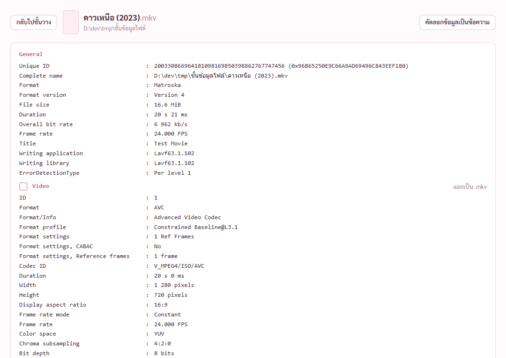
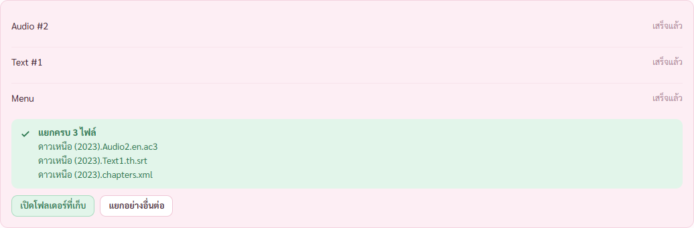
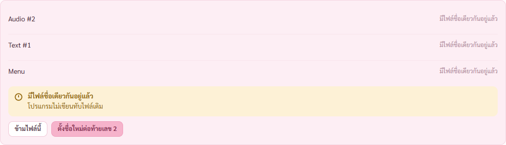
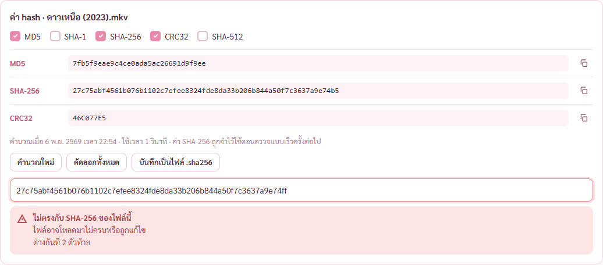

# รายงานขั้น 5 · ข้อมูลไฟล์ แยกไฟล์ ค่า hash (ทำค้าง พักไว้ตามที่พี่กันสั่ง)

6 พ.ย. 2569 · **ขั้นนี้ยังไม่เสร็จ** พักไว้ตอนเกือบเที่ยงคืนตามคำสั่ง · เทสในหน้าต่างจริงผ่าน 11 จาก 11 ข้อที่มี (`scripts/check-stage5.mjs`) · เทส Rust 37 ข้อผ่านหมด (เพิ่ม 8) · เทสขั้น 2 กับขั้น 3 รันซ้ำยังผ่านหมด

## คำสั่งของพี่กัน
- *"ทำต่อ จนเสร็จ"*
- *"เราให้เธอทำถึง 23.55 เเล้วให้เธอ commit สิ่งที่ทำล่าสุดนะ เเล้วพักไว้ตรงนั้น ค่อยมาทำวันต่อไป"*
- *"ถึงไหน commit ตอนนั้น ไม่จำเป้นว่าจะต้องเสร้จขั้นนั้นๆ ทำไปเลย จนถึง 23.55"*

## ทำแล้ว

กดปุ่ม `ข้อมูลไฟล์` ในแผงขวาของชั้นวาง · ข้อความ MediaInfo ภาษาอังกฤษ ตัวอักษรความกว้างคงที่ สามคอลัมน์ · **ตรงกับรัน MediaInfo เองทุกบรรทัด** (97 บรรทัด ตัวเทสเทียบทีละบรรทัด) · หัวข้อที่แยกได้มีช่องติ๊ก บอก `แยกเป็น .ac3` · ไฟล์แนบใน MKV ขึ้นเป็นหัวข้อ Attachment (MediaInfo ไม่แยกให้ อ่านจาก mkvmerge)

ติ๊ก 3 อย่างแล้วแยก ได้ `ดาวเหนือ (2023).Audio2.en.ac3` `ดาวเหนือ (2023).Text1.th.srt` `ดาวเหนือ (2023).chapters.xml` ในโฟลเดอร์ `ดาวเหนือ (2023) แยกไฟล์` · ไฟล์ที่แยกตรงกับที่ดึงด้วย mkvextract เองทุกไบต์ (เทส Rust) · แยกภาพได้ .mkv ที่มีแทร็กภาพอย่างเดียว · ไฟล์แนบได้ `.cover.jpg` · ไฟล์ MP4 แยกเสียงเป็น .aac ด้วย ffmpeg · ไฟล์หนังเดิม hash เท่าเดิม

แยกซ้ำ ชื่อชน บอก `มีไฟล์ชื่อเดียวกันอยู่แล้ว` `โปรแกรมไม่เขียนทับไฟล์เดิม` ไฟล์เดิม hash เท่าเดิม · กด `ตั้งชื่อใหม่ต่อท้ายเลข 2` ได้ไฟล์ใหม่ · แยกภาพจากไฟล์ใหญ่ 1.6 GB แล้วกดหยุด ไฟล์ที่ทำค้างถูกลบ

ค่า hash ตรงกับตัวคำนวณของ Windows (Get-FileHash) ทุกแบบ · ค่ามาตรฐานของข้อความ abc ตรงทั้ง 5 แบบ · CRC32 ตัวพิมพ์ใหญ่ · SHA-256 จดลงคลังใช้ตอนตรวจแบบเร็ว · วางค่าที่ต่างตัวท้าย บอก `ไม่ตรงกับ SHA-256 ของไฟล์นี้` `ต่างกันที่ 2 ตัวท้าย` · บันทึก .sha256 แบบที่ sha256sum อ่านได้ กดซ้ำไม่ทับ ได้ไฟล์ (2) · คิด hash ไฟล์ใหญ่แล้วกดหยุดได้

- เจอและแก้ระหว่างเทส หัวข้อ General มีเส้นกับช่องว่างด้านบนเกิน

## ยังไม่ได้ทำ (ทำต่อวันถัดไป)
- ภาพสถานะ กำลังแยก กำลังคำนวณ คัดลอกข้อมูลแล้ว ที่ว่างไม่พอ
- เช็กที่ว่างตอนแยกชิ้นอื่นนอกจาก Video · ขนาด Dimensions ของไฟล์แนบ · คำอธิบายชนิดที่เจอบ่อย (ต้นแบบบรรทัด 670–692)
- ตรวจภาพทุกภาพอีกรอบหลังแก้ · เทสกับโปรแกรมที่สร้างจริง
