# รายงานมอคอัปหน้ากราฟเสียง (7 พ.ย. 2569)

มอคอัปเสร็จแล้ว ไฟล์ [mockups/audio-graph.html](mockups/audio-graph.html) · กรอบแรกกดได้จริงทุกปุ่ม · ยังไม่ได้ทำในตัวโปรแกรม แคลร์จะลงมือหลังพี่กันดูมอคอัป
ภาพทุกภาพถ่ายด้วย Edge แบบไม่ขึ้นจอ เป็น PNG ขนาดจริง อยู่ `report-2026-11-07/กราฟเสียง/`

## คำสั่งของพี่กัน
- *"กราฟเสียง เธอทำมาเลย แต่ขอสวยๆ มีโทนสีสวย ดูได้หลายแบบ ดูช่องเสียงได้ทั้งหมด แบบรองรับ 7.1 5.1 2.0 ทั้งหมด และเอาไว้ดูเฉพาะไฟล์เสียงได้"*
- *"ขอแบบหยาบแบบนี้ด้วย"* (พิมพ์ตอนแป้นเป็นภาษาอังกฤษ แคลร์ถอดเป็นไทย · ส่งภาพแท่งมนสีขาวบนพื้นมืด)
- *"ขอดูแบบนี้ด้วย มันต้องเอาตัว decode มั้ยยเนี่ย"* (ส่งภาพกราฟความถี่สีรุ้งของแอปวัดเสียง)
- *"ที่เราเสริมคือปุ่มกดเพิ่มนะ อันเดิมที่เธอทำมาไม่เอาออกนะ"*
- *"https://www.spek.cc/ เราอยากดูได้เหมือนเจ้าโปรแกรมนี้"* · *"มันมี github ด้วยนะ ไปเอามาหน่อย"* · *"เเต่ถ้าระบบเราทำได้ดีกว่า เอาตามระบบเรานะ เพราะโปรแกรมไม่ได้อัปเดตนานมากกกก"*
- *"เราว่า อันนี้ยังไม่สวยเลย พื้นหลัง กับเส้นกราฟ ไม่ค่อยเข้ากับเว็บ"* (ส่งภาพกรอบแบบแท่งพื้นน้ำตาลเข้ม ชุดสีอำพัน)
- *"ภาาษษอังกิดให้หมด"* (ส่งภาพค่าในการ์ดข้อมูลเสียง `2.0 · 2 ช่อง` `24 บิต`)

## ทำแล้ว

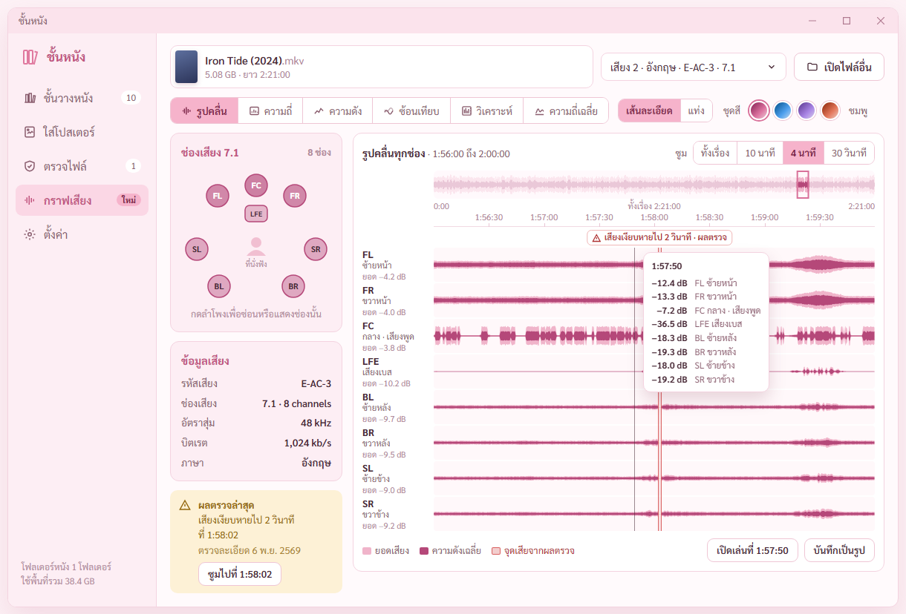

หน้าใหม่ **กราฟเสียง** ในเมนูซ้ายต่อจากตรวจไฟล์ · ทุกช่องมีแถบของตัวเอง สีอ่อนคือยอดเสียง สีเข้มคือความดังเฉลี่ย · แถบบนสุดคือทั้งเรื่อง กรอบชมพูคือช่วงที่ซูม กดที่แถบบนเพื่อกระโดดไปช่วงนั้น · แผนผังลำโพง 7.1 กดลำโพงเพื่อซ่อนหรือแสดงช่อง ลำโพงเข้มตามความดังของช่องนั้น · ชี้บนกราฟขึ้นค่าทุกช่องที่เวลานั้น · ผลตรวจไฟล์ที่เจอเสียงเงียบหายไปขึ้นแถบแดงตรงเวลา ปุ่ม `ซูมไปที่ 1:58:02` · ปุ่ม `เปิดเล่นที่ 1:57:50` กับ `บันทึกเป็นรูป`

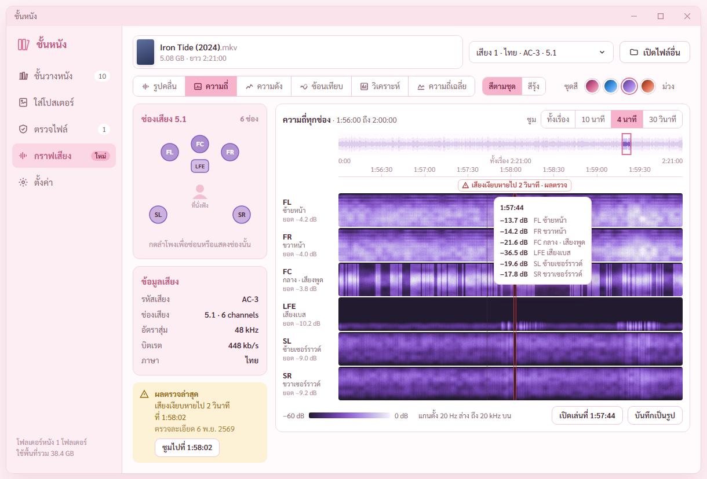

แบบความถี่ ทุกช่อง เสียงต่ำล่าง เสียงสูงบน ยิ่งสว่างยิ่งดัง · เห็นเสียงพูดอยู่ช่องกลาง เสียงเบสอยู่แต่ช่อง LFE · ภาพนี้ชุดสีม่วง

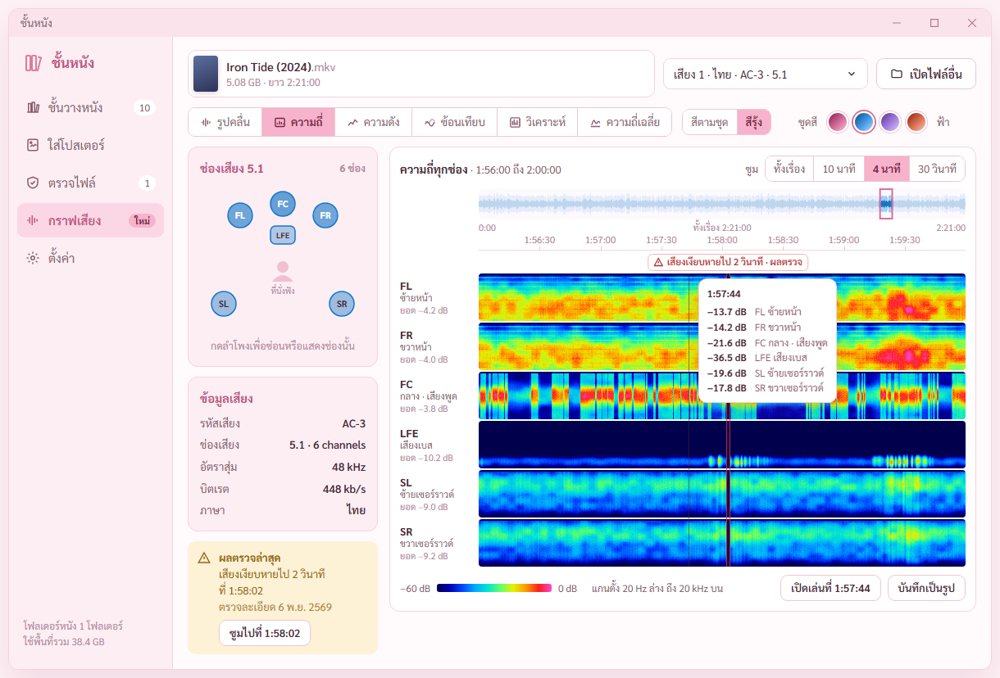

ปุ่มเพิ่ม **สีรุ้ง** ข้างแบบกราฟ แบบเดียวกับภาพที่พี่กันส่ง · มีแถบสเกล −60 ถึง 0 dB · สีตามชุดยังเป็นค่าตั้งต้น เพราะสกิลทำกราฟไม่ให้ใช้สีรุ้งเป็นค่าตั้งต้น คนตาบอดสีแยกเขียวกับแดงไม่ออก
· **ไม่ต้องโหลดตัวถอดรหัสเพิ่ม** ffmpeg ที่แนบในโปรแกรมถอด AC-3 E-AC-3 DTS AAC FLAC MP3 ได้หมดแล้ว ตัวเดียวกับที่ใช้ตรวจไฟล์

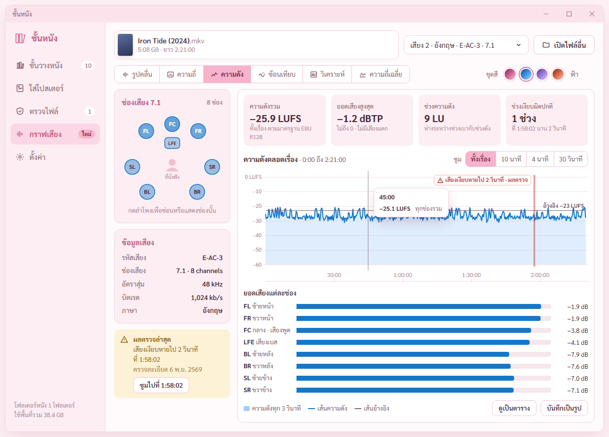

แบบความดัง ตัวเลขทั้งเรื่องตามมาตรฐาน EBU R128 (ความดังรวม ยอดเสียงสูงสุด ช่วงความดัง ช่วงเงียบผิดปกติ) คิดจากข้อมูลชุดเดียวกับกราฟ ตัวเลขกับกราฟตรงกัน · เส้นอ้างอิง −23 LUFS · ยอดเสียงแต่ละช่อง · ปุ่ม `ดูเป็นตาราง` อ่านตัวเลขได้โดยไม่ต้องชี้กราฟ

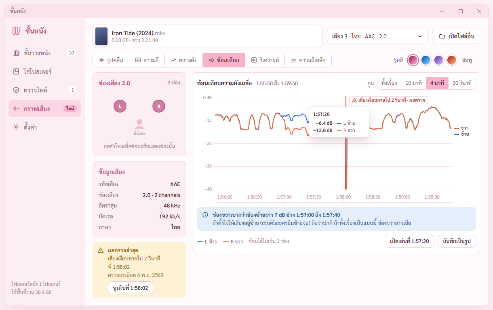

แบบซ้อนเทียบ เส้นความดังช่องซ้าย ขวา กลาง ในกราฟเดียว ไว้ดูเสียงเอียงหรือช่องหนึ่งหาย · สีประจำช่องตายตัว ซ้ายฟ้า ขวาส้ม กลางเขียว ผ่านตัวตรวจคนตาบอดสีทุกคู่ · มีป้ายชื่อที่ปลายเส้น · กล่องฟ้าบอกช่วงที่ช่องขวาเบากว่า

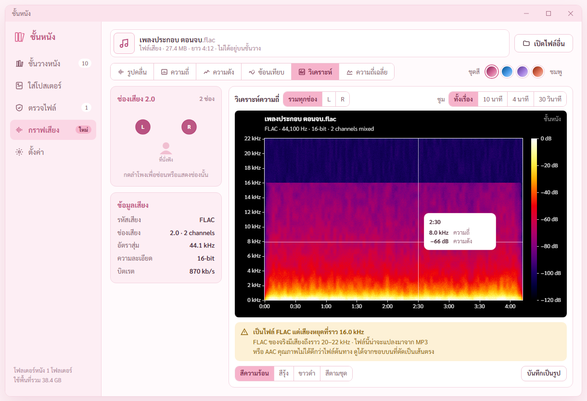

ปุ่มเพิ่ม **วิเคราะห์** หน้าตาแบบโปรแกรม Spek พื้นดำ แกนความถี่ kHz แกนเวลา แถบสเกล 0 ถึง −120 dB · แคลร์อ่านซอร์สของ Spek บน GitHub (alexkay/spek สัญญาอนุญาต GPL-3.0 ส่งโค้ดล่าสุด ก.ค. 2567) ยกขอบ ช่วง dB และระยะแกนเวลามาใช้ ชุดสีความร้อนคำนวณจุดสีเอง ไม่ได้คัดลอกโค้ด
**ที่ระบบเราทำได้มากกว่า Spek** ดูรวมทุกช่องหรือทีละช่อง (Spek ทีละช่อง) · ซูมได้ (Spek ไม่มี) · ชี้แล้วบอกเวลา ความถี่ ความดัง · ชุดสี 4 แบบ ความร้อน สีรุ้ง ขาวดำ สีตามชุด · **บอกเองว่าไฟล์น่าจะแปลงมา** ตัวอย่างเป็น FLAC แต่เสียงหยุดเป็นเส้นตรงที่ 16 kHz
· ลองกับหนัง 7.1 ในกรอบแรกแล้ว ช่วงที่เสียงเงียบหายไปเห็นเป็นเส้นดำตรง 1:58:02

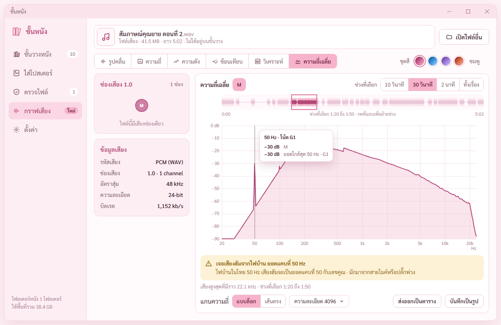

ปุ่มเพิ่ม **ความถี่เฉลี่ย** แบบ Plot Spectrum ของ Audacity ตามที่พี่กันขอ (*"อยากได้แบบนี้ขออง audacity ด้สน เเล้วเอธิบายด้วยมันคือการดูอะไร"*)
**ดูอะไร** ในช่วงที่เลือก แต่ละความถี่ดังเท่าไหร่โดยเฉลี่ยทั้งช่วง แกนนอนความถี่ เสียงต่ำซ้าย เสียงสูงขวา แกนตั้ง dB · ต่างจากแบบความถี่ที่ไล่ตามเวลา อันนี้เป็นภาพนิ่งของช่วงเดียว อ่านค่าละเอียดกว่า
**เอาไว้ทำอะไร** หาเสียงฮัมจากไฟบ้าน (ยอดแคบที่ 50 Hz กับเลขคูณ) · เสียงซ่า · ดูว่าเสียงถูกตัดที่ความถี่ไหน · เบสหนักแค่ไหน · เทียบช่องซ้ายขวา
เลือกช่วงบนแถบด้านบน (10 วินาที 30 วินาที 2 นาที ทั้งเรื่อง หรือกดย้ายช่วง) · ชี้บนกราฟบอกความถี่ ความดัง ยอดที่ใกล้ที่สุด และชื่อโน้ตแบบ Audacity · แกนแบบล็อกหรือเส้นตรง · ความละเอียดการคำนวณ · ส่งออกเป็นตาราง
**ที่ทำได้มากกว่า Audacity** บอกเองว่าเจอเสียงฮัม และความถี่สูงสุดที่มีเสียง · ตัวอย่างเป็นไฟล์อัดเสียงสัมภาษณ์ที่มีเสียงฮัม 50 Hz ปน
· กราฟในมอคอัปวาดจากข้อมูลสมมติ พี่กันบอก *"ไม่ต้องขนาดนั้น ยังไงตอนที่เธอทำโปรแกรมจริงๆ จะเห็นอยู่เเล้ว"* แคลร์จึงหยุดเกลาเส้นกราฟ รอยกระโดดเล็ก ๆ ที่ 600 Hz เป็นรอยจากสูตรสมมติ

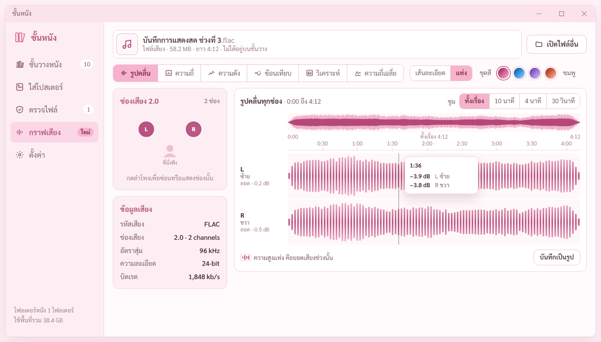

ปุ่มเพิ่ม **แท่ง** ข้างแบบกราฟ แท่งมนแบบภาพที่พี่กันส่ง บนพื้นสว่างโทนเดียวกับโปรแกรม แท่งไล่สีเข้มตรงกลางไปอ่อนที่ปลาย ความสูงคือยอดเสียงช่วงนั้น · เส้นละเอียดยังเป็นค่าตั้งต้น · กรอบนี้เปิดไฟล์เสียงอย่างเดียว (FLAC 2.0) ไม่ต้องอยู่บนชั้นวาง รับ MP3 FLAC WAV M4A AAC AC3 E-AC3 DTS OGG OPUS MKA WMA
· การ์ดข้อมูลเสียงทุกกรอบ ค่าเป็นภาษาอังกฤษทั้งหมด `2.0 · 2 channels` `24-bit` `96 kHz` `1,848 kb/s` · บรรทัดข้อมูลแทร็กบนหัวกราฟวิเคราะห์ กับจำนวนช่องในรายการเลือกแทร็กก็เป็นภาษาอังกฤษ

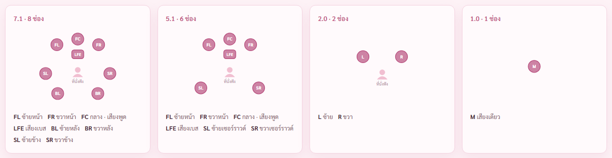

7.1 · 5.1 · 2.0 · ช่องเดียว แผนผังลำโพงเปลี่ยนตามแทร็ก ชื่อช่องตัวย่อสากลคู่ชื่อไทย

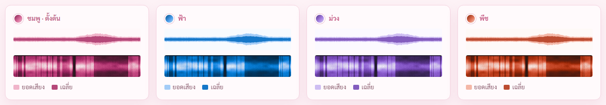

ชุดสี 4 ชุด ชมพู (ตั้งต้น) ฟ้า ม่วง พีช · คำนวณจาก OKLCH สีเดียวไล่ความเข้ม เส้นความดังเฉลี่ยชัดบนพื้นเกิน 4 เท่าทุกชุด (วัดแล้ว 4.45 ถึง 4.81) · พีชแทนอำพันที่ออกน้ำตาล เข้ากับชมพูไม่ได้

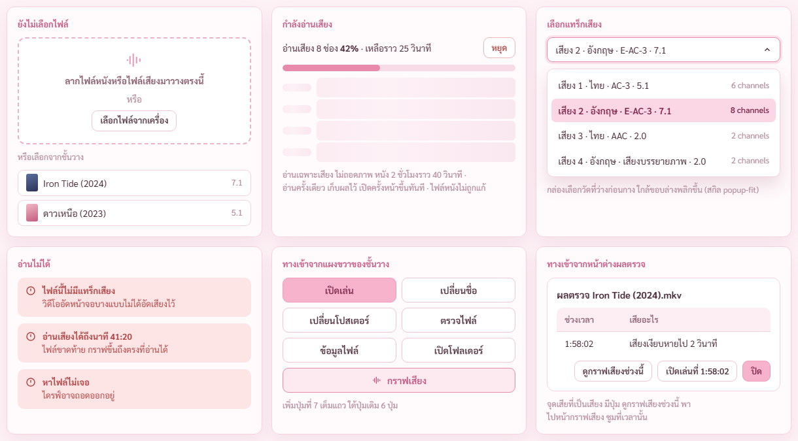

ยังไม่เลือกไฟล์ · กำลังอ่านเสียงเป็นโครงจาง พร้อมเปอร์เซ็นต์และปุ่มหยุด · เลือกแทร็กเสียง · อ่านไม่ได้ 3 แบบ · ทางเข้าจากแผงขวาของชั้นวาง (ปุ่มที่ 7) และจากหน้าต่างผลตรวจ (`ดูกราฟเสียงช่วงนี้`)

## เจอและแก้ระหว่างทำ
1. ที่นั่งฟังในแผนผังลำโพงเป็นวงกลมจาง ดูเหมือนวงหมุนรอโหลด และในแทร็ก 2.0 ทับคำอธิบาย · เปลี่ยนเป็นรูปคนนั่ง ขยายแผนผัง 2.0
2. กราฟความถี่ช่องซ้ายขวาเป็นสีเรียบแยกเสียงต่ำสูงไม่ออก · แก้แล้วเกิดลายเส้นเฉียงทั่วแถบ เพราะสูตรสุ่มเอาเวลากับความถี่บวกกันก่อนสุ่ม · เปลี่ยนเป็นสุ่มสองแกนแยกกัน
3. กราฟความดังลอยแถว −10 LUFS ตลอด ไม่เหมือนหนังจริง และตัวเลขสรุปเป็นค่าที่แคลร์พิมพ์เอง · ปรับระดับ เฉลี่ยพลังงานแต่ละจุด และคิดตัวเลขสรุปจากข้อมูลชุดเดียวกับกราฟ
4. เส้นซ้อนเทียบหยักถี่ · เกลี่ยความดังช่วง 3 วินาที จุดที่เงียบหายไม่เกลี่ย ยังเห็นเป็นร่อง
5. แถบจุดเสียจากผลตรวจมีแต่ในรูปคลื่น · เพิ่มในความดังกับซ้อนเทียบ ป้ายย้ายฝั่งเองเมื่อใกล้ขอบขวา กล่องค่าตอนชี้เลื่อนลงไม่บังป้าย
6. ปุ่มสลับลักษณะทำให้แถบเครื่องมือยาวจนปุ่มซูมตกบรรทัด · ย้ายปุ่มซูมไปมุมขวาบนของกรอบกราฟ
7. ตัวหนังสือตัดบรรทัดกลางวลี (กล่องผลตรวจล่าสุด · รายการแทร็กที่ 4 · คำอธิบายเล็ก) · ล็อกวลีให้อยู่บรรทัดเดียว ย่อชื่อแทร็ก
8. การแทนชื่อตัวแปรทั้งไฟล์ไปโดนบรรทัดประกาศตัวแปรเอง กลายเป็นอ้างถึงตัวเอง · เจอตอนตรวจด้วยการค้นทั้งไฟล์ แก้ก่อนโหลดหน้า
9. **พี่กันทัก** แบบแท่งพื้นน้ำตาลเข้มกับแท่งสีครีมไม่เข้ากับโปรแกรม · ต้นเหตุ แคลร์ทำตามภาพตัวอย่างที่เป็นพื้นมืดตรง ๆ ไม่ได้ปรับให้เข้ากับโปรแกรมที่เป็นโทนชมพูสว่าง และชุดสีอำพันออกน้ำตาล · แก้เป็นพื้นสว่าง แท่งไล่สีตามชุด เปลี่ยนอำพันเป็นพีช กรอบไฟล์เสียงใช้ชุดสีชมพู
10. **พี่กันทัก** ค่าในการ์ดข้อมูลเสียงปนภาษาไทย `2 ช่อง` `24 บิต` · แก้เป็นภาษาอังกฤษทั้งหมดทุกกรอบ ตามกฎหน่วยบนหน้าจอเป็นภาษาอังกฤษ

## ยังไม่ได้ทำ
- ยังไม่ได้ทำในตัวโปรแกรม กราฟในมอคอัปวาดจากข้อมูลสมมติ ของจริงจะอ่านด้วย ffmpeg ที่แนบอยู่
- ยังไม่ได้วัดว่าอ่านเสียงหนัง 2 ชั่วโมงใช้เวลาเท่าไหร่จริง ตัวเลข ราว 40 วินาที ในมอคอัปเป็นค่าคาด

## ไฟล์เสียงที่พี่กันจะหามาให้เทส
พี่กันถาม *"อยากได้ไฟล์เสียงแบบไหน"* · ใช้ตอนทำหน้ากราฟเสียงในโปรแกรมจริง เก็บที่ `test-media/จากพี่กัน/` ไม่ขึ้น git
1. เพลง FLAC ของจริง 1 เพลง · 2. เพลงเดียวกันแบบ MP3 (FLAC ปลอมแคลร์ทำเองจาก MP3 นี้) · 3. หนังหรือคลิปเสียง 5.1 หรือ 7.1 ดีที่สุดคือคลิปทดสอบลำโพงที่ประกาศชื่อทีละช่อง · 4. เสียงอัดจากมือถือ ถ้าอัดใกล้พัดลมหรือปลั๊กพ่วงได้เสียงฮัมจริง · 5. ถ้ามี เพลง FLAC 96 kHz 24-bit
· แคลร์สร้างเองได้ด้วย ffmpeg เสียงฮัม 50 Hz · ช่องหนึ่งเงียบ · เสียงทดสอบแยกทีละช่อง 7.1 · ไฟล์เสียกลางเรื่อง

## ต่อไป
- เทสปุ่มเปิดเล่นที่นาทีกับ MPC-HC ที่พี่กันลงผ่าน K-Lite (ต่อคิวถัดจากงานนี้)
- ทำหน้ากราฟเสียงในโปรแกรมหลังพี่กันดูมอคอัป · ขั้น 7 ตั้งค่า
