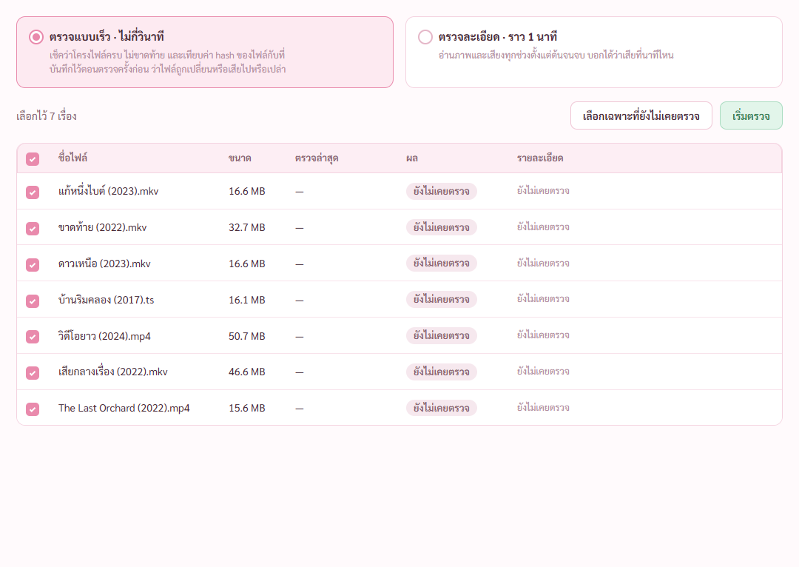
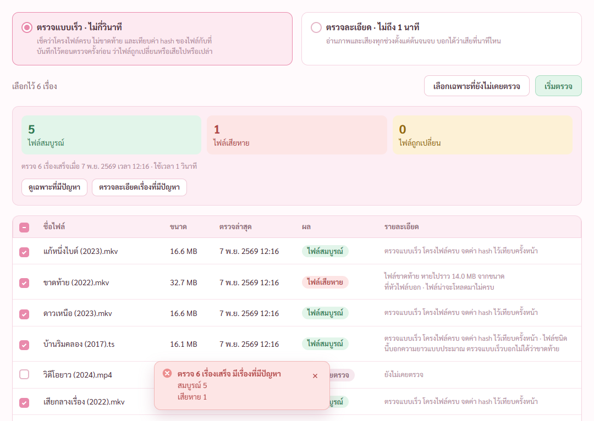
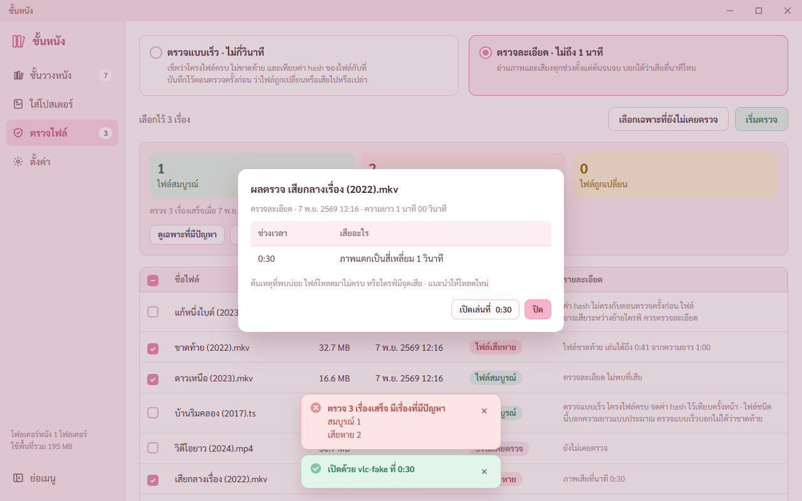
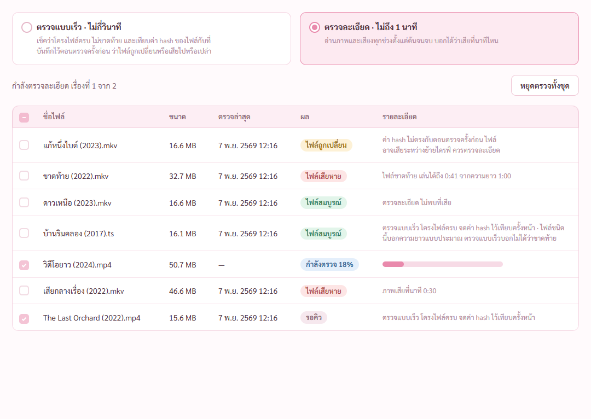
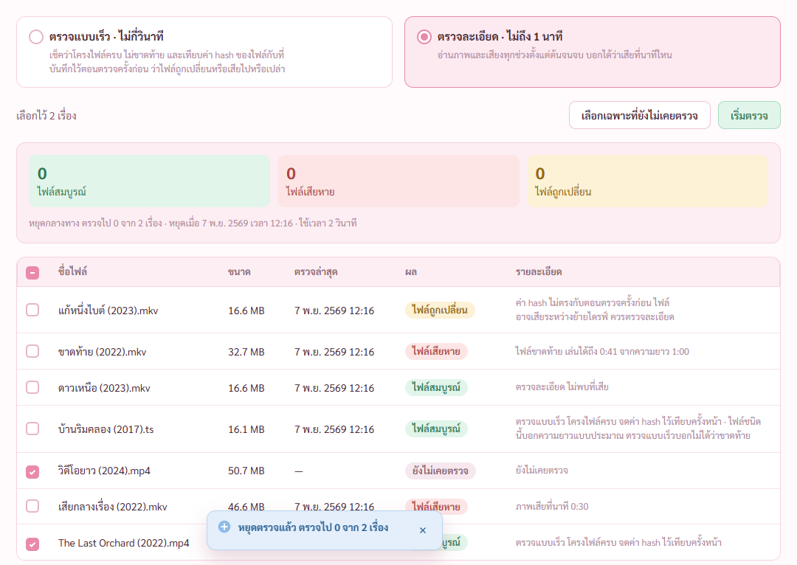
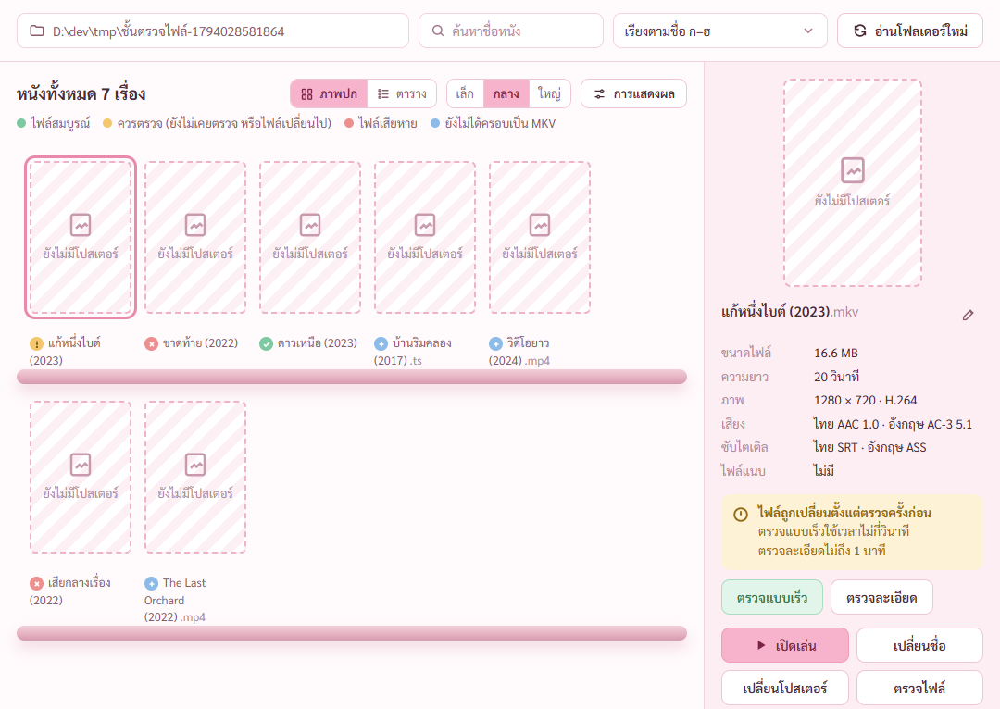
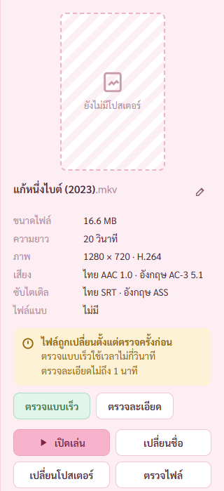
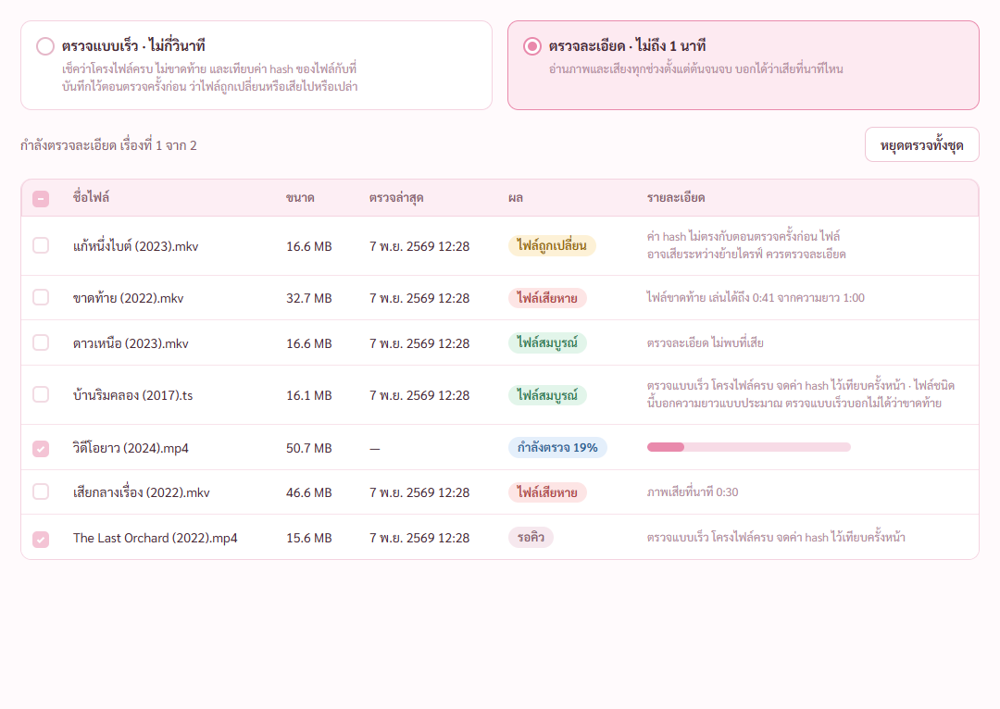

# รายงานขั้น 6 · ตรวจไฟล์ (เสร็จ 7 พ.ย. 2569 เวลา 12.35 น.)

7 พ.ย. 2569 · **ขั้นนี้เสร็จแล้ว** ทุกข้อในตารางเทสขั้น 6 ของแผนผ่าน · เทสในหน้าต่างจริงผ่าน 21 จาก 21 (`scripts/check-stage6.mjs`) · เทสกับโปรแกรมที่สร้างจริงผ่าน 23 จาก 23 (`scripts/check-stage6.mjs --built` เพิ่มสองข้อ หน้าโหลดจากตัวโปรแกรม และไม่มีอะไรโดนกติกาความปลอดภัยกันตลอดการเทส) · เทส Rust 52 ข้อผ่านหมด · เทสขั้น 2 3 4 5 รันซ้ำผ่านหมด
· ยังไม่ได้ลองกับโปรแกรมเล่นตัวจริง ปุ่มเปิดเล่นที่นาที เพราะเครื่องนี้ไม่มี VLC MPC-HC PotPlayer mpv (รายละเอียดหัวข้อ ยังไม่ได้ลอง)

## คำสั่งของพี่กัน
- *"เอาเลย"* (เริ่มขั้น 6)
- *"เราไปหาวิดีโอให้เธอไปลองเทสนะ"* (วิดีโอ TED-Ed 1080p ยาว 4:21 · แคลร์เก็บไว้ที่ `test-media/จากพี่กัน/` ไม่ขึ้น git · ในภาพเปลี่ยนชื่อเป็น `วิดีโอยาว (2024).mp4`)
- *"ทำต่อจนเสร็จ น่าจะไม่มีอะไรมีปัญหาเเ้ล้วนะ ขออย่ามี"*
- *"ตอนนี้เธอเปิดโปรกรมที่หน้าจอได้เลยนะ"* (แคลร์เพิ่มตัวเลือก `scripts/dev-app.ps1 -Front` ค่าตั้งต้นยังเปิดอยู่หลังสุดเหมือนเดิม)

## ทำแล้ว

หน้าตรวจไฟล์ ทุกเรื่องบนชั้นขึ้นตาราง เลือกไว้ทั้งหมด ตั้งต้นที่ `ตรวจแบบเร็ว` ผลเป็น `ยังไม่เคยตรวจ` · เวลาบนการ์ดแบบตรวจคิดจากขนาดและความยาวจริงของเรื่องที่เลือก (`ไม่กี่วินาที` · `ราว 1 นาที`) ตามที่พี่กันเคาะในสเปกข้อ 12 · ไม่ได้เลือกเรื่องเลย ปุ่ม `เริ่มตรวจ` เป็นสีรอ ชี้แล้วบอก `เลือกเรื่องที่จะตรวจในตารางก่อน` กดแล้วไม่เริ่ม

ตรวจแบบเร็ว 6 เรื่อง ใช้เวลา 1 วินาที · เช็กโครงไฟล์ (MKV WebM MP4 MOV M4V AVI FLV) แล้วคิด SHA-256 จดไว้เทียบครั้งหน้า · ไฟล์ขาดท้ายจับได้ `หายไปราว 14.0 MB จากขนาดที่หัวไฟล์บอก` · ไฟล์ TS บอกตรง ๆ ว่า `ไฟล์ชนิดนี้บอกความยาวแบบประมาณ ตรวจแบบเร็วบอกไม่ได้ว่าขาดท้าย` · การ์ดสรุปจำนวนตรง ปุ่ม `ดูเฉพาะที่มีปัญหา` กดแล้วเหลือแต่ไฟล์ขาดท้าย กดอีกทีกลับมาทุกเรื่อง · แถบแดงมีเรื่องที่มีปัญหาไม่หายเอง · ผลเขียนลงคลังหนังแล้ว

ตัวเทสแก้สำเนาไฟล์ 1 ไบต์ แล้วตรวจแบบเร็ว ขึ้น `ไฟล์ถูกเปลี่ยน` `ค่า hash ไม่ตรงกับตอนตรวจครั้งก่อน ไฟล์อาจเสียระหว่างย้ายไดรฟ์ ควรตรวจละเอียด` · ค่า hash ในคลังยังเป็นค่าเดิม ไม่โดนค่าของไฟล์ที่เสียทับ (ตรวจละเอียดผ่านแล้วถึงจดค่าใหม่)

ตรวจละเอียดไฟล์ที่ทำเสียไว้ที่วินาที 30–30.333 · บอก `0:30` ตรงจุดจริง (แผนให้ห่างได้ไม่เกิน 5 วินาที) · ในตารางเขียน `ภาพเสียที่นาที 0:30` · หน้าต่างผลตรวจครบตามต้นแบบ หัว แบบตรวจ วันที่ ความยาว ตารางช่วงเวลา เสียอะไร ต้นเหตุที่พบบ่อย ปุ่มเปิดเล่นที่ ปิด · ไฟล์ดีขึ้น `ตรวจละเอียด ไม่พบที่เสีย` · ไฟล์ขาดท้ายบอก `ไฟล์ขาดท้าย เล่นได้ถึง 0:41 จากความยาว 1:00`

กด `เปิดเล่นที่ 0:30` โปรแกรมเล่นจำลองชื่อ vlc ได้รับคำสั่ง `--start-time=30` พร้อมที่อยู่ไฟล์ แถบเขียว `เปิดด้วย vlc-fake ที่ 0:30` · ตั้งโปรแกรมเล่นเป็นที่อยู่ที่ไม่มีจริง ขึ้นแถบแดง `หาโปรแกรมเล่นหนัง … ไม่เจอ ตั้งใหม่ได้ที่หน้าตั้งค่า` · ไม่ได้ตั้งโปรแกรมเล่น โปรแกรมหาตามลำดับ โปรแกรมหลักที่ Windows ใช้เปิดไฟล์ชนิดนั้น (ถ้าสั่งกระโดดนาทีได้) แล้วโฟลเดอร์ติดตั้งมาตรฐาน ไม่เจอเลยเปิดด้วยโปรแกรมหลักแล้วแถบเหลืองบอกว่าเปิดตรงนาทีไม่ได้

ตรวจละเอียดวิดีโอจริงที่พี่กันหามา · แถวที่ตรวจอยู่ `กำลังตรวจ 15%` มีแถบความคืบหน้า · เรื่องถัดไป `รอคิว` · เลือกแบบตรวจไม่ได้ระหว่างตรวจ · มีปุ่ม `หยุดตรวจทั้งชุด` · วิดีโอ 1080p ยาว 4:21 รอบแรกใช้ราว 8 วินาที

กด `หยุดตรวจทั้งชุด` หยุดจริง เรื่องที่ตรวจค้างไม่ถูกเขียนผล ยังเป็น `ยังไม่เคยตรวจ` · สรุป `หยุดกลางทาง ตรวจไป 0 จาก 2 เรื่อง · หยุดเมื่อ …` · แถบฟ้า `หยุดตรวจแล้ว ตรวจไป 0 จาก 2 เรื่อง`

ตรวจครั้งล่าสุดเกินจำนวนวันที่ตั้ง (30 วัน) ขึ้น `ตรวจครั้งล่าสุดเกิน 30 วัน ถึงเวลาตรวจซ้ำ`

ป้ายสีบนชั้นเปลี่ยนตามผล เสียหายแดง ถูกเปลี่ยนเหลือง สมบูรณ์เขียว · เลขที่เมนูตรวจไฟล์ = เหลือง + แดง = 3

การ์ดสถานะในแผงขวา กด `ตรวจละเอียด` พาไปหน้าตรวจไฟล์แล้วตรวจเรื่องนั้นเลย ได้ `ภาพเสียที่นาที 0:09` (ไบต์ที่แก้ไปโดนภาพช่วงนั้น) · การ์ดสถานะเสียหาย กด `ดูรายละเอียดผลตรวจ` เปิดหน้าต่างผลตรวจของเรื่องนั้น

## เทสกับโปรแกรมที่สร้างจริง

ตัวเทสขั้น 6 ทั้งชุดรันกับ `movie-shelf.exe` ที่สร้างจริง ผ่าน 23 จาก 23 · หน้าโหลดจาก `http://tauri.localhost` · ตลอดการเทส ทั้งการตรวจ แถบความคืบหน้า หน้าต่างผลตรวจ ปุ่มเปิดเล่น ไม่มีอะไรโดนกติกาความปลอดภัยกันเลย · ฟอนต์ Sarabun สี ป้ายผล ขึ้นเหมือนตัวทดสอบ · ภาพชุดตัวจริงอยู่ `report-2026-11-07/ขั้น6-ตัวจริง/`

## เจอและแก้ระหว่างทำ
1. **ffprobe หลายเส้นจับที่เสียไม่ได้เลย** เพราะไม่แปะข้อความผิดพลาดกับภาพที่ถอด · เปลี่ยนเป็นตรวจสองรอบ รอบแรก ffmpeg หลายเส้นหาจุดคร่าว รอบสอง ffprobe เส้นเดียวอ่านเฉพาะรอบจุดนั้นได้เวลาตรงภาพ · ffprobe เส้นเดียวทั้งเรื่องช้ากว่า 19.7 วินาที เทียบกับราว 8 วินาที
2. **ตอนเครื่องทำงานหนัก รอบแรกบอกเวลาผิด** บอกวินาที 2.6 ทั้งที่เสียที่ 30 เพราะตัวอ่านไฟล์อ่านล่วงหน้า · เปลี่ยนเป็นคิดเวลาจากตำแหน่งไบต์ในไฟล์
3. **ไฟล์ดีโดนนับว่าเสีย** เพราะบรรทัดความคืบหน้า `speed= 100x` มีช่องว่าง ตัวอ่านนับเป็นข้อความผิดพลาด · แก้ตัวอ่านแล้ว
4. **ไฟล์ขาดท้ายบอกเวลาไม่นิ่ง** 0:40 บ้าง 0:35 บ้าง เพราะจุดคร่าวของรอบแรกใกล้ท้ายไฟล์ถูกนับเป็นจุดเสียแยก · ข้ามจุดคร่าวที่อยู่ในช่วงท้ายที่ขาด · หลังแก้ทุกรอบที่ดูผล (5 รอบ ทั้งตัวทดสอบและตัวจริง) ได้ `เล่นได้ถึง 0:41` เท่ากัน
5. **คำในหน้าต่างผลตรวจไม่ตรงต้นแบบ** โปรแกรมเขียน `ภาพแตก ถอดรหัสไม่ได้` `เสียงขาดหาย ถอดรหัสไม่ได้` ต้นแบบเขียน `ภาพแตกเป็นสี่เหลี่ยม` `เสียงเงียบหายไป` (ต้นแบบบรรทัด 992–993) · แก้ตามต้นแบบ เพิ่มเทส Rust เช็กคำ และให้ตัวเทสขั้น 6 เช็กคำในหน้าต่าง
6. **TECH-REVIEW ข้อ 14 ทำไม่ครบ** ไม่ได้ตั้งโปรแกรมเล่นไว้ โปรแกรมหาแค่โฟลเดอร์ติดตั้งมาตรฐาน ถ้าโปรแกรมหลักเป็น MPC-HC แบบพกพาที่ไว้ที่อื่น จะเปิดได้แต่ไม่กระโดดไปนาทีที่เสีย · เพิ่มการถาม Windows ว่าไฟล์ชนิดนั้นเปิดด้วยโปรแกรมไหน · เทสใหม่เจอบั๊กต่อ นามสกุลที่ไม่ได้ตั้งโปรแกรม Windows ตอบเป็นหน้าต่างเลือกโปรแกรมกลับมา แทนที่จะตอบว่าไม่มี แก้แล้ว
7. **หน้าจอ** ข้อความในช่องรายละเอียดลอยสูงกว่าชื่อไฟล์ จัดกลางแถวแล้ว · สรุปตอนหยุดอ่านติดกันเป็น `เรื่องเมื่อ` แยกเป็น `· หยุดเมื่อ` แล้ว · ปุ่มที่กดไม่ได้เปลี่ยนเป็นสีรอ ชี้แล้วบอกเหตุผล ตามสกิล button-feedback
8. **ตัวเทสผิดเอง 5 จุด แก้แล้ว** ① เครื่องหมาย \ ในรูปแบบเช็กเวลาหายตอนแก้ไฟล์ ข้อไฟล์ขาดท้ายไม่ผ่านทั้งที่โปรแกรมถูก ② เจอตอนเทสตัวจริง ตัวเทสอ่านผลตอนการตรวจยังไม่ทันเริ่ม (ตัวทดสอบผ่านเพราะจังหวะบังเอิญ) ③ ตัวเทสเปิดหน้าต่างผลตรวจด้วยคำสั่ง ระบบถือว่าใช้คีย์บอร์ด ปุ่มแรกขึ้นกรอบโฟกัสในภาพ คลิกเมาส์จริงไม่ขึ้น เปลี่ยนเป็นคลิกเมาส์จริง ④ ช่องติ๊กหัวตารางอ่านค่าก่อนหน้าจอเปลี่ยน ⑤ คัดลอกไฟล์ทับที่เดิม Windows เก็บเวลาแก้ไขเดิมไว้ ผลตรวจรอบก่อนติดมา เปลี่ยนเป็นโฟลเดอร์ชื่อใหม่ทุกรอบ
9. **สร้างโปรแกรมไม่ผ่าน** ฟ้อง `LNK1120` สองรอบ ต้นเหตุ ตัวทดสอบที่เปิดค้างเฝ้าไฟล์อยู่ สร้างตัวเองใหม่พร้อมกับเทส Rust ของที่เก็บไว้ใช้ซ้ำเพี้ยน · ล้างของที่สร้างไว้เฉพาะชั้นหนัง ได้ที่ว่างไดรฟ์ D คืน 13.4 GB กับ 5.6 GB · จดวิธีกันกับวิธีแก้ลง CLAUDE.md แล้ว

เพราะแก้หน้าชั้นวาง แผงขวา และตัวอ่านโฟลเดอร์ รันเทสขั้นก่อนหน้าซ้ำกับตัวทดสอบ · ขั้น 2 ผ่าน 39 จาก 39 · ขั้น 3 ผ่าน 17 จาก 17 · ขั้น 4 ผ่าน 58 จาก 58 · ขั้น 5 ผ่าน 16 จาก 16 · ภาพที่ถ่ายทับของขั้น 4 แคลร์เปิดดูทุกภาพแล้ว มีแต่รูปแถบสีที่โปรแกรมสร้าง ภาพที่มีรูป HEIC ของพี่กันโดน `.gitignore` กันไว้

## ยังไม่ได้ลอง
- **ปุ่มเปิดเล่นที่นาที กับโปรแกรมเล่นตัวจริง** เครื่องนี้ไม่มี VLC MPC-HC PotPlayer mpv · เทสด้วยโปรแกรมเล่นจำลองที่จดคำสั่งที่ได้รับ ได้ `--start-time=30` ตรง · คำสั่งของทั้ง 4 โปรแกรมเทสใน Rust
  ถ้าพี่กันอนุญาต แคลร์จะโหลด `vlc-3.0.24-win64.zip` จาก download.videolan.org (เว็บทางการของ VLC) ขนาด 82,765,861 ไบต์ ราว 79 MB · แตกไว้ใน `D:\dev\tmp` ไม่ติดตั้งลงเครื่อง เทสว่าเปิดตรงนาทีจริง แล้วลบทิ้ง
- ไม่ได้ตั้งโปรแกรมเล่นไว้ แล้วให้โปรแกรมหาเอง ยังไม่ได้ลองกดจริงในหน้าต่าง เพราะเครื่องนี้หาไม่เจอสักตัว จะเปิดโปรแกรมหลักของ Windows ขึ้นมาบนจอ · ตัวถาม Windows เทสใน Rust แล้ว

## ต่อไป
- คิวต่อจากขั้น 6 ใน [ROADMAP](ROADMAP.md) หน้าดูกราฟเสียง ทำมอคอัปให้พี่กันดูก่อนลงมือ
- แล้วขั้น 7 ตั้งค่า (สเปกข้อ 9)
