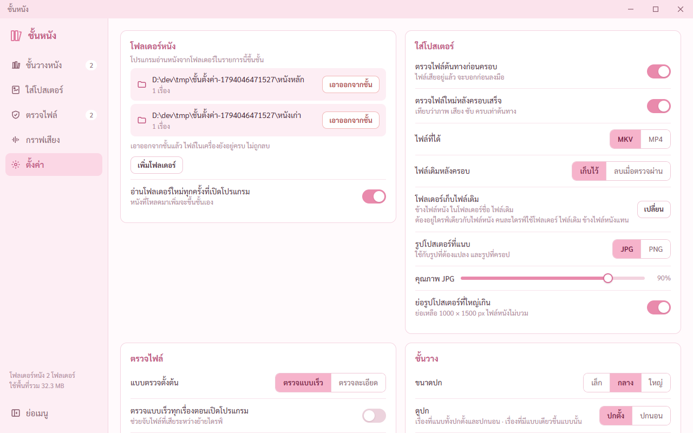
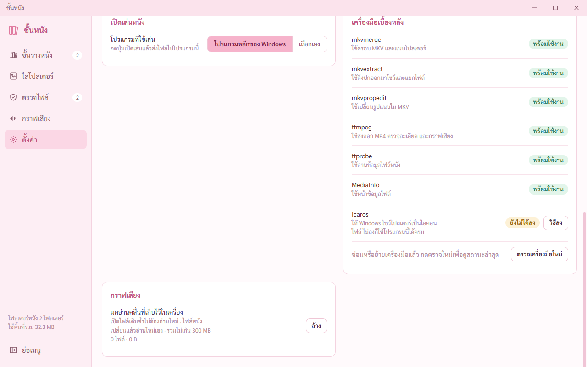
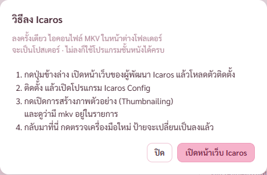
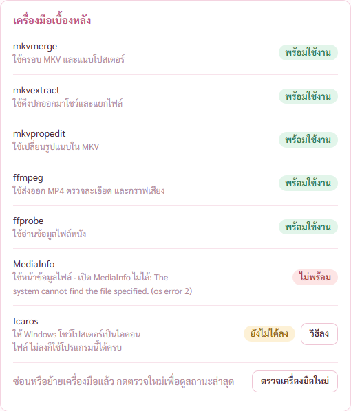
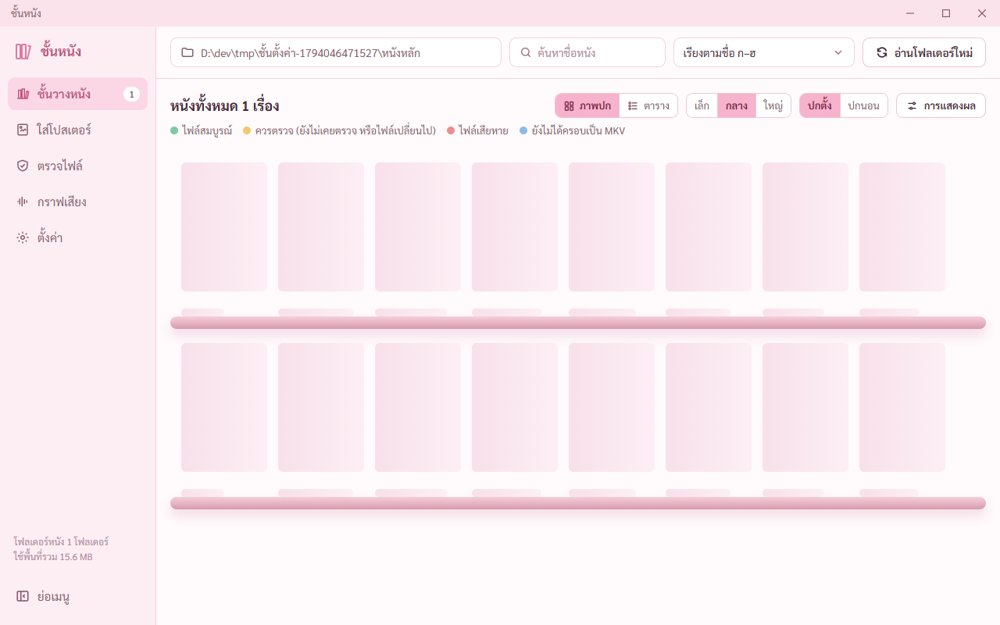

# รายงานขั้น 7 หน้าตั้งค่า · 7 พ.ย. 2569

## คำสั่งของพี่กัน
- แผนขั้น 7 *"ทุกการ์ดมีผลทันที · สถานะเครื่องมือทุกตัวพร้อมปุ่มตรวจใหม่ · เช็กว่าลง Icaros ไหม พร้อมวิธีลง · เลือกโปรแกรมเล่นเอง"*
- ก่อนลงเวร *"ทำจนเสร็จ เดี๋ยวเรารีโมตมาดู จนเสร็จคือทุกขั้นตอนเเล้วรีนเอเจ้นตรวจตามที่วางเเผน"* · *"เธอห้ามเปิดโปรแกรมเด้งขึ้นมา ใช้เเละถ่ายพื้นหลังเท่านั้น"*

## ทำแล้ว
หน้าตั้งค่าตามต้นแบบบรรทัด 1002–1100 ตั้งแล้วมีผลทันที ไม่ต้องกดบันทึก ค่าเก็บในไฟล์ค่าตั้งของโปรแกรม

| การ์ด | มีอะไร |
|---|---|
| โฟลเดอร์หนัง | รายการโฟลเดอร์ พร้อมจำนวนเรื่อง · หาโฟลเดอร์ไม่เจอบอกสีแดง · ปุ่ม เอาออกจากชั้น ยืนยันขั้นเดียว · ปุ่ม เพิ่มโฟลเดอร์ · สวิตช์อ่านโฟลเดอร์ใหม่ทุกครั้งที่เปิดโปรแกรม |
| ใส่โปสเตอร์ | สวิตช์ตรวจไฟล์ต้นทางก่อนครอบ ตรวจไฟล์ใหม่หลังครอบ · ไฟล์ที่ได้ MKV MP4 · ไฟล์เดิมหลังครอบ เก็บไว้ ลบเมื่อตรวจผ่าน · โฟลเดอร์เก็บไฟล์เดิม ปุ่มเปลี่ยน (บอกว่าต้องอยู่ไดรฟ์เดียวกับไฟล์หนัง) · รูปที่แนบ JPG PNG · แถบคุณภาพ JPG 50–100% · สวิตช์ย่อรูปที่ใหญ่เกิน |
| ตรวจไฟล์ | แบบตรวจตั้งต้น · สวิตช์ตรวจแบบเร็วตอนเปิดโปรแกรม · เตือนให้ตรวจซ้ำ ไม่ต้องเตือน 7 30 90 วัน (รายการกางวัดที่ว่างก่อนกาง) |
| ชั้นวาง | ขนาดปก · ดูปก ปกตั้ง ปกนอน (คิว 5) · ชื่อไฟล์ใต้ปก · จุดสีบอกสภาพไฟล์ · แสดงโครงจางค้างไว้ (ไม่เก็บลงไฟล์ ปิดโปรแกรมแล้วกลับเป็นปิด) |
| เปิดเล่นหนัง | โปรแกรมหลักของ Windows หรือเลือกเอง · เลือกเองแล้วขึ้นที่อยู่โปรแกรมกับปุ่มเปลี่ยน · หาโปรแกรมไม่เจอวันหลัง กดเปิดเล่นแล้วบอกและพากลับมาหน้าตั้งค่า |
| เครื่องมือเบื้องหลัง | เครื่องมือ 6 ตัว ป้ายพร้อมใช้งาน หรือไม่พร้อมพร้อมสาเหตุ · Icaros ลงแล้ว หรือยังไม่ได้ลงพร้อมปุ่มวิธีลง · ปุ่มตรวจเครื่องมือใหม่ · ระหว่างตรวจขึ้นโครงจาง |
| กราฟเสียง (แคลร์เพิ่ม) | ผลอ่านคลื่นที่เก็บไว้ในเครื่อง จำนวนไฟล์ ขนาดรวม ปุ่มล้าง (คิว 8) |

## ค่าที่แคลร์ตั้งเอง
- ปุ่ม ใช้ข้างไฟล์หนัง กลับไปใช้โฟลเดอร์ ไฟล์เดิม ข้างไฟล์หนัง (ต้นแบบมีแค่ปุ่มเปลี่ยน)
- Icaros ดูว่าลงแล้วจากไฟล์ IcarosConfig.exe ในโฟลเดอร์ติดตั้งมาตรฐาน · ปุ่มเปิดหน้าเว็บเปิดหน้าผู้พัฒนาบน GitHub ที่อยู่ตายตัวในโปรแกรม หน้าจอส่งที่อยู่อื่นมาเปิดไม่ได้
- โปรแกรมเล่นหาไม่เจอ แถบแจ้งผลไม่มีปุ่ม จึงขึ้นแถบแจ้งผลแล้วพาไปหน้าตั้งค่าทันที
- การ์ดสูงตามเนื้อหา ไม่ยืดเท่าการ์ดข้าง ๆ (ต้นแบบยืด การ์ดสั้นมีที่ว่างโล่ง)

## เจอและแก้ระหว่างทำ
- แถวโฟลเดอร์ ที่อยู่ยาว จุดคั่นค้างท้ายบรรทัดแล้วจำนวนเรื่องตกบรรทัดใหม่ · ให้จำนวนเรื่องขึ้นบรรทัดของมันเอง
- การ์ดยืดสูงเท่าการ์ดข้าง ๆ การ์ดโฟลเดอร์กับการ์ดเปิดเล่นหนังโล่งครึ่งการ์ด · การ์ดสูงตามเนื้อหา
- หัวหน้าต่างยืนยัน ตัดคำ ออก กับ จากชั้น คนละบรรทัด · ให้คำนี้ติดกัน (แก้หลังภาพชุดนี้ ภาพใหม่อยู่ในรอบเทสรวมก่อนผู้ช่วยตรวจ)

## ผลเทส
check-stage7.mjs กับตัวที่สร้างจริง เปิดแบบอยู่หลังสุด ไม่ขึ้นหน้าจอ **16 จาก 16**
- กดเปลี่ยนทุกค่า 15 ค่า มีผลทันทีและเก็บลงไฟล์ค่าตั้งในเครื่องครบ · ชั้นวางเปลี่ยนตามทันที · โหลดหน้าใหม่แล้วหน้าตั้งค่ายังขึ้นค่าที่ตั้ง
- เอาโฟลเดอร์ออก หนังในโฟลเดอร์หายจากชั้น ไฟล์ในเครื่องยังอยู่
- โครงจางค้างไว้ ชั้นวางขึ้นโครงจาง 32 ชิ้น ไม่มีหนัง · โหลดใหม่กลับเป็นปิด ไม่เก็บลงไฟล์
- ซ่อน MediaInfo ไปหนึ่งตัว กดตรวจใหม่ ป้ายเป็นไม่พร้อม · คืนไฟล์ กลับเป็นพร้อมใช้งาน
- โปรแกรมเล่นที่เลือกไว้หาไม่เจอ กดเปิดเล่นแล้วบอกและพากลับมาหน้าตั้งค่า
- ไม่มีอะไรโดนกติกาความปลอดภัยกัน

## ยังไม่ได้เทส
- กล่องเลือกโฟลเดอร์และเลือกโปรแกรมของ Windows (ปุ่มเพิ่มโฟลเดอร์ เปลี่ยน เลือกเอง) ตัวเทสกดกล่องของ Windows ไม่ได้ และพี่กันลงเวรห้ามมีหน้าต่างเด้ง · เทสค่าที่ได้จากกล่องผ่านคำสั่งตั้งค่าแทน
- ปุ่มเปิดหน้าเว็บ Icaros ไม่ได้กด จะเปิดเบราว์เซอร์ขึ้นหน้าจอ
- เปิดเล่นด้วยโปรแกรมหลักของ Windows ไม่ได้กด จะเปิดโปรแกรมเล่นขึ้นหน้าจอ
