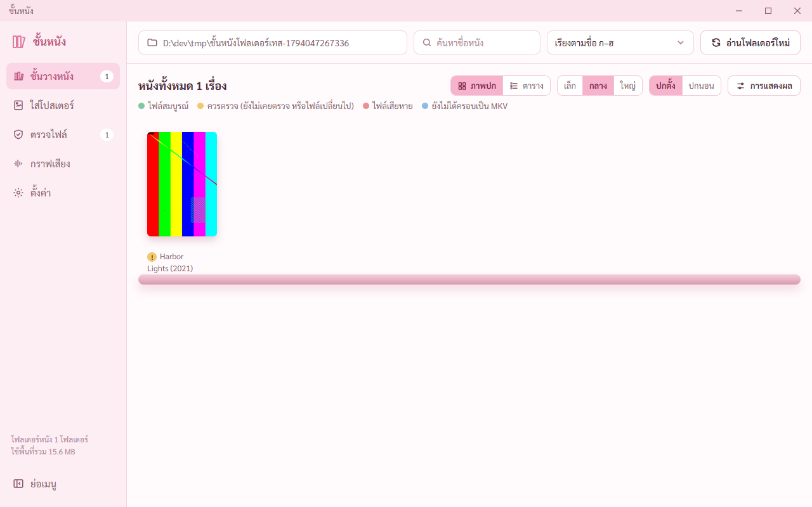

# รายงานขั้น 8 ตัวติดตั้ง · 7 พ.ย. 2569

## คำสั่งของพี่กัน
- แผนขั้น 8 *"สร้างตัวติดตั้ง ลงในเครื่องพี่กัน · ลองกับ สำเนา หนังจริงก่อน ห้ามแตะไฟล์ต้นฉบับจนกว่าพี่กันอนุญาต"* · ผ่านเมื่อ *"ลงตัวติดตั้งแล้วเปิดได้ เครื่องมือครบ · ถอนการติดตั้งได้ ไม่ลบไฟล์หนัง · ลองทุกปุ่มหลักกับสำเนาหนังจริง"*
- ก่อนลงเวร *"เธอห้ามเปิดโปรแกรมเด้งขึ้นมา ใช้เเละถ่ายพื้นหลังเท่านั้น มันรบกวนคนอื่น เพราะจะมีคนอื่นมาใช้คอมนี้"*

## ทำแล้ว
- **ตัวติดตั้ง** `src-tauri\target\release\bundle\nsis\ชั้นหนัง_0.1.0_x64-setup.exe` ขนาด 141.7 MB (เครื่องมือ 515 MB ถูกบีบในตัวติดตั้ง) · สร้างรุ่นจริง 3 นาที 30 วินาที รวมทำตัวติดตั้ง 7 นาที
- ติดตั้งแบบผู้ใช้คนเดียว ไม่ต้องขอสิทธิ์ผู้ดูแลเครื่อง · โปรแกรม `movie-shelf.exe` กับเครื่องมือ 7 ไฟล์และไฟล์สัญญาอนุญาตอยู่โฟลเดอร์ `tools`
- **เทสโดยไม่มีหน้าต่างเด้งขึ้นจอ** ติดตั้งแบบเงียบลงโฟลเดอร์ทดสอบบนไดรฟ์ D · เปิดตัวที่ติดตั้งแบบอยู่หลังสุด · ถอนการติดตั้งแบบเงียบตอนจบ ไม่ทิ้งโปรแกรม ทางลัด หรือรายการถอนการติดตั้งค้างในเครื่อง
- ให้รุ่นจริงเปิดแบบอยู่หลังสุดได้เมื่อคนเปิดตั้งตัวแปร `MOVIE_SHELF_BACKGROUND=1` เอง (เดิมใช้ได้เฉพาะรุ่นทดสอบ) · ตัวแปรนี้แค่วางหน้าต่างไว้หลังสุด ไม่เปิดสิทธิ์หรือคำสั่งอะไรเพิ่ม · เปิดโปรแกรมปกติขึ้นหน้าเหมือนเดิม

## ผลเทส
`node scripts/check-install.mjs` **10 จาก 10**

| ข้อ | ผล |
|---|---|
| ติดตั้งแบบเงียบลงโฟลเดอร์ที่เลือก | ผ่าน 17 วินาที รหัส 0 ได้ movie-shelf.exe |
| เครื่องมือ 7 ไฟล์ hash ตรงกับที่โหลดมา มีไฟล์สัญญาอนุญาต | ผ่าน สัญญาอนุญาต 4 ไฟล์ |
| มีตัวถอนการติดตั้ง | ผ่าน uninstall.exe |
| เปิดตัวที่ติดตั้ง ต่อพอร์ตดีบักได้ หน้าต่างอยู่หลังสุด | ผ่าน |
| หน้าจอโหลดจากในตัวโปรแกรม | ผ่าน http://tauri.localhost |
| เรียกเครื่องมือ 6 ตัวได้ | ผ่าน ทุกตัวพร้อม |
| คำสั่งสำหรับเทสไม่มีในตัวติดตั้งจริง | ผ่าน เรียกแล้วล้ม |
| อ่านโฟลเดอร์ขึ้นชั้น ปกโหลดได้ภายใต้กติกาความปลอดภัยของตัวจริง | ผ่าน |
| ถอนการติดตั้ง ไฟล์โปรแกรมกับเครื่องมือหายหมด | ผ่าน |
| ถอนแล้วไฟล์หนังยังอยู่ hash เท่าเดิม | ผ่าน |

- ตรวจเพิ่มหลังถอน ไม่มีทางลัดในเมนูเริ่ม เดสก์ท็อป และไม่มีรายการถอนการติดตั้งค้าง

## เทสรวมทุกขั้นกับรุ่นล่าสุด (ก่อนผู้ช่วยตรวจ)
ทุกชุดเปิดโปรแกรมแบบอยู่หลังสุด ไม่ขึ้นหน้าจอ · `bash scripts/run-built-all.sh` กับ `bash scripts/run-dev-all.sh`

| ชุด | โปรแกรม | ผล |
|---|---|---|
| ขั้น 1 กรอบหน้าต่าง ชิ้นส่วนกลาง | โหมด dev | 53 จาก 53 |
| ขั้น 2 ชั้นวาง | โหมด dev | 39 จาก 39 |
| ขั้น 3 เปลี่ยนชื่อ | โหมด dev | 17 จาก 17 |
| ขั้น 4 ใส่โปสเตอร์ | โหมด dev | 58 จาก 58 |
| ขั้น 5 ข้อมูลไฟล์ แยกไฟล์ hash | โหมด dev | 16 จาก 16 |
| ขั้น 6 ตรวจไฟล์ | ตัวที่สร้างจริง | 23 จาก 23 |
| ตัวจริงรวม (ปก ฟอนต์ กติกาความปลอดภัย คัดลอก) | ตัวที่สร้างจริง | 11 จาก 11 |
| ขั้น 7 ตั้งค่า | ตัวที่สร้างจริง | 16 จาก 16 |
| กราฟเสียง | ตัวที่สร้างจริง | 68 จาก 68 |
| ปกแนวนอน สองปก แผงขวา | ตัวที่สร้างจริง | 17 จาก 17 |
| ขั้น 8 ตัวติดตั้ง | ตัวที่ติดตั้งรุ่นจริง | 10 จาก 10 |
| Rust cargo test | | 62 จาก 62 |

- เจอตอนรันรวม ตัวเทสตัวจริงรวมใช้ชั้นวางที่ค้างจากตัวเทสก่อนหน้า รันต่อจากขั้น 6 แล้วไม่มีเรื่องที่มีปก ล้ม 2 ข้อ · เป็นที่ตัวเทส ไม่ใช่โปรแกรม · ให้ตัวเทสเตรียมชั้นวางของตัวเองแล้วผ่าน 11 จาก 11
- ภาพรายงานวันที่ 6 ที่ตัวเทสขั้น 1 ถึง 5 เขียนทับ คืนกลับเป็นภาพเดิมของวันนั้น

## ยังไม่ได้ทำ ต้องรอพี่กัน
- **ลองทุกปุ่มหลักกับสำเนาหนังจริง** ต้องรอพี่กันบอกโฟลเดอร์หนังที่ให้ลอง (แผนหัวข้อ ที่ต้องขอจากพี่กันระหว่างทาง) · แคลร์จะคัดลอกหนังมาไว้โฟลเดอร์ทดสอบก่อน ไม่แตะต้นฉบับ
- **ยังไม่ได้ลงไว้ใช้จริงในเครื่อง** ลงแล้วถอนออกในตัวเทส เพราะพี่กันลงเวรและมีคนอื่นใช้คอม · พี่กันดับเบิลคลิกตัวติดตั้งข้างบนเพื่อลงได้เลย
- เปิดตัวที่ติดตั้งแบบปกติให้ขึ้นหน้าจอ ยังไม่ได้ดู (ห้ามเด้งขึ้นจอตอนนี้) · ตัวเทสเปิดแบบอยู่หลังสุดทุกครั้ง
