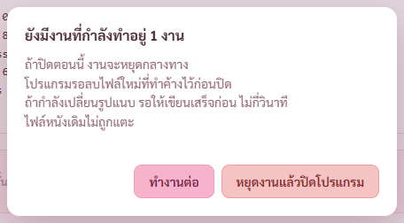
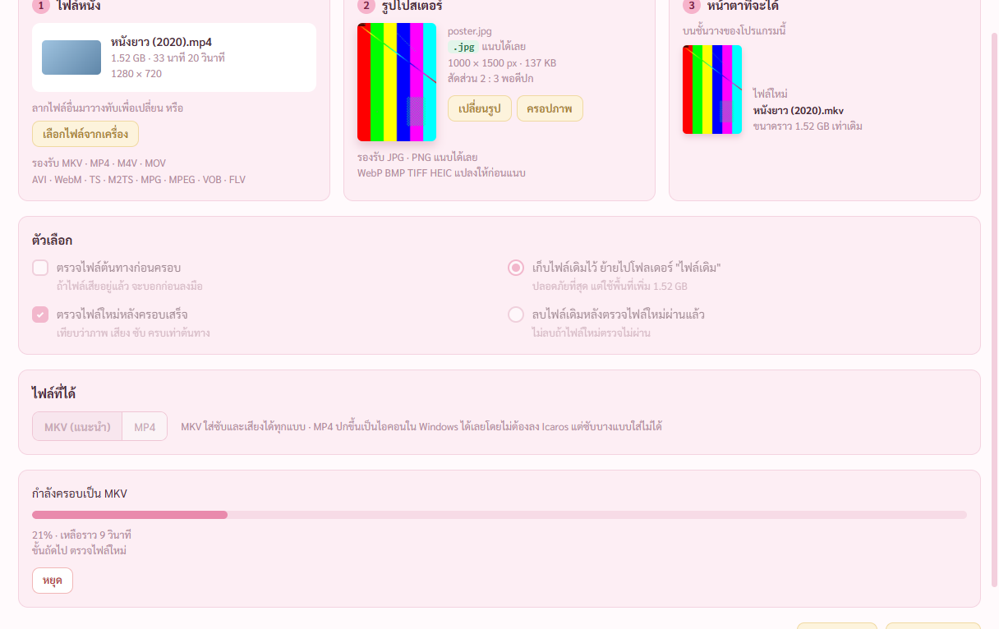
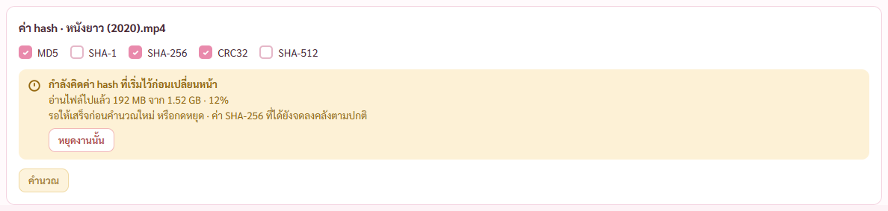
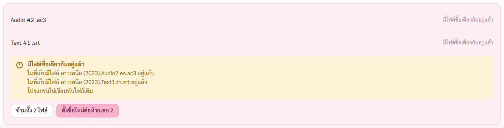
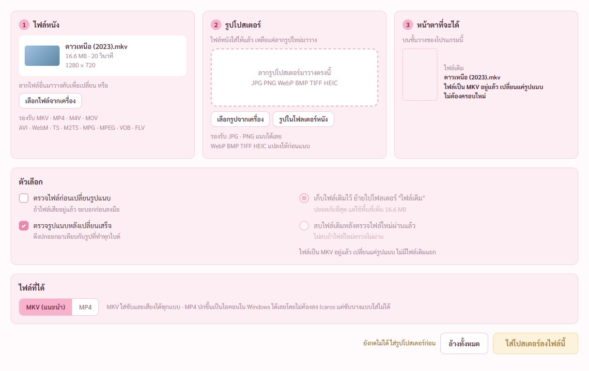
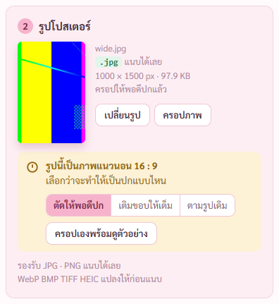
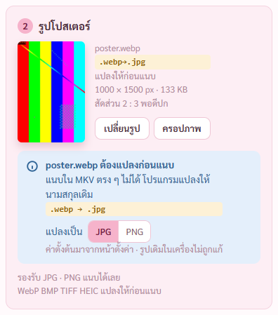
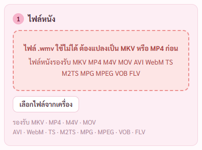

# รายงานแก้ตามผู้ช่วยตรวจตอนจบ · 7 พ.ย. 2569

## คำสั่งของพี่กัน
- ก่อนลงเวร *"ทำจนเสร็จ เดี๋ยวเรารีโมตมาดู จนเสร็จคือทุกขั้นตอนเเล้วรีนเอเจ้นตรวจตามที่วางเเผน"*
- แผน หัวข้อตรวจผลยังไง *"ตอนงานเสร็จทั้งหมด (หลังขั้น 8) ปล่อยผู้ช่วยตรวจ 2 ตัว · แก้ข้อที่ตรวจแล้วจริง · เทสซ้ำ · commit · รายงาน"*
- *"เธอห้ามเปิดโปรแกรมเด้งขึ้นมา ใช้เเละถ่ายพื้นหลังเท่านั้น"* · ทุกภาพในรายงานนี้ถ่ายจากหน้าต่างที่เปิดอยู่หลังสุดผ่านพอร์ตดีบัก ไม่มีอะไรขึ้นจอ

## ภาพรวม
- ผู้ช่วยตรวจ 2 ตัว เขียนผลลง [review/ทั้งหมด-สเปก.md](review/ทั้งหมด-สเปก.md) (37 ข้อ ❌ 4 ⚠️ 19 ✅ 14) กับ [review/ทั้งหมด-โค้ด.md](review/ทั้งหมด-โค้ด.md) (23 ข้อ 🔴 0 🟠 7 🟡 13 ⚠️ 3)
- แคลร์ตรวจของจริงทุกข้อก่อนเชื่อ ผลอยู่ช่อง **ผลที่แคลร์ตรวจ** ของแต่ละข้อในสองไฟล์นั้น
- **ไม่เจอทางที่ไฟล์หนังหายหรือโดนทับ** · ข้อที่ร้ายที่สุดคือปิดโปรแกรมตอนมีงานแล้วไฟล์ที่ทำค้างไม่ถูกลบ กับคิด hash ในหน้าข้อมูลไฟล์ทับค่าอ้างอิง แก้แล้วทั้งคู่
- แก้แล้ว ❌ 4 จาก 4 · 🟠 7 จาก 7 · 🟡 12 จาก 13 · ⚠️ สเปก 19 ข้อ แก้ในโค้ด 11 แก้ที่สเปก 3 ตั้งใจคงไว้ 5 (ข้อ 9 12 23 29 30 เหตุผลอยู่ในไฟล์ผลตรวจและสเปก)
- ยังไม่ได้แก้ 4 เรื่อง (โค้ดข้อ 14 21 22 23) จดใน [ROADMAP.md](ROADMAP.md) หัวข้องานค้างจากผู้ช่วยตรวจ พร้อมว่าติดอะไร

## ข้อที่แก้ พร้อมภาพ

### 1. ปิดโปรแกรมตอนมีงาน รอลบไฟล์ที่ทำค้างก่อนปิด (โค้ดข้อ 2)
เดิมกด หยุดงานแล้วปิดโปรแกรม แล้วปิดทันที ไฟล์ .partial ขนาดเกือบเท่าหนังค้างข้างไฟล์หนัง ถ้าตรงจังหวะเขียนรูปแนบ เครื่องมือโดนฆ่ากลางการเขียน · ตอนนี้สั่งหยุดทุกงาน รอให้งานลบไฟล์ของตัวเองก่อน ไม่เกิน 20 วินาที ระหว่างรอปุ่มเป็น กำลังหยุดงานและลบไฟล์ที่ทำค้าง…

### 2. เปลี่ยนหน้าระหว่างครอบ กลับมาเห็นงานเดิม (โค้ดข้อ 6)
เดิมกลับมาหน้าใส่โปสเตอร์แล้วหน้าว่าง ไม่มีปุ่มหยุด งานจบแล้วไม่เห็นผล · ตอนนี้เห็นไฟล์หนัง รูปโปสเตอร์ ความคืบหน้า ปุ่มหยุด กดหยุดได้จริง

### 3. เปลี่ยนหน้าระหว่างคิด hash กลับมาเห็นว่างานยังทำอยู่ (โค้ดข้อ 6)
การ์ดเหลืองบอกความคืบหน้าของงานที่เริ่มไว้ พร้อมปุ่มหยุดงานนั้น · ปุ่มคำนวณรอจนงานจบ · สั่งคิดซ้อนไม่ได้ (เดิมงานหลังล้างตัวหยุดของงานแรก) · แยกไฟล์ก็กันซ้อนแบบเดียวกัน

### 4. การ์ดชื่อชนตอนแยกไฟล์บอกชื่อไฟล์ (สเปกข้อ 10)
เดิมบอกแค่ มีไฟล์ชื่อเดียวกันอยู่แล้ว · ตอนนี้บอกทุกไฟล์ ในที่เก็บมีไฟล์ … อยู่แล้ว ตามต้นแบบ · ชนหลายไฟล์ปุ่มเป็น ข้ามทั้ง N ไฟล์

### 5. หน้าใส่โปสเตอร์ตรงสเปก (สเปกข้อ 17 18 19 20 34)

### 6. ข้อที่แก้ในตัวโปรแกรมโดยไม่มีหน้าตาเปลี่ยน
- **คิด hash ในหน้าข้อมูลไฟล์ไม่ทับค่าอ้างอิง** (โค้ดข้อ 1 สเปกข้อ 14) ไม่ตรงกับที่จดไว้ ตั้งว่าไฟล์ถูกเปลี่ยน คงค่าเดิม
- **ครอบ MP4 ที่มีปกฝังอยู่แล้ว** (โค้ดข้อ 3) ลองแล้วจริง เดิมได้ cover.jpg สองอัน ตรวจไม่ผ่าน
- **ลบไฟล์เดิมต้องผ่านหน้าต่างยืนยัน 2 ขั้นทุกทาง** (โค้ดข้อ 4) รวมปุ่มลองใหม่ กับปุ่มทิ้งแทร็กแล้วทำต่อ
- **ชื่อไฟล์แนบใน MKV พาไฟล์ที่แยกออกนอกโฟลเดอร์ไม่ได้แล้ว** (โค้ดข้อ 5)
- **แยกซับจาก MP4 ได้ไฟล์ SRT จริง** (โค้ดข้อ 7) ลองแล้ว แบบเดิมล้ม Could not write header · นามสกุลตรงกับข้างในทุกชนิด
- **สวิตช์ย่อรูปโปสเตอร์มีผลจริง** (สเปกข้อ 28 โค้ดข้อ 16)
- เช็กไฟล์ถูกเปิดซ้ำตรงจังหวะที่เขียน · บันทึกคลังทีละทาง · สั่งอ่านโฟลเดอร์ระหว่างอ่านแล้วอ่านซ้ำเอง · ตรวจละเอียดไม่ถอดรูปปก · จดคลังทุกครั้งที่แก้ไฟล์ไปแล้ว · ที่อยู่ไฟล์ยาวบอกตรงสาเหตุ · รูปบนการ์ดไม่หายหลังเปิดครอปซ้ำ · MP4 ส่งออก MP4 ล้มขั้นสุดท้ายแล้วย้ายไฟล์เดิมกลับ (โค้ดข้อ 8 9 10 11 13 15 18 20)
- เวลาตรวจละเอียดที่คาด ชั้นวางกับหน้าตรวจไฟล์ใช้สูตรเดียว · เปิดเล่นที่นาทีจากหน้าต่างผลตรวจ หาโปรแกรมเล่นไม่เจอพาไปหน้าตั้งค่า · คำอธิบาย AV1 · ข้อความผิดพลาดตอนแยกไฟล์ใช้ชื่อหัวข้อ (สเปกข้อ 11 13 25 26)

### 7. เจอระหว่างเทสซ้ำ แก้แล้ว
- **ใส่ปกให้ MKV แล้วสถานะตรวจหาย** ตัวเทสขั้น 4 ล้ม 2 ข้อหลังให้ตัวอ่านโฟลเดอร์อ่านซ้ำเอง · ต้นเหตุคือตัวอ่านเอาสำเนาคลังตอนเริ่มอ่านมาทับเรื่องที่ถูกจดระหว่างอ่าน (ตรงกับโค้ดข้อ 12) · แก้ให้เรื่องที่ถูกแก้ระหว่างอ่านใช้ของในคลัง · ขั้น 4 กลับมาผ่านครบ
- **การ์ด hash ที่เปิดใหม่ค้างที่เปอร์เซ็นต์สุดท้าย** เห็นจากภาพ การ์ดรับความคืบหน้าของงานเดิมไปแสดงเป็นงานตัวเอง แต่ไม่รู้ว่างานจบ · แก้ให้รับเฉพาะงานที่ตัวเองเริ่ม
- **กลับมาหน้าใส่โปสเตอร์ การ์ดรูปว่าง** เห็นจากภาพ · เก็บรูปที่เลือกไว้กับงานด้วย
- **หน้าต่างถามตอนปิด ตัดบรรทัดกลางประโยค** เห็นจากภาพ · แยกบรรทัดตามวลี

## ผลเทส
ทุกชุดรันกับหน้าต่างที่เปิดอยู่หลังสุด ไม่มีอะไรขึ้นจอ · ไฟล์หนังทุกไฟล์เป็นสำเนาในโฟลเดอร์ทดสอบบนไดรฟ์ D

| ชุด | ผล |
|---|---|
| เทสฝั่ง Rust `cargo test` | **68 จาก 68** (เดิม 62 เพิ่มใหม่ 6 ข้อ แยกชื่อไฟล์แนบไม่หลุดโฟลเดอร์ · นามสกุลตรงกับที่ ffmpeg เขียน · ซับ MP4 ได้ SRT จริง · รองานหยุดก่อนปิด · ของที่จดระหว่างอ่านโฟลเดอร์ไม่โดนทับ · สวิตช์ย่อรูปโปสเตอร์) |
| ตรวจชนิดข้อมูลหน้าจอ `tsc` | ผ่าน |
| ขั้น 1 กรอบหน้าต่าง (dev) | **53 จาก 53** |
| ขั้น 2 ชั้นวาง (dev) | **39 จาก 39** |
| ขั้น 3 เปลี่ยนชื่อ (dev) | **17 จาก 17** |
| ขั้น 4 ใส่โปสเตอร์ (dev) | **61 จาก 61** (เพิ่มใหม่ 3 ข้อ MP4 มีปกฝังสองแบบ · ลองใหม่ต้องถามลบ 2 ขั้น · รอบแรก 59 จาก 61 ดูหัวข้อ 7) |
| ขั้น 5 ข้อมูลไฟล์ (dev) | **17 จาก 17** (เพิ่มใหม่ 1 ข้อ การ์ดชื่อชนบอกชื่อไฟล์) |
| ข้อที่แก้ตามผู้ช่วยตรวจ `check-review.mjs` ใหม่ (dev) | **13 จาก 13** ภาพ 8 ภาพข้างบน |
| ขั้น 6 ตรวจไฟล์ (ตัวจริง) | **23 จาก 23** (ปรับข้อเปิดเล่นที่นาที ให้เช็กว่าพาไปหน้าตั้งค่า) |
| ตัวจริงรวม `check-built` | **11 จาก 11** |
| กราฟเสียง (ตัวจริง) | **68 จาก 68** |
| ปกแนวนอน (ตัวจริง) | **17 จาก 17** |
| ขั้น 7 ตั้งค่า (ตัวจริง) | **16 จาก 16** |
| ตัวติดตั้ง `check-install` (สร้างใหม่จากโค้ดล่าสุด 141.7 MB) | **11 จาก 11** (เพิ่มใหม่ 1 ข้อ ตัวที่ติดตั้งจริง กดหยุดงานแล้วปิดโปรแกรมระหว่างครอบไฟล์ 1.6 GB โปรแกรมรองานหยุดแล้วปิดเองใน 0.6 วินาที ไฟล์ที่ทำค้างถูกลบ ไฟล์เดิม hash เท่าเดิม) |

**พิสูจน์ว่าข้อที่แก้เป็นของจริง** (ลองกับเครื่องมือตรง ๆ)
- ครอบ MP4 ที่มีปกฝังด้วย mkvmerge แบบเดิม ได้ไฟล์แนบ cover.jpg สองอัน · ใส่ `--no-attachments` เหลืออันเดียว
- แยกซับ mov_text จาก MP4 แบบเดิม (`-c copy`) ffmpeg ล้ม Could not write header · แบบใหม่ (`-c srt`) ได้ไฟล์ขึ้นต้น `1` ตามด้วย `00:00:01,000 --> 00:00:04,000`

**ยังไม่ได้ตรวจ**
- ข้อที่ต้องให้หน้าต่างของ Windows เด้งขึ้นจอ (ถังขยะเกินโควตา) ทำตอนพี่กันลงเวรไม่ได้
- ปิดโปรแกรมระหว่างเปลี่ยนรูปแนบ (mkvpropedit ไม่ฟังตัวหยุด ต้องรอเขียนเสร็จ) ช่วงนี้ใช้ไม่ถึงวินาทีกับไฟล์ทดสอบ จังหวะกดให้ตรงทำไม่ได้ · เทสแบบครอบไฟล์ใหญ่แทน
- ภาพทั้งหมดถ่ายจากหน้าต่างโปรแกรมจริงขนาดเดิม ไม่ได้ลองจอขยาย 125–150%

## ยังไม่ได้ทำ
- ลงถังขยะไฟล์ใหญ่เกินถัง (โค้ดข้อ 21) ต้องเห็นหน้าต่างของ Windows เด้งขึ้นจอ ทำตอนพี่กันลงเวรไม่ได้
- งานต่างชนิดทำกับไฟล์เดียวกันพร้อมกัน (โค้ดข้อ 22) · แยกซับ VobSub (ข้อ 23 ไม่มีไฟล์ทดสอบ) · เอาโฟลเดอร์ออกแล้วประวัติหาย (ข้อ 14 ต้องตัดสินแบบ)
- ขั้น 8 ลองกับสำเนาหนังจริง รอพี่กันบอกโฟลเดอร์ · ลากไฟล์จาก Explorer จริงต้องให้พี่กันลากหนึ่งครั้ง
- ยังไม่ push รอพี่กันสั่ง
