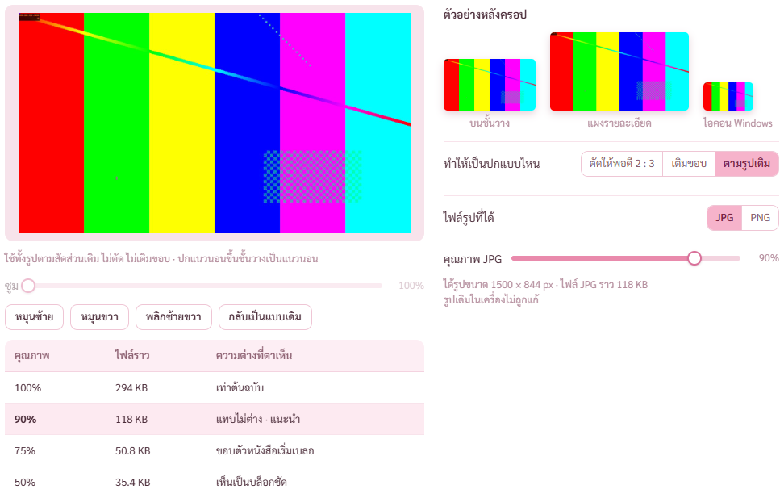
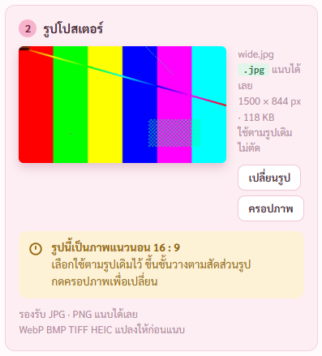
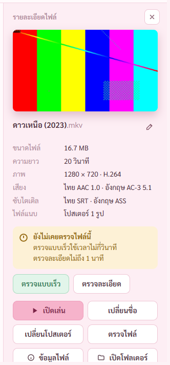
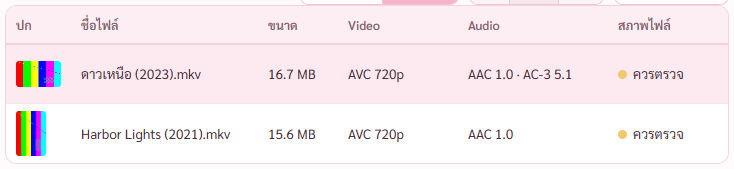
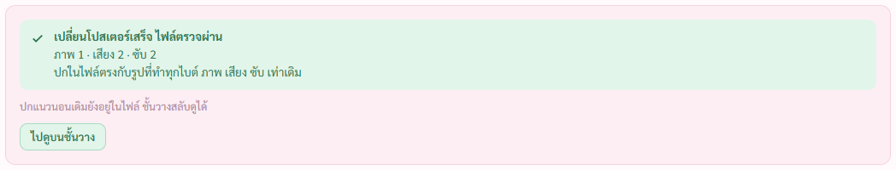
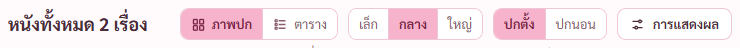
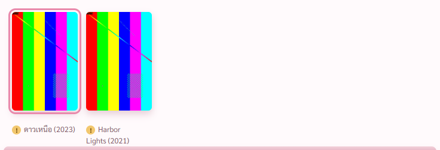
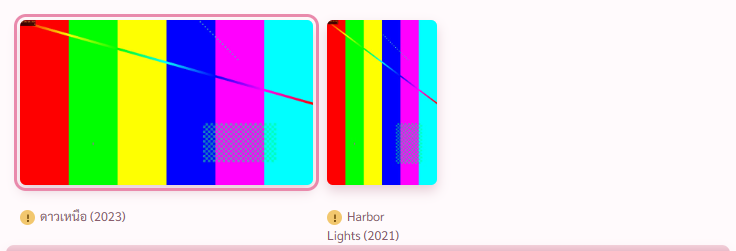
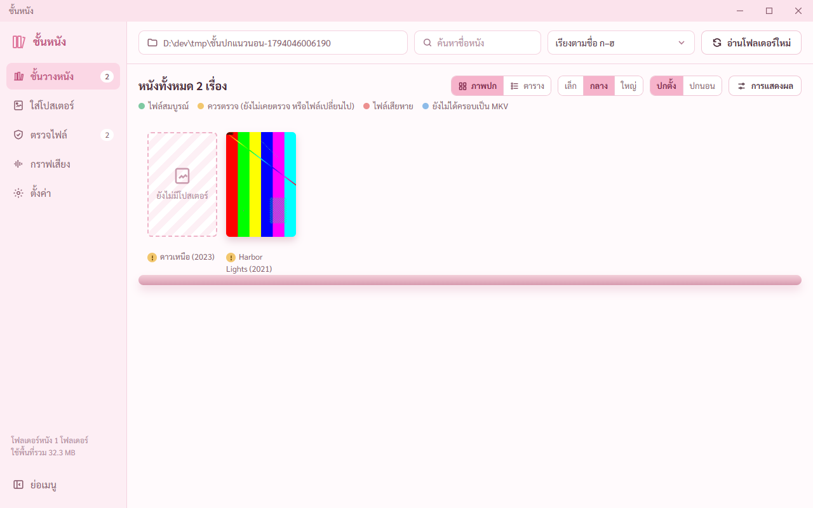
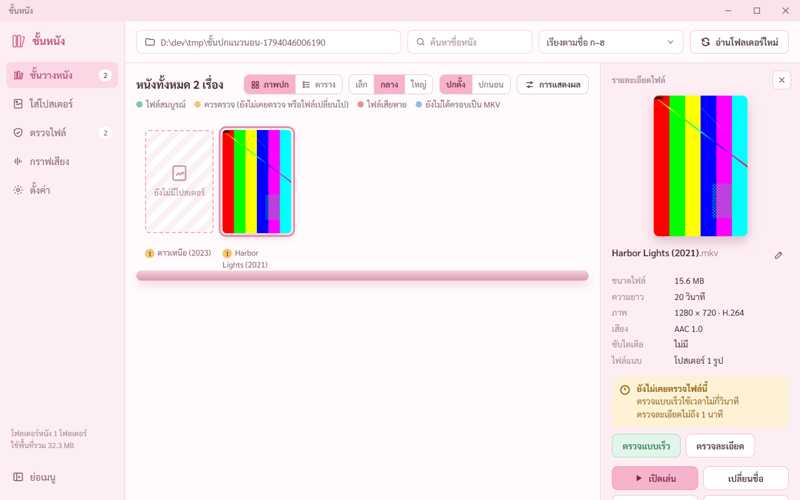

# รายงานปกแนวนอน (7 พ.ย. 2569)

ปกแนวนอนแสดงเป็นแนวนอนบนชั้นวาง แผงขวา และตาราง · หน้าใส่โปสเตอร์มีแบบ **ตามรูปเดิม** ไม่ตัด ไม่เติมขอบ
ภาพถ่ายจากหน้าต่างโปรแกรมจริง อยู่ `report-2026-11-07/ปกแนวนอน/` · ตัวเทส `scripts/check-wide.mjs`

## คำสั่งของพี่กัน
- *"ระบบที่เเสดงตรงนี้ ถ้าเราเอาโปสเตอร์แบบเเนวนอนมา มันก็จะเเสดงเป็เเเนวนอนด้วยนะ"* (ส่งภาพชั้นวาง)

## เดิมเป็นยังไง
- ภาพเล็กของปกบนชั้นวางถูกตัดเป็น 300 × 450 (2:3) ตั้งแต่ตอนสร้างฝั่ง Rust ปกแนวนอนเหลือแค่กลางภาพ
- หน้าใส่โปสเตอร์มีแค่ ตัดให้พอดี 2:3 กับเติมขอบ ปกแนวนอนจึงไม่มีทางออกมาเป็นแนวนอน

## ทำแล้ว

หน้าครอปมีแบบที่ 3 **ตามรูปเดิม** ใช้ทั้งรูปตามสัดส่วนเดิม · ตัวอย่างบนชั้นวาง แผงรายละเอียด ไอคอน เป็นแนวนอนตามรูป ย่อให้อยู่แถวเดียว · ได้รูป 1500 × 844 (ด้านยาว 1,500 เท่าด้านยาวของปก 2:3)

การ์ดรูปโปสเตอร์บอก ใช้ตามรูปเดิม ไม่ตัด · รูปตัวอย่างเป็นแนวนอน

ชั้นวาง ปกแนวนอนสูงเท่าเล่มอื่น กว้างตามสัดส่วน (ไม่เกิน 16:9) · ขนาดกลาง 293 × 165 ข้างปกตั้ง 110 × 165 · ขนาดเล็กกับใหญ่ก็สูงเท่ากัน · แบ่งแถวตามความกว้างจริงของแต่ละเล่ม

แผงขวา ปกแนวนอนกว้างเต็มแผง ไม่ถูกตัด

ตาราง ภาพเล็กของปกแนวนอนเป็นแนวนอน 45 × 26

## ข้างใน
- ภาพเล็กสร้างแบบคงสัดส่วน สูง 450 ชื่อลงท้าย `-a` · ภาพเล็กแบบเก่าที่ตัด 2:3 ตัวอ่านโฟลเดอร์สร้างใหม่ให้เองรอบแรกที่เปิด (ไฟล์หนังไม่ถูกแตะ อ่านปกออกมาย่อใหม่)
- คลังหนังจดสัดส่วนปก (coverAspect) · คลังเก่าเปิดได้ปกติ ค่านี้ได้มาตอนอ่านโฟลเดอร์
- ตัวแปลงรูปฝั่ง Rust มีแบบ `original` เทส Rust เช็กว่าคงสัดส่วน ด้านยาว 1,500 ไม่ตัด

## ผลเทส
| เทส | ผล |
|---|---|
| ปกแนวนอน check-wide.mjs ตัวที่สร้างจริง | 10 จาก 10 · ไม่มีอะไรโดนกติกาความปลอดภัยกัน |
| ปกแนวนอน check-wide.mjs แบบ dev (หลังย่อตัวอย่างในหน้าครอป) | 9 จาก 9 |
| Rust cargo test | 59 จาก 59 |
| เทสขั้น 4 หน้าใส่โปสเตอร์ซ้ำ | 58 จาก 58 |
| เทสขั้น 2 ชั้นวางซ้ำ | 39 จาก 39 |

## เจอและแก้ระหว่างทำ
- ตัวอย่างในหน้าครอปแบบตามรูปเดิมกว้างจนตกคนละแถว แถบคุณภาพ JPG ตกขอบล่าง · ย่อทั้งสามเท่ากันให้อยู่แถวเดียว
- ตัวเทสส่งที่อยู่รูปแบบสั้น โหมด dev โปรแกรมทำงานจากโฟลเดอร์ src-tauri หารูปไม่เจอ · เปลี่ยนเป็นที่อยู่เต็ม (ที่ตัวเทส ไม่ใช่ที่โปรแกรม)

## ตาราง ภาพเล็กอยู่กลางช่อง (หลัง commit 0de0d9b)
- พี่กันทัก *"ถ้ามันมีทั้งเเนวตั้งเเละเเนวนอน ตอนปรับเป็นมุมมองตารา เราอยากห้รู้มันอยู่เเนวกลาง"* (ส่งภาพตาราง ภาพเล็กชิดซ้าย)
- ภาพเล็กทั้งปกตั้งและปกแนวนอนอยู่กลางช่อง หัวช่อง ปก อยู่กลางด้วย · เดิมกฎของปกแนวนอนเขียนขอบซ้ายขวาเป็นศูนย์ ทับการจัดกลาง แก้แล้ว

- ตัวเทสวัดจากหน้าจอ ห่างจากกลางช่อง 0 กับ 0 จุดภาพ · check-wide.mjs กับตัวที่สร้างจริง 11 จาก 11

## ปกตั้งกับปกนอนในไฟล์เดียว สลับดูบนชั้นวาง (คิว 5)
- พี่กันถาม *"การรวมไฟล์ภาพ ถ้ารวมสองภาพได้ไหมนะ เเล้วมันจะเเสดภาพไหน"* แล้วสั่ง *"ทำระบบนี้มาเลย ให้เเนบหลายรูปได้ เเละทำระบบที่ดูรูปแบบเเนวตั้ง หรือเเนวนอนได้ ยกเว้นเรื่องนั้นๆมีเเค่เเนวเดียวมันจะเเสดงเเค่เเนวนั้น"* · *"อันนี้เราให้ต่อคิวงานที่สั่งตอนนี้นะ ไม่ใส่โร๊ดเเมพ"*
- **ชื่อไฟล์แนบตามธรรมเนียม MKV** รูปแนวตั้งแนบชื่อ `cover.jpg` · รูปแนวนอนแนบชื่อ `cover_land.jpg` · ไฟล์หนึ่งมีได้ทั้งสองปก
- **ใส่ปกแบบหนึ่ง ปกอีกแบบยังอยู่** แทนเฉพาะปกเดิมแนวเดียวกัน · หน้าจอบอกใต้ผลว่า *ปกแนวนอนเดิมยังอยู่ในไฟล์ ชั้นวางสลับดูได้* · ตรวจหลังแนบว่าปกอีกแนวยังอยู่ครบหนึ่งอัน ไม่ครบขึ้นว่าตรวจไม่ผ่าน
- รูปแนวนอนที่เคยแนบชื่อ `cover.jpg` ก่อนมีระบบนี้ โปรแกรมดูสัดส่วนจริงของรูป ตอนใส่ปกตั้งเปลี่ยนชื่อรูปเดิมเป็น `cover_land.jpg` ให้ ไม่ลบทิ้ง
- **คลังหนังจดสองปก** ปกตั้งเป็นปกหลักเสมอ ปกนอนเป็นปกที่สอง ดูจากสัดส่วนจริงของรูป ไม่ใช่ชื่อ
- **ชั้นวางมีปุ่ม ดูปก ปกตั้ง | ปกนอน** สลับทั้งภาพปก ตาราง และแผงขวาพร้อมกัน · เรื่องที่มีปกเดียวขึ้นปกนั้นเสมอ · จำค่าไว้ในค่าตั้ง

- ตัวเทสอ่านไฟล์แนบจริงด้วย mkvmerge ทุกขั้น ใส่ปกนอน ได้ `cover_land.jpg` · ใส่ปกตั้งเพิ่ม ได้ `cover.jpg cover_land.jpg` · ใส่ปกนอนใหม่อีกรอบ ยังเป็น `cover.jpg cover_land.jpg` อย่างละอัน
- คลังหนัง ดาวเหนือ ปกหลัก cover.jpg สัดส่วน 0.67 · ปกที่สอง cover_land.jpg 1.78 · Harbor Lights ไม่มีปกที่สอง
- check-wide.mjs กับตัวที่สร้างจริง 16 จาก 16 · Rust cargo test 61 จาก 61 (ข้อใหม่ ตัวอ่านไฟล์แยก cover กับ cover_land ไม่ว่าจะมาก่อนหลัง)

## แผงขวาของชั้นวางขึ้นเฉพาะตอนกดเลือกเรื่อง (คิว 6)
- พี่กัน *"แถบนี้ เราอยากให้มันขึ้นตอนที่กดหนังนั้นๆ เเละมีปุ่มปิดได้ เราอยากห้มันเเสดงชั้นวางมากกว่า"*
- เปิดชั้นวางยังไม่มีแผงขวา ชั้นวางกว้างเต็ม · กดเรื่องไหนแผงขึ้นเรื่องนั้น · หัวแผงมีคำว่า รายละเอียดไฟล์ กับปุ่มกากบาทปิด · ปิดแล้วชั้นวางกว้างคืน ไม่มีเรื่องไหนถูกเลือก
- เดิมไม่ได้เลือกก็ขึ้นเรื่องแรกค้างไว้ตลอด

- ตัวเทสวัดความกว้างชั้นวาง 1,080 → กดเลือก 760 → ปิด 1,080 จุดภาพ · check-wide.mjs 17 จาก 17

## ยังไม่ได้ทำ
- ไอคอนไฟล์ใน Explorer (Icaros) กับปกแนวนอน ยังไม่ได้ลองว่าโชว์ยังไง
- ส่งออก MP4 ใส่ได้ปกเดียว (รูปที่เลือกตอนนั้น) MP4 ไม่มีธรรมเนียมปกนอนแบบ MKV
