# รายงาน 7 พ.ย. 2569 · มอคอัปหน้าเสียงและซับ รอบแก้ตามพี่กัน

มอคอัป [docs/mockups/audio-merge.html](mockups/audio-merge.html) · ภาพทั้งหมดอยู่ [report-2026-11-07/มอคอัปเสียงและซับ/](report-2026-11-07/มอคอัปเสียงและซับ/)
ภาพถ่ายผ่านหน้าต่างโปรแกรมแบบเปิดอยู่หลังสุดกับ CDP ไม่มีอะไรขึ้นจอ · หน้ากว้าง 1300 px
แก้ข้อความรอบก่อน รอบก่อนเขียนว่าข้อผิดพลาดในหน้า 0 ทุกรอบถ่าย แต่หน้ามอคอัปยังไม่มีตัวเก็บข้อผิดพลาด ตัวเลขนั้นจึงเชื่อไม่ได้ · ใส่ตัวเก็บแล้วในข้อ 7 ตรวจใหม่ได้ 0 จริง
ยังไม่ได้ตรวจ โหมดมืด (มอคอัปนี้ยังไม่มีโหมดมืด) · หน้าจอแคบ

## 1. คำเทคนิคคงภาษาอังกฤษ มีคำอธิบายไทยใต้ช่อง

พี่กันสั่ง (ส่งภาพแผง AAC กับ Opus) *"อันไหนควรคงคำอังกิด ก็ควรคงไว้ แต่ก็จะมีอธิบายไทยด้านล่างอยู่แล้ว"*

- ป้ายช่องในแผงตั้งค่าเสียงใช้คำที่คนเล่นเรื่องนี้ใช้กัน คำอธิบายไทยตัวเล็กอยู่ใต้ช่องเหมือนเดิม
  - หัวแผง Codec · Lossy · Lossless · Encoder
  - Opus Bitrate · Bitrate mode (VBR · Constrained VBR · Hard CBR) · Complexity · Frame size · Tuning (Auto · Music · Speech) · Channels
  - AAC Mode (TVBR · CVBR · ABR · CBR) · TVBR quality · Profile · Encoder quality · Lowpass · Channels
  - MP3 Mode (VBR · ABR · CBR) · VBR quality แสดงเป็น V2 · Bitrate (ABR, CBR) · Stereo mode (Joint stereo · Stereo · Mono) · Quality (-q) · Lowpass
  - AC-3 Bitrate · Dialnorm · Center mix level · Surround mix level · Room type · Channels
  - FLAC Compression level · Threads · Verify · Bit depth · Sample rate · Block size
  - WavPack Mode (Fast · Normal · High · Very High) · Extra · Hybrid · Verify · Monkey's Audio Compression level (Fast ถึง Insane)
  - ใช้กับทุกชนิด Gain · Loudness normalize
- ชุดค่าแบบง่ายใช้คำเดียวกัน เช่น TVBR 91 · CBR 320 kbps · Level 5 · High · -h · Normal · -c2000
- ค่าตั้งต้นที่แก้ให้ตรงตัวแปลงจริงระหว่างทำ AC-3 Center mix −4.5 dB และ Surround mix −6 dB ตามค่าของ ffmpeg · LAME Quality ค่าตั้งต้น 3 · WavPack และ Monkey's Audio ค่าตั้งต้น Normal ให้ตรงกับชุดที่เลือก
- คิวแปลงใช้คำเดียวกัน FLAC Level 8 · FLAC Level 5

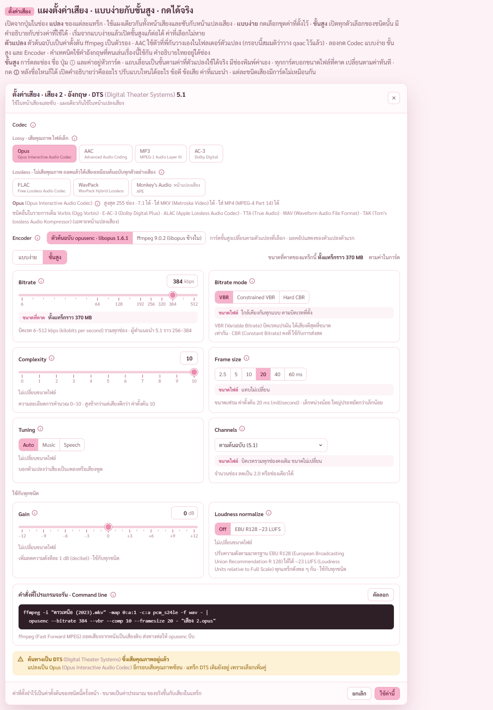
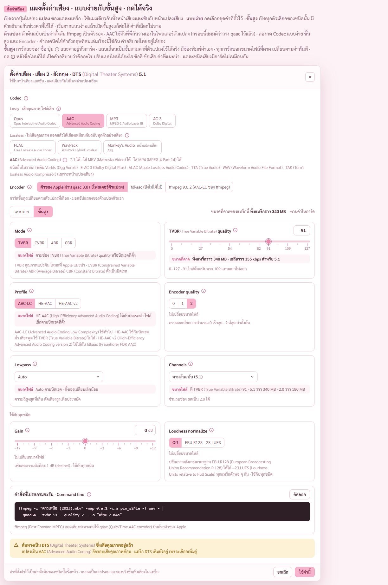
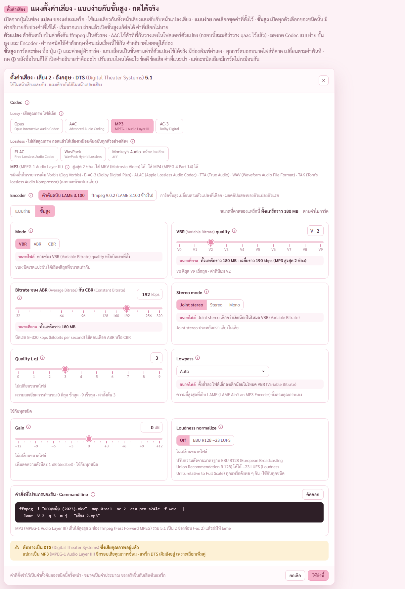
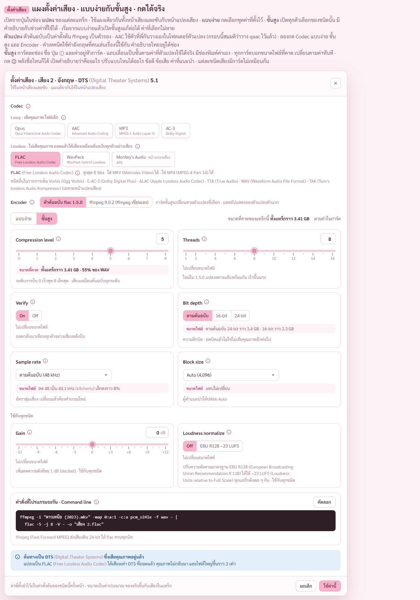

## 2. คอลัมน์ชนิดไฟล์ ทุกชนิด สีไม่ซ้ำกัน

พี่กันสั่ง *"ใส่คอลัมน์นึงที่แสดงชนิดไฟล์ด้วย เช่น flac aac srt ass ac3 งี้"* แล้วเพิ่ม *"ไม่ได้หมายถึงแค่ชนิดพวกนี้ แต่ทุกตัว และใส่สีต่างกันด้วย"*

- ตารางแทร็กมีคอลัมน์ **ชนิด** ต่อจากไอคอน ป้ายสีของแต่ละแทร็ก H.264 · AC-3 · DTS · FLAC · ASS · SRT · PGS
- ชื่อแทร็กในหนังตัดชื่อชนิดที่ซ้ำออก เช่น เสียง 1 · AC-3 5.1 เป็น เสียง 1 · 5.1
- ทุกชนิดที่โปรแกรมรู้จัก 26 ชนิด สีไม่ซ้ำกัน · สีโทนเดียวกันคือตระกูลเดียวกัน Dolby ส้มทอง · DTS แดง · Lossy อื่นชมพูม่วง · Lossless อื่นเขียวฟ้า
  - ภาพ H.264 H.265 AV1 VP9 MPEG-2 · เสียง AC-3 E-AC-3 TrueHD DTS DTS-HD MA AAC Opus MP3 Vorbis FLAC PCM ALAC WavPack TTA APE TAK · ซับ SRT ASS VTT PGS VobSub
  - APE กับ TAK ป้ายพื้นขาวขอบประ เพราะสีใกล้ FLAC และใช้ได้เฉพาะหน้าแปลงเสียง · ชนิดที่ไม่อยู่ในรายการขึ้นสีเทา
- ใต้หน้าต่างมีแถบรวมสีทุกชนิดให้ดูครบ (ในโปรแกรมจริงไม่มีแถบนี้)
- ตรวจ ตัวหนังสือบนพื้นทุกสีอ่านชัด ค่าความต่างแสงต่ำสุด 5.64 เท่า (เกณฑ์ 4.5) ที่ WavPack
- แก้ระหว่างตรวจภาพ คอลัมน์ชื่อแคบลง บรรทัดรองตัดคำกลางวลี เช่น 410 กับ MB อยู่คนละบรรทัด · แก้ให้ตัดบรรทัดเฉพาะตรงจุดคั่น จุดคั่นติดท้ายช่วงก่อนหน้า

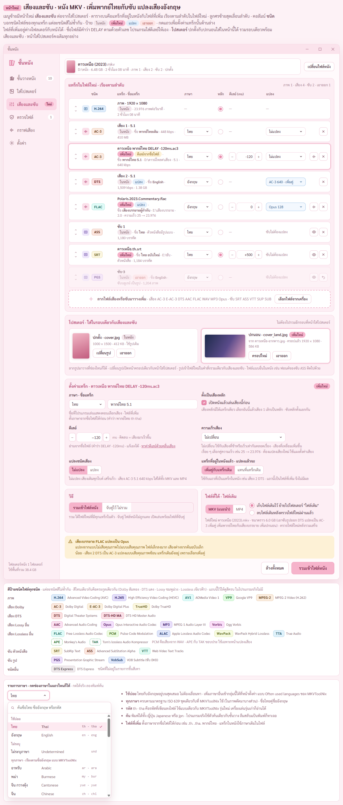

## 3. เทียบก่อนกับหลังแปลง ใช้หน้ากราฟเสียงหลัก

พี่กันบอก (ส่งภาพหน้าเทียบเดิม) *"ที่เราคิดคือ เทียบกราฟ จากหน้ากราฟหลักน่ะ"*

- หน้าเทียบเดิมวาดกราฟของตัวเอง ไม่เหมือนหน้ากราฟเสียงจริง · ทำใหม่เป็นหน้ากราฟเสียงหลักแบบเปิดสองไฟล์ ดูแบบจากภาพหน้ากราฟจริงใน report-2026-11-07/กราฟเสียง-ตัวจริง/
- แท็บเดิมครบ 6 แท็บ รูปคลื่น · ความถี่ · ความดัง · ซ้อนเทียบ · วิเคราะห์ · ความถี่เฉลี่ย ทุกกราฟแสดงสองไฟล์ ต้นฉบับสีฟ้า หลังแปลงสีส้ม กดสลับแท็บได้จริง
- แผงซ้ายช่องเสียงแบบเดิม · ข้อมูลเสียงเทียบสองคอลัมน์ รหัสเสียง ช่องเสียง อัตราสุ่ม ความละเอียด บิตเรต ขนาด
- วิเคราะห์ ภาพพื้นดำแบบหน้าจริงสองภาพ แกนความถี่เท่ากัน เห็นเส้นตัดเหนือ 20.2 kHz
- ความถี่เฉลี่ย แกน log 20 Hz ถึง 40 kHz สองเส้นซ้อน ช่องอ่านค่าที่จุดชี้บอกค่าทั้งสองไฟล์กับผลต่าง
- ความดัง ช่องสรุปมีค่าทั้งสองไฟล์ ยอดเสียงหลังแปลงเกิน 0 ขึ้นเตือนพร้อมทางแก้ Gain −1 dB
- ซ้อนเทียบ ช่องเดียวกันของสองไฟล์ซ้อนกัน ผลต่างแยกเป็นกราฟของตัวเอง แกน ±2 dB
- แก้ระหว่างตรวจภาพ ภาพวิเคราะห์ของต้นฉบับเหนือ 30 kHz มืดสนิท ไม่ตรงกับข้อความว่ามีเสียงถึง 46 kHz · ช่องความดังรวมตกบรรทัด · เส้นความดังช่วงต้นมีหลุมเหลี่ยม · ช่องอ่านค่าแยกป้ายกับค่าคนละบรรทัด แก้ครบแล้วถ่ายใหม่

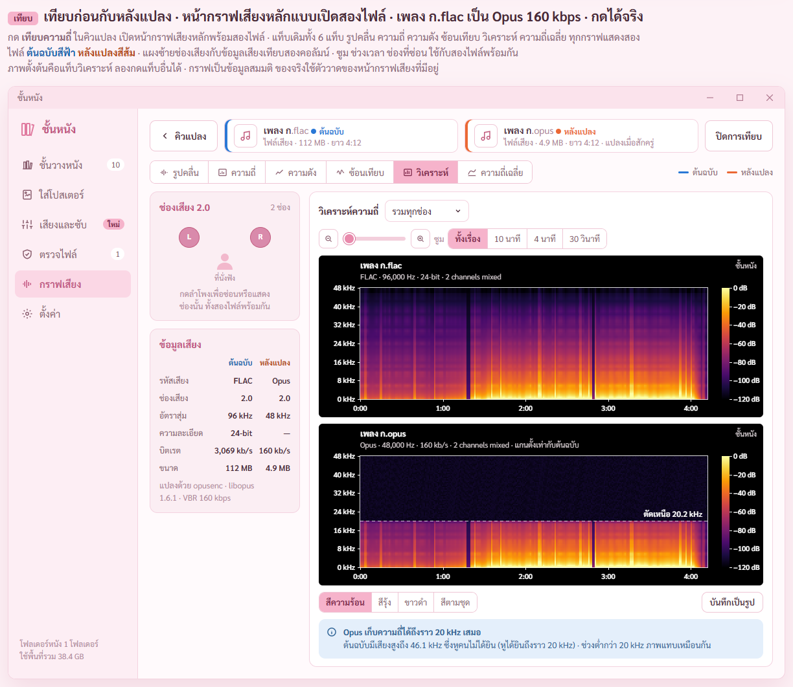
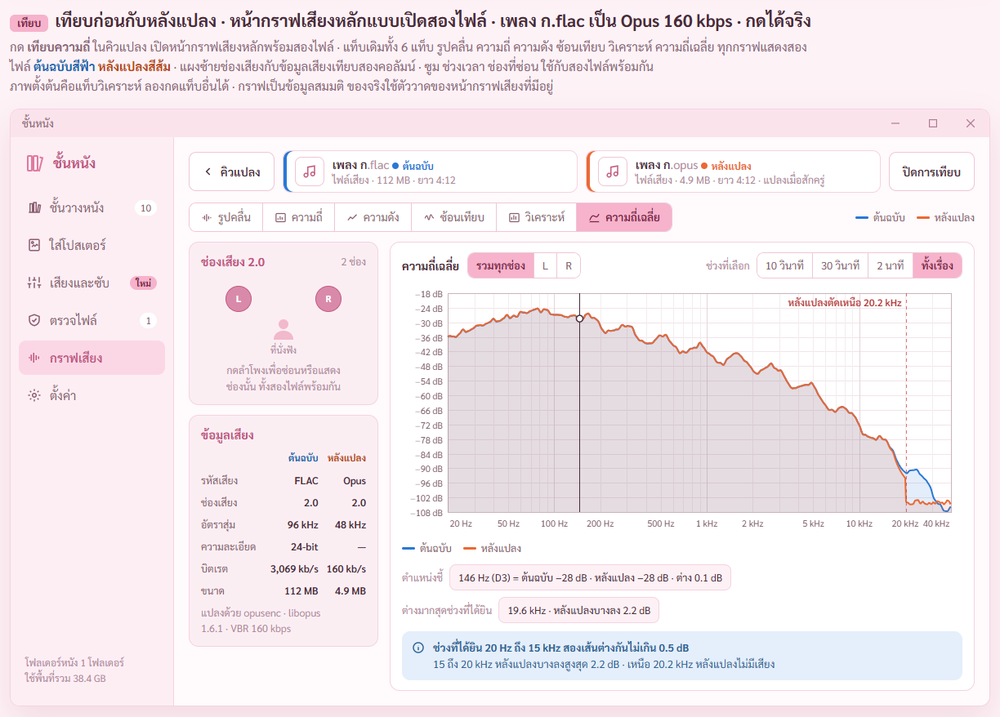
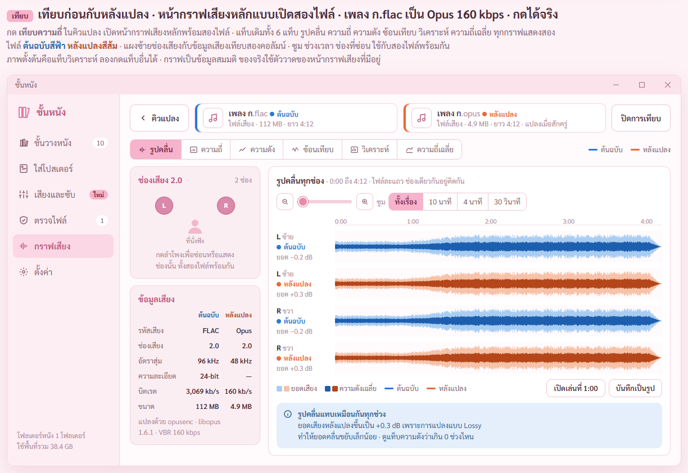
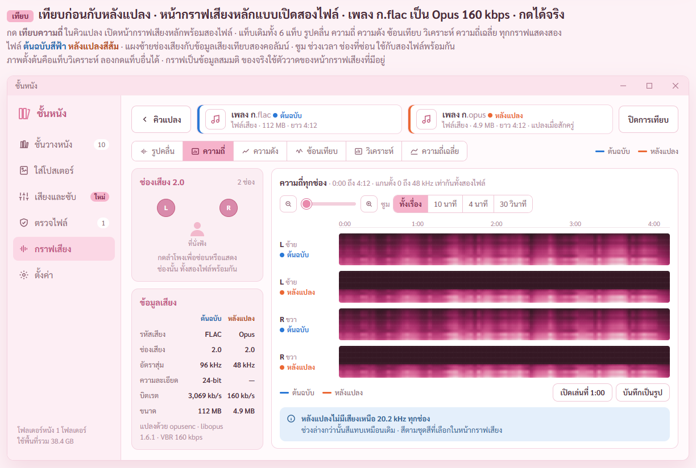
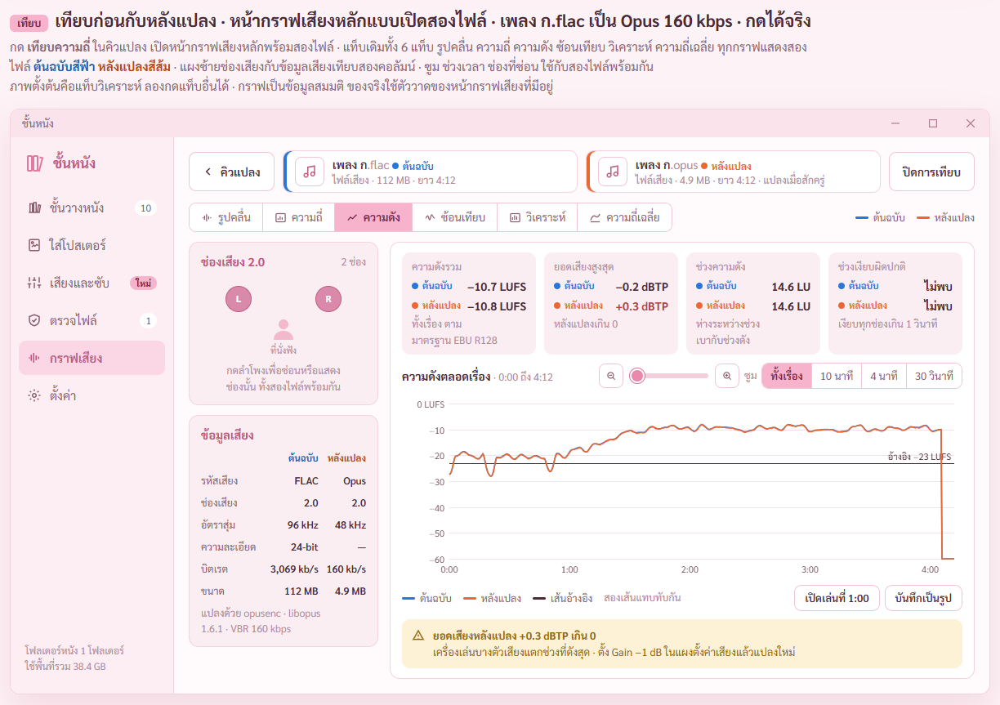
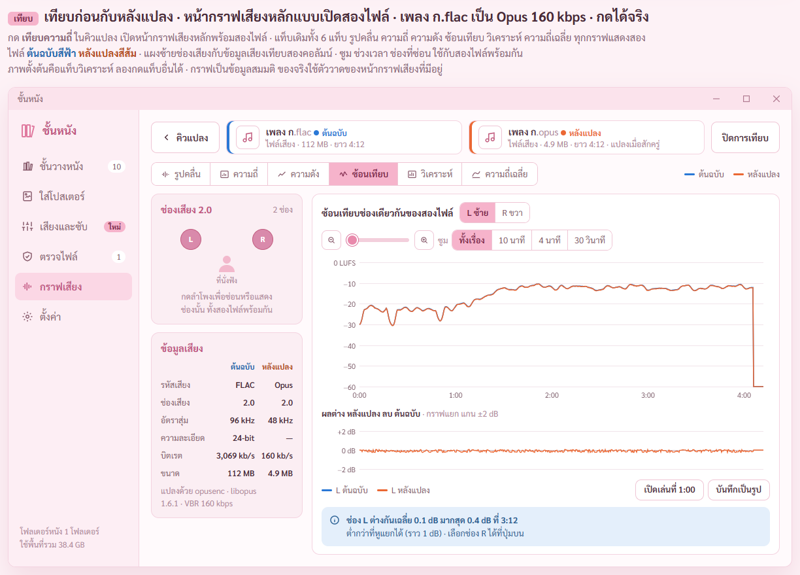

## 4. รายการภาษา ไทยกับอังกฤษอยู่บนสุด

พี่กันบอก *"ภาษา ถ้าจำไม่ผิด ใน mkvtool มันมีให้เลือกเยอะเลยนะ แต่ให้สองตัวใช้บ่อยคือ ไทย อังกิด"*

- กดช่องภาษาแล้วกางรายการ กลุ่ม **ใช้บ่อย** ไทย อังกฤษ อยู่บนสุด แบบ Often used languages ของ MKVToolNix เพิ่มภาษาเข้ากลุ่มนี้ได้ที่หน้าตั้งค่า
- ต่อด้วย ไม่ระบุภาษา (und) และทุกภาษาตามมาตรฐาน ISO 639 เรียงตามชื่ออังกฤษแบบ MKVToolNix ชื่อไทยคู่ชื่ออังกฤษ รหัสคู่ เช่น th · tha
- ช่องค้นพิมพ์ได้ทั้งชื่อไทย ชื่ออังกฤษ รหัส · ในมอคอัปพิมพ์ค้นได้จริง

ภาพอยู่ท้ายภาพ 01 (กรอบรายการภาษาใต้แถบรวมสี)

## 5. โปสเตอร์ในหน้าเสียงและซับ รวมรอบเดียว

พี่กันถาม *"หัวข้อ เสียงและซับ มันก็ใส่ภาพได้นะ ถ้าเธอแยกหัวข้อแบบนี้เราต้อง merge ไฟล์สองรอบเหรอ"* · ถามต่อ *"โปสเต้อคือภาพ ส่วนแทรกภาพก็คือโปสเต้อนี่ หรือเราเข้าใจผิด"* · แล้วบอก *"อ้อ หน้าใส่โปสเต้อ ยังคงเดิมนะ ไม่เปลี่ยน ตอนที่เอาไปรวมกับ ภาพและเสียง"*

- ตอบในแชท แยกหน้าแบบเดิมต้องทำสองรอบ (MP4 เขียนไฟล์ใหม่ทั้งไฟล์สองครั้ง) · แทร็กภาพคือตัวหนังที่เล่นบนจอ โปสเตอร์คือรูปแนบ คนละอย่าง
- หน้าเสียงและซับมีการ์ด **โปสเตอร์** ปกตั้ง cover.jpg กับปกนอน cover_land.jpg เปลี่ยน ครอปใหม่ เอาออก ลากรูปมาวางได้ ใช้หน้าครอปเดียวกับหน้าใส่โปสเตอร์ รูปเข้าไฟล์ใหม่ในคำสั่งรวมเดียวกับเสียงและซับ
- หน้าใส่โปสเตอร์คงเดิมทุกอย่าง เขียนไว้ในคำอธิบายหัวข้อ 1 ของมอคอัปแล้ว
- หัวข้อข้างใน ข้อรวม เพิ่มว่าโปสเตอร์ตั้งในคำสั่งเดียวกัน

ภาพอยู่ในภาพ 01 (การ์ดโปสเตอร์ใต้ตารางแทร็ก)

## 6. ซับตัวหนังสือดูแบบ notepad

พี่กันสั่ง *"ซับ sex ขอดูแบบ notepad ด้วย"* · แก้ว่า *"ซับ text ไม่ใช่ sex เขียนผิด ดั้งนั้นไม่ใช่แค่ ass"* · แล้วบอก *"ดูซับ อันเดิมที่เธอทำ ไม่เปลี่ยนนะ แค่่การดูแบบ notepad เพิ่มขึ้นมา"*

- แบบ Aegisub แบบอ่านยาว และซับรูป คงเดิมทุกตัวอักษร · ปุ่มสลับในแบบ Aegisub มีปุ่มที่สาม แบบ notepad
- กรอบ notepad เพิ่มล่างสุดของหัวข้ออ่านซับ เปิดไฟล์จริงทุกตัวอักษร มีเลขบรรทัด ช่องค้น ตัดบรรทัดยาว แถบล่างบอกบรรทัด คอลัมน์ จำนวนบรรทัด ชนิดขึ้นบรรทัด การเข้ารหัส
- ใช้ได้กับซับตัวหนังสือทุกชนิด ในมอคอัปกดสลับดูตัวอย่าง SRT ASS VTT ได้ · ASS เห็นส่วนหัว Script Info Styles Events และแท็กรูปแบบสีม่วง
- กรอบเลื่อนไปบรรทัดที่ค้นเจอเอง (แก้ระหว่างตรวจภาพ รอบแรกบรรทัดที่เจอตกขอบล่าง)

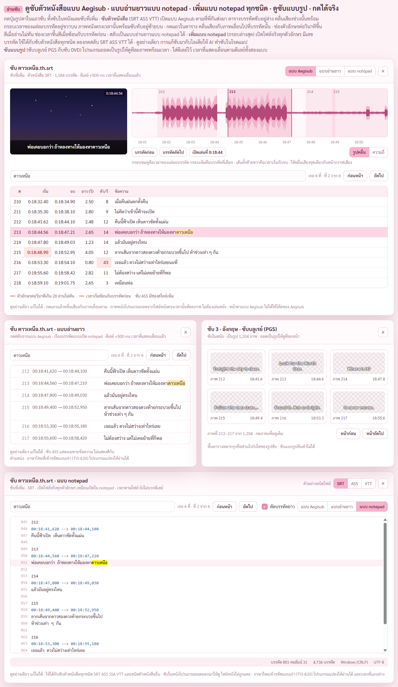
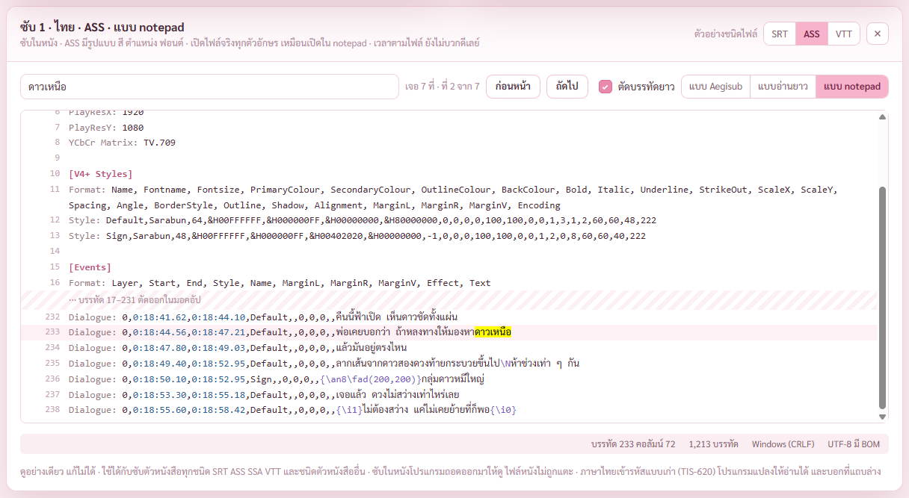
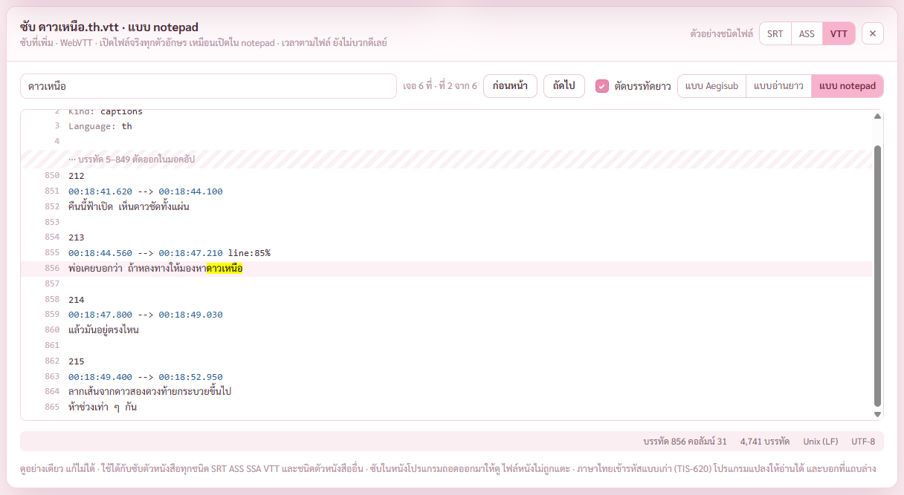

## 7. แผงตั้งค่าเสียง ปุ่ม ⓘ การ์ดละช่อง แถบเลื่อนเป็นขั้น ขนาดที่คาด

พี่กันสั่ง *"ขอเพิ่มจุดนึง มีปุ่มหลังแต่ละตัว เป็นเหมือน infor ที่กดแล้วจะมี popup เล็กๆอธิบายว่าสิ่งนี้คืออะไร หลัง bitrate หลัง complex tuning และอื่นๆ และสอนว่าปรับแบบนี้ จะได้อะไร ข้อดีข้อเสีย"* · เพิ่ม *"Lossy lossless ด้วย มีบอกทั้งหมดเลย ถ้าเป็นได้"*
แล้วเสนอ *"เธอว่า ทำเป็นการ์ดแต่ละอันดีไหม เพราะแบบนี้เราจะงงๆว่า 384 kpbs มันอยู่ในการ์ดไหน และแถบเส้นต่างๆ เราขอเป็นช่วงหน่อย ไม่ใช่เส้นที่ลื่นไหล ... หรือถ้ามีแบบเลือกได้ ก็มีช่องให้กรอกแบบแมนนวลเลย แถมทั้งหมด คนรวนขนาดไฟล์ไว้ให้ดูล่วงหน้าได้"* · แคลร์เห็นด้วย ทำเลย
พี่กันถาม *"แต่ละ codec มันตั้งค่าไม่เหมือนกันนี่นา แปลว่าแต่ละหน้ามันไม่เหมือนกัน"* · ตอบในแชท กรอบแผงเหมือนกันทุกชนิด การ์ดขั้นสูงต่างกันตามชนิด และตามตัวแปลงด้วย มอคอัปแสดงของตัวแปลงตัวแรก เขียนบอกไว้ที่แถว Encoder แล้ว

- **ปุ่ม ⓘ** หลังชื่อทุกช่อง รวม Codec · Lossy · Lossless · ชนิดที่เลือก (Opus AAC MP3 AC-3 FLAC WavPack Monkey's Audio) · Encoder · Gain · Loudness normalize · การ์ดขั้นสูงทุกใบของทุกชนิด
  - กดแล้วกางกล่องบอก คืออะไร · ปรับแบบไหนได้อะไร พร้อมข้อดีข้อเสียของแต่ละทาง · แนะนำค่าไหน
  - กดซ้ำ กดที่อื่น หรือกด Esc ปิด
  - วางตามกฎ popup-fit วัดที่ว่างทุกครั้งที่กาง ล่างพอกางลง บนพอกางขึ้น ไม่พอทั้งคู่ค่อย ๆ เลื่อนหน้าแล้วกางลงเต็ม เลื่อนไม่ได้เลือกฝั่งที่กว้างกว่าแล้วเลื่อนในกล่อง ไม่ล้นซ้ายขวา
- **การ์ดละช่อง** ชื่อ ปุ่ม ⓘ และค่าอยู่หัวการ์ดเดียวกัน
- **แถบเลื่อนเป็นขั้น** ตามค่าที่ตัวแปลงใช้ได้จริง ขีดทุกขั้น ตัวเลขใต้ขั้นหลัก
  - Opus 6 ถึง 512 kbps 17 ขั้น · AAC TVBR ขั้นละราว 9 (0 9 … 91 100 109 118 127) · MP3 V0–V9 · MP3 CBR 32–320 · AC-3 32–640 ตามบิตเรตมาตรฐาน · FLAC Level 0–8 · Gain −12 ถึง +12 dB
- **ช่องพิมพ์ค่าเอง** ทุกแถบเลื่อน · Opus พิมพ์ 300 ได้ แถบชี้ขั้น 320 ที่ใกล้สุด ขนาดคิดจาก 300 · AAC TVBR พิมพ์ 95 ปัดเป็น 91 แบบที่ตัวแปลงปัดจริง · พิมพ์เกินช่วงบีบให้อยู่ในช่วง
- **ขนาดที่คาด** ทุกการ์ด การ์ดที่เปลี่ยนขนาดคิดให้ทันทีตามค่า การ์ดที่ไม่เปลี่ยนเขียนว่า ไม่เปลี่ยนขนาดไฟล์ · หัวแผงบอกขนาดรวมตามการ์ดหลัก · ชุดค่าแบบง่ายบอกขนาดทั้งแทร็กทุกชุด
  - สูตร แทร็กยาว 2 ชั่วโมง 08 นาที บิตเรต 1 kbps ราว 0.96 MB · Lossless คิดเป็นเปอร์เซ็นต์ของ WAV 6.2 GB · ขนาดเป็นค่าประมาณ เขียนบอกที่ท้ายแผง

ตรวจ ตัวทดสอบกล่องคำอธิบายกับช่องค่า ผ่าน 19 จาก 19 ข้อ บนหน้าต่าง 1300 × 620 กับ 1300 × 420
- ปุ่มล่างจอกางขึ้น · ปุ่มบนจอกางลง · จอเตี้ยเลื่อนหน้าแล้วกางลงเต็ม ปุ่มยังอยู่ในจอ · ไม่ล้นขอบทุกกรณี · กดซ้ำ กดที่อื่น Esc ปิดได้
- แถบเลื่อนกับช่องพิมพ์ ขนาดที่คาดเปลี่ยนตามทั้งในการ์ดและหัวแผง · MP3 มีปุ่ม ⓘ ครบ 13 ปุ่ม
- กล่องเตือนสีฟ้าทุกกล่องในหน้ากว้างปกติ · ข้อผิดพลาดในหน้า 0 (มีตัวเก็บแล้ว)
- ตัวทดสอบจับของผิดได้จริง รอบแรกไม่ผ่านข้อจอเตี้ย กล่องยื่นเลยขอบล่าง 20 จุด แก้แล้วผ่าน
- ยังไม่ได้ตรวจ ทางเลือกสุดท้ายของกฎ (เลื่อนหน้าไม่ได้แล้ว) เพราะหน้ามอคอัปยาว เลื่อนได้เสมอ

แก้ระหว่างตรวจภาพ
- คลาสปุ่ม ⓘ ชื่อ info ชนกับกล่องเตือน .stat.info กล่องเตือนสีฟ้าหดเหลือแถบแคบ ตัวหนังสือเรียงลงมาทับการ์ด Gain · เปลี่ยนชื่อเป็น infob และเพิ่มข้อตรวจกล่องเตือนในตัวทดสอบ
- ช่องค่า VBR quality ตัว V กับเลขห่างกันเหมือนคนละช่อง · ให้ช่องกว้างตามจำนวนหลัก
- ตัว V หน้าค่าใช้คลาสเดียวกับการ์ดชุดค่าแบบง่าย เปลี่ยนชื่อก่อนถ่ายภาพ
- กล่อง AAC คำว่า รุ่น ตกบรรทัดคำเดียว · ตั้งให้ตัดบรรทัดสวยขึ้น

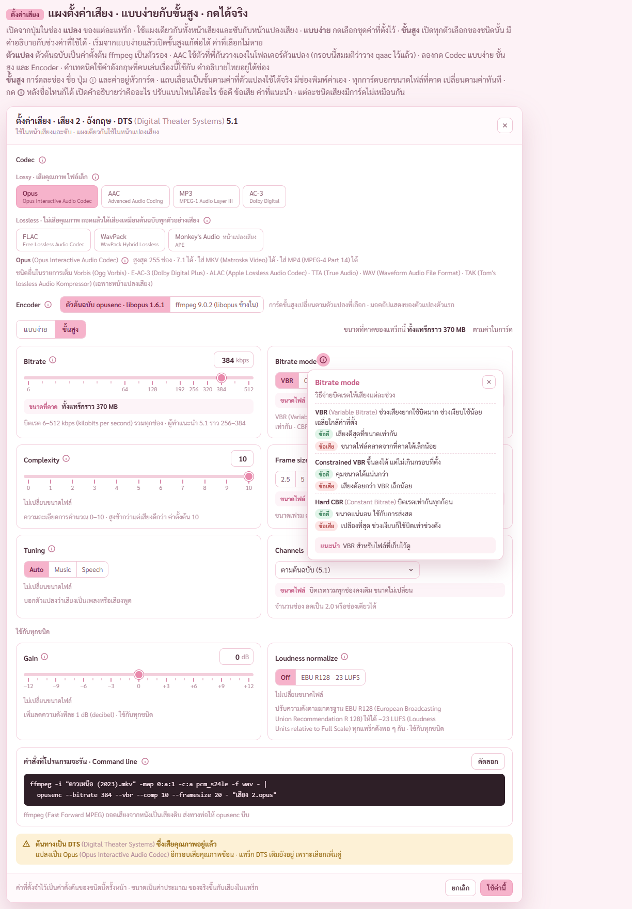
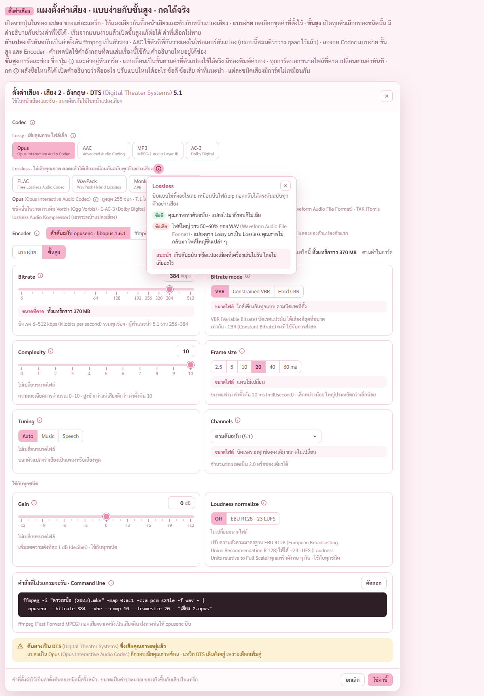
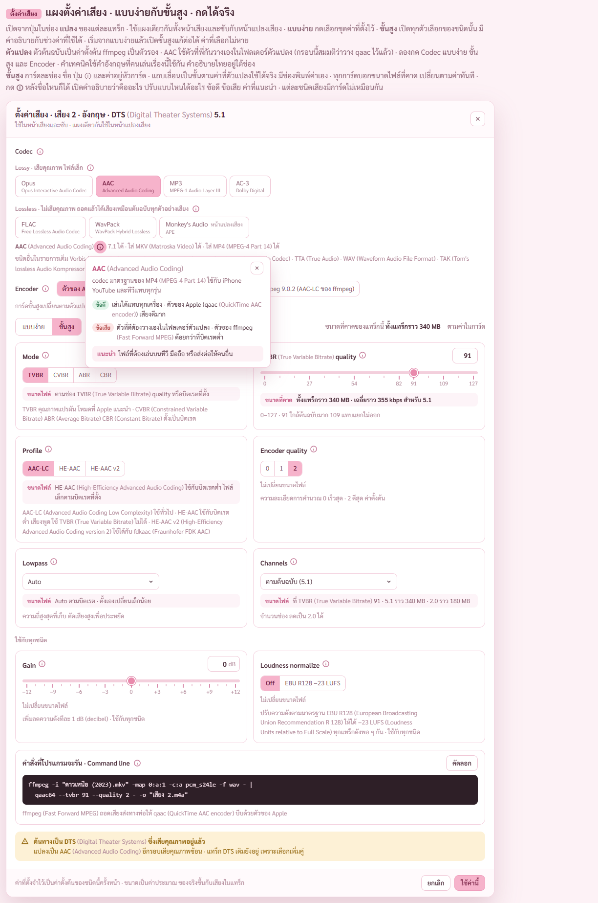

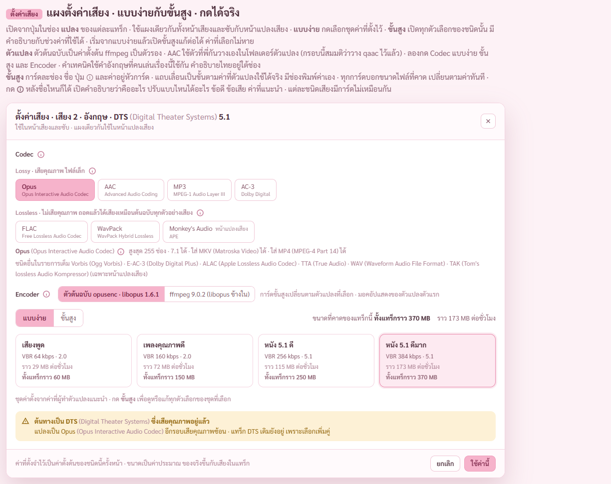

## 8. ตัวย่อมีคำเต็ม ชื่อ codec เต็ม และคำสั่งที่โปรแกรมจะรัน

พี่กันสั่ง (ส่งภาพกล่อง ⓘ ของ Bitrate mode) *"ตัวย่อทุกตัวในนี้ วงเล็บคำเต็มด้วย"* · *"ชื่อ codec ทั้งหมดใส่ ชื่อเต็มด้วย"* · *"อีกเรื่อง ถ้าจำไม่ผิด ตอนที่เราปรับความละเอียดเสียงขั้นสูง มันจะได้ code มาด้วย เราอยากให้แสดงด้วย"*

- **ตัวย่อ** มีคำเต็มในวงเล็บตอนที่ขึ้นครั้งแรกในแต่ละการ์ด แต่ละกล่อง ⓘ และแต่ละบรรทัด ไม่ซ้ำจนรก
  - เช่น VBR (Variable Bitrate) · TVBR (True Variable Bitrate) · HE-AAC (High-Efficiency Advanced Audio Coding) · kbps (kilobits per second) · LUFS (Loudness Units relative to Full Scale) · EBU R128 · Dialnorm (Dialogue Normalization) · ffmpeg (Fast Forward MPEG)
  - ปุ่มเลือก ค่าตัวเลข และชุดค่าแบบง่าย คงตัวย่อ เพราะการ์ดกับกล่อง ⓘ ข้างล่างมีคำเต็มแล้ว
  - ชื่อการ์ด Bitrate (ABR, CBR) ของ MP3 เปลี่ยนเป็น Bitrate ของ ABR กับ CBR ไม่ให้วงเล็บซ้อนวงเล็บ
  - การ์ด Gain Loudness normalize กับ Profile เขียนคำอธิบายใหม่ให้มีตัวย่อที่อยู่ในปุ่ม จะได้มีคำเต็มด้วย
- **ชื่อ codec เต็ม** ปุ่มเลือกชนิดเป็นสองบรรทัด ชื่อย่อกับชื่อเต็ม · บรรทัดของชนิดที่เลือกและรายการชนิดอื่นมีชื่อเต็ม · แถบสีชนิดไฟล์หัวข้อ 1 มีชื่อเต็มครบ 26 ชนิด · ป้ายชนิดในตารางแทร็กชี้แล้วขึ้นชื่อเต็ม
- **คำสั่งที่โปรแกรมจะรัน** กล่องใต้การ์ดขั้นสูง เปลี่ยนตามค่าในการ์ดทันที มีปุ่มคัดลอก และปุ่ม ⓘ
  - ตัวต้นฉบับ ffmpeg ถอดเสียงจากหนังเป็นเสียงดิบ 24-bit ส่งทางท่อให้ตัวแปลง เช่น `opusenc --bitrate 384 --vbr --comp 10 --framesize 20` · `qaac64 --tvbr 91 --quality 2` · `lame -V 2 -q 3 -m j` · `flac -5 -j 8 -V`
  - เลือก ffmpeg เป็นตัวแปลง คำสั่งเปลี่ยนเป็นคำสั่งเดียว เช่น `-c:a libopus -b:a 384k -vbr on`
  - Gain กับ Loudness normalize เข้าไปอยู่ในคำสั่ง ffmpeg ส่วนถอดเสียง · MP3 มี `-ac 2` เพราะเก็บได้ 2 ช่อง · Monkey's Audio ถอดเป็น WAV ชั่วคราวก่อน
  - ใต้กล่องบอกว่าคำสั่งทำอะไร · ชื่อไฟล์ในภาพย่อไว้ ของจริงเป็นที่อยู่เต็ม

ตรวจ ตัวทดสอบผ่าน 28 จาก 28 ข้อ (เพิ่มจากรอบก่อน 9 ข้อ)
- คำสั่ง MP3 Opus AAC FLAC ตรงค่าในการ์ด · กด Hard CBR เลื่อนเป็น 128 ลด Gain 1 dB แล้วคำสั่งเปลี่ยนตามทันที · เลือก ffmpeg ได้คำสั่ง libopus
- การ์ด Bitrate mode มีคำเต็มของ VBR กับ CBR · กล่อง ⓘ ขยาย VBR ครั้งเดียว · ปุ่มชนิดมีชื่อเต็มครบ 7 ปุ่ม
- เจอบั๊กระหว่างทดสอบ กด Hard CBR แล้วเปลี่ยนตัวแปลง ปุ่มกลับเป็น VBR เอง เพราะค่าที่เลือกเก็บไว้แค่บนจอ · แก้ให้จำค่าที่เลือกไว้ ไม่หายเมื่อแผงวาดใหม่
- ยังไม่ได้ตรวจ ว่าคำสั่งรันได้จริงกับตัวแปลงทุกตัว เพราะยังไม่ได้โหลดตัวแปลงต้นฉบับ (รอพี่กันอนุญาตตอนเริ่มทำจริง) · ตัวเลือกเขียนตามคู่มือของแต่ละตัว

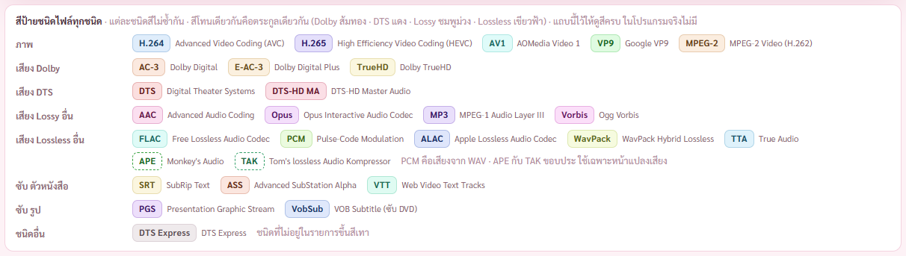

## ที่แคลร์ทำพลาดรอบนี้

- จดเรื่องคงคำอังกฤษลงโรดแมป ทั้งที่เป็นงานที่สั่งทำตอนนี้ · พี่กันทัก *"ไม่ต้องจดลงโร๊ดแมพ นี่งานตอนนี้ ก็เรียงคิวสิ"* · เอาออกจากโรดแมปแล้ว
- เดาว่า sex คือ ASS · พี่กันแก้ว่าเป็น text · ทำให้ครบทุกชนิดแล้ว
- เอากรอบแบบอ่านยาวเดิมออกแล้วใส่ notepad แทน · พี่กันทัก · คืนกรอบเดิมกลับทุกตัวอักษรแล้ว
- ข้อความคั่นระหว่างทำงานหลุดเป็นภาษาอังกฤษ 4 ครั้ง บอกพี่กันเป็นภาษาไทยแล้วทุกครั้ง
- รายงานรอบก่อนบอกว่าข้อผิดพลาดในหน้า 0 ทั้งที่หน้ายังไม่มีตัวเก็บ · ใส่ตัวเก็บแล้ว ตรวจใหม่ได้ 0 จริง
- ทำกล่องคำอธิบายรอบแรกข้ามขั้นเลื่อนหน้าของกฎ popup-fit จอเตี้ยกล่องยื่นเลยขอบล่าง · ตัวทดสอบจับได้ แก้แล้ว
- ตั้งชื่อคลาสปุ่ม ⓘ ชนกับกล่องเตือนที่มีอยู่ · เจอตอนตรวจภาพ แก้ก่อนส่ง
