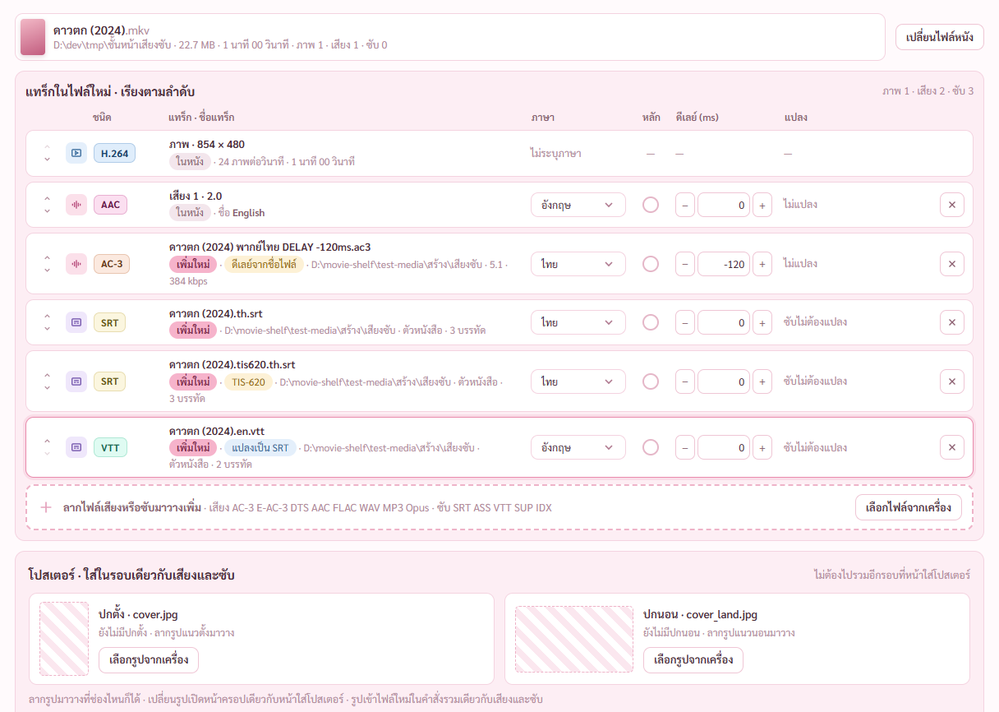
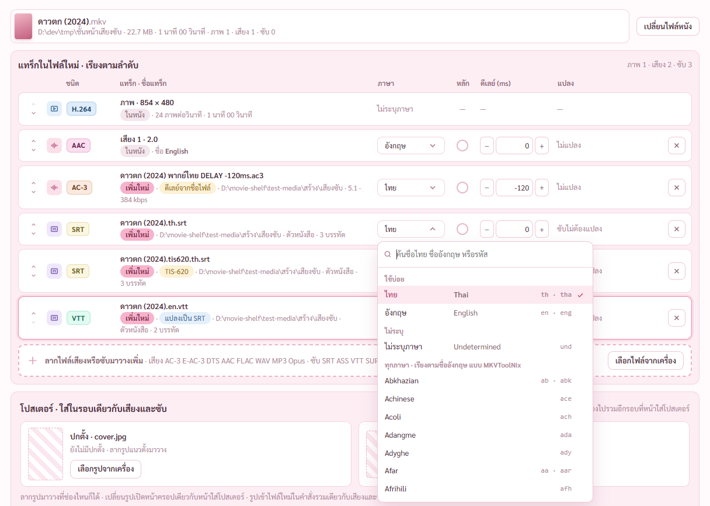
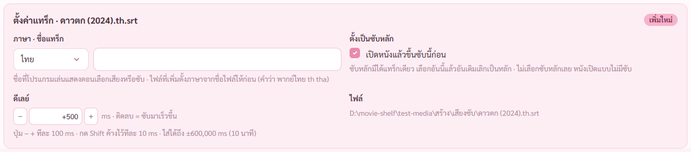
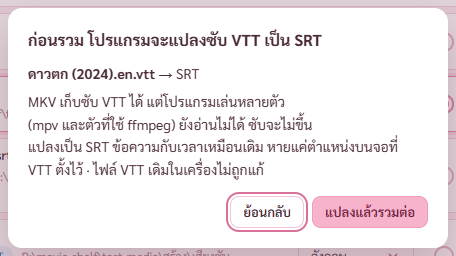
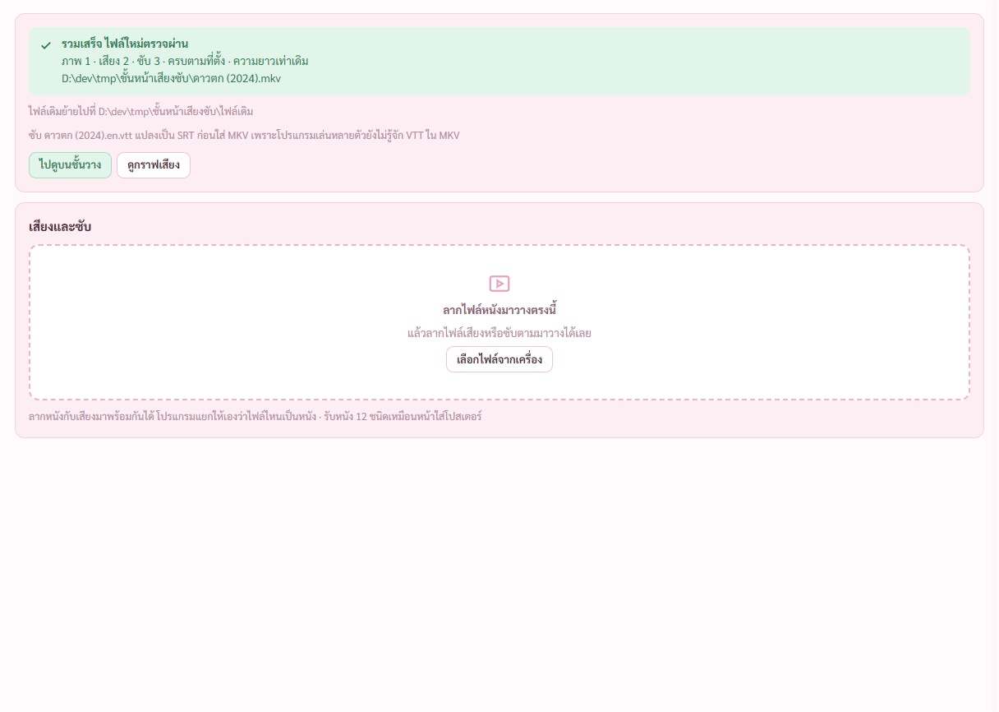
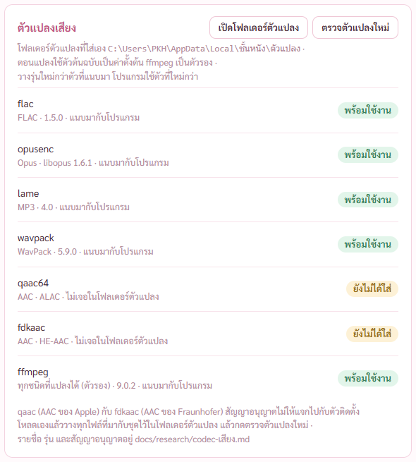
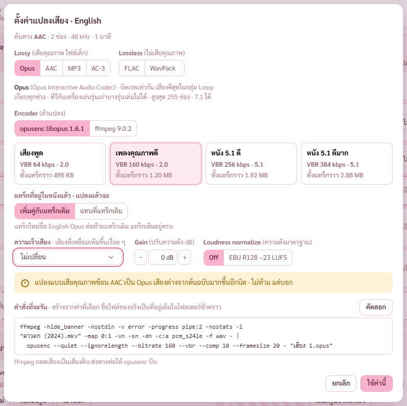

# รายงาน 7 พ.ย. 2569 · ลงโปรแกรมหน้าเสียงและซับ ขั้น 0 ถึง 4 ส่วนแรก

พี่กันสั่ง *"Commit เสร็จ เอาลงโปรแกรมให้เสร็จเลย / เทสด้วย / และถ้าเสร็จแล้วรันเอเจ้น 1 ตัวตรวจสอบ"*
แล้วให้เวลา *"เราให้ทำถึง 23.50 นะ แล้ว commit ล่าสุดแค่ไหนแค่นั้น"*

แผน 11 ขั้น (ขั้น 0 ถึง 10) อยู่ไฟล์แผนที่พี่กันอนุมัติ · คืนนี้ทำถึงขั้น 4 ส่วนแรก commit ทุกขั้น ยังไม่ push
ทุกการตรวจรันกับโปรแกรมแบบเปิดอยู่หลังสุด ถ่ายภาพผ่าน CDP ไม่มีอะไรเด้งขึ้นจอ · ไม่แตะไฟล์หนังจริงของพี่กัน

| ขั้น | commit | สถานะ |
|---|---|---|
| 0 เตรียม | `1d36aff` | เสร็จ |
| 1 แกนงานรวมฝั่ง Rust | `b69ec25` | เสร็จ |
| 2 หน้าเสียงและซับ | `93bc86d` | เสร็จ (ปุ่มหาดีเลย์ ดูซับ จับคู่ อยู่ขั้น 5 6 7) |
| 3 ตัวแปลงเสียงฝั่ง Rust | `5fb4822` | เสร็จ |
| 4 แผงตั้งค่าเสียง | `0d5795f` | ส่วนแรก การ์ดตัวแปลงในหน้าตั้งค่า · แผงตั้งค่าเสียงยังไม่ได้ทำ |
| 5 ถึง 10 | | ยังไม่เริ่ม |

ผลตรวจล่าสุด เทส Rust 84/84 · ตัวตรวจคำสั่งรวม 20/20 · ตัวตรวจหน้าเสียงและซับ 23/23 · ตัวตรวจหน้าใส่โปสเตอร์เดิม 61/61

## 1. ขั้น 0 เตรียม · `1d36aff`

พี่กันอนุญาตโหลด *"โหลดเลย / และ mp3 เอาล่าสุด ล่าสุดทุกตัว"* · แหล่ง *"ชุดที่คนในวงการทำ (แนะนำ)"*

- ตัวแปลงที่แนบลงโปรแกรม เช็ก SHA-256 ทุกไฟล์ จดใน [vendor/README.md](../vendor/README.md)
  - flac 1.5.0 · opusenc (libopus 1.6.1) · LAME 4.0 · wavpack 5.9.0 · Monkey's Audio 13.45
- Monkey's Audio ชุดที่โหลดมาไม่มีตัวแปลงแบบคำสั่ง (MAC.exe) มีแต่ MACDll64.dll · โปรแกรมจะเรียก DLL ตรงในขั้น 8 ไม่ต้องโหลดเพิ่ม
- ไฟล์ซับตัวอย่างตามที่พี่กันสั่ง *"PGS VOB srt ass vtt เราไม่มีตอนนี้ เธอลองค้น Google เลย ลองหามา ในเว็บที่เชื่อถือ"*
  โหลดจากคลังตัวอย่างทางการของ FFmpeg 11 ไฟล์ แหล่งกับ hash อยู่ [test-media/README.md](../test-media/README.md)
- ไฟล์ทดสอบชุดเสียงซับ 14 ไฟล์ พากย์ไทย 5.1 ที่เลื่อนจริง 120 ms · เสียง PAL 25 fps · ซับ SRT ASS VTT และ TIS-620 · FLAC 96 kHz 24 บิตมีปก · MKV ซับรูป PGS VobSub · MKV ฟอนต์แนบ
- แยกเครื่องช่วยทำไฟล์ใหม่ออกจากหน้าใส่โปสเตอร์ ใช้ร่วมกับหน้าใหม่ ตัวตรวจหน้าใส่โปสเตอร์ยังผ่าน 61/61 เท่าเดิม

## 2. ขั้น 1 แกนงานรวมฝั่ง Rust · `b69ec25`

- รวมเสียง ซับ ปกตั้ง ปกนอน เข้าไฟล์หนังในคำสั่งเดียว เป็น MKV (mkvmerge) หรือ MP4 (ffmpeg)
- อ่านดีเลย์จากชื่อไฟล์ (DELAY -120ms) กับภาษาจากชื่อไฟล์ (พากย์ไทย .th. .eng.) · ซับไทย TIS-620 อ่านถูก
- ตรวจไฟล์ใหม่เทียบที่สั่ง ลำดับ ชนิด ภาษา ชื่อ แทร็กหลัก ไฟล์แนบ ปก ความยาว · ไม่ผ่านลบไฟล์ใหม่ ไฟล์เดิมไม่ถูกแตะ
- เช็กไฟล์ถูกเปิด ที่ว่าง ชื่อซ้ำ ก่อนเริ่ม · กดหยุดได้ ไฟล์ทำค้างลบเอง · ไฟล์เดิมย้ายไปโฟลเดอร์ไฟล์เดิม hash เท่าเดิม
- เจอระหว่างเทส ซับ VTT ที่ใส่ MKV ตรง ๆ ffmpeg 9 อ่านไม่ได้ (mpv จะไม่เห็นซับ) · โปรแกรมแปลง VTT เป็น SRT ก่อนใส่

## 3. ขั้น 2 หน้าเสียงและซับ · `93bc86d`

เมนูซ้ายหน้าใหม่ต่อจากใส่โปสเตอร์ · ปุ่มในแผงขวาของชั้นวางคู่กับกราฟเสียง

ลากหนังกับพากย์ไทย ซับ 3 ไฟล์มาพร้อมกัน โปรแกรมแยกเองว่าไฟล์ไหนเป็นหนัง · ป้ายชนิดสีต่างกันตามที่พี่กันสั่ง *"ไม่ได้หมายถึงแค่ชนิดพวกนี้ แต่ทุกตัว และใส่สีต่างกันด้วย"*

รายการภาษาแบบ MKVToolNix ตามที่พี่กันบอก *"ใน mkvtool มันมีให้เลือกเยอะเลยนะ แต่ให้สองตัวใช้บ่อยคือ ไทย อังกิด"* · ครบ 1,003 ภาษาจาก MKVToolNix ไทย อังกฤษ บนสุด พิมพ์ค้นได้ ลืมสลับแป้นก็หาเจอ

การ์ดตั้งค่าแทร็ก ภาษา ชื่อ แทร็กหลัก ดีเลย์ (ปุ่มละ 100 ms กด Shift ละ 10 ms)

ปกตั้งปกนอนอยู่ในหน้านี้ รวมรอบเดียว ตามที่พี่กันถาม *"ถ้าเธอแยกหัวข้อแบบนี้เราต้อง merge ไฟล์สองรอบเหรอ"* · ใช้หน้าครอปเดียวกับหน้าใส่โปสเตอร์ หน้าใส่โปสเตอร์คงเดิม

หน้าต่างที่พี่กันสั่งระหว่างทำ *"ระบบจะต้องบอกด้วยนะ ว่าก่อนจะรวม ระบบจะ แปลง vtt เป็น srt เป็น popup ขึ้นก็ได้"*

รวมเสร็จ ไฟล์ใหม่ตรวจผ่าน ไฟล์เดิมย้ายไปโฟลเดอร์ไฟล์เดิม

ปุ่มเสียงและซับในแผงขวาของชั้นวาง

- ไปหน้าอื่นแล้วกลับมา แทร็ก ลำดับ ดีเลย์ ปก ยังอยู่ครบ (ตัวตรวจข้อนี้ผ่าน)
- เจอในภาพแล้วแก้ แถบแจ้งเรื่องซับ TIS-620 ค้างบนจอ บังรายการภาษากับช่องปก · เอาออก ข้อความอยู่ที่ป้ายในแถวแทน

## 4. ขั้น 3 ตัวแปลงเสียงฝั่ง Rust · `5fb4822`

- แปลงได้ 7 ชนิด Opus MP3 FLAC WavPack ด้วยตัวต้นฉบับ (ffmpeg ถอดเสียงส่งทางท่อ) · AC-3 E-AC-3 AAC ด้วย ffmpeg · ทุกชนิดมีแบบ ffmpeg ล้วนเป็นตัวรอง
- ความเร็ว 25 → 23.976 ยืดด้วย rubberband ระดับเสียงไม่เพี้ยน (เทสยืดเสียง PAL 57.57 วินาทีได้ 60.03) · Gain · ความดังมาตรฐาน EBU R128
- แปลงตอนรวม แทร็กในหนังเพิ่มคู่กับแทร็กเดิมเป็นค่าตั้งต้นตามที่พี่กันเคาะ หรือแทนที่ · ไฟล์ที่เพิ่มแปลงแทนที่
- คำสั่งที่จะรันสร้างที่เดียว หน้าจอจะเรียกมาแสดงในแผงตั้งค่าเสียง คำสั่งที่เห็นคือคำสั่งที่รันจริง
- เจอบั๊กระหว่างเทส แปลง AC-3 แบบตั้งชนิดห้อง ffmpeg ไม่ยอมทำ · แก้แล้ว
- qaac กับ fdkaac (AAC ของ Apple กับ Fraunhofer) ใส่เองในโฟลเดอร์ตัวแปลงได้ ยังไม่ได้ลอง เพราะไม่มีในเครื่อง

## 5. ขั้น 4 ส่วนแรก การ์ดตัวแปลงเสียงในหน้าตั้งค่า · `0d5795f`

- รุ่นอ่านจากตัวแปลงจริง ไม่ใช่ตัวเลขที่พิมพ์ไว้ · ปุ่มเปิดโฟลเดอร์ตัวแปลง ตรวจตัวแปลงใหม่
- เจอในภาพแล้วแก้ บรรทัดขึ้นต้นด้วยจุดคั่น ·

### แผงตั้งค่าเสียง แบบง่าย (commit ถัดจากรายงานนี้)

กดช่องแปลงของแถวเสียง แผงขึ้น · เลือกชนิด Lossy หรือ Lossless · ตัวแปลง (ตัวต้นฉบับเป็นค่าตั้งต้น) · ชุดค่า 4 ชุดพร้อมขนาดทั้งแทร็ก · แทร็กในหนังเลือกเพิ่มคู่หรือแทนที่ · เตือนแปลงเสียคุณภาพซ้อน · คำสั่งที่จะรันจริงพร้อมปุ่มคัดลอก ตามที่พี่กันขอ *"ตอนที่เราปรับความละเอียดเสียงขั้นสูง มันจะได้ code มาด้วย เราอยากให้แสดงด้วย"*

- เทสผ่านหน้าจอจริง ตั้งเสียงอังกฤษแปลงเป็น Opus 160 เพิ่มคู่ แล้วรวม ไฟล์ใหม่ได้ AC-3 ไทยหลัก · AAC อังกฤษ · Opus อังกฤษ (English Opus) · ซับ 3
- ตัวตรวจจับบั๊กได้ แผงเปิดก่อนรายชื่อตัวแปลงมา ค้างเป็น ffmpeg ทั้งที่มี opusenc · แก้แล้ว
- เจอในภาพแล้วแก้ กรอบปุ่มเลือกยืดเต็มกว้าง · คำสั่งตัดบรรทัดหลังขีด -i

ความเร็วเสียง (25 → 23.976 และคู่อื่น) · Gain · ความดังมาตรฐาน EBU R128 ใช้กับทุกชนิด คำสั่งเปลี่ยนตามทันที

## 6. งานค้าง

- **ขั้น 4 ส่วนที่เหลือ** แผงแบบขั้นสูง การ์ดละช่อง แถบเลื่อนเป็นขั้น ช่องพิมพ์ค่าเอง ขนาดที่คาดทุกการ์ด ⓘ ทุกช่อง ตัวย่อมีคำเต็ม
- ขั้น 5 ตัวช่วยหาดีเลย์ · ขั้น 6 ตัวดูซับ · ขั้น 7 จับคู่ไม่รวม · ขั้น 8 หน้ากราฟเสียง คิวแปลง เทียบ Monkey's Audio · ขั้น 9 เทสรวมกับตัวติดตั้ง · ขั้น 10 ผู้ช่วยตรวจ 1 ตัว
- บวกขนาดไฟล์ที่แปลงในการเช็กที่ว่างก่อนรวม
- จดโรดแมปตามที่พี่กันแทรก *"ระบบ OCR จากซับภาพเป็น text โดยใช้ระบบแมนนวลคือกรอกเอง และระบบที่ให้ AI ช่วย"* · อยู่ [ROADMAP.md](ROADMAP.md) หัวข้อท้ายสุด

## 7. พี่กันต้องทำเอง

- ลากไฟล์จาก Explorer มาวางหน้าเสียงและซับหนึ่งครั้ง (ตัวตรวจลากจริงไม่ได้)
- กดปุ่มเปิดโฟลเดอร์ตัวแปลงในหน้าตั้งค่าหนึ่งครั้ง (เปิด Explorer ขึ้นจอ ตัวตรวจไม่กดตอนพี่กันไม่อยู่)
- push เมื่อพี่กันสั่ง

## 8. ที่แคลร์ทำพลาดคืนนี้

- พิมพ์สคริปต์ลงในคำสั่ง Bash ตรง ๆ หลายครั้ง เครื่องหมาย \ หาย คำสั่งพังหรือตัวตรวจขึ้นไม่ผ่านทั้งที่หน้าจอถูก · แก้ในไฟล์แล้วทุกที่ · CLAUDE.md เตือนเรื่องนี้ไว้ รอบหน้าเขียนเป็นไฟล์ทุกครั้ง
- ตัวตรวจหน้าใส่โปสเตอร์เดิมเขียนภาพทับรายงานวันที่ 6 พ.ย. ทุกครั้งที่รัน คืนเป็นของเดิมก่อน commit ทุกรอบ
- ข้อความคั่นระหว่างทำงานหลุดเป็นภาษาอังกฤษ 2 ครั้ง บอกพี่กันเป็นภาษาไทยแล้ว
