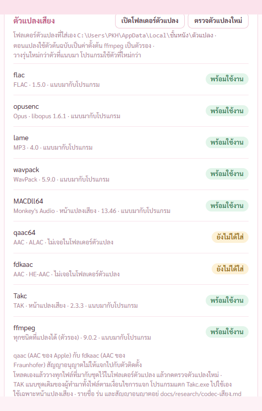
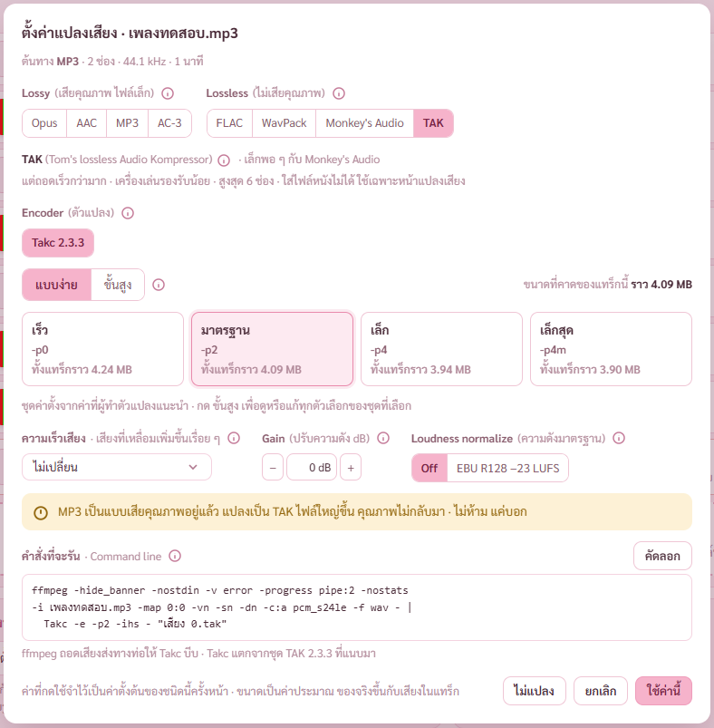
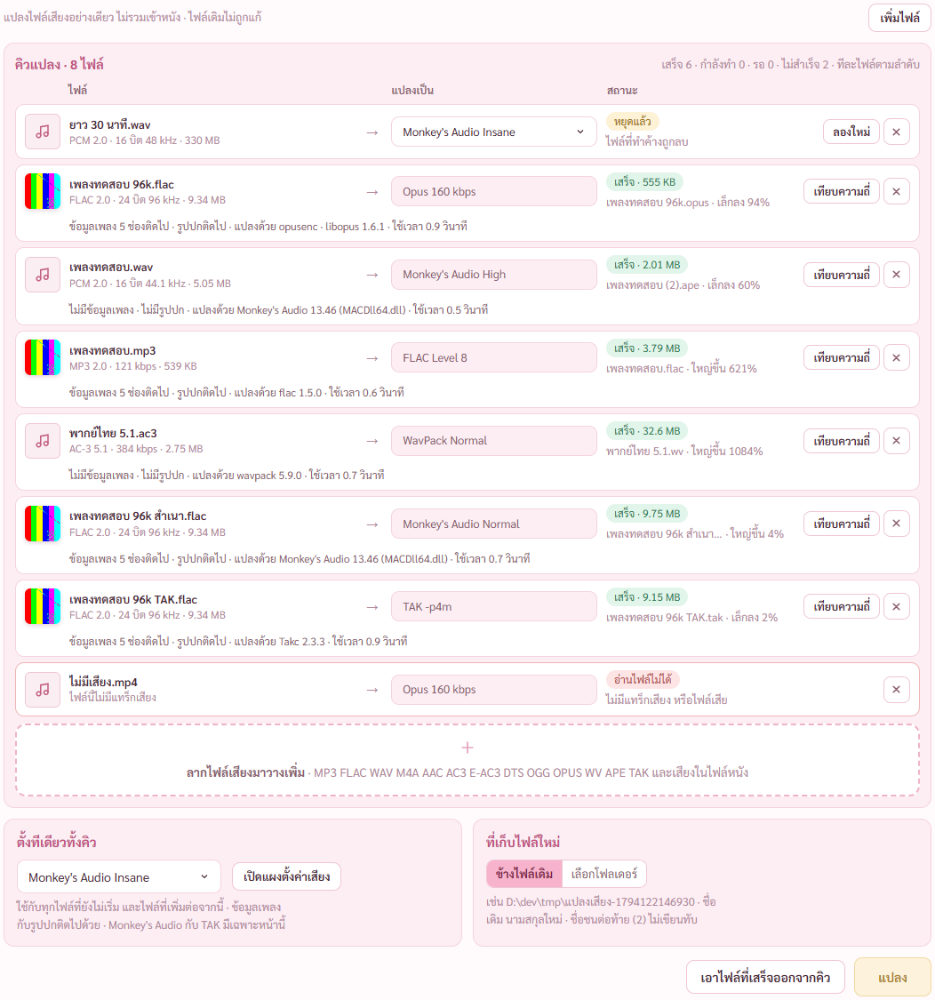

# รายงาน 8 พ.ย. 2569 · Monkey's Audio 13.46 ตัวจริง กับ TAK แนบมากับโปรแกรม

พี่กันสั่ง *"จัดเลย / ลิง เอาไงงง ไปหามา"* ต่อจากที่แคลร์บอกว่า MACDll64.dll ในชุด SDK ไม่ใช่รุ่นที่เขียนบนกล่อง และยกคำสั่งเดิม *"ลิง และ TAK เอามาด้วยนะ"* ที่แคลร์ยังไม่ได้ทำ

## 1. สรุป

| เรื่อง | ก่อน | หลัง |
|---|---|---|
| Monkey's Audio ตัวที่ใช้แปลง | MACDll64.dll จากชุด SDK 13.45 ข้างในเป็นรุ่น 12.36 | MACDll64.dll **13.46** จากตัวติดตั้งของผู้ทำ ลายเซ็นถูกต้อง |
| TAK | ต้องวาง Takc.exe เอง ไม่เคยลองกับของจริง | แนบชุด TAK 2.3.3 มาทั้งไฟล์ โปรแกรมแตก Takc.exe เอง แปลงจริงผ่าน |
| เทส Rust | 104 | 105 (เพิ่มเทสแปลง TAK จริง) |
| ตัวตรวจหน้าแปลงเสียง | 40 | 41 (เพิ่มแถวแปลงเป็น TAK ในคิว) |

## 2. Monkey's Audio 13.46

- หน้าเว็บผู้ทำขึ้นรุ่น **13.46** แล้ว ออกวันที่ 7 พ.ย. 2569 ห้าทุ่มกว่าเวลาไทย ห่างจากตอนที่แคลร์โหลดชุด 13.45 แค่ชั่วโมงครึ่ง
- ชุด SDK 13.46 ก็ยังแนบ MACDll64.dll ไฟล์เก่ารุ่น 12.36 ไฟล์เดียวกับชุด 13.45 ทุกไบต์ ผู้ทำอัปเดตโค้ดแต่ไม่ได้สร้างไฟล์ตัวแปลงใหม่ใส่ชุด
- ตัวที่ตรงรุ่นจริงอยู่ในตัวติดตั้ง MAC_1346_x64.exe แคลร์เขียนสคริปต์ `scripts/nsis-extract.py` ถอดตัวติดตั้งในเครื่องเอาเฉพาะ MACDll64.dll ออกมา **ไม่รันตัวติดตั้ง ไม่มีหน้าต่างขึ้นจอ**
- ได้ MACDll64.dll รุ่น 13.46 มีลายเซ็นผู้ทำ (Matthew Ashland) ถูกต้อง สคริปต์แตกเครื่องมือเช็กทั้ง hash และลายเซ็นทุกครั้ง
- ในตัวติดตั้งนั้น flac wavpack ตรงทุกไบต์กับตัวที่เราใช้อยู่ และ Takc.exe ตรงทุกไบต์กับชุด TAK ที่โหลดมา เป็นการยืนยันจากแหล่งที่สองว่าของเราเป็นของแท้

## 3. TAK

- โหลด TAK 2.3.3 ตัวจริงจากเว็บผู้ทำ (thbeck.de) · เว็บเปิดได้แค่ http ไม่มี hash ให้เทียบ แต่ Takc.exe ตรงกับตัวในตัวติดตั้ง Monkey's Audio ที่มีลายเซ็น
- สัญญาอนุญาตในชุด ฟรีสำหรับใช้ส่วนตัวที่ไม่ใช่การค้า แจกต่อได้ถ้าไม่ดัดแปลงและแจกทั้งไฟล์ zip เดิม · แคลร์จึงแนบไฟล์ zip เดิมทั้งไฟล์ไปกับตัวติดตั้ง โปรแกรมแตก Takc.exe ไปไว้ที่ AppData\Local\ชั้นหนัง\TAK 2.3.3 ตอนใช้ครั้งแรก
- แก้ของที่ไม่เคยลองกับตัวจริง · โปรแกรมถามรุ่นด้วย `-h` ซึ่ง Takc ไม่รู้จัก ได้รุ่นว่าง · ของจริงคือ `-version` ได้ TAKC 2.3.3
- ลองแปลง FLAC 96 kHz 24 บิต 30 วินาที เป็น TAK -p4m ได้ไฟล์ 55% ของเดิม ใช้ 0.76 วินาที ถอดกลับมาเสียงตรงต้นฉบับทุกตัวอย่าง

การ์ดตัวแปลงในหน้าตั้งค่า Monkey's Audio 13.46 กับ TAK 2.3.3 แนบมากับโปรแกรม พร้อมใช้งาน

เลือก TAK ในแผงตั้งค่าเสียง ตัวแปลง Takc 2.3.3 ปุ่มใช้ค่านี้กดได้ (เดิมกดไม่ได้เพราะยังไม่ได้วาง Takc.exe)

คิวแปลงในตัวตรวจ แถว TAK แปลงเสร็จ ข้อมูลเพลง 5 ช่องกับรูปปกติดไป แปลงด้วย Takc 2.3.3 · แถว Monkey's Audio แปลงด้วย 13.46 · แก้เพิ่มจากที่เห็นในภาพ แถวที่ชื่อไฟล์ยาวเดิมตัดทั้งบรรทัดเหลือ "ใหญ่ขึ..." ตอนนี้ตัดเฉพาะชื่อไฟล์ เห็น "ใหญ่ขึ้น 4%" ครบ

## 4. ผลตรวจ

- เทส Rust 105/105 · เทสรุ่น DLL ลองสลับ DLL เก่า 12.36 เข้าไปชั่วคราวแล้วแดงจริง คืนแล้วผ่าน
- ตัวตรวจหน้าแปลงเสียง 41/41 (รันสองรอบ) · หน้าเสียงและซับ 74/74
- ตัวติดตั้ง ดูข้อ 5

## 5. ตัวติดตั้ง

สร้างตัวติดตั้งใหม่ ชั้นหนัง_0.1.0_x64-setup.exe 145.4 MB (เดิม 143.6 MB ใหญ่ขึ้นจาก zip ของ TAK กับ DLL ตัวใหม่) · ติดตั้งเงียบ 17 วินาที ไม่มีหน้าต่าง · ตัวตรวจผ่าน 14/14
- เครื่องมือ 15 ไฟล์ลงครบ hash ตรง (เพิ่ม TAK_2.3.3.zip)
- ตัวที่ติดตั้งตอบ Monkey's Audio 13.46 กับ TAK 2.3.3 แบบแนบมา
- ตัวตรวจลบโฟลเดอร์ Takc.exe ที่แตกไว้จากโปรแกรมทดสอบก่อน แล้วให้ตัวที่ติดตั้งแตกใหม่จาก zip ของตัวเอง ได้ Takc.exe hash ตรงพร้อม Readme.html (รอบแรกแคลร์ลืมลบ ผ่านเพราะใช้ไฟล์เดิม จึงแก้ตัวตรวจแล้วรันซ้ำ)
- ถอนการติดตั้งแล้วไฟล์โปรแกรมหายหมด ไฟล์หนังอยู่ครบ · โฟลเดอร์ AppData\Local\ชั้นหนัง\TAK 2.3.3 ยังอยู่ เหมือนข้อมูลอื่นของโปรแกรมที่ตัวถอนแบบเงียบไม่ลบ

## 6. ยังไม่ได้ตรวจ

- TAK กับเสียงเกิน 6 ช่อง แผงยังให้เลือกถึง 7.1 (โรดแมปข้อ 30) · ตัวแปลงตัดเหลือ 6 ช่องให้แล้ว แต่ยังไม่ได้ลองกับไฟล์ 7.1 จริง
- Monkey's Audio 13.46 กับเสียงดิบเกิน 2 GB
- สคริปต์แตกเครื่องมือต้องมี Python ในเครื่อง (เครื่องนี้มี) ถ้าย้ายไปเครื่องอื่นที่ไม่มีจะหยุดพร้อมบอก
