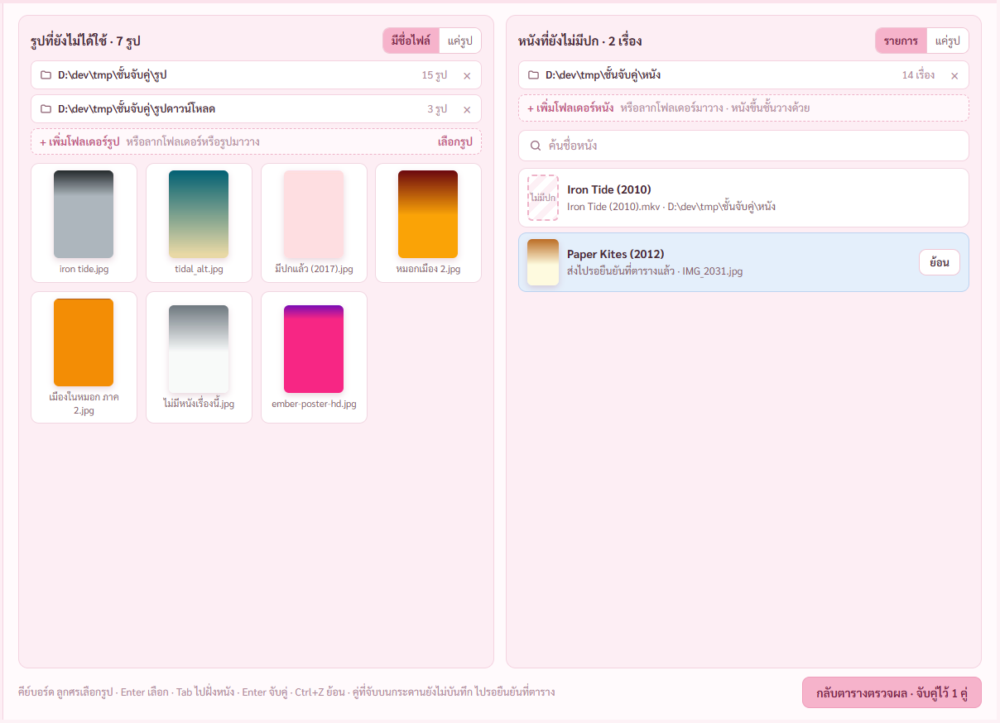
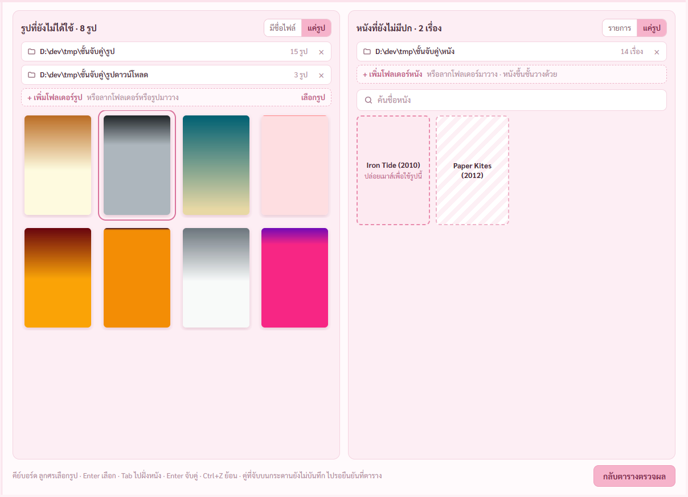
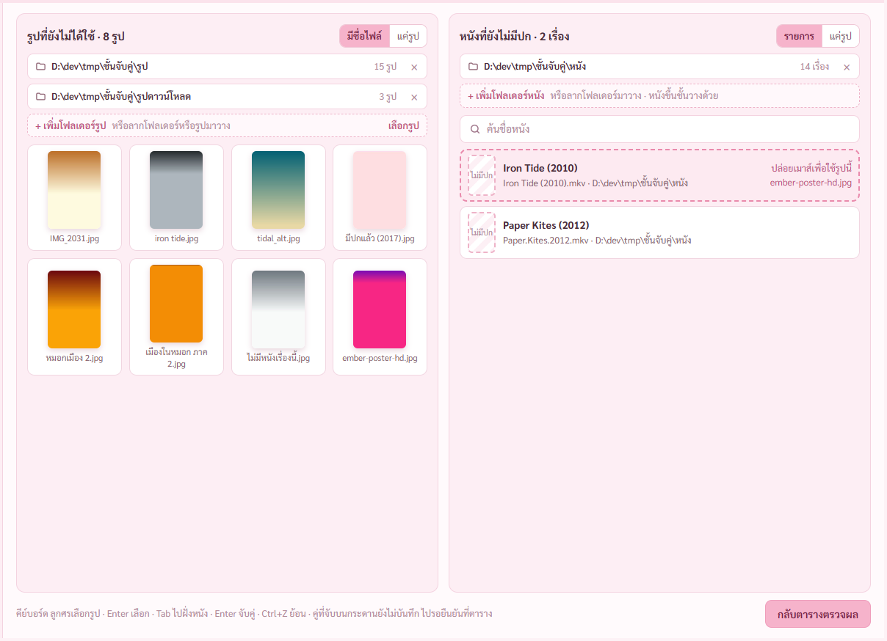

# รายงาน 8 พ.ย. 2569 · แผนจับคู่รูปปก ขั้น 4 กระดานกับลากจาก Explorer

พี่กันสั่ง *"ขี้นที่อยู่โฟลเด้อข้างบนด้วย เพราะอันนี้เราเลือกทั้งโฟลเด้อมา เเละเราขอเปลี่ยนมุมมองเป็นทั้งเเบบที่เธอมีตอนนี้ กับเเสดงเเค่รุป"* · *"เราอยากให้ลากแบบวิธีนี้ด้วย นั่นคือ ลากจากโฟลเด้อข้างนอกเลย"* · *"สามารถเลือกโฟลเด้อเพิ่มได้เรื่อยๆ เเล้วยิ่งโฟลเด้อเยอะ เเถวมันจะลงมา"*

## 1. กระดาน แบบรายการ

- หัวแผงเป็นรายการโฟลเดอร์ เพิ่มได้เรื่อย ๆ แถวยาวลงมา แต่ละแถวบอกจำนวน กดกากบาทเอาออก · แผงหนังคือโฟลเดอร์ของชั้นวาง เพิ่มแล้วหนังขึ้นชั้นด้วย (พี่กันตอบตอนทำแผน) เอาออกถามก่อน ไฟล์ในเครื่องไม่ถูกแตะ
- แถวหนังบอกโฟลเดอร์ของไฟล์ เพราะหนังกระจายหลายที่
- กดรูปแล้วกดหนัง 2 คลิก หรือลากรูปไปวาง · จับคู่แล้วยังไม่บันทึก แถวสีฟ้าบอกส่งไปรอยืนยันที่ตาราง กดย้อนได้ Ctrl+Z ได้ · ปุ่มท้ายกระดานกลับตารางตรวจผล

## 2. กระดาน แบบแค่รูป

แผงรูปรูปใหญ่ไม่มีชื่อไฟล์ ชี้แล้วเห็นชื่อ · แผงหนังเป็นช่องปก มีชื่อหนังในช่อง · สองแผงสลับแยกกัน โปรแกรมจำค่าไว้

## 3. ลากรูปจาก Explorer มาวางบนหนังตรง ๆ

ไม่ต้องเอารูปเข้ากระดานก่อน · ชี้บนหนังขึ้นกรอบปล่อยเมาส์พร้อมชื่อรูป · ไฟล์ที่ไม่ใช่รูปขึ้นแดงไม่รับ · หลายรูปแยกปกตั้งปกนอน · วางบนแผงรูปเป็นเพิ่มรูป วางโฟลเดอร์บนแผงหนังเป็นเพิ่มโฟลเดอร์ หนัง

## ตรวจแล้ว

- `check-link.mjs` 73 จาก 73 ข้อ · ลากในโปรแกรมใช้เมาส์จำลองจริงผ่าน CDP
- ตรวจภาพแล้ว · เจอบั๊กลากรูปไปวางแล้วไม่จับคู่ จากตัวตรวจ แก้แล้ว · โฟลเดอร์ชื่อมีจุดอย่าง `หนังเพิ่ม.ชุด2` ถูกแยกด้วยคำสั่งฝั่ง Rust ไม่เดาจากชื่อ

## ยังไม่ได้ตรวจ

- ลากจาก Explorer จริง ๆ ตัวตรวจจำลองแค่ตัวรับไฟล์ พี่กันต้องลองเองตอนจบ
- ปุ่มเลือกโฟลเดอร์ เลือกรูป เพราะหน้าต่างเลือกไฟล์จะเด้งขึ้นจอ
