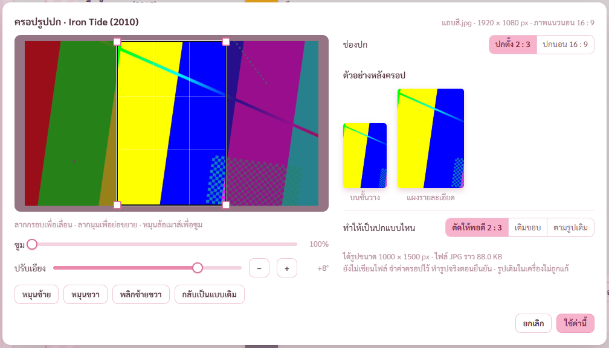
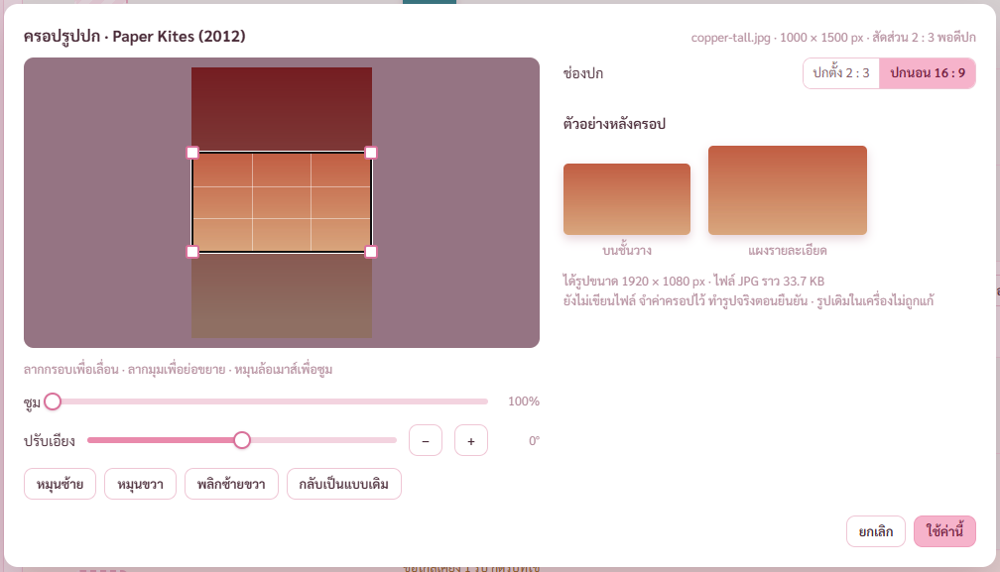
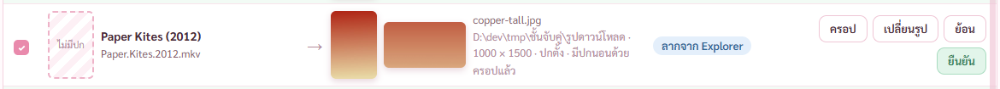

# รายงาน แผนจับคู่รูปปก ขั้น 5 หน้าครอป (8 พ.ย. 2569)

แผน `C:\Users\PKH\.claude\plans\precious-wobbling-hellman.md` · มอคอัปหน้า 4 `docs/mockups/poster-link.html`

พี่กันสั่ง *"ภาพที่เอามาจับคู่ดัดแปลง ครอป บิด ได้หมดเหมือนที่จะรวมกับรูป"* และ *"ถ้าจับคู่ เเล้ว เเม้จะช้วิธีไหนก็ตาม มันจะมาหน้านี้ เพื่อมาจัดการอีกที ว่าจะเปลี่ยน จะครอป จะยืนยัน"*

## 1. ปรับเอียงทีละครึ่งองศา ตัวอย่างบนจอตรงกับรูปจริง

- แถบปรับเอียง ±15° ปุ่ม − + ทีละ 0.5° กดลูกศรซ้ายขวาบนแถบได้ · ภาพขยายให้เต็มกรอบเอง ไม่มีมุมว่าง · ไม่มีปรับสีตามที่พี่กันเคาะ
- หัวหน้าต่างบอกชื่อหนังที่กำลังครอป ปุ่มเขียนว่า ใช้ค่านี้ เพราะยังไม่เขียนไฟล์ ทำรูปจริงตอนยืนยัน
- ตรวจจริง เอียงรูปแถบสี 8° แล้วยืนยัน เอาตัวอย่างบนจอไปเทียบกับรูปที่ได้ คะแนนความเหมือน 0.85 · เทียบกับรูปที่ไม่เอียงได้ 0.57 เปิดภาพเทียบด้วยตา เส้นตรงกันทุกเส้น

## 2. รูปเดียวได้ทั้งปกตั้ง 2:3 และปกนอน 16:9

- ช่องปกสลับได้ในหน้าต่างเดียว ค่าครอปแยกกันคนละช่อง · ปกนอนบังคับตัดให้พอดี 16:9 ไม่มีตัวเลือกเติมขอบ
- ยืนยันแล้วได้ไฟล์ `-poster.jpg` 1000 × 1500 กับ `-landscape.jpg` 1920 × 1080 จากรูปต้นฉบับรูปเดียว · รูปต้นฉบับค่า hash เท่าเดิม
- สลับช่องตอนแก้ค่าไว้ ค่านั้นถูกจำลงแถวให้ ไม่หายเงียบ · สลับช่องโดยไม่ได้แก้อะไร แถวไม่เปลี่ยน ไม่ขึ้นว่าครอปแล้ว · แคลร์ตั้งเอง ไม่อยู่ในมอคอัป

## 3. ในตาราง

- แถวโชว์ภาพหลังครอป ขึ้นคำว่า ครอปแล้ว ยังไม่เขียนรูปจนกว่าจะกดยืนยัน · เปิดครอปอีกครั้งค่าเดิมกลับมา · กดยกเลิกค่าในแถวไม่เปลี่ยน

## บั๊กที่แคลร์เจอจากการเปิดภาพ ตอนตัวตรวจผ่านหมดแล้ว 85 จาก 85 ข้อ

1. **มุมจับซ้ายล่างของกรอบครอปเป็นวงกลมขาว** ชื่อคลาส `sw` ชนปุ่มเลือกธีมของหน้ากราฟเสียง (commit 25b9101) · โดนหน้าใส่โปสเตอร์กับหน้าเสียงและซับที่ใช้หน้าครอปเดียวกันมาตั้งแต่ตอนนั้น · แก้แล้ว เพิ่มข้อตรวจ และคืนบั๊กชั่วคราวเพื่อยืนยันว่าข้อตรวจจับได้จริง
2. **สลับช่องแล้วค่าที่ปรับหาย** แก้ตามข้อ 2 ข้างบน
3. **ตัวอย่างไอคอน Windows กับตารางคุณภาพ** โผล่ในโหมดจับคู่ · ปกจับคู่ไม่เปลี่ยนไอคอนไฟล์ (มอคอัปเขียนไว้เอง) และคุณภาพใช้ค่าจากหน้าตั้งค่า เอาออกทั้งคู่ · หน้าใส่โปสเตอร์ยังมีครบเหมือนเดิม
4. **แถบแจ้งผลจากข้อก่อนหน้าทับหน้าต่างในภาพ** เป็นของตัวตรวจ ปิดก่อนถ่าย

## ผลตรวจ

| ตัวตรวจ | ผล |
|---|---|
| `check-link.mjs` | ผ่าน 95 จาก 95 ข้อ (เดิม 73 · เพิ่ม 22 ข้อของขั้นนี้) |
| `check-stage4.mjs` หน้าใส่โปสเตอร์ | ผ่าน 61 จาก 61 ข้อ |
| `check-av.mjs` หน้าเสียงและซับ | ผ่าน 76 จาก 76 ข้อ (แก้ข้อตรวจลำดับเมนูที่ล้าสมัยตั้งแต่ขั้น 3) |
| `check-graph.mjs` หน้ากราฟเสียง | ผ่าน 66 จาก 66 ข้อ ปุ่มเลือกธีมยังใช้ได้หลังแก้ชื่อคลาส |
| `cargo test` | ผ่าน 125 ข้อ |

**ยังไม่ได้ตรวจ** · รุ่นตัวจริงภายใต้ CSP ภาพหลังครอปในตาราง อยู่ในขั้น 7 · ปุ่มเปลี่ยนรูปในหน้าครอป เปิดหน้าต่างเลือกไฟล์ เด้งขึ้นจอ ตัวตรวจไม่กด

## ต่อไป

ขั้น 6 ชั้นวาง ตัวกรองปกจับคู่ ป้ายโซ่ แผงขวา การ์ดเก็บรูปในหน้าตั้งค่า แถบทำต่อ กันปิด
