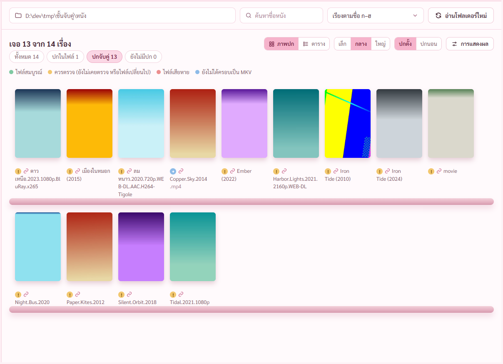
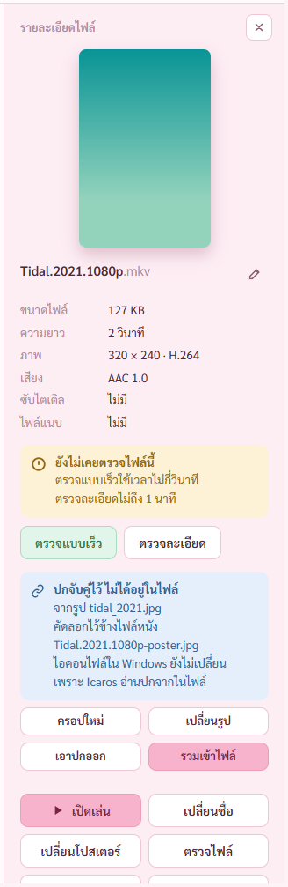
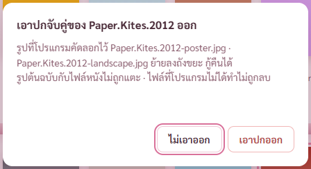
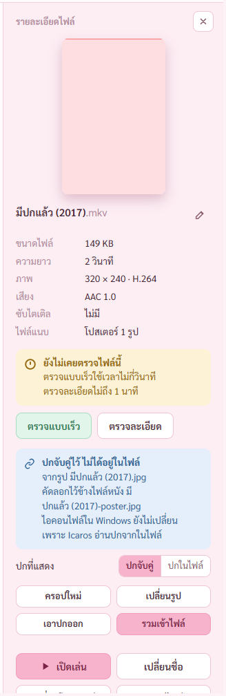
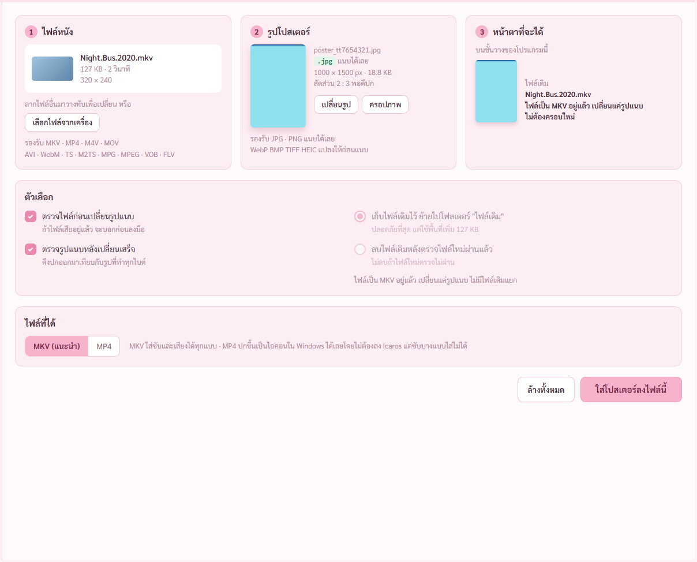
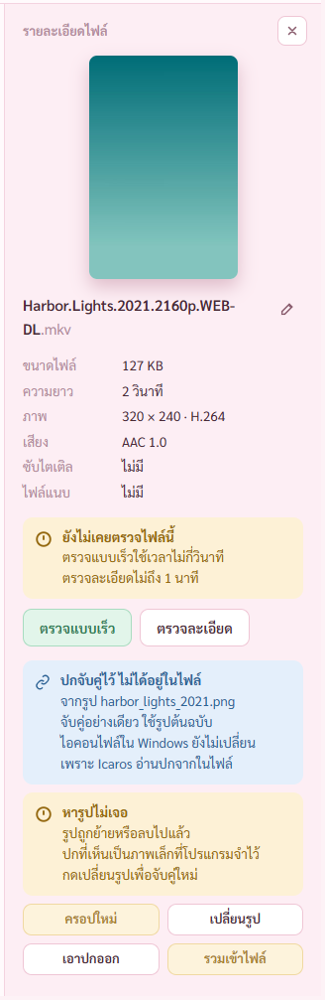
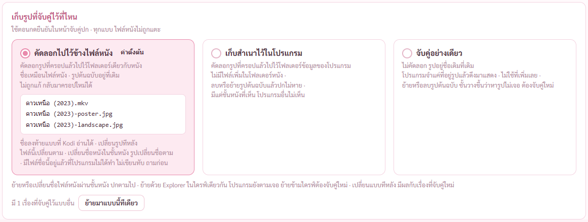
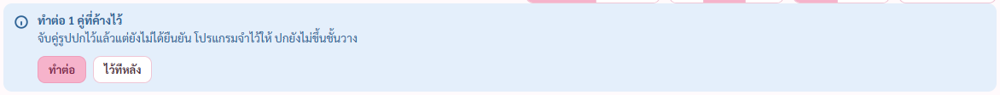
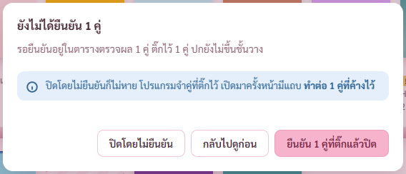

# รายงาน แผนจับคู่รูปปก ขั้น 6 ชั้นวาง ตั้งค่า กันปิด (8 พ.ย. 2569)

แผน `C:\Users\PKH\.claude\plans\precious-wobbling-hellman.md` · มอคอัป `docs/mockups/poster-link.html` หน้า 5 หน้าตั้งค่า หน้าต่างถาม

## 1. ปกจับคู่ขึ้นชั้นวาง กรองได้

พี่กันเคาะ *"หน้าจับคู่ปกแยกในเมนูซ้าย · ชั้นวางกรองได้ว่าเรื่องไหนปกมาจากการรวม เรื่องไหนจับคู่"* และสั่งเรื่องป้ายว่าไม่ให้ทับภาพ

- แท็บ ทั้งหมด · ปกในไฟล์ · ปกจับคู่ · ยังไม่มีปก มีเลขจำนวน นับตามปกที่กำลังแสดง เรื่องหนึ่งอยู่หมวดเดียว ยอดสามหมวดรวมเท่าทั้งหมด (แคลร์ตั้ง)
- ป้ายโซ่อยู่หน้าชื่อหนังใต้ปก ไม่ทับรูป ทั้งแบบภาพปกและตาราง
- ปุ่มปกตั้งปกนอนสลับปกจับคู่ตามทั้งชั้น เรื่องที่มีแบบเดียวใช้แบบที่มี

## 2. แผงขวา

- การ์ดบอกว่าปกไม่ได้อยู่ในไฟล์ มาจากรูปไหน ครอปแล้วไหม เก็บไว้ที่ไหน และไอคอนไฟล์ใน Windows ไม่เปลี่ยน
- ปุ่มครอปใหม่ เปลี่ยนรูป พาไปแถวของเรื่องนั้นในตาราง แก้แล้วยืนยันอีกครั้งถึงเปลี่ยนบนชั้น ตามที่พี่กันสั่งว่าทุกวิธีมาจบที่ตาราง · ครอปใหม่เปิดหน้าครอปให้เลย
- เพิ่มปุ่ม เลิกแก้ ในแถวที่มาจากชั้นวาง ปกเดิมคงอยู่ ไม่มีอะไรถูกเขียน (แคลร์เพิ่ม ไม่อยู่ในมอคอัป ไม่งั้นกดเข้ามาแล้วออกไม่ได้)
- เรื่องที่ยังไม่มีปกจับคู่มีปุ่ม จับคู่รูปปก

**เอาปกออก** ถามก่อน บอกชื่อไฟล์ที่ลงถังขยะ ตามที่พี่กันตอบตอนทำแผน รูปต้นฉบับกับไฟล์หนังไม่โดน

**เรื่องที่มีสองปก** พี่กันตอบ *"เลือกได้"* · ค่าตั้งต้นแสดงปกจับคู่ (แคลร์ตั้ง) เลือกแล้วรูป ป้าย และเลขในแท็บเปลี่ยนตาม

**รวมเข้าไฟล์** พาไปหน้าใส่โปสเตอร์พร้อมไฟล์หนัง รูป และค่าครอป ไม่ต้องครอปซ้ำ · รวมเสร็จปกจับคู่ยังอยู่ เรื่องนั้นกลายเป็นสองปก เลือกได้ (แคลร์ตั้ง)

**หารูปไม่เจอ** แบบจับคู่อย่างเดียวแล้วย้ายรูปต้นฉบับหนี แผงขวาบอกตรง ๆ ปกยังเห็นจากภาพเล็กที่จำไว้ ปุ่มครอปใหม่กับรวมเข้าไฟล์กดไม่ได้พร้อมเหตุผล · มอคอัปเขียนว่าชั้นวางขึ้นว่าหารูปไม่เจอ แคลร์ทำไว้ที่แผงขวาตอนเลือกเรื่อง ไม่ได้ขึ้นบนเล่ม เพราะต้องไล่เช็กไฟล์ทุกเรื่องทุกครั้งที่เปิดชั้น

## 3. หน้าตั้งค่า เก็บรูปไว้ที่ไหน 3 แบบ

พี่กันเคาะข้อ 1 ค่าตั้งต้นคัดลอกไปข้างไฟล์หนัง · เปลี่ยนแบบแล้วมีปุ่มย้ายเรื่องเดิมทีเดียว ทำไฟล์ใหม่ก่อน สำเร็จแล้วค่อยเอาของเก่าออก · เจอไฟล์ชื่อซ้ำของคนอื่น ไม่เขียนทับ เรื่องนั้นคงแบบเดิมแล้วแจ้งเตือน

## 4. แถบทำต่อ

เปิดโปรแกรมมาแล้วมีคู่ค้าง ชั้นวางขึ้นแถบ กดทำต่อพาไปตาราง กดไว้ทีหลังแถบหาย

## 5. กันปิด

พี่กันเคาะข้อ 3 *"แค่ต้องห้ามด้วยถ้าเผลอปิดโปรแกรม"* · มีงานทำอยู่ใช้หน้าต่างเดิมก่อน · ไม่มีคู่รอ ปิดเลยไม่ถาม

เทสปิดจริงแล้ว กดปุ่มปิดของแถบชื่อ ขึ้นหน้าต่าง กดปิดโดยไม่ยืนยัน โปรแกรมออกจริง เปิดใหม่คู่ยังอยู่ ขึ้นแถบทำต่อ 1 คู่ · ไม่มีคู่รอกดปิดแล้วปิดเลย

## บั๊กที่เจอระหว่างทำ

1. **เรื่องที่รูปอยู่ข้างหนังชื่อถูกอยู่แล้ว ย้ายที่เก็บกลับมาไม่ได้** คำสั่งย้ายส่งค่าครอปกลางรูปไปด้วย โปรแกรมคิดว่าต้องทำไฟล์ใหม่แล้วชนไฟล์ตัวเอง · แก้แล้ว ส่งค่าครอปเฉพาะที่ผู้ใช้ครอปเอง ตัวตรวจเจอ
2. **ป้ายครอปแล้วขึ้นทุกเรื่องที่เปิดกลับมาจากชั้นวาง** เพราะจดค่ากลางรูปไว้ด้วย · แก้แล้ว จดแยกว่าผู้ใช้ครอปเองไหม
3. **ปุ่มยืนยันในหน้าต่างปิดเว้นวรรคกว้างผิดปกติ** เจอจากการเปิดภาพ แก้แล้ว

## ผลตรวจ

| ตัวตรวจ | ผล |
|---|---|
| `check-link.mjs` | ผ่าน 143 จาก 143 ข้อ (เดิม 95 · เพิ่ม 48 ข้อของขั้นนี้) |
| `check-stage1` ถึง `check-stage5` | ผ่าน 53 39 17 61 17 ครบทุกข้อ |
| `cargo test` | ผ่าน 126 ข้อ (เพิ่ม 1) |
| ตัวอย่างบนจอเทียบรูปจริง หมุน พลิก เอียงพร้อมกัน | ความเหมือน 0.80 · ตัวคุมรูปก่อนหมุน 0.31 · เปิดภาพเทียบด้วยตาแล้วทิศกับลำดับแถบสีตรงกัน |
| ปิดโปรแกรมจริง 2 กรณี | ผ่าน |

**ยังไม่ได้ตรวจ** · รุ่นตัวจริงภายใต้ CSP อยู่ขั้น 7 · รวมเข้าไฟล์จากปกนอน อยู่ขั้น 7 · ปุ่มเลือกรูปในตาราง เปิดหน้าต่างเลือกไฟล์ เด้งขึ้นจอ พี่กันต้องลองเอง · ปิดเครื่องตอนมีคู่รอ Windows อาจถามว่าโปรแกรมนี้กันการปิดเครื่องอยู่ เหมือนตอนมีงานทำอยู่ ยังไม่ได้ลอง เพราะต้องปิดเครื่องจริง

## ต่อไป

ขั้น 7 เทสรวมทุกชุด รุ่นตัวจริง ตัวติดตั้ง
