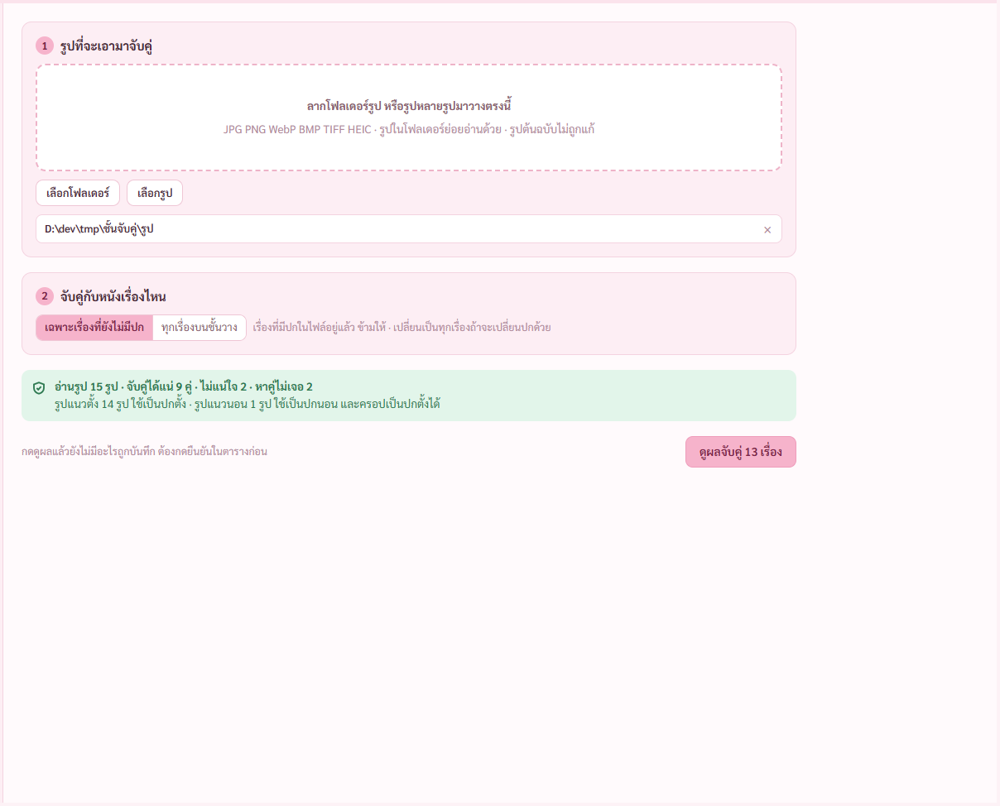
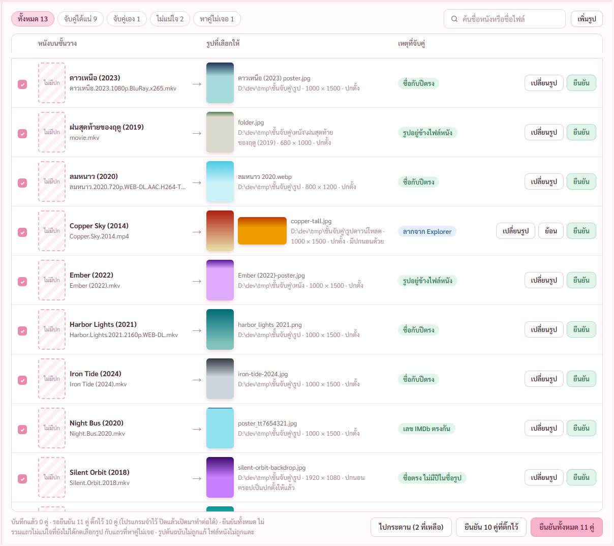
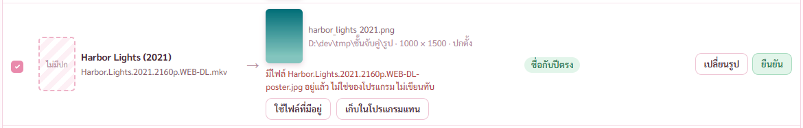
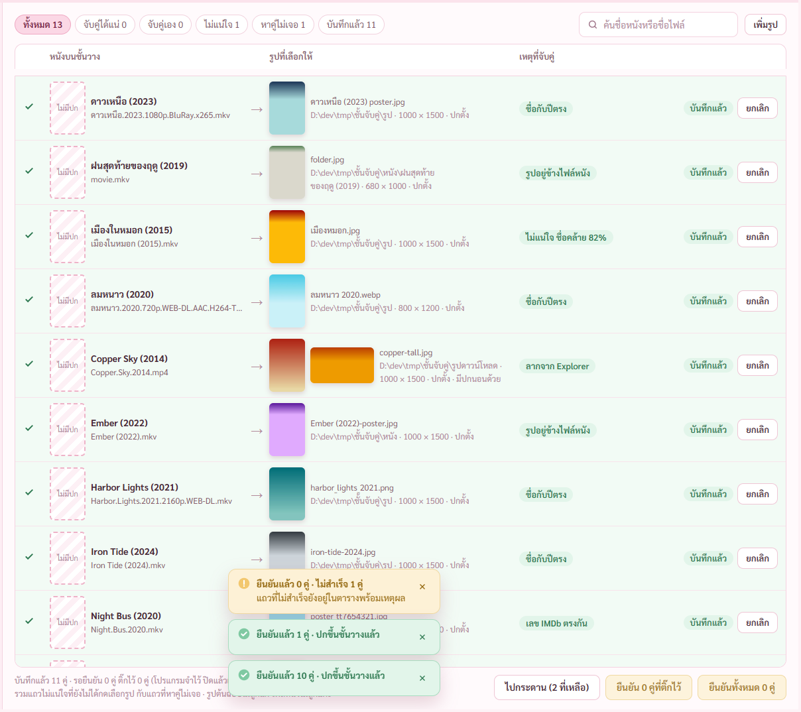

# รายงาน 8 พ.ย. 2569 · แผนจับคู่รูปปก ขั้น 3 หน้าจับคู่ปกกับตารางตรวจผล

พี่กันสั่ง *"commit เเละทำจริงเลย"* · *"ถ้าจับคู่ เเล้ว เเม้จะช้วิธีไหนก็ตาม มันจะมาหน้านี้ เพื่อมาจัดการอีกที ว่าจะเปลี่ยน จะครอป จะยืนยัน เเละหน้านี้มีปุ่มที่บอกว่า ยืนยันทั้หมดด้วย"*

ทดสอบด้วยชุด `test-media/สร้าง/จับคู่` ลอกไปไว้ `D:\dev\tmp\ชั้นจับคู่` · ถ่ายภาพผ่านโปรแกรมทดสอบแบบอยู่หลังสุด ไม่มีอะไรขึ้นจอ

## 1. ลากโฟลเดอร์รูป บอกผลรวมก่อน

เมนูซ้ายมีหน้าจับคู่ปก ต่อจากใส่โปสเตอร์ · ลากโฟลเดอร์ โปรแกรมจับคู่ให้ บอกผลรวมก่อน ยังไม่มีอะไรถูกบันทึก · ชุดทดสอบได้ รูป 15 แน่ 9 ไม่แน่ใจ 2 หาไม่เจอ 2 ตรงตารางที่จดไว้

## 2. ตารางตรวจผล

- แท็บ ทั้งหมด จับคู่ได้แน่ จับคู่เอง ไม่แน่ใจ หาคู่ไม่เจอ บันทึกแล้ว · ค้นชื่อหนังหรือชื่อไฟล์ พิมพ์ผิดแป้นได้
- ช่องเหตุที่จับคู่บอกว่ามาจากไหน ชื่อกับปีตรง · รูปอยู่ข้างไฟล์หนัง · เลข IMDb ตรงกัน · ลากจาก Explorer
- ท้ายตาราง ไปกระดาน · ยืนยันที่ติ๊กไว้ · ยืนยันทั้งหมด (ปุ่มหลัก) · เมนูซ้ายมีเลขคู่ที่รอยืนยัน
- ลากรูปจาก Explorer มาวางบนแถว ใช้แทนรูปของแถวนั้น หลายรูปแยกปกตั้งปกนอน ไฟล์ที่ไม่ใช่รูปไม่รับ

ปุ่มครอปกับกระดานอยู่ขั้นถัดไป

## 3. ชื่อไฟล์ชน ไม่เขียนทับ

มีไฟล์ `ชื่อหนัง-poster.jpg` อยู่แล้วที่โปรแกรมไม่ได้ทำ แถวบอกเหตุผล เลือกได้ ใช้ไฟล์ที่มีอยู่ หรือเก็บในโปรแกรมแทนเฉพาะเรื่องนี้ · เทสแล้วไฟล์เดิมเหมือนเดิมทุกไบต์

## 4. ยืนยันแล้ว

แถวขึ้นสีเขียว บันทึกแล้ว มีปุ่มยกเลิก · กดยกเลิก รูปที่โปรแกรมคัดลอกลงถังขยะ แถวกลับไปรอพร้อมรูปเดิม · แถบเหลืองกับเขียวในภาพมาจากการยืนยันหลายรอบของตัวตรวจ

## ตรวจแล้ว

- `check-link.mjs` ผ่านทุกข้อ · ไฟล์หนังทุกเรื่องกับรูปต้นฉบับทุกรูปค่า hash เท่าก่อนทำ · ไม่มีไฟล์ชั่วคราวค้าง · เปิดหน้าใหม่คู่ที่รอยังอยู่
- ตรวจภาพแล้วแก้ก่อนส่ง · ตารางเบี้ยวเพราะชื่อสไตล์ `.lrow` ชนกับตัวเลือกภาษาของหน้าเสียงและซับ เปลี่ยนเป็น `.lkrow` · ภาพเล็กของรูปข้างไฟล์หนังไม่ขึ้น แก้ให้ตัวทำภาพเล็กทำด้วยและจดลงแถว · หน้าต่างแคบปุ่มยกเลิกตกขอบ ปรับคอลัมน์ · ข้อความในช่องลากห่างเกิน

## ยังไม่ได้ตรวจ

- ลากจาก Explorer จริง ๆ ตัวตรวจจำลองแค่ตัวรับไฟล์ พี่กันต้องลองเองตอนจบ
- หยุดกลางทางตอนยืนยันหลายร้อยคู่ ชุดทดสอบเล็ก จบเร็วเกินกดหยุดทัน
