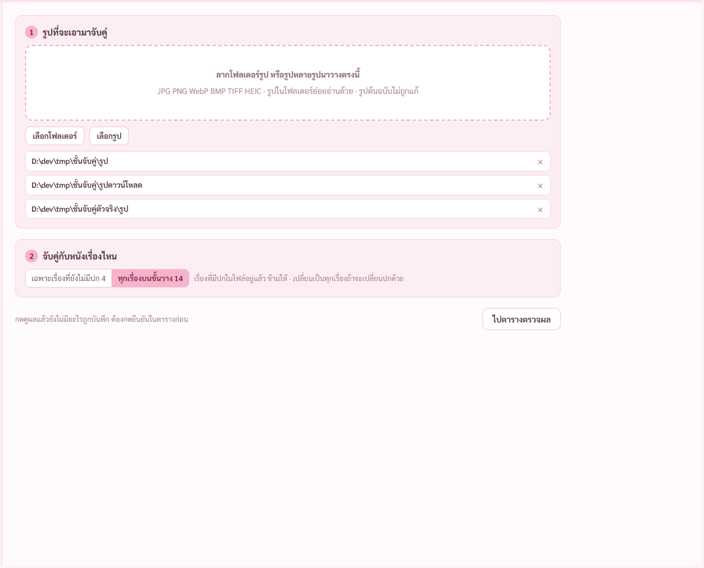

# รายงาน แผนจับคู่รูปปก ขั้น 8 แก้ตามผู้ช่วยตรวจ (8 พ.ย. 2569)

พี่กันตอบตอนทำแผนว่ารันผู้ช่วยตรวจ 1 ตัวตอนจบ · ผลเต็มกับตารางที่แคลร์ตรวจทีละข้อ [review/จับคู่รูปปก.md](review/จับคู่รูปปก.md)

ผู้ช่วยตรวจเจอ 29 ข้อ กับน่าสงสัย 3 ข้อ · แคลร์ไล่โค้ดจริงแล้ว ข้อใหญ่เป็นบั๊กจริงทุกข้อ · ไม่เจอทางที่ไฟล์หนังหรือรูปต้นฉบับโดนลบหรือแก้ ที่หายคือไฟล์ปกที่โปรแกรมทำเอง

## เรื่องที่คนใช้จะเจอแน่ถ้าไม่แก้

1. **รวมเสียงเข้าหนังที่จับคู่ปกไว้ แล้วปกหาย** รวมเสียงเข้า MKV ได้ไฟล์ใหม่ชื่อเดิม เลขประจำไฟล์เปลี่ยน ตัวอ่านโฟลเดอร์นึกว่าหนังหาย ลบภาพเล็กกับสำเนา ทั้งที่รายการใหม่ยังใช้อยู่ · แก้แล้ว เช็กก่อนลบว่ายังมีใครใช้ · MP4 รวมเป็น MKV ปกตามเรื่องใหม่ครบทุกช่อง
2. **เอาโฟลเดอร์หนังออกจากชั้นวาง สำเนาปกโดนลบถาวร** ทั้งที่หน้าต่างบอกไม่มีอะไรถูกลบ · แก้แล้ว ไม่ลบอะไร โปรแกรมจำปกไว้ ใส่โฟลเดอร์กลับปกกลับมาเอง เทสแล้ว 14 เรื่องครบ
3. **ย้ายที่เก็บตอนรูปต้นฉบับหายแล้ว สำเนารูปสุดท้ายโดนเอาออก** · แก้แล้ว เรื่องนั้นไม่ย้าย บอกเหตุผล
4. **ปุ่มเพิ่มรูปกดแล้วเด้งกลับตาราง** กลับหน้าแรกไม่ได้เลย · แก้แล้ว

5. **จับคู่ผิดเรื่องแล้วติ๊กให้** `Dune.mkv` กับรูปหลายปีเลือกรูปแรกให้ · `Blade Runner 2049` ได้ปกภาคแรก · `The Final Cut` กับ `The Cut` · แก้แล้ว ขึ้นไม่แน่ใจให้เลือกเอง · แถวที่ไม่มีปีไม่ติ๊กให้ ตามมอคอัป · `Final Destination` `Charlotte's Web` `The Web` ชื่อไม่เพี้ยนแล้ว
6. **เพิ่มรูปหรือจับคู่อีกรอบ ค่าครอปกับติ๊กที่เอาออกหาย** · แก้แล้ว แถวที่แตะแล้วไม่ถูกทับ
7. **กดอะไรระหว่างยืนยันได้หมด** · แก้แล้ว ยืนยันกับย้ายที่เก็บห้ามซ้อนกัน ปุ่มในแถวบอกให้รอ

## เรื่องลบไฟล์ แคลร์ตัดสินเอง

ผู้ช่วยตรวจเสนอให้พี่กันเคาะว่าเอาปกออกลบสำเนาในโปรแกรมถาวรได้ไหม · แคลร์ไม่ถาม เพราะพี่กันตอบตอนทำแผนแล้วว่าย้ายลงถังขยะ และแผนเขียนว่าลงถังขยะเท่านั้น ตอนนี้ลงถังขยะทุกแบบ · ไดรฟ์ที่ไม่มีถังขยะไม่ลบ บอกให้ลบเอง

## เพิ่มจากข้อเสนอ

แถวที่เปิดจากชั้นวางแล้วไม่ได้แก้อะไร ไม่นับว่ารอยืนยัน ไม่ขึ้นเลข ไม่ถามตอนปิด

## ผลตรวจ

| ตัวตรวจ | ผล |
|---|---|
| `check-link` | ผ่าน 154 จาก 154 ข้อ (เดิม 145 · เพิ่มเรื่องปกหาย 3 ทาง ลากเหนือแถว ปุ่มเพิ่มรูป) |
| แบบทดสอบทั้งชุด | 16 ตัวตรวจ 634 ข้อ ไม่มีข้อตก |
| ตัวจริงทั้งชุด | 8 ตัวตรวจ 212 ข้อ ไม่มีข้อตก |
| `cargo test` | ผ่าน 132 ข้อ (เดิม 126) |

หลังรันชุดเหล่านี้ แคลร์แก้เพิ่มหนึ่งบรรทัด ช่องซ้ายของแถวที่บันทึกแล้วเดิมขึ้นไม่มีปก ตอนนี้ดูปกจับคู่ด้วย · ตรวจแค่ชนิดข้อมูล ภาพจะดูตอนปรับหน้าตาที่รันทุกชุดอีกรอบ

**ยังไม่ได้ตรวจ** · ตัวติดตั้งยังไม่ได้สร้างใหม่หลังแก้ จะสร้างหลังปรับหน้าตาทีเดียว เพราะหนักเครื่อง · ข้อ 7 8 9 16 17 18 ไล่โค้ด ยังไม่มีข้อตรวจเฉพาะ · ไม่ได้รันตัวตรวจข้อใหม่กับโค้ดก่อนแก้เพื่อพิสูจน์ว่าแดง · ไดรฟ์ไม่มีถังขยะยังไม่ได้ลองจริง

## เรื่องเครื่องกระตุก วัดจริงแล้ว

| ตอนไหน | CPU เฉลี่ย | CPU สูงสุด | การ์ดจอสูงสุด | แรมสูงสุด |
|---|---|---|---|---|
| สร้างโปรแกรมกับเทส Rust ก่อนจำกัดเทส | 42% | 98% | 11% | 7.5 จาก 7.7 GB |
| ตัวจริง สร้างแล้วรันตัวตรวจ หลังจำกัด | 18% | 58% | 19% | 7.4 จาก 7.7 GB |
| แบบทดสอบทั้งชุด 12 นาที | 13% | 80% | 38% | 7.7 จาก 7.7 GB |

การ์ดจอไม่ใช่ตัวการ · แรมเต็มกับดิสก์คือตัวตัน แรมที่เหลือถูกโปรแกรมอื่นบนเครื่องใช้ร่วมอยู่ด้วย แคลร์จำกัดได้แค่ฝั่งงานของแคลร์ · ตัวเลขสองแถวแรกวัดคนละงาน เทียบตรง ๆ ไม่ได้ทั้งหมด

## ที่รอพี่กัน

ข้อเสนอที่ไม่ใช่บั๊ก 3 ข้ออยู่ใน ROADMAP ไม่ได้ขวางงาน · ค่าตั้งต้นเรื่องที่มีสองปกแสดงปกจับคู่ · แถวรูปแนวนอนที่ครอปกลางให้เองควรติ๊กไหม · บันทึกคลังทุกคู่อาจหน่วงตอนหลายร้อยคู่

## ต่อไป

ปรับหน้าตาทั้งโปรแกรมตามคิว
