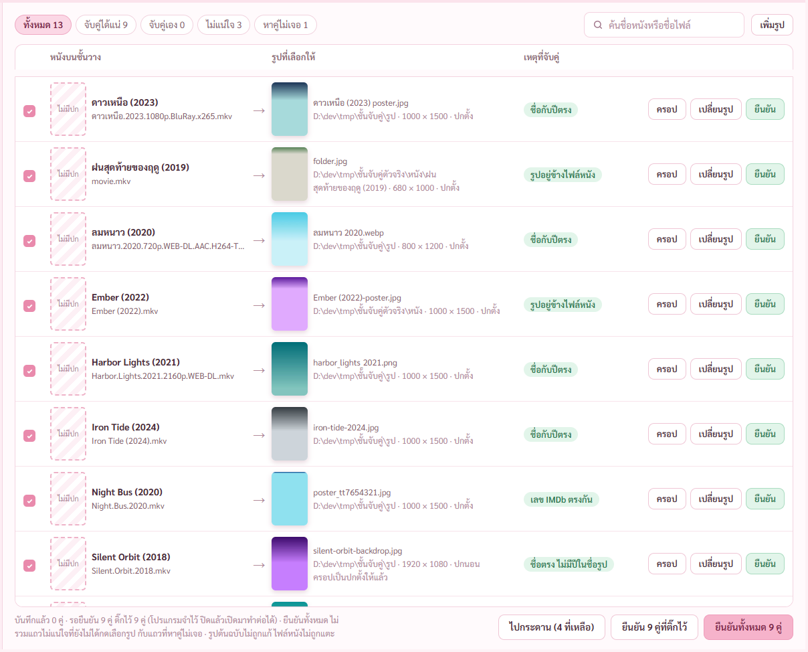
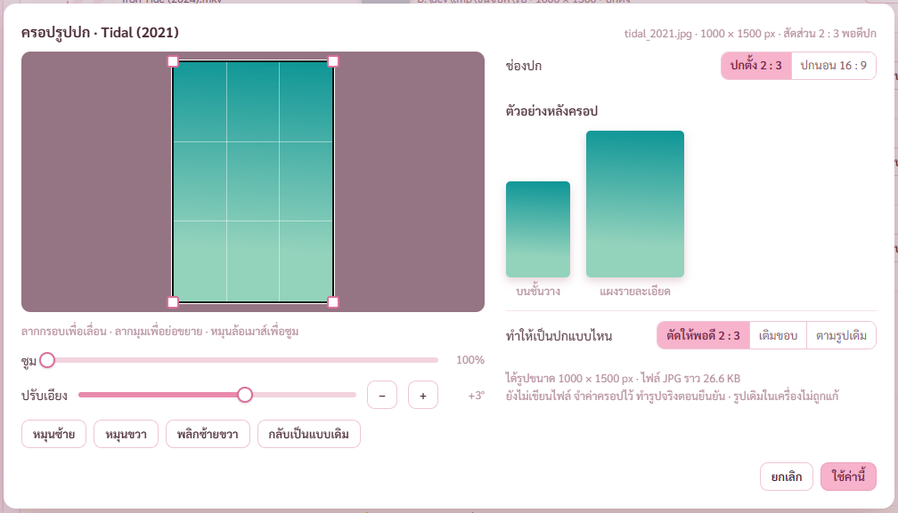
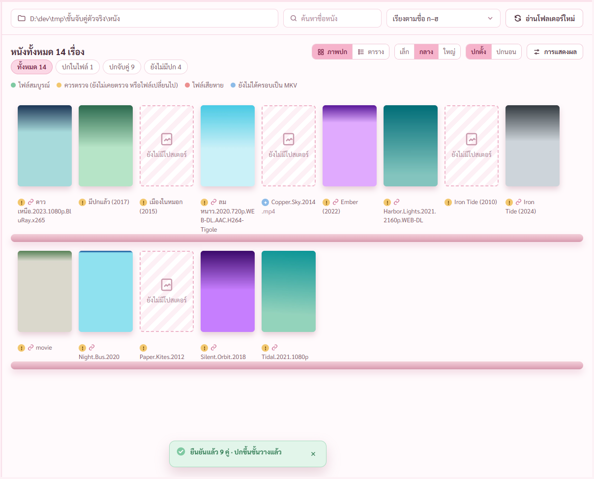
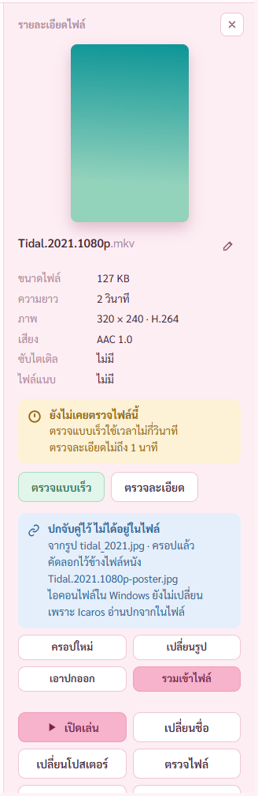

# รายงาน แผนจับคู่รูปปก ขั้น 7 เทสรวม (8 พ.ย. 2569)

แผน `C:\Users\PKH\.claude\plans\precious-wobbling-hellman.md`

## ผลตรวจทุกชุด

| ชุด | ตัวตรวจ | ผล |
|---|---|---|
| แบบทดสอบ ขั้น 1 ถึง 5 | `check-stage1` ถึง `check-stage5` | 53 · 39 · 17 · 61 · 17 ผ่านครบ |
| แบบทดสอบ ชุดที่เหลือ | `check-stage6` `check-stage7` `check-merge` `check-review` `check-wide` `check-graph` `check-av` `check-convert` `check-latest` `check-fonts` | 21 · 13 · 20 · 13 · 16 · 66 · 76 · 41 · 11 · 16 ผ่านครบ |
| แบบทดสอบ จับคู่รูปปก | `check-link` | 145 จาก 145 |
| ตัวจริง | `check-stage6` `check-built` `check-graph` `check-wide` `check-stage7` `check-merge` `check-convert` `check-link-built` | 23 · 11 · 68 · 17 · 16 · 20 · 43 · 14 ผ่านครบ |
| ตัวติดตั้ง | `check-install` | 14 จาก 14 ติดตั้งเงียบ เปิด ถอน ไฟล์หนังค่า hash เท่าเดิม |
| ฝั่ง Rust | `cargo test` | 126 ข้อ |

รวมแบบทดสอบ 625 ข้อ ตัวจริง 212 ข้อ ไม่มีข้อตก

## รุ่นตัวจริง รูปทุกชนิดขึ้นภายใต้กติกาความปลอดภัย

เพิ่มตัวตรวจใหม่ `check-link-built.mjs` เพราะ `tauri dev` ไม่ใช้กติกาตัวจริง · ไม่มีอะไรโดนกันตลอดการเทส

## ปิดเปิดโปรแกรมจริงแล้วปกยังอยู่

กับตัวจริง · ก่อนปิดปกจับคู่ 9 เรื่อง กดปุ่มปิด โปรแกรมออกทันทีเพราะไม่มีคู่รอ · เปิดใหม่ ปกจับคู่ 9 เรื่อง ไฟล์ `-poster` อยู่ครบ ป้ายโซ่ 9 ป้าย รูปขึ้น 10 รูปครบ · แถวที่ยืนยันแล้วไม่ค้างในตาราง

## เรื่องเครื่องกระตุกที่พี่กันบอกระหว่างเทส

พี่กันบอก *"เธอรันเเล้วคอมเรากระตุก ฝากดู cop กดาร์ดจอด้วยนะ"*

| วัดตอนงานเบา 64 วินาที เปิดโปรแกรมจริงพร้อมตัวตรวจ | เฉลี่ย | สูงสุด |
|---|---|---|
| CPU | 9% | 16% |
| การ์ดจอ | 6% | 14% |
| แรม | | 6.8 จาก 7.7 GB |
| ดิสก์ | | ไม่ว่าง 100% เป็นช่วง ๆ |

- เครื่องเป็น i5-10505 6 คอร์ 12 เธรด การ์ดจอในตัว UHD 630 แรม 8 GB SSD SATA ลูกเดียว C กับ D ใช้ร่วมกัน · ไฟล์สำรองแรมใช้อยู่ 2.5 GB สูงสุดตั้งแต่เปิดเครื่อง 3.2 GB
- การ์ดจอกับ CPU ตอนเทสหน้าจอไม่หนัก แรมกับดิสก์คือจุดตัน
- **ต้นเหตุที่คิด ยังไม่พิสูจน์** ช่วงที่กระตุกน่าจะเป็นตอนสร้างตัวจริงกับตัวติดตั้ง เดิมใช้ครบ 12 เธรด กินแรมจนต้องสลับลงดิสก์ลูกเดียวกับระบบ · ไม่ได้วัดตอนนั้น เพราะเพิ่งเขียนตัววัดหลังพี่กันบอก
- แก้แล้ว `dev.ps1` จำกัดการสร้าง 6 จาก 12 เธรด และให้ความสำคัญต่ำกว่าโปรแกรมที่คนใช้อยู่ · ตอนสร้างครั้งถัดไปจะวัดจริงแล้วรายงาน
- แคลร์เองซ้ำเติมตอนสั่งนับขนาดโฟลเดอร์ชั่วคราวทั้งโฟลเดอร์ วิ่งอ่านดิสก์นานเกิน 2 นาที จดเป็นกฎใน CLAUDE.md แล้ว
- **C: เหลือว่าง 4.9 จาก 169 GB** ข้อมูลโปรแกรมนี้บน C: มี 346 MB ไม่ใช่ต้นเหตุ · ที่ใช้ไปส่วนใหญ่แคลร์ยังไม่ได้ดูว่าเป็นอะไร ไม่ได้ลบอะไร

## ยังไม่ได้ตรวจ

- ลากรูปจาก Explorer จริง ปุ่มเลือกไฟล์เลือกโฟลเดอร์ เปิดหน้าต่างขึ้นจอ พี่กันต้องลองเอง
- ปิดเครื่องตอนมีคู่รอ

## ต่อไป

ขั้น 8 ผู้ช่วยตรวจ 1 ตัว แล้วปรับหน้าตาทั้งโปรแกรม
