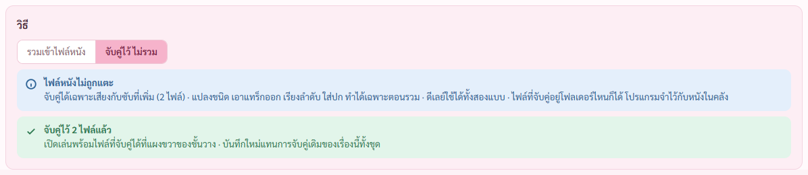
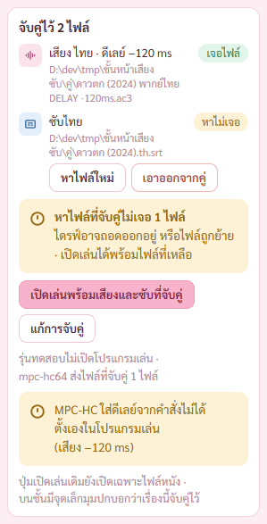

# รายงาน 8 พ.ย. 2569 · จับคู่ไว้ ไม่รวม (แผนเสียงและซับ ขั้น 7)

พี่กันสั่ง *"เธอ ทำให้จบทุกขั้น ตามแผนเดิม เราจะมาดูตอนเสร็จ เพราะทำงานอยู่ เรารีโหมดเข้ามา"*
ทุกการตรวจรันกับโปรแกรมแบบเปิดอยู่หลังสุด ถ่ายภาพผ่าน CDP · ปุ่มเปิดเล่นในรุ่นทดสอบคืนคำสั่ง ไม่เปิดโปรแกรมเล่น ไม่มีอะไรเด้งขึ้นจอ

ผลตรวจ เทส Rust 93/93 (เพิ่ม 2 ตัว) · ตัวตรวจหน้าเสียงและซับ 70/70 (เพิ่ม 6 ข้อ)

## 1. เลือกวิธีในหน้าเสียงและซับ

- การ์ด วิธี ปุ่มสลับ รวมเข้าไฟล์หนัง กับ จับคู่ไว้ ไม่รวม
- เลือกจับคู่ บอกว่าไฟล์หนังไม่ถูกแตะ จับคู่ได้เฉพาะเสียงกับซับที่เพิ่ม · แปลงชนิด เอาแทร็กออก เรียงลำดับ ใส่ปก ทำได้เฉพาะตอนรวม · ดีเลย์ใช้ได้ทั้งสองแบบ
- ปุ่มล่างเปลี่ยนเป็น จับคู่ไว้กับหนังเรื่องนี้ · การ์ดไฟล์ที่ได้ซ่อน (ไม่มีไฟล์ใหม่)
- กดได้เมื่อหนังอยู่บนชั้น และมีเสียงหรือซับที่เพิ่ม · ไม่ได้ บอกเหตุผลข้างปุ่ม
- จับคู่แล้วบอกในการ์ด · บันทึกใหม่แทนการจับคู่เดิมของเรื่องนั้นทั้งชุด · ตัวตรวจเทียบ hash ไฟล์หนังแล้วเท่าเดิม

## 2. แผงขวาของชั้นวาง

- การ์ด จับคู่ไว้ N ไฟล์ ทุกไฟล์บอกชนิด ภาษา ชื่อ ดีเลย์ ที่อยู่ และเจอไฟล์ไหม
- ปุ่ม เปิดเล่นพร้อมเสียงและซับที่จับคู่ · ปุ่ม แก้การจับคู่ เปิดหน้าเสียงและซับของเรื่องนั้น
- ไฟล์หาไม่เจอ ขึ้นหาไม่เจอ พร้อมปุ่มหาไฟล์ใหม่ กับเอาออกจากคู่ · เปิดเล่นได้พร้อมไฟล์ที่เหลือ
- บนชั้นมีจุดฟ้าเล็กมุมปกบอกว่าเรื่องนี้จับคู่ไว้ · ปุ่มเปิดเล่นเดิมยังเปิดเฉพาะไฟล์หนัง

## 3. โปรแกรมเล่นแต่ละตัว

| โปรแกรมเล่น | เสียงแยก | ซับแยก | ดีเลย์ |
|---|---|---|---|
| mpv | ได้ทุกไฟล์ | ได้ทุกไฟล์ | ได้ ค่าเดียวต่อชนิด · เลือกภาษาให้ |
| VLC | ได้ | ไฟล์เดียว | ได้ · เลือกภาษาให้ |
| MPC-HC · MPC-BE | ได้ | ได้ | ไม่ได้ บอกค่าที่ต้องตั้งเอง |
| PotPlayer | ไม่ได้ | ไฟล์เดียว | ไม่ได้ |
| โปรแกรมหลักของ Windows | ไม่ได้ | ไม่ได้ | ไม่ได้ · บอกให้เลือกโปรแกรมเล่นในหน้าตั้งค่า |

สิ่งที่โปรแกรมเล่นทำไม่ได้ ขึ้นเป็นกล่องเตือนใต้ปุ่มทุกครั้งที่กด · เครื่องนี้ใช้ MPC-HC ของ K-Lite (หาเองในเครื่อง)

## 4. บั๊กที่เจอและแก้

**จับคู่สำเร็จแล้วขึ้นแจ้งเตือนซ้ำกับการ์ดในหน้า และบังการ์ด** (ตรวจภาพ) · เหลือการ์ดในหน้าอย่างเดียว

**หมายเหตุของ MPC-HC เขียนดีเลย์เป็น -120 ms** (ตรวจภาพ) · ใช้เครื่องหมาย −120 · +500 แบบเดียวกับส่วนอื่น

**ไฟล์ที่จับคู่หาไม่เจอ บอกซ้ำสองกล่อง** (ตรวจภาพ) · การ์ดบอกอยู่แล้ว ผลกดเปิดเล่นไม่บอกซ้ำ

## 5. งานค้าง

- ขั้น 8 หน้ากราฟเสียง · 9 เทสรวมและตัวติดตั้ง · 10 ผู้ช่วยตรวจ 1 ตัว
- ยังไม่ได้ตรวจ ปุ่มเปิดเล่นเปิดโปรแกรมเล่นจริงพร้อมไฟล์ที่จับคู่ (ห้ามเด้งจอตอนพี่กันลงเวร) · ตรวจแค่คำสั่งที่ส่ง

## 6. พี่กันต้องทำเอง

- จับคู่เสียงพากย์กับหนังจริงหนึ่งเรื่อง แล้วกดเปิดเล่นจากแผงขวาของชั้นวาง ดูว่า MPC-HC เปิดพร้อมเสียงที่จับคู่
