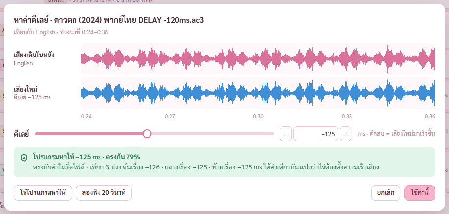
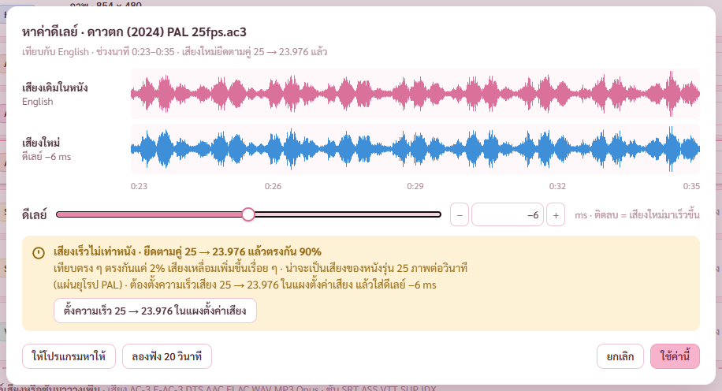

# รายงาน 8 พ.ย. 2569 · ตัวช่วยหาดีเลย์ (แผนเสียงและซับ ขั้น 5)

ต่อจากขั้น 4 ในรอบเดียวกัน ตามที่พี่กันสั่ง *"วันใหม่เเล้ว เริ่มงานหม่เลย"* · แผนบอกไว้ว่าทำต่อได้ ไม่ต้องหยุดถามระหว่างขั้น
ทุกการตรวจรันกับโปรแกรมแบบเปิดอยู่หลังสุด ถ่ายภาพผ่าน CDP · ปุ่มลองฟังในรุ่นทดสอบทำไฟล์แต่ไม่เปิดโปรแกรมเล่น ไม่มีอะไรเด้งขึ้นจอ · ไม่แตะไฟล์หนังจริงของพี่กัน

ผลตรวจ เทส Rust 89/89 (เพิ่ม 3 ตัว) · ตัวตรวจหน้าเสียงและซับ 53/53 (เพิ่ม 8 ข้อ)

## 1. ปุ่มหาค่าดีเลย์

อยู่ในการ์ดตั้งค่าแทร็ก ข้างช่องดีเลย์ ของเสียงที่เพิ่มจากไฟล์แยก · กับในคำเตือนเสียงยาวไม่เท่าหนัง (ปุ่ม ให้โปรแกรมเทียบเสียงกับหนัง)
กดแล้วหน้าต่างขึ้น ดึงคลื่นเสียงช่วงกลางเรื่องกับหาค่าดีเลย์ให้ทันที ไม่ต้องกดอีกรอบ

- คลื่นเสียงเดิมของหนังอยู่บน (ชมพู) เสียงใหม่อยู่ล่าง (ฟ้า) · ลากแถบเลื่อนหรือกด − + ทีละ 10 ms คลื่นเสียงใหม่เลื่อนตามทันที เทียบยอดเสียงด้วยตา
- โปรแกรมเทียบ 3 ช่วง ต้นเรื่อง กลางเรื่อง ท้ายเรื่อง บอกค่าทุกช่วงกับเปอร์เซ็นต์ที่ตรงกัน
- พากย์ไทยในไฟล์ทดสอบที่เลื่อนจริง 120 ms หาได้ −125 ms ตรงกัน 79% ทั้งสามช่วงได้ −126 −125 −125
  ชื่อไฟล์บอก −120 ต่างกัน 5 ms · แคลร์คาดว่ามาจากตัวแปลง AC-3 ตอนสร้างไฟล์ทดสอบเติมเสียงเงียบหัวไฟล์ราว 256 ตัวอย่าง (5.3 ms) แปลว่าเนื้อเสียงช้าจริง 125 ms · **ยังไม่ได้พิสูจน์**
- ตั้งค่าเองต่างจากที่โปรแกรมหาได้ บอกใต้แถบว่าต่างกันเท่าไหร่
- กด ใช้ค่านี้ ช่องดีเลย์ของแถวเป็นค่าที่ตั้ง

## 2. เสียงที่เร็วไม่เท่าหนัง

เสียงจากแผ่นยุโรป 25 ภาพต่อวินาทีเร็วกว่าหนัง 4% เทียบคลื่นตรง ๆ ไม่ติดเลย · โปรแกรมลองยืดเสียงใหม่ตามคู่ความเร็วที่เจอบ่อยก่อนเทียบ คู่ที่ตรงกันมากสุดคือคำตอบ

- ไฟล์ทดสอบเสียง PAL เทียบตรง ๆ ตรงกัน 2% · ยืดตามคู่ 25 → 23.976 แล้วตรงกัน 90% · บอกว่าน่าจะเป็นเสียงของหนังรุ่น 25 ภาพต่อวินาที
- ปุ่ม ตั้งความเร็ว 25 → 23.976 ในแผงตั้งค่าเสียง เปิดแผงตั้งค่าเสียงพร้อมช่องความเร็วตั้งไว้แล้ว · ความเร็วต้องแปลงเสียงใหม่ จึงตั้งในแผงตั้งค่าเสียง ไม่ใช่ในหน้าต่างนี้
- คลื่นเสียงใหม่ในหน้าต่างวาดแบบยืดแล้ว ยอดเสียงตรงกันให้เห็น
- ค่าสามช่วงต่างกันเกิน 40 ms โดยไม่มีคู่ความเร็วที่ตรง บอกว่าเสียงอาจถูกตัดต่อไม่เหมือนหนัง · หาไม่เจอเลย (ตรงกันต่ำกว่า 30%) บอกว่าเสียงอาจเป็นคนละรุ่น ให้เทียบเอง

## 3. ลองฟัง 20 วินาที

ทำไฟล์ MKV ชั่วคราวช่วงที่เห็นในหน้าต่าง ภาพจากหนัง เสียงใหม่ใส่ดีเลย์แล้ว เปิดด้วยโปรแกรมเล่นที่ตั้งไว้ในหน้าตั้งค่า (ไม่ได้ตั้ง ใช้ตัวที่หาเจอในเครื่อง)
ไฟล์ลองฟังอยู่ในโฟลเดอร์ชั่วคราวของโปรแกรม รอบใหม่ลบไฟล์รอบก่อนเอง · ไฟล์หนังไม่ถูกแก้ ตัวตรวจเทียบ hash แล้วเท่าเดิม
ตัวตรวจทำไฟล์จริง ได้ภาพ H.264 กับเสียง AC-3 ยาว 20.8 วินาที

## 4. วิธีหาค่า (delay.rs)

- ถอดเสียงทั้งสองแทร็กเป็นช่องเดียว 8 kHz ด้วย ffmpeg ทีละช่วง (เสียงเดิม 12 วินาที เสียงใหม่เผื่อข้างละ 5 วินาที) · หาได้ไกลสุด ±5 วินาที
- เทียบคลื่นเสียงด้วย cross-correlation ผ่าน FFT ตัวเดียวกับหน้ากราฟเสียง · ละเอียดกว่าหนึ่งตัวอย่างด้วยพาราโบลาสามจุด
- ช่วงกลางลองทุกคู่ความเร็ว 25 → 23.976 · 23.976 → 25 · 24 → 23.976 · 23.976 → 24 เลือกคู่ที่ตรงกันมากกว่าเทียบตรง ๆ เกิน 5 จุด
- ถอดแบบข้ามไปกลางไฟล์ (เร็ว) · ไฟล์ดิบบางชนิดข้ามไปได้ไม่เป๊ะ ถ้าเกิด สามช่วงจะไม่เท่ากันแล้วโปรแกรมบอก

## 5. การตัดสินใจ

- เปิดหน้าต่างแล้วหาให้ทันที ปุ่ม ให้โปรแกรมหาให้ เป็นปุ่มหาใหม่ · มอคอัปมีผลหาให้ขึ้นอยู่แล้ว
- ลองฟังใส่แค่ดีเลย์ ความเร็วเสียงมีผลตอนรวมจริงเพราะต้องแปลงเสียงใหม่ · บอกใต้ปุ่มเมื่อแทร็กตั้งความเร็วไว้
- เสียงอ้างอิงคือเสียงแรกในหนังที่ยังเก็บไว้

## 6. บั๊กที่เจอและแก้

**ป้าย ดีเลย์ −125 ms ใต้คำว่าเสียงใหม่ แตกเป็นสามบรรทัด** (ตรวจภาพรอบแรก)
คลาส lab ชนกับของหน้ากราฟเสียงที่จัดแนวตั้งและตัดข้อความ · เปลี่ยนชื่อเป็น dlab · ไล่เช็กชื่อคลาสใหม่ทุกตัวของวันนี้แล้วไม่ชนอีก

## 7. งานค้าง

- ขั้น 6 ตัวดูซับ · 7 จับคู่ไม่รวม · 8 หน้ากราฟเสียง โหมดแปลงและเทียบ · 9 เทสรวมและตัวติดตั้ง · 10 ผู้ช่วยตรวจ 1 ตัว
- ยังไม่ได้ตรวจ กับหนังจริงที่พากย์ไทยกับเสียงอังกฤษพูดคนละภาษา (เสียงประกอบร่วมกันต้องพอให้เทียบ) · ไฟล์ทดสอบเป็นเสียงเดียวกัน
- ยังไม่ได้ตรวจ ปุ่มลองฟังเปิดโปรแกรมเล่นจริง (ห้ามเด้งจอตอนพี่กันลงเวร)

## 8. พี่กันต้องทำเอง

- ลองกดหาค่าดีเลย์กับหนังจริงหนึ่งเรื่อง แล้วกดลองฟัง 20 วินาที ดูว่าเปิดโปรแกรมเล่นถูกตัว ปากตรงเสียง
