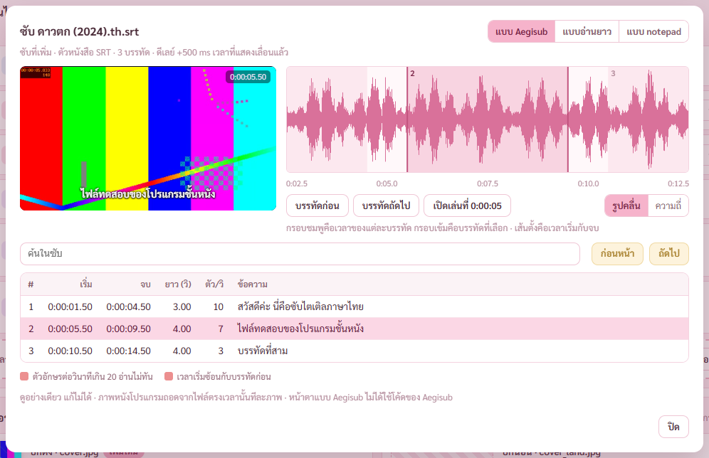
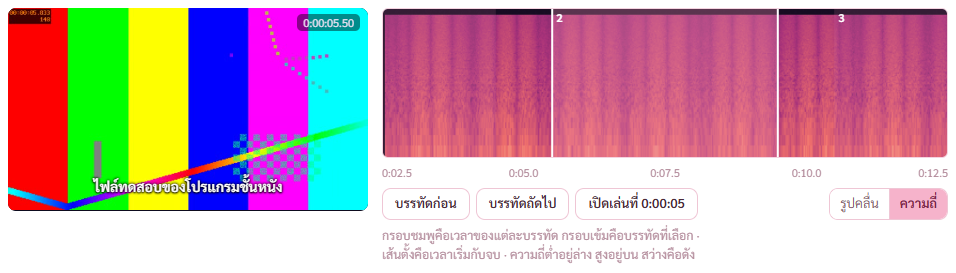
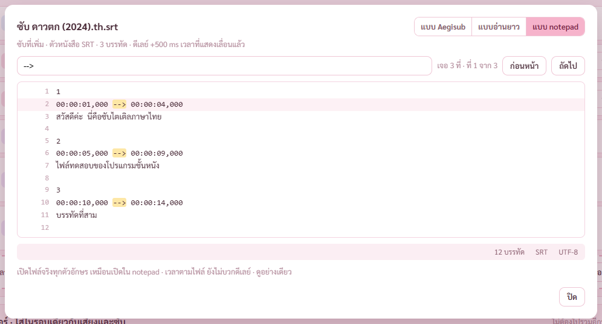
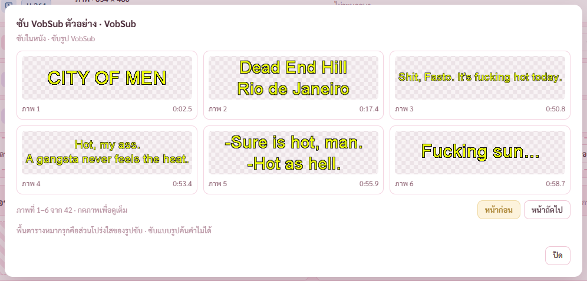

# รายงาน 8 พ.ย. 2569 · ตัวดูซับ (แผนเสียงและซับ ขั้น 6)

พี่กันสั่ง *"เธอ ทำให้จบทุกขั้น ตามแผนเดิม เราจะมาดูตอนเสร็จ เพราะทำงานอยู่ เรารีโหมดเข้ามา"*
ทุกการตรวจรันกับโปรแกรมแบบเปิดอยู่หลังสุด ถ่ายภาพผ่าน CDP ไม่มีอะไรเด้งขึ้นจอ · ไม่แตะไฟล์หนังจริงของพี่กัน

ผลตรวจ เทส Rust 91/91 (เพิ่ม 2 ตัว) · ตัวตรวจหน้าเสียงและซับ 64/64 (เพิ่ม 11 ข้อ)

## 1. ปุ่มรูปตาในแถวซับ

ทุกแถวซับมีปุ่มรูปตา ทั้งซับในหนังและซับที่เพิ่ม · ดูอย่างเดียว แก้ไม่ได้

## 2. แบบ Aegisub

- ภาพหนังตรงเวลาของบรรทัดที่เลือกพร้อมซับทับ ซ้ายบน · โปรแกรมถอดภาพจากไฟล์หนังทีละภาพ ไม่ต้องเล่นหนัง
- คลื่นเสียงช่วงนั้นพร้อมกรอบเวลาของแต่ละบรรทัด ขวาบน · กรอบเข้มคือบรรทัดที่เลือก เส้นตั้งคือเวลาเริ่มกับจบ
- ตารางบรรทัดซับ เวลาเริ่ม จบ ยาว ตัวอักษรต่อวินาที ข้อความ · ช่องตัว/วิขึ้นสีแดงเมื่อเกิน 20 (อ่านไม่ทัน) · ช่องเวลาเริ่มขึ้นสีเมื่อซ้อนกับบรรทัดก่อน
- กดแถว หรือปุ่มบรรทัดก่อน บรรทัดถัดไป ภาพกับคลื่นเลื่อนตาม
- ปุ่มรูปคลื่น กับ ความถี่ · ความถี่ใช้คำสั่งเดียวกับหน้ากราฟเสียง ความถี่ต่ำอยู่ล่าง สูงอยู่บน สว่างคือดัง
- ปุ่มเปิดเล่นที่เวลาของบรรทัด เปิดหนังด้วยโปรแกรมเล่นที่ตั้งไว้ (ตัวตรวจไม่กด เพราะจะเปิดโปรแกรมเล่นขึ้นจอ)

- ซับไทยในภาพตั้งดีเลย์ +500 ms ไว้ เวลาที่แสดงเลื่อนแล้ว (1.00 เป็น 1.50)

## 3. แบบอ่านยาว กับแบบ notepad

- แบบอ่านยาว เรียงบรรทัดพร้อมเวลา ค้นคำ บอกเจอกี่ที่ ที่เท่าไหร่ กดก่อนหน้า ถัดไป หรือ Enter ไฮไลต์คำที่เจอ
- แบบ notepad เปิดไฟล์จริงทุกตัวอักษร มีเลขบรรทัด ค้นคำได้ · ใต้กล่องบอกจำนวนบรรทัด ชนิด รหัสอักษร · เวลาตามไฟล์ ยังไม่บวกดีเลย์
- ซับไทยที่เข้ารหัสแบบเก่า (TIS-620) อ่านได้เหมือนซับ UTF-8 · ซับ ASS เอาแท็กสีออก แสดงเฉพาะข้อความ · ซับ VTT

## 4. ซับรูป PGS กับ VobSub

- ถอดเป็นรูปทีละภาพ หน้าละ 6 ภาพ พร้อมเวลา · พื้นตารางหมากรุกคือส่วนโปร่งใส
- กดภาพ ดูเต็มกรอบที่ตำแหน่งจริงบนจอ
- ครั้งแรกต้องอ่านทั้งไฟล์ หนังยาวใช้เวลาสักครู่ · ผลเก็บไว้ในโฟลเดอร์ชั่วคราว ครั้งต่อไปเปิดทันที
- ไฟล์ทดสอบ PGS ได้ 1 ภาพ (ขึ้นวินาทีที่ 1 หายวินาทีที่ 9) · VobSub ได้ 42 ภาพ
- ภาพในภาพมาจากไฟล์ตัวอย่างทางการของ FFmpeg (หนัง City of Men) คำหยาบเป็นของไฟล์ตัวอย่าง

## 5. วิธีทำ (subs.rs)

- ซับที่เพิ่มอ่านไฟล์ตรง · ซับในหนัง MKV ดึงด้วย mkvextract ได้ไฟล์ต้นฉบับทุกตัวอักษร · ซับในหนัง MP4 ให้ ffmpeg แปลงเป็น SRT
- รหัสอักษร BOM ก่อน (UTF-8 UTF-16) · UTF-8 ที่ถูกต้อง · ไม่ใช่ อ่านเป็นไทยแบบเก่า CP874 (เขียนตารางเอง ไม่ต้องเพิ่มห้องสมุด)
- ตัวแยกบรรทัด SRT VTT ASS SSA เขียนเอง · ASS ใช้บรรทัด Format หาช่อง Start End Text ข้อความมีจุลภาคก็ไม่ขาด
- ซับรูปถอดด้วย ffmpeg แบบ sub2video ได้ภาพทุกครั้งที่ซับเปลี่ยน · ตัดภาพว่าง (ตอนซับหาย) กับภาพซ้ำออก ครอปเฉพาะส่วนที่มีตัวหนังสือ

## 6. บั๊กที่เจอและแก้

**กดหน้าถัดไปของซับรูป ป้ายเปลี่ยนเป็นภาพที่ 7–12 ทันที แต่ภาพยังเป็นของหน้าแรก กดภาพช่วงนั้นได้ภาพผิด** (ตัวตรวจข้อใหม่เจอ)
แก้ให้ระหว่างโหลดหน้าใหม่ขึ้นโครงจาง ไม่โชว์ภาพของหน้าเก่าค้าง

**เลขบรรทัดบนภาพความถี่อ่านยาก** (ตรวจภาพ) · เปลี่ยนเป็นสีขาวตอนอยู่โหมดความถี่

**ช่องค้นในซับสูงกว่าปุ่มก่อนหน้า ถัดไป · ปุ่มที่กดไม่ได้ไม่บอกเหตุผล** (ตรวจภาพ) · ช่องสูง 32 เท่าปุ่ม ตัวตรวจวัดแล้ว · ปุ่มบอกว่าพิมพ์คำที่จะค้นก่อน หรือไม่เจอคำที่ค้น

**README ของไฟล์ทดสอบเขียนว่า VobSub 46 ภาพ PGS 2 ภาพ** ซึ่งนับจากแพ็กเก็ต · ของจริงเห็นเป็นภาพ 42 กับ 1 (VobSub มี 4 แพ็กเก็ตที่ไม่มีรูป PGS แพ็กเก็ตที่สองคือคำสั่งลบภาพ) · แก้ README ให้ตรงแล้ว

## 7. งานค้าง

- ขั้น 7 จับคู่ไม่รวม · 8 หน้ากราฟเสียง · 9 เทสรวมและตัวติดตั้ง · 10 ผู้ช่วยตรวจ 1 ตัว
- ยังไม่ได้ตรวจ ซับรูปของหนังยาวจริง (ไฟล์หลาย GB) ว่าถอดครั้งแรกนานแค่ไหน · ไฟล์ทดสอบสั้น
- ยังไม่ได้ตรวจ ซับในหนัง MP4 (mov_text) ในหน้าจอ · มีแค่ทางโค้ด
- ยังไม่ได้ตรวจ ปุ่มเปิดเล่นที่เวลาบรรทัดเปิดโปรแกรมเล่นจริง (ห้ามเด้งจอตอนพี่กันลงเวร)
