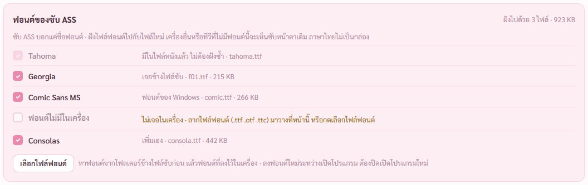
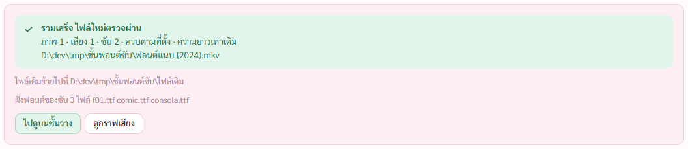

# รายงาน 8 พ.ย. 2569 · ฝังฟอนต์ของซับ ASS ตอนรวม

พี่กันสั่ง *"เสริมอีกเรื่องที่ต่อคิว เราลืมไปว่าพวกซับ ass มันต้องฝังฟ้อนด้วยนี่นา ให้มีระบบนี้ด้วยนะ"*

## 1. ทำไมต้องฝัง

ซับ ASS เก็บแค่ชื่อฟอนต์ ไม่มีตัวฟอนต์ · เปิดหนังบนเครื่องหรือทีวีที่ไม่มีฟอนต์นั้น ตัวหนังสือเปลี่ยนหน้าตา ป้ายที่จัดตำแหน่งไว้เพี้ยน ภาษาไทยอาจเป็นกล่อง · MKV เก็บไฟล์ฟอนต์เป็นไฟล์แนบได้ โปรแกรมเล่นอย่าง mpv VLC MPC โหลดฟอนต์จากในไฟล์เอง

## 2. ทำอะไร

- เพิ่มซับ ASS หรือ SSA ในหน้าเสียงและซับ โปรแกรมอ่านชื่อฟอนต์ทุกตัวที่ซับใช้ ทั้งจากสไตล์และจากคำสั่งเปลี่ยนฟอนต์กลางบรรทัด
- หาไฟล์ฟอนต์ตามลำดับ โฟลเดอร์ข้างไฟล์ซับ (รวมโฟลเดอร์ย่อย fonts ที่ชุดซับมักแถมมา) → ฟอนต์ที่ลงไว้เฉพาะผู้ใช้ → ฟอนต์ของ Windows
- เทียบกับชื่อที่อ่านจากในไฟล์ฟอนต์จริง ไม่เดาจากชื่อไฟล์ (ชุดซับบางชุดตั้งชื่อไฟล์ฟอนต์เป็นเลข เช่น f01.ttf)
- การ์ด **ฟอนต์ของซับ ASS** บอกทุกชื่อ ติ๊กฝังไว้ให้ทุกตัวที่เจอ เอาติ๊กออกได้
  - ฟอนต์ที่หนังมีแนบอยู่แล้ว ติ๊กไว้แบบจาง ไม่ฝังซ้ำ
  - ฟอนต์ที่หาไม่เจอ บอกตรง ๆ ลากไฟล์ฟอนต์มาวางที่หน้า หรือกดเลือกไฟล์ฟอนต์ เพิ่มเองได้
- รวมแล้วฟอนต์ที่ติ๊กไว้เข้าไฟล์ใหม่เป็นไฟล์แนบ · ตัวตรวจไฟล์ใหม่เช็กว่าไฟล์แนบครบตามที่สั่ง ไม่ครบลบไฟล์ใหม่ทิ้ง ไม่แตะไฟล์เดิม
- เลือกไฟล์ที่ได้เป็น MP4 การ์ดเตือนว่า MP4 ฝังฟอนต์ไม่ได้

ซับทดสอบเรียก 4 ฟอนต์ · Tahoma หนังมีอยู่แล้ว ติ๊กจาง · Georgia เจอในโฟลเดอร์ fonts ข้างซับ แม้ชื่อไฟล์เป็น f01.ttf · Comic Sans MS เจอในฟอนต์ของ Windows · ตัวที่ไม่มีในเครื่องบอกว่าไม่เจอพร้อมวิธีเพิ่ม · Consolas ลากมาเพิ่มเอง

รวมเสร็จ ตรวจผ่าน ผลบอกว่าฝังฟอนต์ของซับ 3 ไฟล์ · อ่านไฟล์ใหม่ได้ไฟล์แนบ comic.ttf consola.ttf f01.ttf tahoma.ttf ไม่ซ้ำ

## 3. ที่แก้ระหว่างทำ

- แถวฟอนต์ที่หนังมีอยู่แล้ว เดิมเป็นช่องติ๊กว่าง ดูเหมือนฟอนต์จะหายจากไฟล์ใหม่ · เปลี่ยนเป็นติ๊กไว้แบบจาง กดไม่ได้

## 4. ผลตรวจ

- เทส Rust 112/112 (เพิ่ม 4 ข้อ) · อ่านชื่อฟอนต์จากซับ · อ่านชื่อในไฟล์ฟอนต์ของ Windows รวมไฟล์ TTC · หาฟอนต์ข้างซับก่อนฟอนต์ของ Windows · รวมจริงแล้วไฟล์ใหม่มีฟอนต์ครบ ไม่ซ้ำ และไฟล์ฟอนต์หายไปแล้วหยุดพร้อมบอก
- พิสูจน์ว่าจับของผิดได้ · ปิดการฝังฟอนต์ชั่วคราว ตัวตรวจไฟล์ใหม่ของโปรแกรมฟ้อง "ไฟล์แนบไม่ตรง" แล้วลบไฟล์ใหม่ทิ้ง · คืนแล้วผ่าน
- ตัวตรวจใหม่ check-fonts 16/16 ผ่านโปรแกรมจริง · รวมไฟล์ 20/20 · หน้าเสียงและซับ 74/74

## 5. ยังไม่ได้ตรวจ

- ยังไม่ได้เปิดไฟล์ที่ฝังฟอนต์ด้วยโปรแกรมเล่นจริงดูหน้าตาซับ (ตัวตรวจไม่เปิดโปรแกรมเล่น เพราะหน้าต่างจะเด้งขึ้นจอ)
- ซับ ASS ที่อยู่ในไฟล์ MKV หรือ MKS ที่เพิ่ม ใช้ฟอนต์ที่แนบมากับไฟล์นั้นอยู่แล้ว (ติดไปเหมือนเดิม) ไม่ได้หาฟอนต์เพิ่ม
- ปุ่มเลือกไฟล์ฟอนต์ไม่ได้กด เพราะหน้าต่างเลือกไฟล์จะเด้งขึ้นจอ · ทางลากไฟล์ทดสอบแล้ว
- ยังไม่ได้ลองในตัวติดตั้ง
- ลงฟอนต์ใหม่ระหว่างเปิดโปรแกรม ต้องปิดเปิดโปรแกรมใหม่ถึงจะเจอ (โปรแกรมอ่านรายชื่อฟอนต์ในเครื่องครั้งเดียวแล้วจำไว้)
