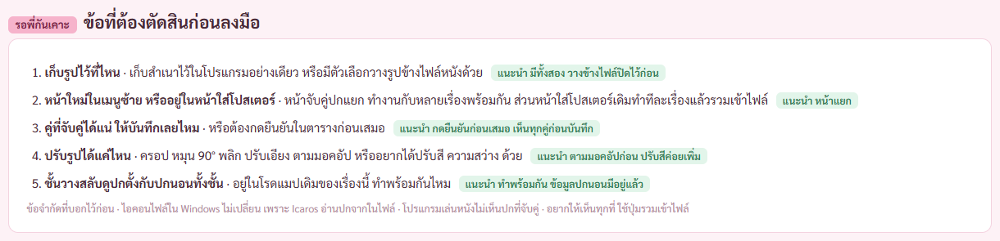

# รายงาน 8 พ.ย. 2569 · มอคอัประบบจับคู่รูปปกกับไฟล์หนัง (ไม่รวมเข้าไฟล์)

พี่กันสั่ง *"เธอไปร่างมอคอัปมา สิ่งที่เราต้องการคือ เเม้โปสเต้อ เเละวิดีโอจะอยู่คนละที่ เเต่โปรแกรมจะจับคู่กันได้ โดยไม่ต้อง merge เเละภาพที่เอามาจับคู่ก้สามารุดัดแปลง ครอบ บิด อะไรได้หมดเหมือนที่จะรวมกับรูป เเละเราอยากได้วิธีกดที่ง่าย เพราะสมมุติเรามีหนัง 100 เรื่อง กับรูป 100 รูป เราจะจับคู่ยังไงให้ง่าย ไปเสนอมานะ"*

มอคอัปอยู่ [mockups/poster-link.html](mockups/poster-link.html) · ภาพถ่ายผ่านหน้าต่างโปรแกรมแบบอยู่หลังสุดกับ CDP ไม่มีอะไรขึ้นจอ · ชื่อหนังกับรูปเป็นของสมมติ

## 1. ข้อเสนอ จับคู่ได้ 3 ทาง

หนัง 100 เรื่องกับรูป 100 รูป ส่วนใหญ่จบที่ทางที่ 1 ด้วยปุ่มเดียว ที่เหลือไม่กี่เรื่องจบที่ทางที่ 2 ทางที่ 3 ไว้เปลี่ยนรูปทีละเรื่อง

## 2. หน้าจับคู่ปก ลากรูปทั้งโฟลเดอร์มาวาง

หน้าใหม่ในเมนูซ้าย · เลือกว่าจะจับคู่เฉพาะเรื่องที่ยังไม่มีปก หรือทุกเรื่อง · อ่านรูปเสร็จบอกผลรวมก่อน ยังไม่บันทึกอะไร

## 3. ตารางตรวจผลจับคู่ ยืนยันทีเดียว

- โปรแกรมตัดปี ความละเอียด ชื่อทีมทำไฟล์ออกจากชื่อก่อนเทียบ · ชื่อกับปีตรงกัน ติ๊กไว้ให้ · รูปที่อยู่ข้างไฟล์หนัง (folder.jpg poster.jpg) จับคู่ให้ก่อน · เลข IMDb ในชื่อรูปหรือไฟล์ .nfo ใช้จับคู่ได้แม่นที่สุด
- คู่ที่ไม่แน่ใจขึ้นสีเหลือง มีรูปใกล้เคียง 3 รูปให้กดเลือก · หาคู่ไม่เจอขึ้นสีแดง ไปต่อที่กระดาน
- รูปแนวนอนใช้เป็นปกนอน และครอปกลางรูปเป็นปกตั้งให้ก่อน แก้ทีหลังได้

## 4. กระดานจับคู่ ลากรูปไปวางบนหนัง หรือกดรูปแล้วกดหนัง

รูปที่เหลือซ้าย หนังที่ยังไม่มีปกขวา · กดรูปแล้วกดหนัง 2 คลิก หรือลากไปวาง · จับคู่แล้วแถวเขียวแล้วหายจากกระดาน กดย้อนได้ · ใช้คีย์บอร์ดได้

## 5. ครอป หมุน ปรับเอียง ได้ทุกอย่างเหมือนตอนรวม

ใช้หน้าครอปเดิม เพิ่มหมุน 90° พลิก และปรับเอียงทีละ 0.5° (คำว่า บิด ของพี่กัน แคลร์ตีความเป็นหมุนกับปรับเอียง) · รูปต้นฉบับไม่ถูกแก้ โปรแกรมจำค่าที่ปรับไว้ แก้ใหม่ได้ · รูปเดียวได้ทั้งปกตั้งและปกนอน

## 6. บนชั้นวาง ปกที่จับคู่ไว้มีป้ายโซ่

ปกที่จับคู่แสดงบนชั้นวางเหมือนปกในไฟล์ มีป้ายโซ่บอก · แผงขวามีครอปใหม่ เปลี่ยนรูป เอาออก และรวมเข้าไฟล์ (ใช้รูปที่ครอปไว้แล้ว)

## 7. เก็บรูปไว้ที่ไหน

แคลร์เสนอเก็บสำเนารูปไว้ในโปรแกรม ลบหรือย้ายรูปต้นฉบับแล้วปกไม่หาย · ตัวเลือกเสริมวางรูปข้างไฟล์หนังแบบที่ Kodi Jellyfin Plex อ่าน

## 8. รอพี่กันเคาะ

1. เก็บรูปไว้ในโปรแกรมอย่างเดียว หรือมีตัวเลือกวางรูปข้างไฟล์หนังด้วย · แคลร์แนะนำ มีทั้งสอง วางข้างไฟล์ปิดไว้ก่อน
2. หน้าจับคู่ปกแยกในเมนูซ้าย หรืออยู่ในหน้าใส่โปสเตอร์ · แคลร์แนะนำ หน้าแยก
3. คู่ที่จับคู่ได้แน่ บันทึกเลยหรือต้องกดยืนยันก่อน · แคลร์แนะนำ กดยืนยันก่อนเสมอ
4. ปรับรูปได้แค่ครอป หมุน พลิก ปรับเอียง หรืออยากได้ปรับสีด้วย · แคลร์แนะนำ ตามมอคอัปก่อน
5. ชั้นวางสลับดูปกตั้งกับปกนอนทั้งชั้น (อยู่ในโรดแมปเดิม) ทำพร้อมกันไหม · แคลร์แนะนำ ทำพร้อมกัน

ข้อจำกัด · ไอคอนไฟล์ใน Windows ไม่เปลี่ยน (Icaros อ่านปกจากในไฟล์) · โปรแกรมเล่นหนังไม่เห็นปกที่จับคู่ · อยากเห็นทุกที่ใช้ปุ่มรวมเข้าไฟล์

## 9. ตรวจภาพแล้วแก้ก่อนส่ง

- หน้า 2 แท็บที่เลือกไว้เป็นจับคู่ได้แน่ แต่ตารางมีแถวไม่แน่ใจกับหาคู่ไม่เจอ · เปลี่ยนเป็นแท็บทั้งหมด
- หน้า 2 ปุ่มครอปกับเปลี่ยนรูปตกบรรทัดซ้อนกัน · ให้อยู่บรรทัดเดียว
- หน้า 3 รูปที่กำลังลากบังชื่อการ์ดอื่น · ย้ายไปไว้ระหว่างทางไปหาหนังที่จะวาง
- หน้าตั้งค่า เดิมเขียนว่าโปรแกรมจำไฟล์จากลายนิ้วมือไฟล์ ไม่ตรงของจริง · แก้เป็นตามไฟล์จากเลขประจำไฟล์ของ Windows ย้ายในไดรฟ์เดียวกันยังตามเจอ ย้ายข้ามไดรฟ์ต้องจับคู่ใหม่
- ภาพรอบแรกออกมาว่างเปล่า เพราะตัวถ่ายคิดตำแหน่งจากจอ ใช้ได้กับหน้าโปรแกรมที่ไม่เลื่อนทั้งหน้า แต่หน้ามอคอัปเลื่อนทั้งหน้า · สคริปต์ถ่ายของรอบนี้บวกระยะที่เลื่อนเอง ไม่แตะตัวต่อ CDP ที่ตัวตรวจอื่นใช้
