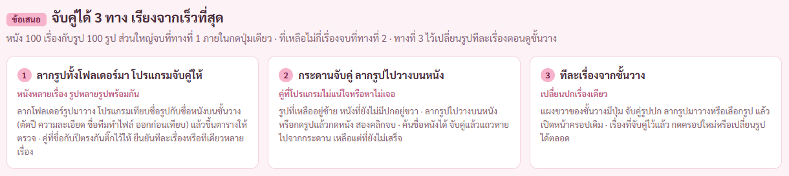
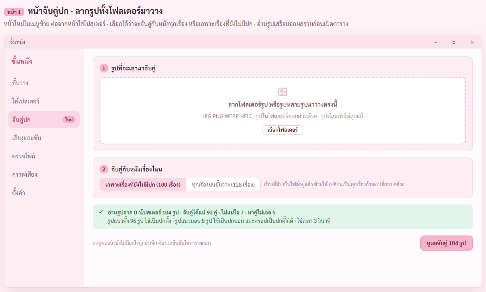
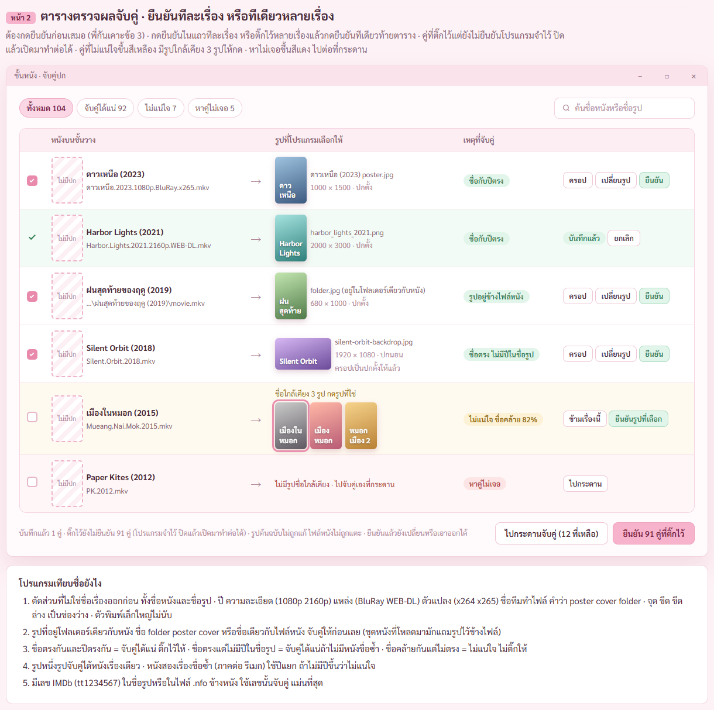
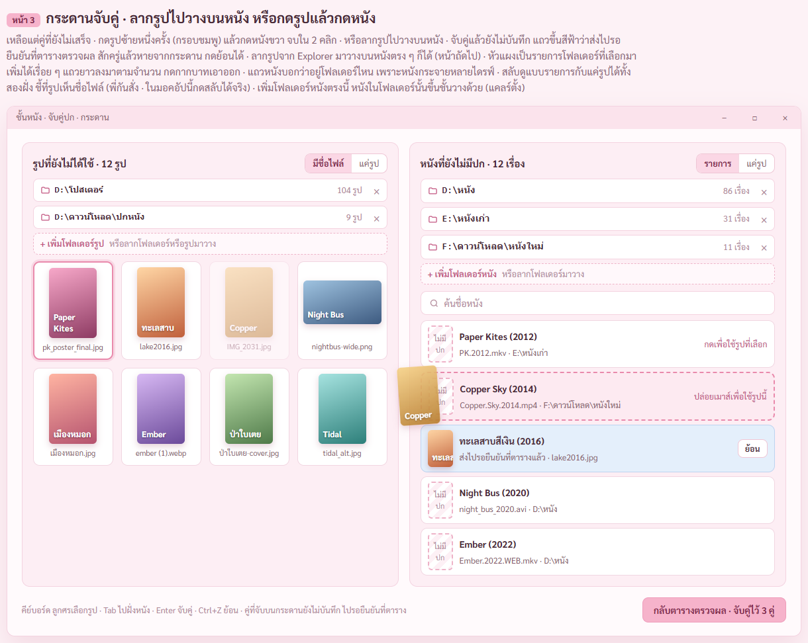
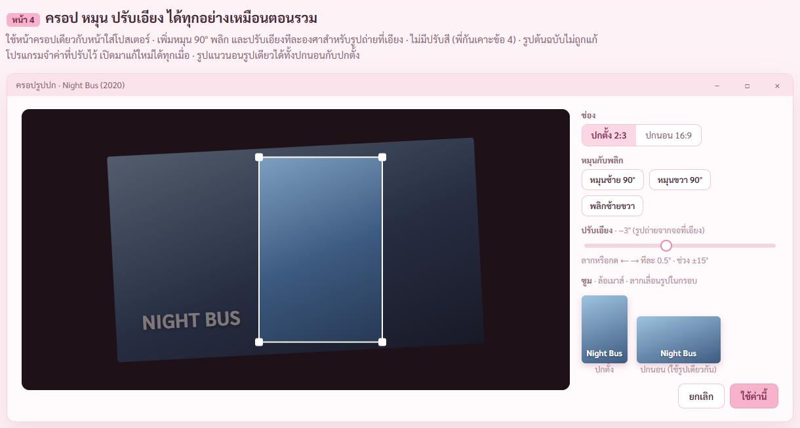
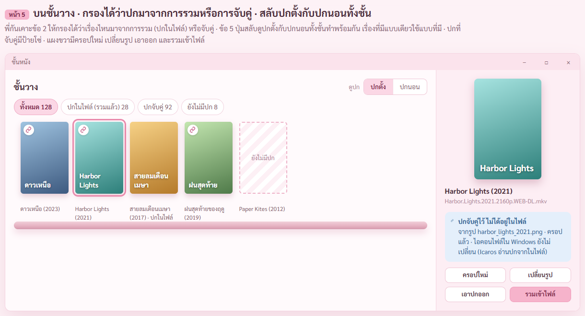
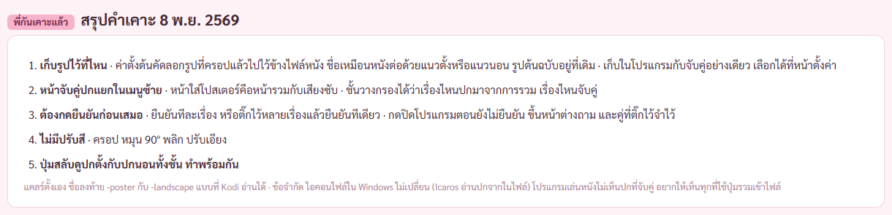
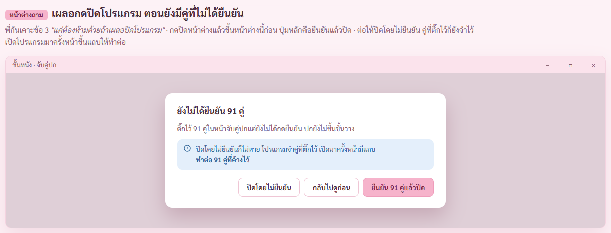
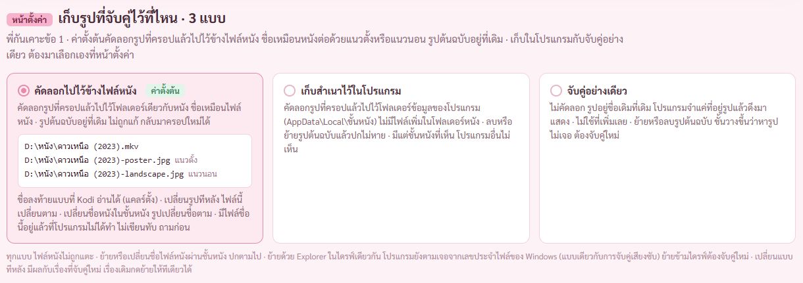

# รายงาน 8 พ.ย. 2569 · มอคอัประบบจับคู่รูปปกกับไฟล์หนัง (ไม่รวมเข้าไฟล์)

พี่กันสั่ง *"เธอไปร่างมอคอัปมา สิ่งที่เราต้องการคือ เเม้โปสเต้อ เเละวิดีโอจะอยู่คนละที่ เเต่โปรแกรมจะจับคู่กันได้ โดยไม่ต้อง merge เเละภาพที่เอามาจับคู่ก้สามารุดัดแปลง ครอบ บิด อะไรได้หมดเหมือนที่จะรวมกับรูป เเละเราอยากได้วิธีกดที่ง่าย เพราะสมมุติเรามีหนัง 100 เรื่อง กับรูป 100 รูป เราจะจับคู่ยังไงให้ง่าย ไปเสนอมานะ"*

มอคอัปอยู่ [mockups/poster-link.html](mockups/poster-link.html) · ภาพถ่ายผ่านหน้าต่างโปรแกรมแบบอยู่หลังสุดกับ CDP ไม่มีอะไรขึ้นจอ · ชื่อหนังกับรูปเป็นของสมมติ

## 1. ข้อเสนอ จับคู่ได้ 3 ทาง

หนัง 100 เรื่องกับรูป 100 รูป ส่วนใหญ่จบที่ทางที่ 1 ด้วยปุ่มเดียว ที่เหลือไม่กี่เรื่องจบที่ทางที่ 2 ทางที่ 3 ไว้เปลี่ยนรูปทีละเรื่อง

## 2. หน้าจับคู่ปก ลากรูปทั้งโฟลเดอร์มาวาง

หน้าใหม่ในเมนูซ้าย · เลือกว่าจะจับคู่เฉพาะเรื่องที่ยังไม่มีปก หรือทุกเรื่อง · อ่านรูปเสร็จบอกผลรวมก่อน ยังไม่บันทึกอะไร

## 3. ตารางตรวจผลจับคู่ ยืนยันทีเดียว

- โปรแกรมตัดปี ความละเอียด ชื่อทีมทำไฟล์ออกจากชื่อก่อนเทียบ · ชื่อกับปีตรงกัน ติ๊กไว้ให้ · รูปที่อยู่ข้างไฟล์หนัง (folder.jpg poster.jpg) จับคู่ให้ก่อน · เลข IMDb ในชื่อรูปหรือไฟล์ .nfo ใช้จับคู่ได้แม่นที่สุด
- คู่ที่ไม่แน่ใจขึ้นสีเหลือง มีรูปใกล้เคียง 3 รูปให้กดเลือก · หาคู่ไม่เจอขึ้นสีแดง ไปต่อที่กระดาน
- รูปแนวนอนใช้เป็นปกนอน และครอปกลางรูปเป็นปกตั้งให้ก่อน แก้ทีหลังได้

## 4. กระดานจับคู่ ลากรูปไปวางบนหนัง หรือกดรูปแล้วกดหนัง

รูปที่เหลือซ้าย หนังที่ยังไม่มีปกขวา · กดรูปแล้วกดหนัง 2 คลิก หรือลากไปวาง · จับคู่แล้วแถวเขียวแล้วหายจากกระดาน กดย้อนได้ · ใช้คีย์บอร์ดได้

## 5. ครอป หมุน ปรับเอียง ได้ทุกอย่างเหมือนตอนรวม

ใช้หน้าครอปเดิม เพิ่มหมุน 90° พลิก และปรับเอียงทีละ 0.5° (คำว่า บิด ของพี่กัน แคลร์ตีความเป็นหมุนกับปรับเอียง) · รูปต้นฉบับไม่ถูกแก้ โปรแกรมจำค่าที่ปรับไว้ แก้ใหม่ได้ · รูปเดียวได้ทั้งปกตั้งและปกนอน

## 6. บนชั้นวาง ปกที่จับคู่ไว้มีป้ายโซ่

ปกที่จับคู่แสดงบนชั้นวางเหมือนปกในไฟล์ มีป้ายโซ่บอก · แผงขวามีครอปใหม่ เปลี่ยนรูป เอาออก และรวมเข้าไฟล์ (ใช้รูปที่ครอปไว้แล้ว)

## 7. เก็บรูปไว้ที่ไหน

รอบแรกแคลร์เสนอเก็บสำเนารูปไว้ในโปรแกรมเป็นหลัก · พี่กันเคาะให้ค่าตั้งต้นเป็นคัดลอกไปไว้ข้างไฟล์หนัง ส่วนเก็บในโปรแกรมต้องเลือกเอง (ภาพหน้าตั้งค่าใหม่อยู่ข้อ 8)

## 8. พี่กันเคาะครบ 5 ข้อ (8 พ.ย. 2569) · มอคอัปแก้ตามแล้ว

1. *"ข้อ 1 ค่าตั้งต้นคือ ระบบจะ copy ไฟล์ภาพและเปลี่ยนชื่อให้เหมือนกับชื่อหนังเลย แต่ตปุ่มตั้งค่าสามารถเอาออกได้ แค่จับคู่ ชื่อเดิม ที่เดิม แค่โปรแกรมจับมาแสดงเฉยๆ"* · *"เก็บในโปรแกรม เอา แต่ต้องไปเลือกในตั้งค่า"* · *"รูผที่ ครอบแล้วตอน copy มาตัวต้นฉบับยังอยู่ เป็นค่าพื้นฐาน"* · *"นามสกุลเป็นรูป ใช่ และใส่ด้วย แนวตั้งแนวนอน"*
   หน้าตั้งค่ามี 3 แบบ คัดลอกไปไว้ข้างไฟล์หนัง (ค่าตั้งต้น) · เก็บสำเนาไว้ในโปรแกรม · จับคู่อย่างเดียว · ชื่อลงท้าย -poster กับ -landscape แคลร์ตั้งเอง แบบที่ Kodi อ่านได้
2. *"แยกหน้า … หนังที่รวม หรือจับคู่ ตะไปแสดงที่ชั้นหนัง และสามารถกดกรองได้ว่าเรื่องไหนมาจาก merge หรือจับคู่"* · ชั้นวางมีตัวกรอง ปกในไฟล์ (รวมแล้ว) · ปกจับคู่ · ยังไม่มีปก
3. *"กดยืนวันก่อนเท่านั้น แต่เราอยากได้แบบ กดทีละเรื่อง หรือเราเลือกจับคู่ไว้จนครบ 50 เรื่องแล้วกดยืนยันทีเดียวได้ แค่ต้องห้ามด้วยถ้าเผลอปิดโปรแกรม"* · ปุ่มยืนยันในแถวกับปุ่มยืนยันที่ติ๊กไว้ท้ายตาราง · หน้าต่างถามก่อนปิด คู่ที่ติ๊กไว้จำไว้
4. *"ไม่เอาปรับสี"*
5. *"ทำพร้อมกัน"* · ปุ่มสลับดูปกตั้งกับปกนอนทั้งชั้น

ข้อจำกัด · ไอคอนไฟล์ใน Windows ไม่เปลี่ยน (Icaros อ่านปกจากในไฟล์) · โปรแกรมเล่นหนังไม่เห็นปกที่จับคู่ · อยากเห็นทุกที่ใช้ปุ่มรวมเข้าไฟล์

### หน้าที่แก้ตามคำเคาะ

ตารางมีปุ่มยืนยันในแถว แถวที่บันทึกแล้วเป็นสีเขียวมีปุ่มยกเลิก · ท้ายตารางยืนยันที่ติ๊กไว้ทีเดียว 91 คู่

กดปิดโปรแกรมตอนยังมีคู่ที่ไม่ได้ยืนยัน ขึ้นหน้าต่างนี้ ปุ่มหลักคือยืนยันแล้วปิด · ปิดโดยไม่ยืนยันก็ไม่หาย เปิดมาครั้งหน้ามีแถบทำต่อ

ชั้นวางมีตัวกรองว่าปกมาจากการรวมหรือจับคู่ และปุ่มสลับดูปกตั้งกับปกนอน

หน้าตั้งค่า 3 แบบ ค่าตั้งต้นคัดลอกไปไว้ข้างไฟล์หนัง พร้อมตัวอย่างชื่อไฟล์

## 9. ตรวจภาพแล้วแก้ก่อนส่ง

- หน้า 2 แท็บที่เลือกไว้เป็นจับคู่ได้แน่ แต่ตารางมีแถวไม่แน่ใจกับหาคู่ไม่เจอ · เปลี่ยนเป็นแท็บทั้งหมด
- หน้า 2 ปุ่มครอปกับเปลี่ยนรูปตกบรรทัดซ้อนกัน · ให้อยู่บรรทัดเดียว
- หน้า 3 รูปที่กำลังลากบังชื่อการ์ดอื่น · ย้ายไปไว้ระหว่างทางไปหาหนังที่จะวาง
- หน้าตั้งค่า เดิมเขียนว่าโปรแกรมจำไฟล์จากลายนิ้วมือไฟล์ ไม่ตรงของจริง · แก้เป็นตามไฟล์จากเลขประจำไฟล์ของ Windows ย้ายในไดรฟ์เดียวกันยังตามเจอ ย้ายข้ามไดรฟ์ต้องจับคู่ใหม่
- ภาพรอบแรกออกมาว่างเปล่า เพราะตัวถ่ายคิดตำแหน่งจากจอ ใช้ได้กับหน้าโปรแกรมที่ไม่เลื่อนทั้งหน้า แต่หน้ามอคอัปเลื่อนทั้งหน้า · สคริปต์ถ่ายของรอบนี้บวกระยะที่เลื่อนเอง ไม่แตะตัวต่อ CDP ที่ตัวตรวจอื่นใช้
- รอบแก้ตามคำเคาะ · แถวที่บันทึกแล้วยังมีช่องติ๊กชมพู (สคริปต์แก้ของแคลร์จับข้อความไม่เจอ) เปลี่ยนเป็นเครื่องหมายถูกสีเขียว · ที่อยู่ไฟล์ยาวกับข้อความครอปเป็นปกตั้งตัดกลางคำ ย่อที่อยู่และแยกบรรทัด · หน้าต่างกันเผลอปิด คำว่าทำต่อ 91 คู่ที่ค้างไว้ขาดสองบรรทัด ให้อยู่บรรทัดเดียว
