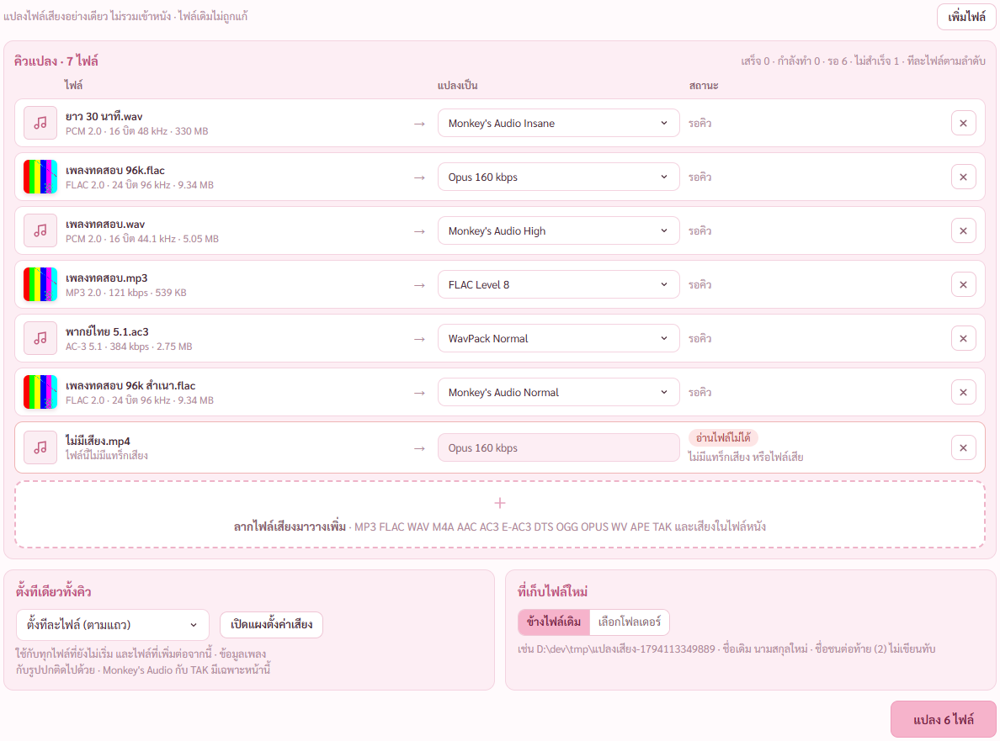
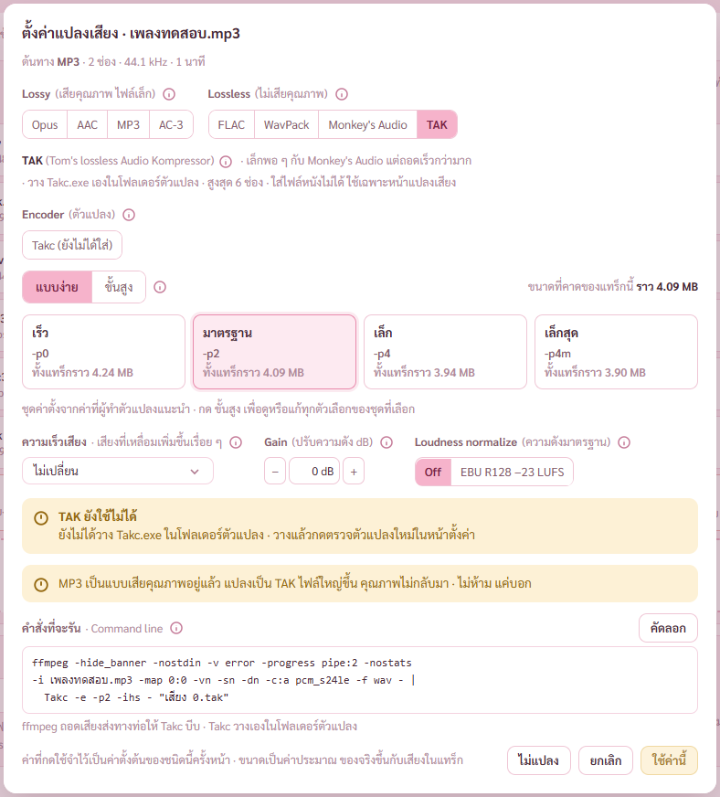
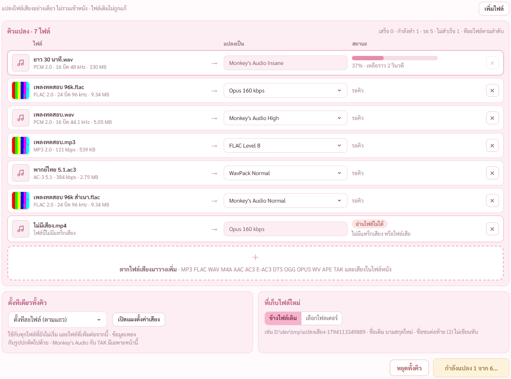
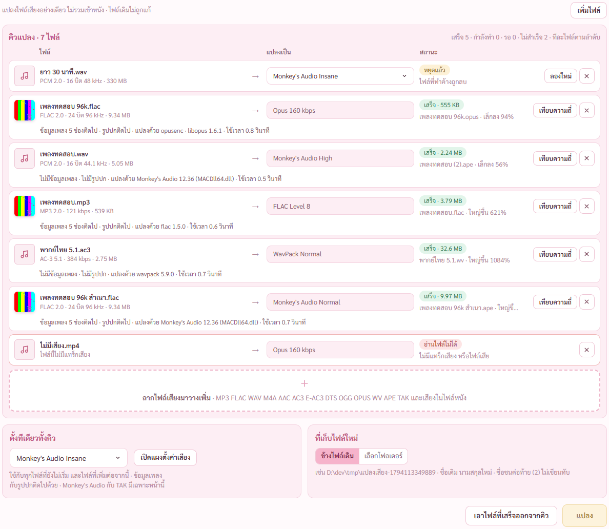
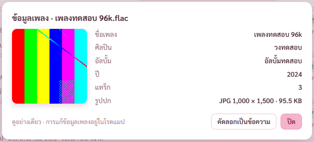
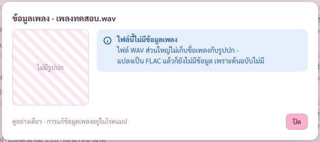
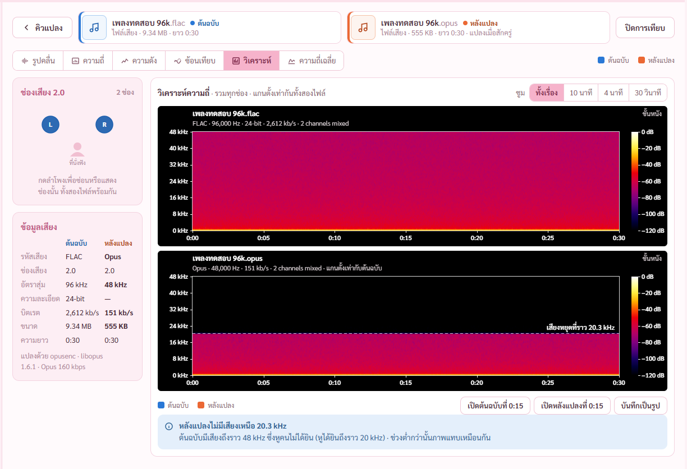
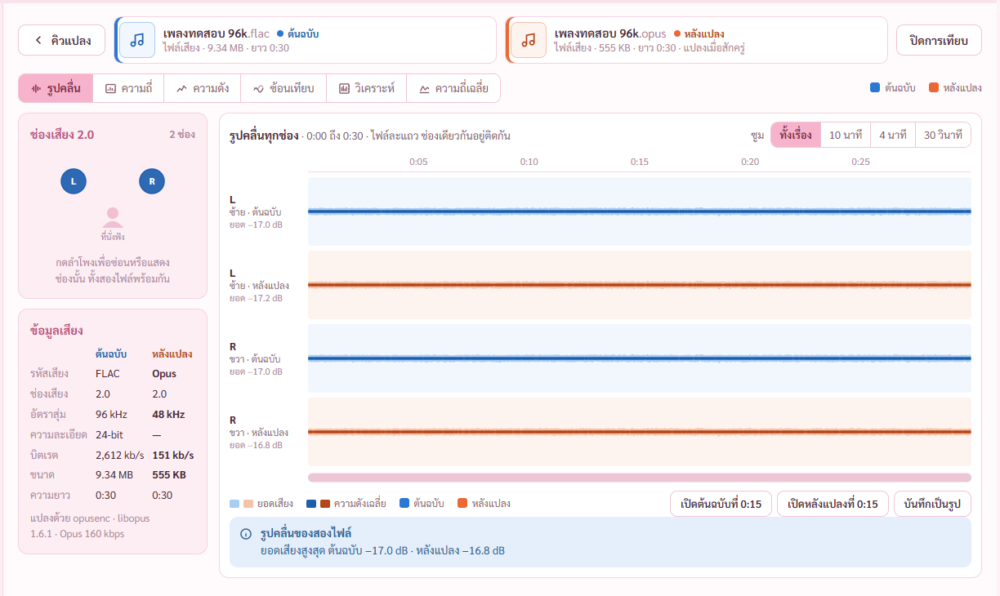
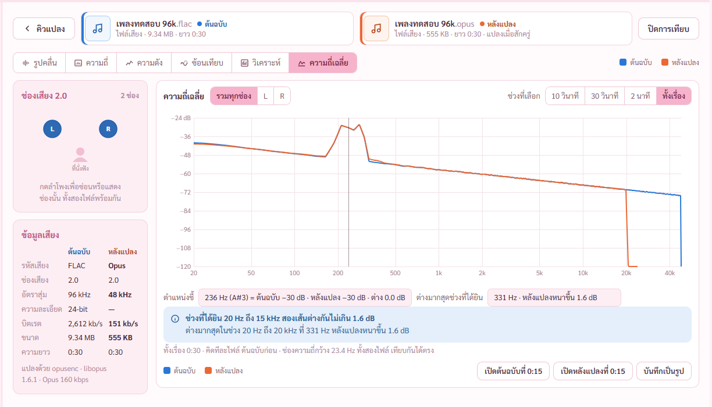

# รายงาน 8 พ.ย. 2569 · หน้ากราฟเสียง แปลงเสียงเป็นคิว เทียบสองไฟล์ ข้อมูลเพลง (แผนเสียงและซับ ขั้น 8)

พี่กันสั่ง *"เธอ ทำให้จบทุกขั้น ตามแผนเดิม เราจะมาดูตอนเสร็จ เพราะทำงานอยู่ เรารีโหมดเข้ามา"*
ทุกการตรวจรันกับโปรแกรมแบบเปิดอยู่หลังสุด ถ่ายภาพผ่าน CDP · ไม่กดปุ่มเลือกโฟลเดอร์ ปุ่มเพิ่มไฟล์ ปุ่มเปิดเล่น ปุ่มบันทึกรูป (เปิดหน้าต่างขึ้นจอ) · ไฟล์ทดสอบเป็นสำเนาใน `D:\dev\tmp`

ผลตรวจ เทส Rust 100/100 (เพิ่ม 7) · ตัวตรวจใหม่ `scripts/check-convert.mjs` 40/40 · หน้ากราฟเดิม `check-graph.mjs` 66/66 (โหมดทดสอบ อีก 2 ข้อมีเฉพาะตัวที่สร้างจริง) · หน้าเสียงและซับ `check-av.mjs` 70/70

## 1. โหมดแปลงเสียง

- หน้ากราฟเสียงมีปุ่มสลับ ดูกราฟ กับ แปลงเสียง บนหน้ารวม · หัวหน้ากราฟของไฟล์มีปุ่ม แปลงเสียง ข้างปุ่มเปิดไฟล์อื่น
- ลากไฟล์มาวางหลายไฟล์พร้อมกัน หรือกดเพิ่มไฟล์ · ไฟล์ที่อยู่ในคิวแล้วไม่เพิ่มซ้ำ บอกว่าข้ามกี่ไฟล์
- แต่ละแถว รูปปกจากไฟล์ (ไม่มีปกเป็นรูปโน้ต) ชื่อ ชนิด ช่อง บิต อัตราสุ่ม ขนาด · ปลายทาง · สถานะ · ปุ่มเอาออกจากคิว
- ไฟล์ที่ไม่มีแทร็กเสียงขึ้นอ่านไฟล์ไม่ได้ ไม่นับในคิว
- ตั้งทีเดียวทั้งคิว ใช้กับทุกไฟล์ที่ยังไม่เริ่มและไฟล์ที่เพิ่มต่อจากนี้ · กดปลายทางของแถวตั้งเฉพาะไฟล์นั้น · ใช้แผงตั้งค่าเสียงเดียวกับหน้าเสียงและซับ
- ที่เก็บไฟล์ใหม่ ข้างไฟล์เดิม (ค่าตั้งต้น) หรือเลือกโฟลเดอร์ · ชื่อเดิม นามสกุลใหม่ · ชื่อชนต่อท้าย (2) ไม่เขียนทับ
- ค่าตั้งต้นของคิว FLAC Level 5 (แคลร์ตั้ง ไม่เสียคุณภาพไม่ว่าต้นทางเป็นอะไร) · ค่าที่ตั้งทั้งคิวครั้งล่าสุดจำไว้ใช้ครั้งหน้า
- ไปหน้าอื่นระหว่างแปลงแล้วกลับมา คิว ความคืบหน้า ผล อยู่ครบ

## 2. Monkey's Audio กับ TAK เฉพาะหน้านี้

- แผงตั้งค่าเสียงที่เปิดจากหน้านี้ ช่อง Lossless มี Monkey's Audio กับ TAK เพิ่ม · หน้าเสียงและซับไม่มี (ใส่ไฟล์หนังไม่ได้)
- Monkey's Audio ระดับ Fast Normal High Extra High Insane · ชุดของผู้ทำไม่มีตัวแปลงแบบคำสั่ง โปรแกรมเรียก `MACDll64.dll` ตรงจาก Rust ป้อนเสียงที่ ffmpeg ถอดแล้ว
- TAK ต้องวาง `Takc.exe` เองในโฟลเดอร์ตัวแปลง · ยังไม่ได้วาง แผงบอกตรง ๆ ปุ่มใช้ค่านี้กดไม่ได้
- หน้าตั้งค่า การ์ดตัวแปลงเสียงมีแถว MACDll64 (รุ่นที่ DLL ตอบเอง) กับ Takc

## 3. กำลังแปลง หยุดทั้งคิว

- แปลงทีละไฟล์ตามลำดับ · แถวที่กำลังทำมีแถบความคืบหน้า เปอร์เซ็นต์ เวลาที่เหลือ · ปุ่มล่างบอก กำลังแปลง 1 จาก 6
- หยุดทั้งคิว ไฟล์ที่กำลังทำหยุดแล้วลบไฟล์ทำค้าง ไฟล์ที่ยังไม่เริ่มรออยู่ในคิว · แถวที่หยุดหรือไม่สำเร็จมีปุ่มลองใหม่
- ที่ว่างในไดรฟ์ไม่พอ ไม่เริ่ม บอกต้องใช้ราวเท่าไหร่ มีว่างเท่าไหร่
- ทำงานลงไฟล์ .partial ข้างปลายทาง ตรวจชนิดกับความยาวด้วย ffprobe ผ่านแล้วค่อยตั้งชื่อจริงแบบไม่เขียนทับ

## 4. แปลงเสร็จ ข้อมูลเพลงกับรูปปกติดไป

- แถวที่เสร็จบอกขนาดใหม่ เล็กลงหรือใหญ่ขึ้นกี่เปอร์เซ็นต์ ข้อมูลเพลงกี่ช่องติดไป รูปปก ตัวแปลงกับรุ่น เวลาที่ใช้ · ไฟล์ที่ไม่มีข้อมูลเพลงบอกว่าไม่มี
- ข้อมูลเพลงกับรูปปกติดไปทุกชนิดที่เก็บได้ · FLAC MP3 M4A ให้ ffmpeg ใส่จากไฟล์เดิมหลังแปลง · Opus ส่งให้ opusenc ตอนแปลง · WavPack Monkey's Audio TAK โปรแกรมเขียนแท็ก APEv2 เอง (ตัวเขียนแท็กของ DLL เป็นแบบ ANSI ภาษาไทยเพี้ยน) · AC-3 ไม่มีที่เก็บ บอกในผล

| ทดสอบ | ผล |
|---|---|
| FLAC 96 kHz มีแท็กกับปก เป็น Opus 160 | ชื่อเพลงไทย ศิลปิน อัลบั้ม ปี แทร็ก กับปกอ่านกลับได้ · ยาว 30 วินาทีเท่าเดิม |
| WAV เป็น Monkey's Audio High | ถอดกลับเสียงตรงต้นฉบับทุกตัวอย่าง (MD5 ของเสียงดิบเท่ากัน) · ชื่อชน ได้ `เพลงทดสอบ (2).ape` ไฟล์ชื่อเดิมไม่ถูกแตะ |
| MP3 มีแท็กกับปก เป็น FLAC Level 8 | แท็กกับปกติดไป |
| AC-3 5.1 เป็น WavPack | 6 ช่อง 5.1 |
| FLAC เป็น Monkey's Audio | แท็ก APEv2 ชื่อไทยกับปกอ่านกลับได้ |
| ไฟล์เดิมทุกไฟล์ | hash เท่าก่อนแปลง · ไม่มีไฟล์ .partial ค้าง |

## 5. ข้อมูลเพลง ดูอย่างเดียว

- กดชื่อไฟล์ในคิวหรือบนหัวหน้ากราฟ · ชื่อเพลง ศิลปิน อัลบั้ม ปี แทร็ก ประเภท รูปปก (ชนิด ขนาดภาพ ขนาดไฟล์) ค่าความดัง · ปุ่มคัดลอกเป็นข้อความ
- ไฟล์ที่ไม่มีข้อมูลเพลงบอกว่าไม่มีพร้อมเหตุตามชนิด (WAV ไม่เก็บ · AC-3 DTS แยกเดี่ยวไม่มีที่เก็บ · ไฟล์หนังเก็บชื่อเรื่องแทน)
- แก้ไม่ได้ ตามที่พี่กันสั่ง การแก้ข้อมูลเพลงอยู่ในโรดแมป

## 6. เทียบสองไฟล์

- กดเทียบความถี่ในแถวที่เสร็จ เปิดหน้ากราฟเสียงแบบสองไฟล์ · ต้นฉบับสีฟ้า หลังแปลงสีส้ม ทุกกราฟ
- แท็บเดิมทั้ง 6 แท็บ รูปคลื่น ความถี่ ความดัง ซ้อนเทียบ วิเคราะห์ ความถี่เฉลี่ย · แต่ละแท็บมีกล่องสรุปผลต่าง
- แผงซ้าย ช่องเสียง กดลำโพงซ่อนช่องทั้งสองไฟล์พร้อมกัน · ข้อมูลเสียงสองคอลัมน์ ค่าที่ต่างตัวหนา · บอกตัวแปลงที่ใช้
- ความถี่กับวิเคราะห์ใช้แกนตั้งเท่ากันทั้งสองไฟล์ · เส้นประบอกว่าเสียงหยุดที่กี่ kHz
- ซูม ช่วงเวลา ใช้กับสองไฟล์พร้อมกัน (ใช้ข้อมูลภาพรวม ละเอียดเท่าที่ภาพรวมมี)
- ปุ่มคิวแปลงกลับหน้าคิว · ปิดการเทียบเปิดต้นฉบับในหน้ากราฟแบบไฟล์เดียว

## 7. เรื่องที่เจอระหว่างทำ

**DLL ในชุด SDK ของ Monkey's Audio 13.45 เป็นรุ่น 12.36** · เรียกคำสั่งบอกรุ่นของ DLL จริงได้ 12.36 ในไฟล์ไม่มีเลข 13.45 · ซอร์สในชุดเป็น 13.45 แต่ DLL ที่แนบมาไม่ได้คอมไพล์ใหม่ · แปลงได้ครบ ถอดกลับตรงทุกตัวอย่าง · แก้ `vendor/README.md` ที่เขียนว่า 13.45 แล้ว · ได้รุ่น 13.45 ต้องคอมไพล์จากซอร์สในชุด หรือเอาจากตัวติดตั้ง `MAC_1345.exe` (ยังไม่ได้โหลด ต้องขอพี่กันก่อน)

## 8. บั๊กที่เจอและแก้

**เปิดแผงตั้งค่าเสียงซ้ำของแทร็กที่ตั้ง Opus แบบง่ายไว้ เด้งไปแท็บขั้นสูง ไม่มีชุดค่าไหนถูกเลือก** (เจอตอนเทส ทั้งหน้าแปลงเสียงและหน้าเสียงและซับ) · ตัวเทียบชุดค่านับช่อง Bit depth กับ Sample rate ที่ Opus ไม่มี · แก้แล้ว เปิดซ้ำได้แท็บแบบง่ายกับชุดเดิม · เพิ่มข้อตรวจแล้ว

**แท็บความถี่เฉลี่ยของหน้าเทียบ เส้นหลังแปลงต่ำกว่าต้นฉบับราว 3 dB ทั้งเส้น ยอดเสียงแหลมคมไม่เท่ากัน** (ตรวจภาพ) · ไฟล์ 96 kHz กับ 48 kHz ใช้ช่วงคำนวณ 4096 เท่ากัน ช่องความถี่กว้าง 23.4 กับ 11.7 Hz ค่าต่อช่องเทียบตรงไม่ได้ · แก้ให้ขอช่วงคำนวณตามอัตราสุ่ม ช่องกว้างเท่ากัน · หลังแก้ ช่วงที่ได้ยินต่างไม่เกิน 1.6 dB จากเดิมต่างถึง 20.4 dB

**ข้อมูลเสียงในหน้าเทียบ บิตเรต 2,612 kb/s ตกเป็นสองบรรทัด** (ตรวจภาพ) · ค่าไม่ตัดบรรทัดแล้ว

**หัวแผงตั้งทีเดียวทั้งคิวนับไฟล์ที่อ่านไม่ได้รวมด้วย** (เจอตอนเทส) · ไม่นับแล้ว

**แถวที่ไม่สำเร็จบอกเหตุซ้ำสองที่** (ตรวจภาพ) · เหลือใต้แถวที่เดียว

**ลากไฟล์ที่อยู่ในคิวแล้วซ้ำ ไม่มีอะไรบอก** (เจอตอนเทส) · ขึ้นแจ้งว่าข้ามกี่ไฟล์

**ตัวตรวจ ภาพคิวกับหน้าเทียบโดนตัดท้าย แถบชื่อหน้าต่างทับหัวภาพ** (ตรวจภาพ) · ตัวตรวจขยายความสูงหน้าจำลองชั่วคราวผ่าน CDP ตอนถ่าย หน้าต่างจริงไม่ขยับ

## 9. งานค้าง

- ขั้น 9 เทสรวมและตัวติดตั้ง · ขั้น 10 ผู้ช่วยตรวจ 1 ตัว
- ยังไม่ได้ตรวจ TAK แปลงจริง (เครื่องนี้ไม่มี Takc.exe · คำสั่ง `-e -p2 -ihs - ปลายทาง` ตั้งตามคู่มือของ Takc ยังไม่ได้ลองกับตัวจริง)
- ยังไม่ได้ตรวจ ปุ่มเพิ่มไฟล์ ปุ่มเลือกโฟลเดอร์ ปุ่มเปิดเล่นกับปุ่มบันทึกรูปของหน้าเทียบ (เปิดหน้าต่างขึ้นจอ ห้ามตอนพี่กันลงเวร)
- ยังไม่ได้ตรวจกับเพลงจริงของพี่กัน

## 10. พี่กันต้องทำเอง

- ลากเพลงจริงสองสามไฟล์เข้าคิว แปลง แล้วกดเทียบความถี่
- ถ้าอยากได้ TAK โหลด TAK จากเว็บผู้ทำ แล้ววาง `Takc.exe` ในโฟลเดอร์ตัวแปลง (หน้าตั้งค่า ปุ่มเปิดโฟลเดอร์ตัวแปลง)
