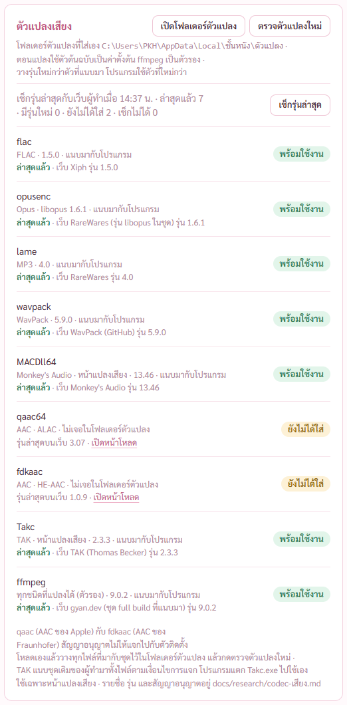
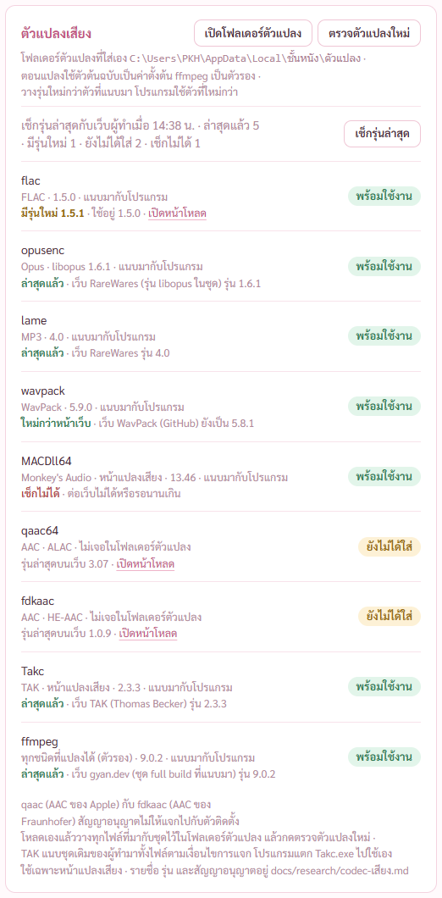
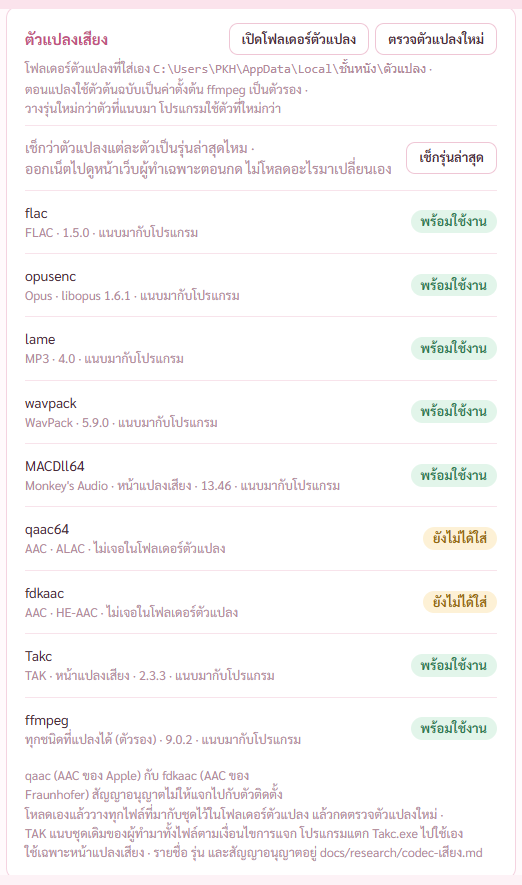

# รายงาน 8 พ.ย. 2569 · ปุ่มเช็กรุ่นล่าสุดของตัวแปลงเสียง

พี่กันสั่ง *"ระบบ codec เสียงทุกอัน เราอยากให้มันสามารถกดเเล้วโปรแกรมมันจะไปเช็คมาว่าล่าสุดหรือยัง เราทำได้ไหม"*

## 1. ทำอะไร

- หน้าตั้งค่า การ์ดตัวแปลงเสียง มีแถวใหม่ **เช็กรุ่นล่าสุด** กดแล้วโปรแกรมออกเน็ตไปอ่านเลขรุ่นจากหน้าเว็บของผู้ทำทั้ง 9 ตัวพร้อมกัน
- ไม่กดก็ไม่ออกเน็ต · อ่านอย่างเดียว ไม่โหลดตัวแปลงมาเปลี่ยนเอง (ตัวแปลงต้องเช็ก hash กับลายเซ็นก่อนใช้) · ไม่ส่งข้อมูลอะไรของพี่กันไป
- ใต้ตัวแปลงแต่ละตัวบอกผล ล่าสุดแล้ว · มีรุ่นใหม่ (บอกรุ่นใหม่กับรุ่นที่ใช้อยู่ มีปุ่มเปิดหน้าโหลด) · ใหม่กว่าหน้าเว็บ · ยังไม่ได้ใส่ (บอกรุ่นล่าสุดกับปุ่มเปิดหน้าโหลด) · เช็กไม่ได้ (บอกเหตุ)
- แถวบนสรุปเวลาที่เช็กกับจำนวนแต่ละแบบ · ไปหน้าอื่นแล้วกลับมาผลยังอยู่ ไม่ออกเน็ตซ้ำเอง
- ปุ่มเปิดหน้าโหลดเปิดได้เฉพาะหน้าที่จดไว้ในโปรแกรม หน้าจอส่งที่อยู่อื่นมาเปิดไม่ได้

## 2. อ่านรุ่นจากไหน

| ตัวแปลง | อ่านจาก | ตอนนี้ |
|---|---|---|
| flac | GitHub ของ Xiph | 1.5.0 ล่าสุดแล้ว |
| opusenc | หน้า RareWares (รุ่น libopus ในชุด) | 1.6.1 ล่าสุดแล้ว |
| lame | หน้า RareWares | 4.0 ล่าสุดแล้ว |
| wavpack | GitHub ของ WavPack | 5.9.0 ล่าสุดแล้ว |
| Monkey's Audio | หน้าโหลดของผู้ทำ | 13.46 ล่าสุดแล้ว |
| TAK | เว็บผู้ทำ (http) | 2.3.3 ล่าสุดแล้ว |
| ffmpeg | gyan.dev (ชุดที่แนบมา) | 9.0.2 ล่าสุดแล้ว |
| qaac | GitHub | 3.07 ยังไม่ได้ใส่ |
| fdkaac | GitHub | 1.0.9 ยังไม่ได้ใส่ |

opusenc ต้องอ่านจาก RareWares เพราะ GitHub ของ libopus ขึ้นแค่ 1.5.2 ทั้งที่ชุดของ RareWares ที่เราใช้เป็น 1.6.1 แล้ว ถ้าอ่านจาก GitHub โปรแกรมจะบอกผิดว่าเราใหม่กว่า

กดเช็กของจริง เสร็จใน 1.6 วินาที ตัวที่แนบมาทั้ง 7 ตัวล่าสุดแล้ว qaac กับ fdkaac ยังไม่ได้ใส่ บอกรุ่นล่าสุดพร้อมปุ่มเปิดหน้าโหลด

สถานะที่ของจริงตอนนี้ยังไม่เกิด ถ่ายด้วยผลจำลองที่มีเฉพาะรุ่นทดสอบ · flac มีรุ่นใหม่ · wavpack ใหม่กว่าหน้าเว็บ · Monkey's Audio เช็กไม่ได้พร้อมเหตุ

ก่อนกด แถวบนบอกว่าออกเน็ตเฉพาะตอนกด

## 3. ที่แก้ระหว่างทำ

- ข้อความ "หน้าเว็บXiph" ขาดช่องว่าง เปลี่ยนเป็น "เว็บ Xiph"
- แถวสรุป คำ "ล่าสุดแล้ว" ขาดเป็นสองบรรทัด แล้วเลขหลุดไปขึ้นบรรทัดใหม่ · ผูกคำกับเลขด้วยช่องว่างแบบไม่ตัดบรรทัด
- ภาพการ์ดถูกตัดหัวท้ายเพราะการ์ดสูงกว่าจอ · ตัวตรวจขยายพื้นที่ถ่ายชั่วคราวโดยไม่ขยับหน้าต่างจริง

## 4. ผลตรวจ

- เทส Rust 108/108 (เพิ่ม 3 ข้อ อ่านเลขรุ่นจากหน้าเว็บทุกแบบ เทียบรุ่น ทุกตัวแปลงมีที่เช็ก)
- ตัวตรวจใหม่ check-latest 11/11 · ออกเน็ตจริง ไม่กดปุ่มเปิดหน้าโหลด (เบราว์เซอร์จะเด้งขึ้นจอ)
- หน้าเสียงและซับ 74/74

## 5. ยังไม่ได้ตรวจ

- ยังไม่ได้ลองในตัวติดตั้ง (คำสั่งลงทะเบียนในตัวจริงแล้ว ดึงหน้าเว็บทำในฝั่ง Rust ไม่ติดกติกาความปลอดภัยของหน้าจอ)
- ปุ่มเปิดหน้าโหลดยังไม่ได้กดจริง เพราะเบราว์เซอร์จะเด้งขึ้นจอ · ใช้วิธีเดียวกับปุ่มเปิดหน้า Icaros ที่ใช้อยู่แล้ว · ลองส่งชื่อที่ไม่มีในรายการ โปรแกรมปฏิเสธ
- ถ้าหน้าเว็บผู้ทำเปลี่ยนแบบ จะขึ้นว่าเช็กไม่ได้ หาเลขรุ่นไม่เจอ (ไม่เดาเลข)
