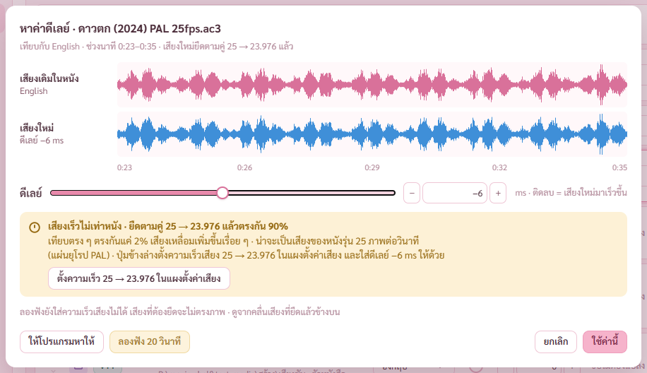

# รายงาน 8 พ.ย. 2569 · ผู้ช่วยตรวจ 1 ตัว แล้วแก้ตามผล (แผนเสียงและซับ ขั้น 10)

พี่กันสั่ง *"เธอ ทำให้จบทุกขั้น ตามแผนเดิม เราจะมาดูตอนเสร็จ เพราะทำงานอยู่ เรารีโหมดเข้ามา"* และอนุญาตผู้ช่วยตรวจไว้ *"ถ้าเสร็จแล้วรันเอเจ้น 1 ตัวตรวจสอบ"*
ผู้ช่วยตรวจอ่านโค้ดของแผนนี้ทั้งหมด (19 commit) ไม่รันอะไร ไม่แก้โค้ด เขียนผลที่ [review/เสียงและซับ.md](review/เสียงและซับ.md) · แคลร์ตรวจของจริงทุกข้อก่อนเชื่อ ผลอยู่ช่อง ผลที่แคลร์ตรวจ ของแต่ละข้อ

## 1. สรุป

| ระดับ | ผู้ช่วยเจอ | จริง | แก้ในรอบนี้ |
|---|---|---|---|
| ร้ายแรง ของในไฟล์ใหม่หายเงียบ | 1 | 1 | 1 |
| บั๊กที่ผู้ใช้เจอ | 7 | 7 | 7 (ข้อ 7 แก้แบบปิดปุ่มพร้อมบอกเหตุ) |
| เล็กน้อย | 18 | 18 | 17 (ข้อ 26 ไม่แก้) |
| ไม่แน่ใจ | 4 | | 2 แก้แบบกันไว้ก่อน · 2 ไม่แก้ |

ไม่เจอเส้นทางที่ไฟล์หนัง ไฟล์เสียง ไฟล์ซับต้นฉบับ หรือไฟล์ที่มีอยู่แล้วโดนเขียนทับหรือลบก่อนไฟล์ใหม่ตรวจผ่าน · ส่วนที่ยังไม่ได้ทำจดไว้ใน [ROADMAP.md](ROADMAP.md) หัวข้องานค้างจากผู้ช่วยตรวจแผนเสียงและซับ

ผลตรวจหลังแก้ เทส Rust 104/104 (เพิ่ม 4) · หน้าเสียงและซับ 74/74 (เพิ่ม 4) · รวมไฟล์ 20/20 · แปลงเสียง 40/40 · ใส่โปสเตอร์ 61/61 · ข้อมูลไฟล์ 17/17 · ตัวติดตั้งใหม่ ดูข้อ 5

## 2. ข้อร้ายแรงกับบั๊กที่ผู้ใช้เจอ

**1 · หนัง MP4 ที่มีปกฝัง รวมออกเป็น MP4 ปกหายเงียบ ตรวจไฟล์ใหม่บอกผ่าน** · ลองจริงแล้ว mkvmerge รายงานปกของ MP4 เป็นไฟล์แนบ cover.jpg แต่ mkvextract เปิด MP4 ไม่ได้ (รหัส 2) · แก้ ต้นทางที่ไม่ใช่ Matroska ใช้สตรีมรูปปกของ ffprobe · ดึงปกเดิมไม่ได้ หยุดพร้อมบอก ไม่ทำต่อเงียบ ๆ · ภาพตัวอย่างช่องปกของ MP4 ขึ้นแล้ว · เทสใหม่รวม MP4 มีปกแล้วปกยังอยู่

**2 · MP4 กับเสียงที่ตั้งแปลง หน้าจอกับฝั่ง Rust ตัดสินคนละแบบ** · แก้ ใช้กติกาเดียว แทร็กที่แปลงดูชนิดหลังแปลง แบบเพิ่มคู่แทร็กเดิมต้องใส่ MP4 ได้ด้วย · การ์ดเตือนมีปุ่ม ใช้แทร็กที่แปลงแทนที่แทร็กเดิม

**3 · เปิด Loudness normalize แล้วเสียงกลายเป็น 192 kHz** · ลองจริงแล้ว 48 kHz ได้ 192 kHz · แก้ คืนอัตราสุ่มของต้นทางหลัง loudnorm ทุกครั้ง · เทสใหม่ WAV 44.1 kHz ได้ 44.1 kHz

**4 · ซับที่ไม่ใช่ UTF-8 ถูกเดาเป็น TIS-620 ทั้งหมด** · แก้ เดาเป็นไทยเฉพาะไบต์ที่เป็นอักษรไทยจริง นอกนั้นอ่านแบบ Windows-1252 (ซับยุโรปแบบเก่า) แถวขึ้นป้ายบอก · ซับจีนยังอ่านผิด (จดโรดแมป)

**5 · ตัวดูซับรูปเปิดซ้ำระหว่างถอด ผลที่เก็บไว้เพี้ยน** · แก้ คำขอที่สองรอผลของงานแรก ไม่ถอดซ้อน

**6 · ตัวดูซับอ่านไฟล์ MKS ที่เพิ่มเป็นข้อความดิบ** · แก้ ไฟล์ห่อดึงแทร็กด้วย mkvextract หรือ ffmpeg · เทสใหม่

**7 · ลองฟัง 20 วินาที ไม่ใส่ความเร็วเสียง** · แก้ เสียงที่ต้องยืดความเร็ว ปุ่มลองฟังกดไม่ได้ พร้อมบอกเหตุ ให้ดูจากคลื่นที่ยืดแล้ว

**8 · กดตั้งความเร็วจากตัวช่วยหาดีเลย์ ค่าดีเลย์ที่หาได้หาย** · แก้ ใส่ดีเลย์ให้แทร็กด้วย

ภาพ 16 ถ่ายใหม่ · ปุ่มลองฟังกดไม่ได้ บรรทัดล่างบอกเหตุ · ข้อความบอกว่าปุ่มตั้งความเร็วใส่ดีเลย์ให้ด้วย

## 3. ข้อเล็กน้อยที่แก้

- 9 กดหยุดตอนกำลังตรวจไฟล์ใหม่ หยุดจริงก่อนแตะไฟล์เดิม (งานรวม) ก่อนตั้งชื่อ (คิวแปลง)
- 10 คิวแปลง ช่วงใส่ข้อมูลเพลงหยุดได้ ปิดโปรแกรมแล้วไม่ค้างไฟล์ทำค้าง
- 11 เปิดโปรแกรมแล้วกวาดไฟล์ชั่วคราวที่ค้างในไดรฟ์ C
- 12 เช็กที่ว่างตอนรวม ไดรฟ์เดียวกันนับเสียงที่แปลงสองเท่า
- 13 รวมได้ไฟล์ชื่อต่าง บอกว่าการจับคู่ไม่ตามไป
- 14 รวมเข้าไฟล์ชื่อเดิม ไม่ขึ้นว่าไฟล์ถูกเปลี่ยนหลังตรวจ
- 15 แก้การจับคู่ ขึ้นการ์ดว่าจับคู่ไว้แล้ว ใส่ไฟล์เดิมลงตารางได้ก่อนบันทึก
- 16 โปรแกรมเล่นที่ไม่รู้จัก เปิดหนังด้วยโปรแกรมนั้น ไม่ใช่โปรแกรมหลักของ Windows
- 17 บอกว่าดีเลย์เสียงของ mpv VLC ใช้กับทุกเสียง · ที่อยู่มี # VLC อ่านไม่ได้
- 18 ตั้งลดช่องทั้งคิว ไฟล์ช่องเดียวไม่กลายเป็นสองช่อง
- 19 ซับรูปในแถวนับเป็นแพ็กเก็ต
- 20 เปลี่ยนหนังเร็ว ๆ ผลเก่าไม่มาทับ
- 21 ลากไฟล์หนังตัวเองลงช่องเพิ่มไฟล์ ขึ้นบอก ไม่เพิ่มซ้ำ
- 22 ภาพตัวอย่างปก รับเฉพาะช่องปกตั้งกับปกนอน
- 23 ชื่อเดิมกับลบไฟล์เดิม ตั้งชื่อไม่สำเร็จ บอกว่าไฟล์เดิมอยู่ในถังขยะ
- 24 หน้าเทียบ เตือนเมื่อสองไฟล์ยาวไม่เท่ากัน
- 25 ปุ่มเสียงและซับในหน้าข้อมูลไฟล์ · การ์ด Monkey's Audio บอกว่าไม่มี Verify
- 27 Monkey's Audio บอกขนาดเสียงสูงสุดล่วงหน้า (กันข้อจำกัด 2 GB) · 30 TAK เพดาน 6 ช่อง

ซับรูปในแถวขึ้น 2 แพ็กเก็ต กับ 46 แพ็กเก็ต (ตัวดูซับนับได้ 1 กับ 42 ภาพ เพราะตัดแพ็กเก็ตล้างจอกับภาพซ้ำ)

## 4. ไม่แก้ในรอบนี้

- 26 ข้อมูลจำลองใน mock.ts · แผนเขียนหลักไว้แต่แผนนี้ไม่ได้ทำ หน้าตาทุกหน้าตรวจผ่านโปรแกรมจริง
- 28 qaac ที่ขาดไฟล์ประกอบอาจขึ้นพร้อมใช้งาน · เครื่องนี้ไม่มี qaac ตรวจไม่ได้
- 29 ความเร็ว 25 → 23.976 ยืดแบบคงระดับเสียง ระดับเสียงยังสูงแบบแผ่น PAL ราว 4% · ตรงกับต้นแบบที่ผ่าน **รอพี่กันเคาะ** ว่าจะคืนระดับเสียงด้วยไหม

## 5. ตัวติดตั้งหลังแก้

สร้างตัวติดตั้งใหม่หลังแก้ ชั้นหนัง_0.1.0_x64-setup.exe 143.6 MB · ติดตั้งเงียบ 17 วินาที เปิด ตรวจ ถอน ผ่าน 14/14 (เครื่องมือ 14 ไฟล์ ตัวแปลงเสียงเรียกได้ อ่านไฟล์เข้าคิวได้ คำสั่งทดสอบไม่หลุดไปตัวจริง ปิดกลางงานไม่ค้างไฟล์ ถอนแล้วไฟล์หนังอยู่ครบ) · ตัวตรวจแบบตัวจริงชุดอื่นไม่ได้รันซ้ำหลังแก้รอบนี้ (รันครบตอนขั้น 9 ก่อนแก้)

## 6. พี่กันต้องทำเอง

- เคาะข้อ 29 ระดับเสียงของเสียงแผ่น PAL
- ลองหนัง MP4 จริงที่มีปก รวมเสียงพากย์ออกเป็น MP4 แล้วดูว่าปกยังอยู่
