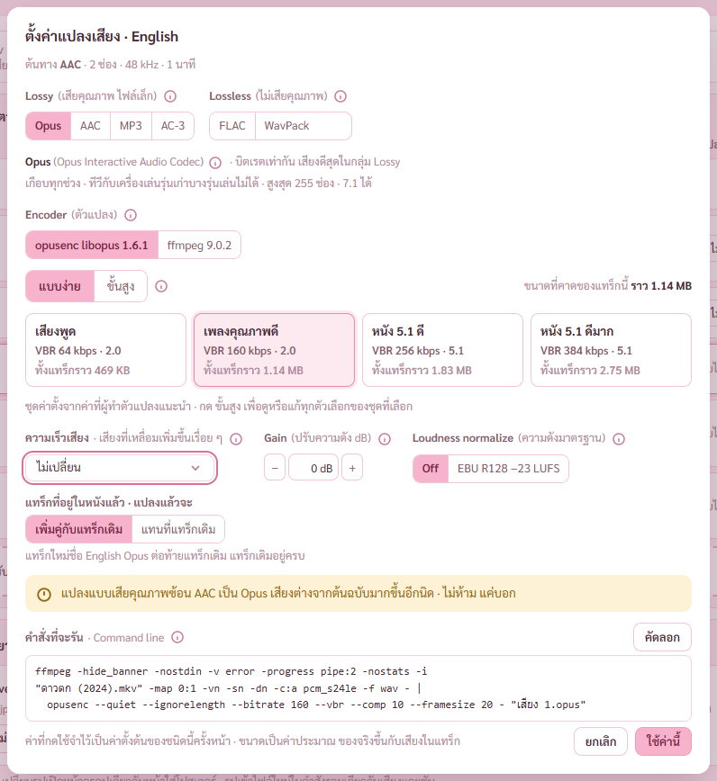
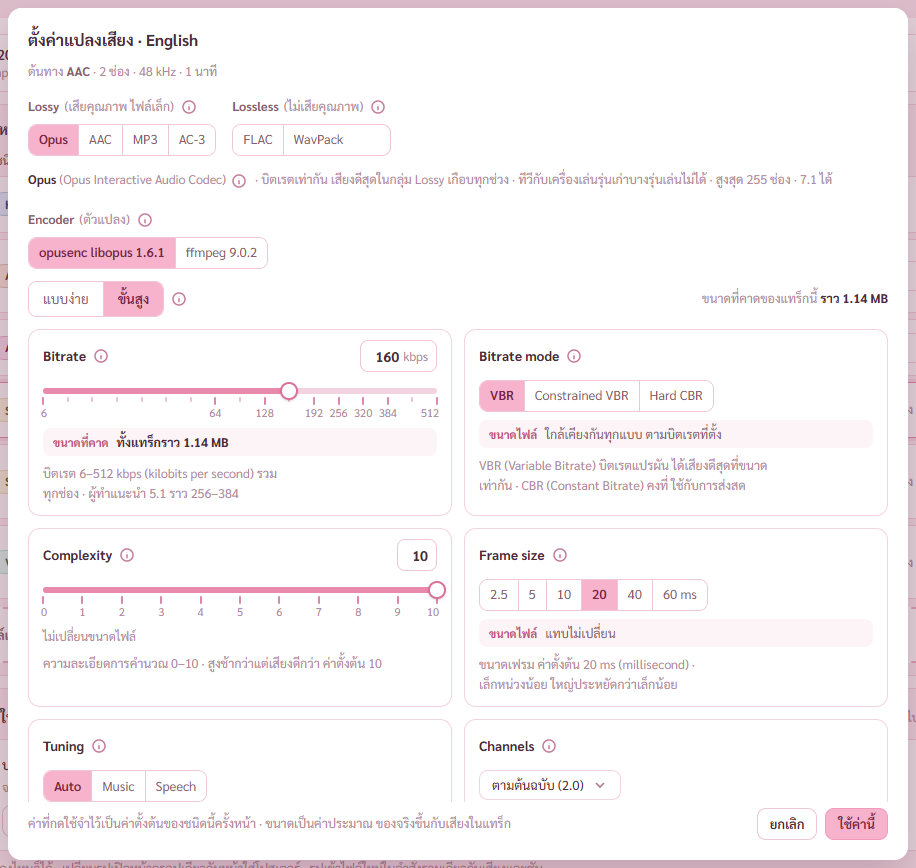
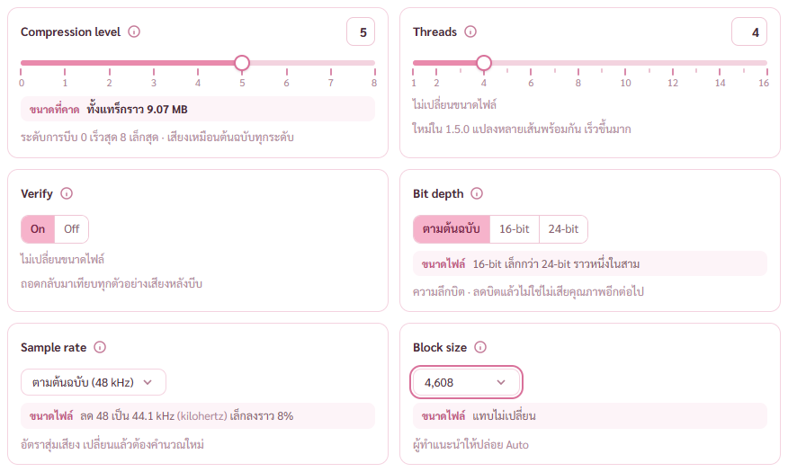
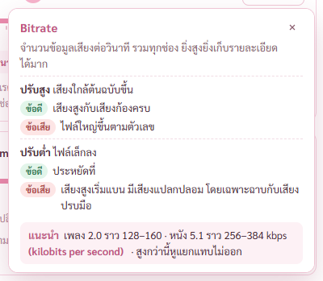

# รายงาน 8 พ.ย. 2569 · แผงตั้งค่าเสียงแบบขั้นสูง (แผนเสียงและซับ ขั้น 4 ส่วนที่เหลือ)

พี่กันสั่ง *"วันใหม่เเล้ว เริ่มงานหม่เลย"* · ต่อจากงานค้างเมื่อคืน ขั้น 4 แบบขั้นสูง การ์ดละช่อง ⓘ ทุกช่อง ตัวย่อมีคำเต็ม ตามมอคอัป
ทุกการตรวจรันกับโปรแกรมแบบเปิดอยู่หลังสุด ถ่ายภาพผ่าน CDP ไม่มีอะไรเด้งขึ้นจอ · ไม่แตะไฟล์หนังจริงของพี่กัน
ภาพอยู่โฟลเดอร์เดียวกับรายงานเมื่อคืน `docs/report-2026-11-07/เสียงซับ-ขั้น2/` เพราะตัวตรวจ check-av เขียนภาพลงที่นั่นที่เดียว

ผลตรวจ เทส Rust 86/86 (เพิ่ม 1 ตัว และเทสแปลงจริงเพิ่มกรณี WAV 16 บิต) · ตัวตรวจหน้าเสียงและซับ 45/45 (เดิม 27 ข้อ เพิ่ม 18 ข้อ) · ตัวตรวจคำสั่งรวม 20/20

## 1. แบบง่ายกับขั้นสูง

ปุ่ม **แบบง่าย** กับ **ขั้นสูง** อยู่เหนือชุดค่า มี ⓘ บอกว่าต่างกันยังไง · ขนาดที่คาดของทั้งแทร็กอยู่ฝั่งขวา เปลี่ยนตามค่าทันที
เริ่มจากแบบง่ายแล้วเปิดขั้นสูงแก้ต่อได้ ค่าที่เลือกไม่หาย ตามมอคอัป · แก้ในขั้นสูงจนไม่ตรงชุดไหน กลับมาแบบง่ายบอกว่ายังไม่ตรงกับชุดไหน
ทุกหัวข้อบนแผงมีปุ่ม ⓘ ทั้ง Lossy Lossless ชนิดที่เลือก Encoder ความเร็วเสียง Gain ความดังมาตรฐาน และคำสั่งที่จะรัน

## 2. การ์ดละช่อง

การ์ดละช่องตามมอคอัป ชื่อ ปุ่ม ⓘ และค่าอยู่หัวการ์ด · แถบเลื่อนเป็นขั้นตามค่าที่ตัวแปลงใช้ได้จริง มีขีดทุกขั้น ป้ายเฉพาะขั้นหลัก · มีช่องพิมพ์ค่าเอง
ทุกการ์ดบอกผลต่อขนาดไฟล์ การ์ดที่เปลี่ยนขนาดบอกขนาดทั้งแทร็กที่คาด คิดจากความยาว จำนวนช่อง อัตราสุ่ม และความลึกบิตจริงของแทร็กนั้น
ตัวย่อขยายเป็นคำเต็มครั้งแรกที่เจอในแต่ละการ์ด เช่น VBR (Variable Bitrate) · kbps (kilobits per second) ตามที่พี่กันสั่งตอนทำมอคอัป *"ตัวย่อทุกตัวในนี้ วงเล็บคำเต็มด้วย"*

| ชนิด | การ์ด |
|---|---|
| Opus | Bitrate · Bitrate mode · Complexity · Frame size · Tuning · Channels |
| AAC | qaac Mode · TVBR quality หรือ Bitrate · Profile · Encoder quality · Lowpass · Channels · fdkaac Mode · VBR mode หรือ Bitrate · Profile · ffmpeg Bitrate · Lowpass · Channels |
| MP3 | Mode · VBR quality หรือ Bitrate · Stereo mode · Quality · Lowpass |
| AC-3 | Bitrate · Dialnorm · Center mix level · Surround mix level · Room type · Channels |
| FLAC | Compression level · Threads · Verify · Bit depth · Sample rate · Block size |
| WavPack | Mode · Extra · Verify · Bit depth · Sample rate |
| ใช้กับทุกชนิด | Gain · Loudness normalize · ความเร็วเสียง |

- การ์ดเปลี่ยนตามตัวแปลงที่เลือก เช่น FLAC ด้วย ffmpeg ไม่มี Threads กับ Verify การ์ดสองใบนั้นหายไป พร้อมบอกเหตุผลใต้การ์ด
- การ์ดที่ใช้ได้เฉพาะบางโหมดขึ้นตามโหมด เช่น MP3 โหมด CBR การ์ด VBR quality หายไป การ์ด Bitrate ขึ้นแทน
- เปลี่ยนชนิดเสียง ค่าของชนิดเดิมไม่ติดไปกับคำสั่ง (สกิล form-input สลับประเภทต้องล้างค่าเก่าจริง)
- เปิดแผงของแทร็กที่ตั้งไว้แล้ว ได้ค่าเดิมทุกช่อง · ค่าที่กดใช้จำไว้เป็นค่าตั้งต้นของชนิดนั้นครั้งหน้า ตามมอคอัป

## 3. กล่องคำอธิบาย ⓘ

กด ⓘ หลังชื่อไหนก็ได้ เปิดคำอธิบายว่าคืออะไร ปรับแบบไหนได้อะไร ข้อดี ข้อเสีย ค่าที่แนะนำ · กดซ้ำ กดที่อื่น หรือ Esc ปิด · เปิดได้ทีละกล่อง
กล่องวัดที่ว่างจริงก่อนกางตามกฎ popup-fit ล่างพอกางลง บนพอกางขึ้น ไม่พอทั้งคู่ค่อย ๆ เลื่อนแผงขึ้นแล้วกางลง
ตัวตรวจวัดแล้ว ⓘ ของ Bitrate กางลง ขอบล่าง 720 จากจอ 900 · ⓘ ของการ์ดล่างสุดพลิกกางขึ้น ขอบล่าง 844 · ไม่ทับแถบบนทั้งคู่

## 4. บั๊กที่เจอและแก้รอบนี้

**เสียงต้นทาง 16 บิต แปลงเป็น FLAC หรือ WavPack ด้วยตัวต้นฉบับ ได้ไฟล์ 24 บิต** (เจอตอนอ่านโค้ดก่อนทำการ์ด Bit depth)
ffmpeg ส่งเสียงดิบให้ตัวแปลงเป็น 24 บิตเสมอ ต้นทาง 16 บิตจึงถูกเติมศูนย์เป็น 24 บิต ไฟล์ใหญ่ขึ้นเปล่า ๆ ทั้งที่ตั้งไว้ตามต้นฉบับ
แก้ให้ตัวสร้างคำสั่งรู้ความลึกบิตของต้นทาง ต้นทาง 16 บิตส่ง 16 บิต ไม่ใส่ dither · เทสแปลง WAV 16 บิตจริง ได้ FLAC 16 บิต · แบบเดิมได้ 24 บิต

**กด Esc ตอนดรอปดาวน์ในแผงตั้งค่าเสียงกางอยู่ แผงปิดทั้งแผง ค่าที่ตั้งหาย** (ตัวตรวจข้อใหม่เจอ)
มีมาตั้งแต่เมื่อวานกับดรอปดาวน์ความเร็วเสียง · ตัวดัก Esc ของหน้าต่างกับของดรอปดาวน์ฟังที่เดียวกัน กดครั้งเดียวทำงานทั้งคู่
แก้ให้ Esc ปิดเฉพาะชั้นบนสุดทีละชั้น ใช้กับทุกหน้าต่างและดรอปดาวน์ทั้งโปรแกรม · ตัวตรวจข้อนี้แดงกับโค้ดก่อนแก้ เขียวหลังแก้

**หัวแผงบอกเสียง AAC ว่า 32-bit** · ตัวเลขนั้นคือรูปแบบตอนถอดเสียง ไม่ใช่ความลึกบิตจริง · แสดงเฉพาะต้นทางที่ไม่เสียคุณภาพ

**จุดคั่นขึ้นต้นบรรทัดในการ์ด Frame size** · ให้จุดคั่นติดคำข้างหน้าทุกข้อความในการ์ดและกล่อง ⓘ

## 5. ฝั่ง Rust เพิ่ม

- Lowpass ของ AAC (qaac fdkaac ffmpeg) กับ MP3 (lame ffmpeg)
- Block size ของ FLAC (flac ffmpeg)
- HE-AAC กับโหมด TVBR ของ qaac ใช้ด้วยกันไม่ได้ ไม่ส่ง --he ในโหมด TVBR

## 6. การตัดสินใจ

- WavPack แบบ Hybrid ไม่มีในหน้านี้ เพราะได้สองไฟล์ (.wv กับไฟล์แก้ .wvc) ใส่ในไฟล์หนังได้แค่ไฟล์แรก ใช้ได้ในหน้าแปลงเสียงขั้น 8 · บอกใต้การ์ด WavPack
- ค่าตั้งต้น Quality ของ MP3 เป็น 3 ตามค่าตั้งต้นของ LAME ตามมอคอัป (เดิมฝั่ง Rust ใช้ 2)
- ขนาดที่คาดของชุดค่าแบบง่ายคิดสูตรเดียวกับการ์ดขั้นสูง ตัวเลขสองแบบตรงกัน

## 7. งานค้าง

- ขั้น 5 ตัวช่วยหาดีเลย์ · 6 ตัวดูซับ · 7 จับคู่ไม่รวม · 8 หน้ากราฟเสียง โหมดแปลงและเทียบ · 9 เทสรวมและตัวติดตั้ง · 10 ผู้ช่วยตรวจ 1 ตัว
- ยังไม่ได้ตรวจ แผงตั้งค่าเสียงในโปรแกรมตัวจริง (สร้างแบบ build) รอบนี้ตรวจกับแบบ dev · ไม่มีการโหลดรูปหรือไฟล์ใหม่ จึงไม่เกี่ยวกับกติกาความปลอดภัยของตัวจริง

## 8. พี่กันต้องทำเอง

- ลากไฟล์จาก Explorer มาวางหน้าเสียงและซับหนึ่งครั้ง · กดเปิดโฟลเดอร์ตัวแปลงหนึ่งครั้ง (ค้างจากเมื่อคืน)
