# รายงาน 9 พ.ย. 2569 · ย้ายงานหน้าตาขึ้นโปรแกรมจริงและตรวจความครบถ้วน

ภาพทั้งหมดถ่ายจากหน้าต่างโปรแกรมจริง อยู่ใน [report-2026-11-09/โปรแกรมจริง](report-2026-11-09/โปรแกรมจริง/) · โปรแกรมเปิดอยู่หลังสุด ไม่เด้งขึ้นจอ · ใช้ไฟล์ใน `test-media` กับสำเนาใน `D:\dev\tmp` ไม่แตะไฟล์หนังจริง

## สรุปผลตรวจ

| ตรวจ | ผล |
|---|---|
| ตัวตรวจในโหมดพัฒนา 18 ชุด | ผ่าน 711 ข้อจาก 711 ข้อ |
| ตัวตรวจบนตัวโปรแกรมที่สร้างจริง 10 ชุด | ผ่าน 236 ข้อจาก 236 ข้อ |
| ตัวติดตั้งรุ่นล่าสุด 145.6 MB ลงเงียบ เปิด ถอน | ผ่าน 14 ข้อจาก 14 ข้อ |
| `cargo test` | ผ่าน 135 ข้อจาก 135 ข้อ |

**ยังไม่ได้ตรวจ** ลากรูปจาก Explorer จริง เทสอัตโนมัติจำลองได้แค่ตัวรับไฟล์ พี่กันต้องลองเอง

## 1. มอคอัปที่แก้เข้าโปรแกรมแล้วหรือยัง

พี่กันถาม *"มอคอัปที่เราแก้ตอนนี้ เธอเอาไปแก้นโปรแกรมยัง"*

โค้ดเข้าแล้วตั้งแต่แรก เพราะหน้ามอคอัปโหลดหน้าจอจริงของโปรแกรม ไม่มีสไตล์ของตัวเอง · ที่ยังไม่เข้าคือตัวโปรแกรมกับตัวติดตั้งที่สร้างไว้เก่ากว่าโค้ด ตอนนี้สร้างใหม่แล้ว

## 2. ปุ่มเปิดเล่นหดขยาย

พี่กันสั่ง *"ปุ่มเปิดเล่นมันย่อหดตลอด เอาให้มัน fix เเะละไปดูทุกที่ ว่ามีปุ่มไหนที่ย่อขยายบ้าง แก้ให้ fix ให้หมด"*

ปุ่มเวลาใช้ตัวกันที่ `FixedTime` กันที่ตามเวลายาวสุดของไฟล์ · ปุ่มที่ข้อความเปลี่ยนตามสถานะหรือจำนวนใช้ `Keep` ไอคอนกับตัวหนังสือชิดกันเสมอ · ปุ่มชุดสีเลิกขยายตอนชี้ · ชี้กราฟหลายจุด ปุ่มกว้าง 127.27 จุดเท่าเดิม

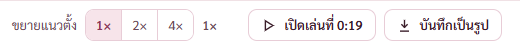

## 3. ปิดลำโพงแล้วคงช่องกราฟ

พี่กันเสนอ *"ตอนที่กดปิดลำโพง ตัวเส้นกราฟเสียงจะไม่หายไป เเต่มันจะยังคงช่องนั้นอยู่ เเต่ไม่มีกราฟ เเล้วขึ้นว่าปิดลำโพง ดีไหม"*

แถบอยู่ตำแหน่งเดิม ขนาดเดิม ขึ้นว่าปิดลำโพง ทั้งหน้ากราฟหลักและหน้าเทียบ · เปิดคืนแล้วกราฟกลับมาวาด

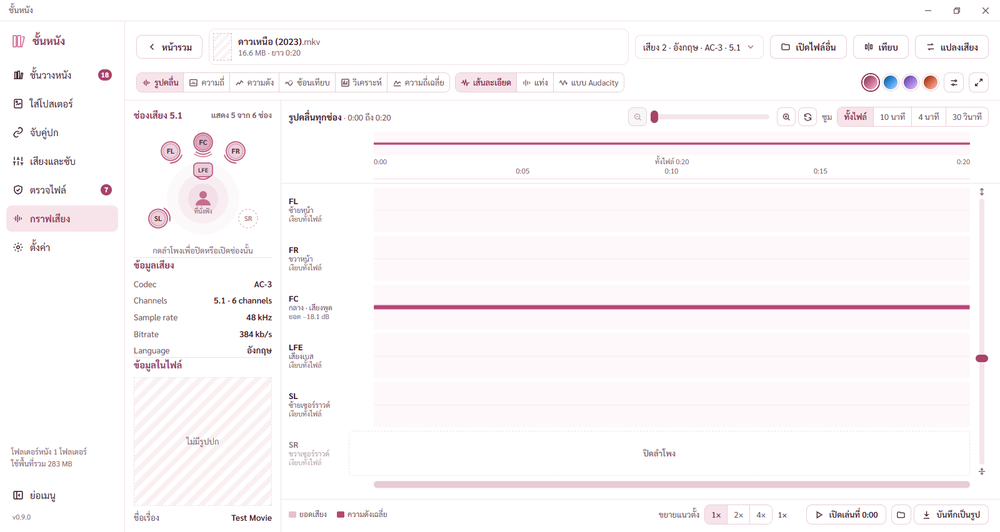

## 4. หน้าเทียบสองไฟล์

พี่กันทัก *"ทำไมยังไม่แก้จุดนี้ เราสั่งเเก้ไปแล้วนี่"*

ต้นเหตุ เมื่อวานแคลร์แก้เฉพาะหน้ากราฟหลัก หน้าเทียบเป็นคนละส่วนของโค้ดและไม่เคยเปิดดู · ตอนนี้แบ่งสองฝั่ง ตรึงหัวท้าย ไม่มีกรอบซ้อน วงที่นั่งฟังไม่โดนตัด มีปุ่มขยาย ทั้ง 6 มุมมอง

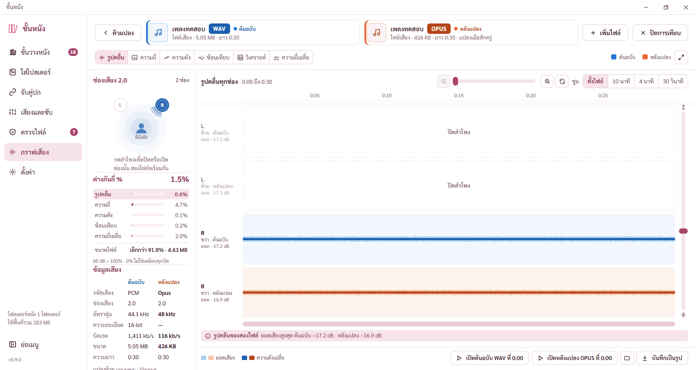

## 5. เมนูชั้นวางจากหน้าข้อมูลไฟล์

พี่กันสั่ง *"แก้"* กดเมนู `ชั้นวางหนัง` จากหน้าข้อมูลไฟล์แล้วกลับชั้นวาง แผงขวาของเรื่องที่เลือกยังอยู่

## 6. บั๊กที่เจอตอนตรวจบนโปรแกรมจริง

| บั๊ก | ต้นเหตุ | ผลหลังแก้ |
|---|---|---|
| ตัวจริงโดนกติกาความปลอดภัยกัน ชิ้นที่เปลี่ยนสีตามโทนเสียสไตล์ โหมดพัฒนาไม่เห็น | ตัวแปลงโทนเขียนสีด้วย `setAttribute("style")` | เขียนผ่าน `style.cssText` ตลอดการตรวจไม่โดนกันเลย |
| ลำโพงที่ปิดเป็นสีน้ำเงินทึบ | ตัวแปลงโทนเอาสีเดิมทับสีที่หน้าจอเปลี่ยน | ถือค่าใหม่เป็นต้นฉบับ ลำโพงที่ปิดเป็นสีขาวเส้นประ |
| แถบปุ่มหน้าแปลงเสียงกับหน้าใส่โปสเตอร์ไม่ชิดล่าง | เนื้อหาสั้น แถบเลยลอยขึ้นมา | ชิดล่างเสมอ |
| ดรอปดาวน์ในแถวคิวตัวหนังสือทับลูกศร | ข้อความยาวไม่ตัด | ตัดด้วยจุดไข่ปลา |
| ตารางหน้าเสียงและซับไม่ตรงแนว แถบปุ่มล่างขยับตอนเลื่อนสุด | ขอบในเกินมา 12 จุด ระยะท้ายหน้า 18 จุด | ตรงแนว 218 ถึง 1262 แถบล่างนิ่ง |
| ปลายตัวหนังสือโผล่ข้างแถบล่าง 1 จุด | พื้นแถบคลุมไม่ถึงขอบ | พื้นแถบคลุมเลยขอบ |
| ช่องไม่มีปกไม่เป็นแถบเอียง 4 จุด | ตัวอย่างหน้าใส่โปสเตอร์ รูปย่อหน้าเสียงและซับ หน้ากราฟ ตารางชั้นวาง | เป็นแถบเอียงครบ |
| แถวตั้งค่าเสียงสูงไม่เท่ากัน 32 กับ 30 จุด | ปุ่มคู่ขนาดเล็กเตี้ยกว่าช่องอื่น | สูงเท่ากัน 32 จุด |
| วงที่นั่งฟังโดนตัดในผังสองลำโพง | ผังสูง 124 จุด วงยาวถึง 150 จุด | ผังสูง 150 จุด |

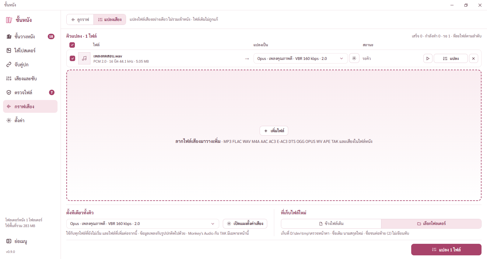

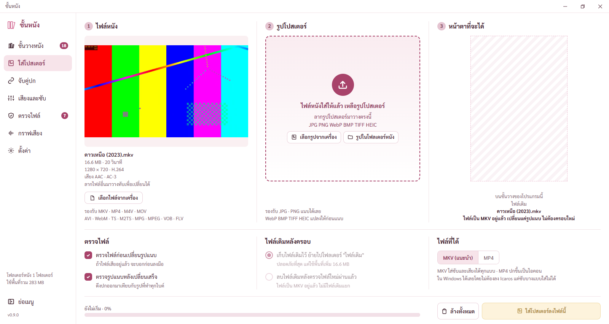

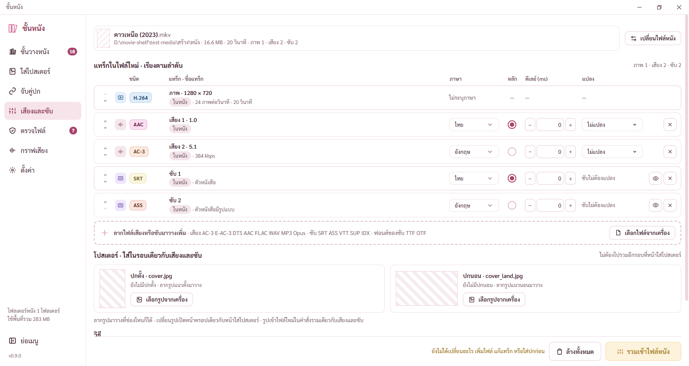

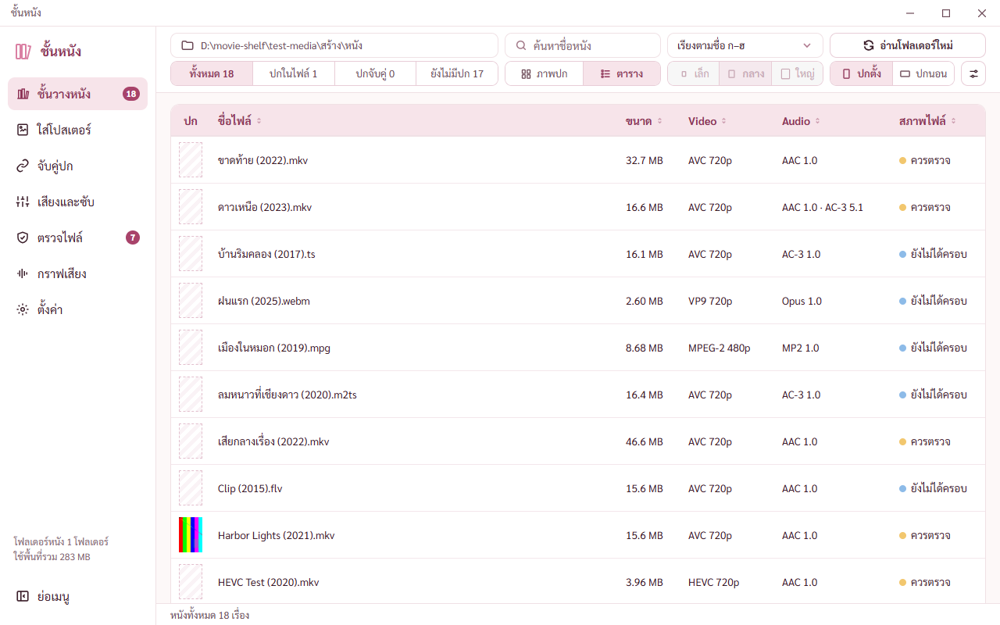

## 7. ตรวจบนตัวจริงใต้กติกาความปลอดภัย

ปุ่มขยายอ่านสีมุมรูปผ่าน asset ได้ สีปุ่มเปลี่ยนตามรูป · ตัวดูรูปเต็มจอโหลดรูปได้ · โทนสีเปลี่ยนได้

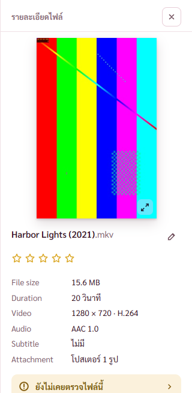

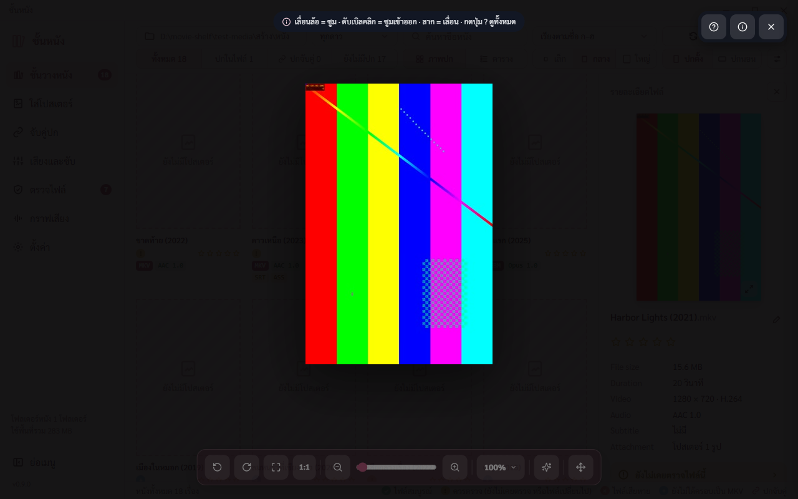

## 8. ตัวตรวจเดิมที่ปรับ

ปรับเฉพาะข้อที่รู้ต้นเหตุว่าตรึงของเก่าไว้ · หน้าตั้งค่าแบ่งหัวข้อ · กดปกซ้ำปิดแผง · สีกับความมนของโทนโรสควอตซ์ · ปกยืดเต็มแถว · ยอดรวมย้ายไปแถบสถานะ · ลำดับการ์ดตั้งค่าเสียงจัดใหม่ · แถวคิวเป็นดรอปดาวน์ · ปิดลำโพงคงแถบ · กราฟยืดเต็มพื้นที่ · เพิ่ม [check-look.mjs](../scripts/check-look.mjs) กับ [check-look-built.mjs](../scripts/check-look-built.mjs)

## 9. ขยายหน้าให้เต็ม

พี่กันสั่ง *"ลองขยายให้เต็ม"* หน้าใส่โปสเตอร์ จับคู่ปก เสียงและซับ แปลงเสียง ไม่ทิ้งที่ว่างเหนือแถบปุ่มแล้ว ช่องลากไฟล์ยืดตามความสูงหน้าต่าง เนื้อหาอื่นสูงเท่าเดิม · ปุ่มครอบหน้าใส่โปสเตอร์ ตัวหนังสือ 13 จุด ห่างขอบซ้ายขวา 8.7 จุด บรรทัดเดียวไม่ล้น

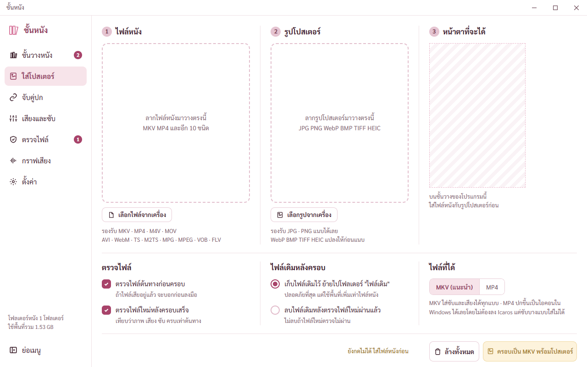

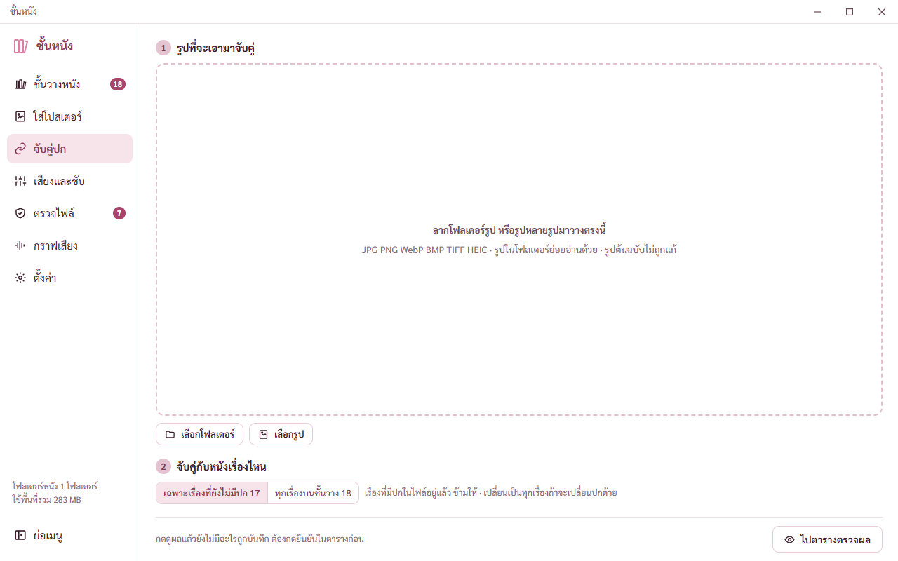

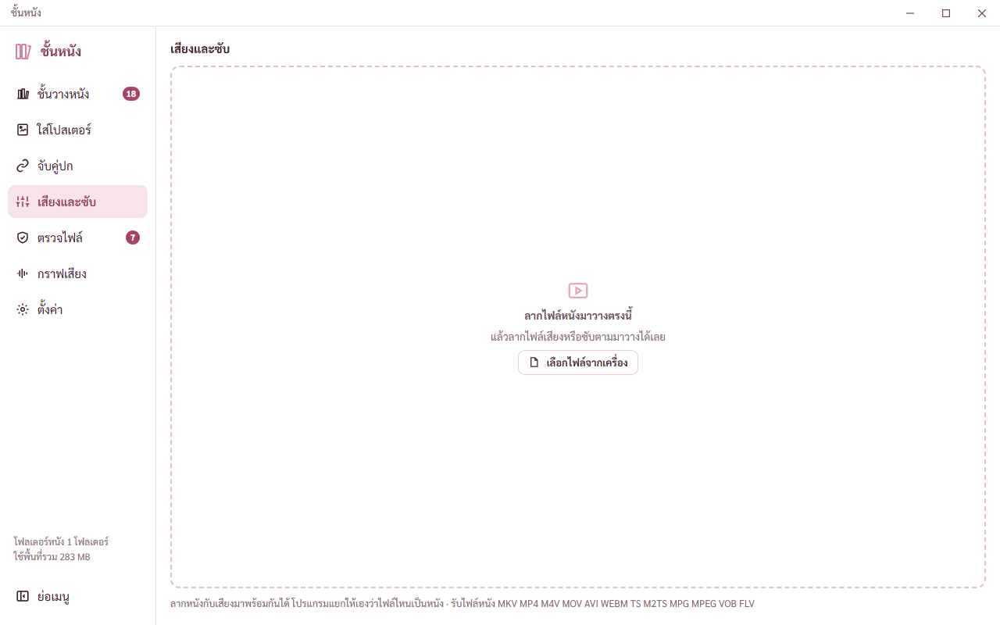

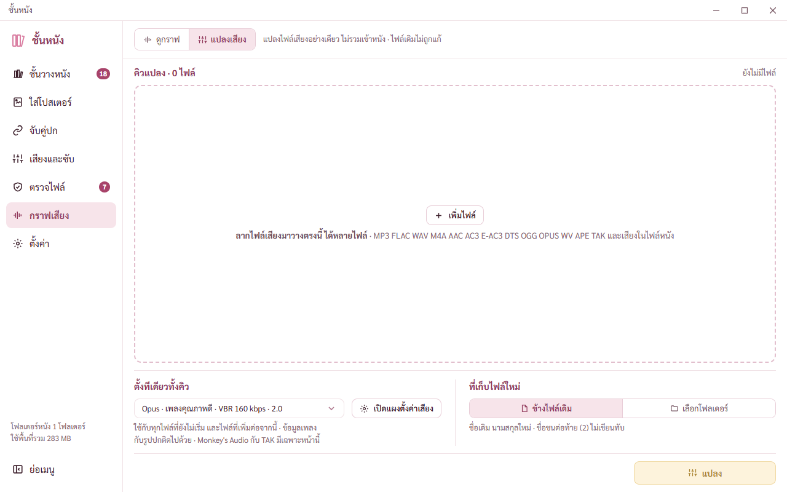

## 10. ปุ่มเลือกแบบและสีอยู่ในกรอบกราฟ

พี่กันแก้ *"เรามาหยถึง ย้ายลงไปอยู่ในการ์ดกราฟเสียงนะ ให้มันเหมือนกับตัวอื่น"* หลังแคลร์เข้าใจผิดย้ายขึ้นแถบบน · ปุ่มสีหน้าวิเคราะห์อยู่ในกรอบกราฟ

แก้ข้อนี้ภายหลัง แคลร์เหมาย้ายปุ่มหน้ารูปคลื่นกับหน้าความถี่ไปด้วย พี่กันไม่ได้สั่ง คืนที่เดิมแล้ว ดู [รายงานแก้รอบบ่าย](REPORT-2026-11-09-แก้รอบบ่าย.md)

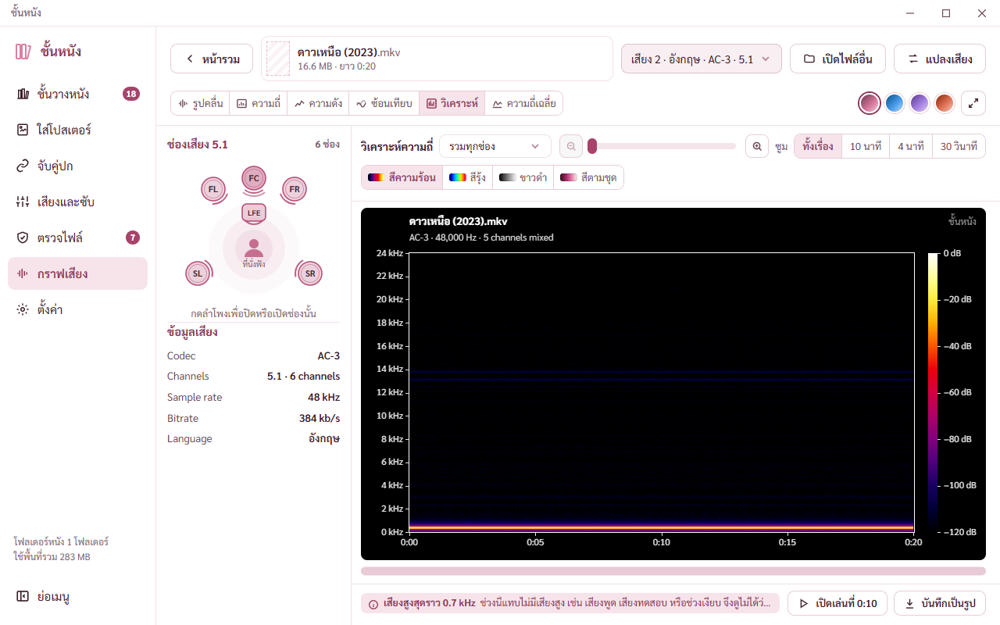

## 11. ปุ่มเปิดปิดภาพจากหนัง

พี่กันสั่ง *"ปุ่มที่ติ๊กเเล้วมันจะเเสดงภาพในหนัเลย ในเรื่องที่ยัไม่มีปกน่ะ คือถ้ากดเปิดจะเก็นภาพที่สุ่มจากหนัง กดปิด จะเห็นเเถบทะเเยงตามเดิม"*

สวิตช์อยู่ในแผงการแสดงผลของชั้นวางกับหน้าตั้งค่าหัวข้อชั้นวาง ค่าตั้งต้นปิด (แคลร์ตั้ง) · เปิดแล้วเรื่องที่ไม่มีปกขึ้นภาพหนึ่งเฟรมจากในหนัง ทั้งมุมมองปก ตาราง แผงขวา · แผงขวาบอกว่าเป็นภาพจากหนัง ยังไม่ใช่ปก · เรื่องนั้นยังนับเป็นไม่มีปกในตัวกรอง · เก็บภาพในโฟลเดอร์ของโปรแกรม ไม่แตะไฟล์หนัง ค่า hash เท่าเดิม · ดึงเฉพาะเรื่องที่เห็นบนจอ ทีละ 2 เรื่อง ไม่ให้เครื่องอืด

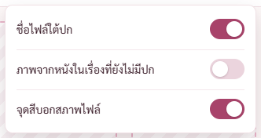

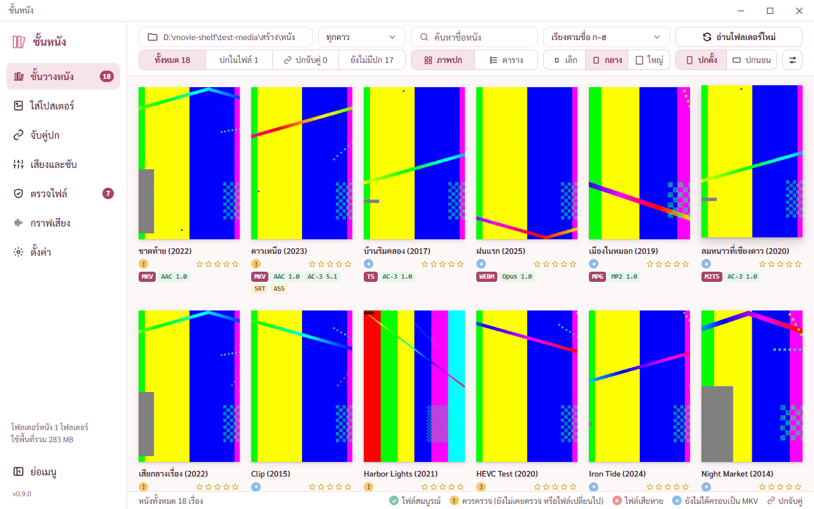

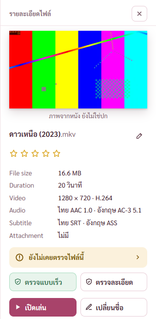

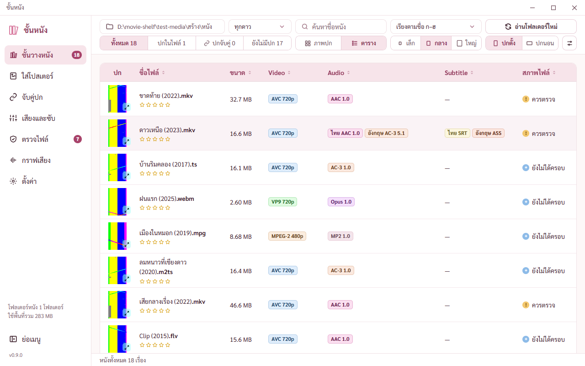

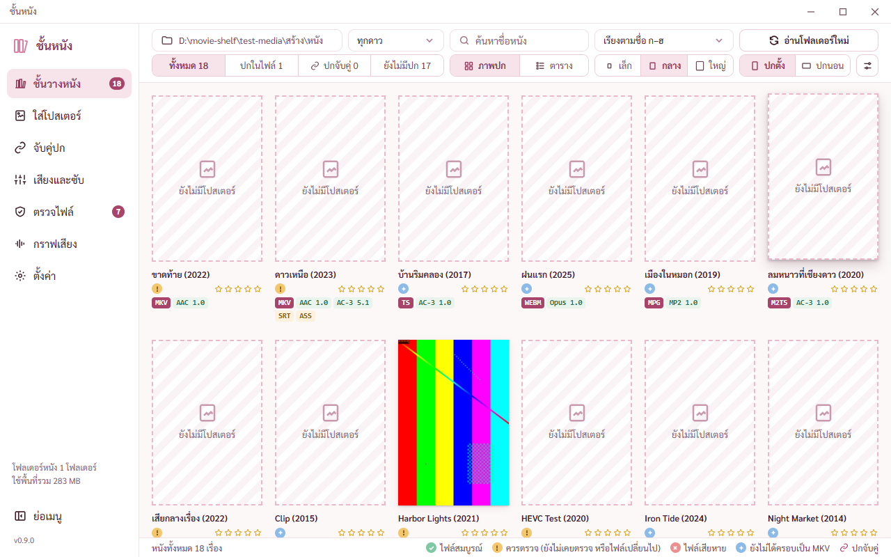

## 12. ของที่พี่กันต้องดูเอง

- ลากรูปจาก Explorer จริง
- รหัสสีบนการ์ดโทนแบบที่ส่งภาพไป ใช่แบบที่ต้องการไหม

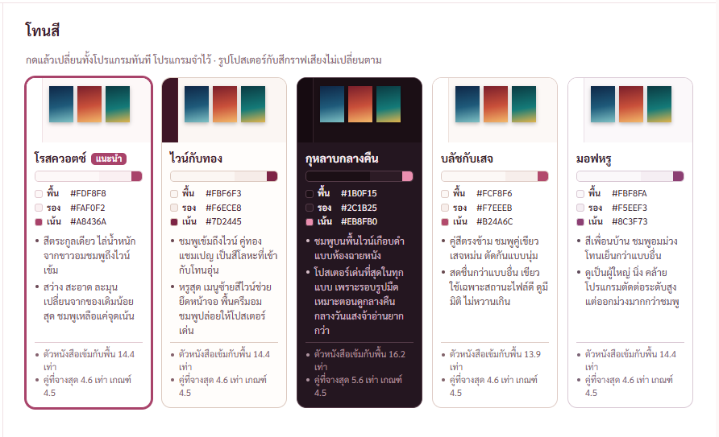

สถานะ commit แล้ว ยังไม่ push เลขรุ่นยังเป็น 0.1.0 · ไฟล์ภาพที่ตัวตรวจสร้างเพิ่มในโฟลเดอร์รายงานเก่าไม่รวมใน commit ยังอยู่ในเครื่อง
