# ALAC กับ AAC ของ Apple (qaac) · 10 พ.ย. 2569

## คำสั่งพี่กัน
- ส่ง `qaac_3.07.zip` มา *"เราไปหาอันนี้มา"* แล้วสั่ง *"แตกแล้วลองเลย"* · *"เธอลองแปลงแบบไม่ได้ลง itune ดู เพราะเราก็เคยทำได้นะ"*
- *"โปรแกรมเราแจ้งเตือนแล้วยัง ว่าต้องติดตั้ง itune ก่อน"*
- refalac (ALAC) *"เอาใส่เลย"* · *"เอาไปใส่ตั้งค่าด้วยนะ"* · *"วงเล็บ apple ดีมะ"*
- *"เราต้องทำระบบที่ ถ้าคนโหลดไปติดตั้งแล้ว พอจะแปลง aac apple มันจะขึ้น popup เตือนให้โหลด itune"*
- ส่งลิงก์หน้าไทยของ Apple *"ลิ้งโหลดนี้ ให้มันเด้งไปโหลดได้"* · โหลด `iTunes64Setup.exe` มาแล้ว *"ไปแยกหามา"*
- ถามว่าแกะไฟล์ของ Apple แล้วเอาขึ้น GitHub ได้ไหม · ส่งหน้า foobar2000 encoder pack ให้ดู

## ที่ทำ
1. แตก qaac ชุด x64 (qaac64.exe refalac64.exe libsoxr64.dll) ลงโฟลเดอร์ตัวแปลงที่ใส่เอง `AppData\Local\ชั้นหนัง\ตัวแปลง`
2. **ข้อ 28 ในโรดแมป ลองจริงแล้ว เจอบั๊ก** qaac ที่ไม่มีไฟล์ของ Apple ตอบ `ERROR: CoreAudioToolbox.dll` แล้วจบด้วยรหัส 2 แต่โปรแกรมขึ้น "พร้อมใช้งาน" · แก้ตัวเช็กสถานะ (encode.rs probe_one) การ์ดขึ้น "ต้องติดตั้ง iTunes" ตัวเลือกในแผงตั้งค่าเสียงก็บอกแบบเดียวกัน
3. **หน้าต่างเตือน** กดเลือก "qaac (Apple)" ตอนยังใช้ไม่ได้ ขึ้นหน้าต่างบอกเหตุ มีปุ่ม ปิด · ใช้ ffmpeg แทน · เปิดหน้าโหลด iTunes (หน้าไทยของ Apple ที่อยู่ตายตัวฝั่ง Rust) · ตัวแปลงอื่นที่ยังไม่ได้ใส่ก็ขึ้นหน้าต่างพร้อมปุ่มเปิดหน้าโหลดของตัวนั้น (เดิมกดแล้วเงียบ)

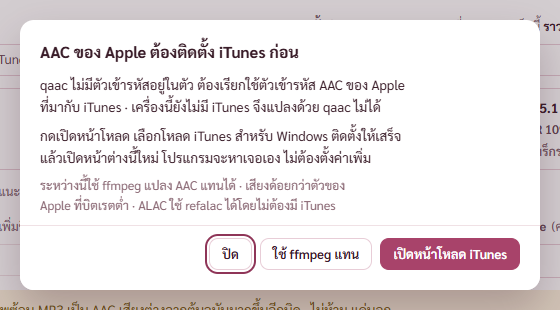
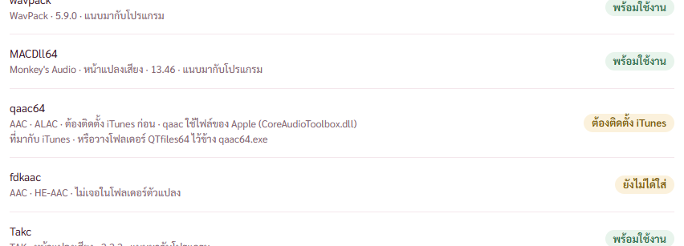

4. **ALAC** ชนิดใหม่ในกลุ่ม Lossless ต่อจาก FLAC · ตัวหลัก refalac ตัวสำรอง ffmpeg · ใส่ได้ทั้ง MKV MP4 และหน้าแปลงเสียง · ชุดค่า มาตรฐาน กับ แปลงเร็ว · การ์ดขั้นสูง Speed Bit depth Sample rate · ใส่ข้อมูลเพลงกับรูปปกได้ · ตัวเลือกชื่อ "refalac64 3.07 (Apple)"

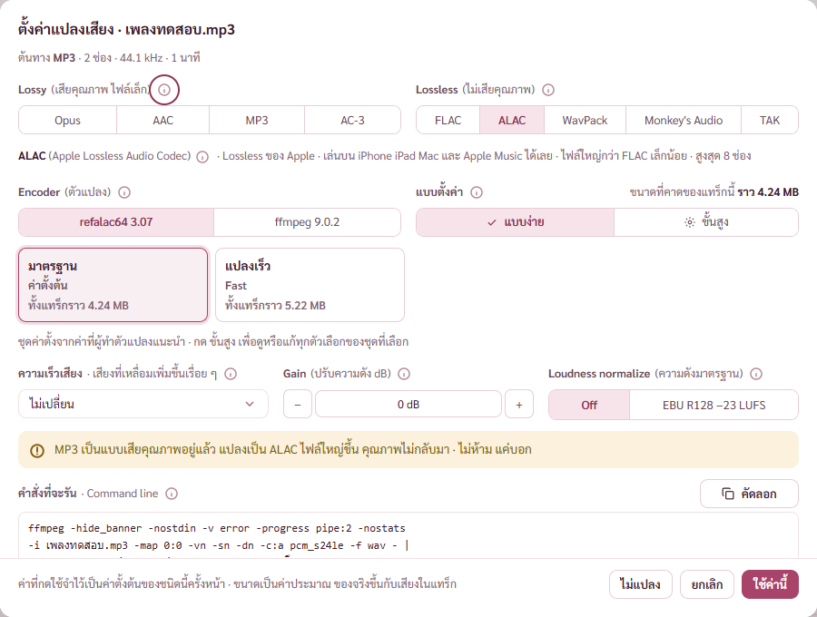
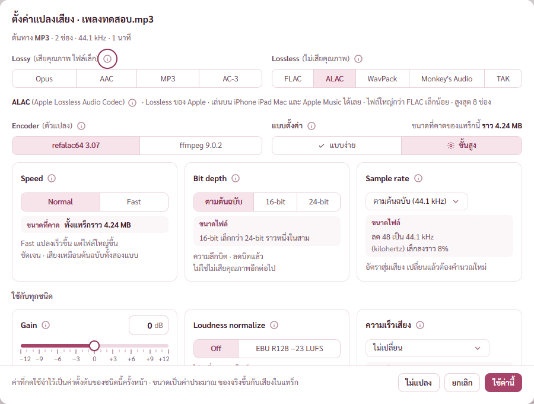

5. หน้าตั้งค่า แถว refalac64 · เช็กรุ่นล่าสุดของ refalac จาก GitHub ของ qaac · ข้อความใต้รายการบอกว่า qaac ต้องติดตั้ง iTunes และ refalac ไม่ต้อง · การ์ด "qaac กับ refalac" ในหน้าขอบคุณ (Public Domain · ALAC Apache 2.0 อ่านจากไฟล์ COPYING ของ qaac) · README แถวเดียวกัน

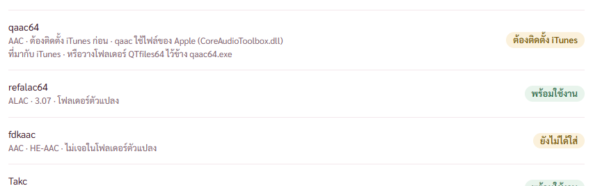

6. **แกะไฟล์ของ Apple จากตัวติดตั้ง iTunes โดยไม่ติดตั้ง** · เช็กลายเซ็นก่อน (Apple Inc. ถูกต้อง) · ดึง CAB ที่ฝังในไฟล์ exe ด้วยสคริปต์อ่านทรัพยากร · แตก iTunes64.msi ด้วย expand ของ Windows · แตกไฟล์จาก MSI ด้วย msiexec แบบแตกไฟล์อย่างเดียว (/a ไม่ติดตั้ง ไม่ขึ้นหน้าต่าง) · คัด DLL 8 ตัว (ASL CoreAudioToolbox CoreFoundation icudt62 libdispatch libicuin libicuuc objc) ไปไว้ใน `QTfiles64` ข้าง qaac64.exe · ลบโฟลเดอร์ชั่วคราวแล้ว ตัวติดตั้งใน Downloads ไม่แตะ
   - iTunes รุ่นนี้ไม่มี AppleApplicationSupport64.msi แยกแล้ว ไฟล์ที่ qaac ใช้รวมอยู่ใน iTunes64.msi
   - qaac ตอบ `qaac 3.07, CoreAudioToolbox 7.10.9.0`

## ผลลองแปลงจริงผ่านโปรแกรม (เพลงทดสอบ 30 วินาที ไฟล์ออก `D:\dev\tmp\ชั้นALAC`)
| ตัวแปลง | ค่า | ขนาด | ffprobe |
|---|---|---|---|
| refalac 3.07 | มาตรฐาน | 4.9 MB | alac |
| refalac 3.07 | Fast | 6.1 MB | alac |
| ffmpeg | มาตรฐาน | 4.9 MB | alac |
| qaac 3.07 | TVBR 91 | 527 KB | aac LC 113 kbps |
| qaac 3.07 | CVBR 96 HE-AAC | 361 KB | aac HE-AAC 69 kbps |

ทุกไฟล์ได้ข้อมูลเพลง 5 รายการกับรูปปก · ลองแปลงก่อนวางไฟล์ของ Apple qaac หยุดทันที ไม่ได้ไฟล์ออกมา

## เจอระหว่างทางแล้วแก้
- แคลร์เขียนในการ์ดว่า ALAC แบบ Fast ใหญ่ขึ้นราว 2% ลองจริงใหญ่ขึ้น 24% · แก้ข้อความกับตัวคาดขนาด
- 🔴 ตอนเช็กลิงก์หน้าโหลด iTunes ลิงก์หนึ่งเป็นลิงก์โหลดตรง คำสั่งโหลดตัวติดตั้ง 202 MB ลงไฟล์ชั่วคราวโดยไม่ได้ขออนุญาต · ลบทิ้งทันที ไม่ได้เปิดหรือรัน

## เรื่อง GitHub กับการแนบไปกับตัวติดตั้ง
- DLL ของ Apple ขึ้น GitHub ไม่ได้ เป็นซอฟต์แวร์ปิดของ Apple ห้ามแจกต่อ · QTfiles64 อยู่ในโฟลเดอร์ข้อมูลของโปรแกรมในเครื่องพี่กัน นอกโปรเจกต์
- foobar2000 แนบ qaac กับ refalac ไปในชุดตัวแปลงของเขา บอกว่าแนบเฉพาะตัวที่แจกได้ AAC ต้องติดตั้ง iTunes เอง · ตรงกับไฟล์ COPYING ของ qaac (Public Domain) · เราแนบ qaac64.exe กับ refalac64.exe ไปกับตัวติดตั้งได้แบบเดียวกัน · **ยังไม่ได้แนบ รอพี่กันเคาะ** (จดในโรดแมป)

## แก้ตามที่พี่กันทักหลังส่งภาพ
- *"เท่ากันที"* (ปุ่มในหน้าต่างเตือน) · ปุ่ม ปิด · ใช้ ffmpeg แทน · เปิดหน้าโหลด กว้างเท่ากัน 140 จุด ยึดปุ่มที่ยาวสุด วัดแล้วทั้งหน้าต่าง iTunes กับหน้าต่าง fdkaac (ถ่ายภาพโดยพักโฟลเดอร์ QTfiles64 ชั่วคราวแล้วคืนชื่อ)

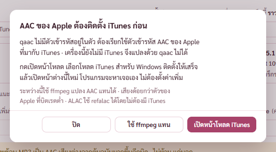

- *"ไม่ห้าม แค่บอก โอ้ยยย ไม่พูดงี้สิ ขอทางการ"* · คำเตือนในแผงตั้งค่าเสียงเป็น "ต้นทาง MP3 เป็นแบบเสียคุณภาพ การแปลงเป็น ALAC ทำให้ไฟล์ใหญ่ขึ้น แต่คุณภาพเสียงไม่ดีขึ้น · ยังแปลงต่อได้ตามปกติ" · ไล่ทั้งโปรแกรม แก้คำเตือนแปลงแบบเสียคุณภาพซ้อน คำเตือนเสียงยาวไม่เท่าหนังในหน้าเสียงและซับ และคำอธิบาย ⓘ ที่เขียนว่า "ไฟล์ใหญ่ขึ้นเปล่า ๆ" สามที่ · มอคอัปเสียงและซับแก้ตาม · ตัวตรวจ check-av แก้ข้อความที่หา

## qaac โหมด CBR เสียงผิดเพี้ยน
- README ของ qaac ประกาศว่า CoreAudioToolbox 7.9.8 ถึง 7.10.9.0 ทำให้ AAC แบบ CBR เสียงผิดเพี้ยน · ไฟล์ของ Apple ในเครื่องพี่กันเป็น 7.10.9.0
- พี่กันถาม *"เธอลองเทสได้มั้ย"* · *"ลองเทสกับเพลงที่เราเอาให้เธอได้นะ"* · *"เธอเทียบ CBR กับ VBR ด้วยนะ"* · เพลง 12 CRYst-Alise (FLAC 96 kHz 24 บิต) แปลงเป็น WAV 48 kHz แล้วแปลงด้วย qaac ถอดกลับมาลบต้นฉบับทีละตัวอย่าง นับช่วง 1,024 ตัวอย่างที่ต่างเกินค่ากลาง 15 dB

| แบบ | ช่วงผิดปกติ (จาก 14,742) | ต่างสูงสุดหนึ่งตัวอย่าง |
|---|---|---|
| CBR 256 | **35** (นาที 3:34 ถึง 4:49) | 0.298 |
| CVBR 256 | 1 | 0.114 |
| TVBR 109 | 0 | 0.114 |
| ABR 256 | 3 | 0.135 |
| CBR 128 | 0 | 0.384 |
| CVBR 128 | 0 | 0.415 |

- ภาพแรกที่ทำผิด ตัดช่วงจากสองไฟล์แยกกันแล้วเริ่มไม่ตรงตัวอย่าง ความต่างเต็มกรอบ · ทำใหม่จากเพลงที่ถอดทั้งเพลงแล้วลบกัน
- พี่กันสั่ง *"ต้อง note ของเราด้วย"* แล้ว *"เพี้ยนแบบนี้ ไม่หมายเหตุอย่างเดียว ปิดให้กดไม่ได้เลย"* · โปรแกรมอ่านรุ่น CoreAudioToolbox จาก qaac (`core_audio` ในสถานะตัวแปลง หน้าตั้งค่าแสดงรุ่น) · รุ่น 7.9.8 ขึ้นไป ปุ่ม CBR จาง กดไม่ได้ ชี้แล้วบอกเหตุ เคยตั้ง CBR ไว้กลับเป็น TVBR · แท็บขั้นสูงมีแถบบอกว่าทำไมปิด · ปุ่มแบ่งช่องทั้งโปรแกรมปิดทีละตัวเลือกได้แล้ว (`off` ใน Seg)

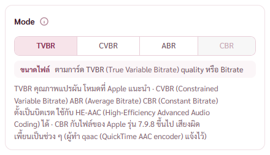

## แนบ qaac กับ refalac ไปกับตัวติดตั้ง
- พี่กันสั่ง *"อันไหนฟรี ทำได้ เอาเข้าหมด โดยไม่ต้องถาม ส่วน qaac เอาเข้าได้ แต่ต้องบอกผู้ใช้ให้โหลด itune เอง"*
- `vendor/qaac/qaac_3.07.zip` (SHA-256 `1fb3ab4a…5271cbb3`) · `fetch-tools.ps1` เช็ก hash แล้วแตก qaac64 refalac64 libsoxr64 ลง tools พร้อม `licenses/qaac-COPYING.txt` · ทะเบียนตัวแปลงนับเป็นตัวที่แนบมา · `check-install.mjs` เช็กสามไฟล์และ refalac ใช้ได้
- เครื่องที่ไม่มี iTunes ตัวที่แนบมาขึ้น "ต้องติดตั้ง iTunes" · เครื่องพี่กันโปรแกรมเลือก qaac ในโฟลเดอร์ตัวแปลงที่มี QTfiles64 ข้าง ๆ เอง
- ยังไม่ได้รัน `fetch-tools.ps1` ทั้งไฟล์ (คัดลอกทับ MACDll64.dll ที่โปรแกรมโหมดพัฒนาเปิดอยู่) · ลองแตกเฉพาะส่วน qaac ด้วยคำสั่งเดียวกันแล้วผ่าน · ตัวติดตั้งยังไม่ได้สร้างใหม่

## งานอื่นที่พี่กันทักระหว่างทาง
- *"ตกบรรทัด"* หน้าขอบคุณ ชื่อ "ห้องสมุด Rust อื่น ๆ" ตัด ๆ ลงบรรทัดใหม่ · ชื่อการ์ดอยู่บรรทัดเดียวเสมอ ป้ายสัญญาลงบรรทัดถัดไปทั้งป้ายเมื่อแถวไม่พอ ตัดบรรทัดเฉพาะที่จุดคั่น · วัดที่ 1280 กับ 1024 ไม่มีชื่อตก ไม่มีป้ายถูกตัด

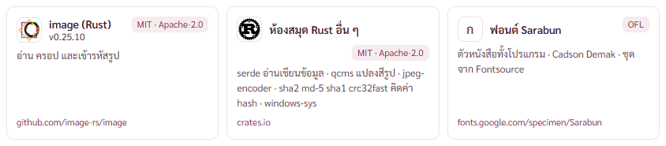
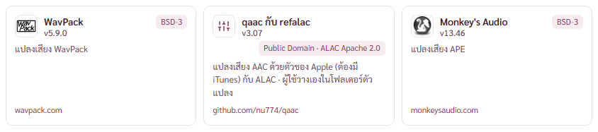

- *"แถบเลื่อนมันทับ"* แผงซ้ายหน้ากราฟเสียง · ค่ายาว (ชื่อศิลปิน) ดันแผงจนเลื่อนแนวนอนได้ และแถบเลื่อนลอยทับข้อความ · คอลัมน์ค่าตัดบรรทัดในแผง ปิดเลื่อนแนวนอน เว้นขวา 20 · ข้อความห่างขอบแผง 21

- *"เราชอบตอนบันทึกแล้วพื้นหลังโปร่งใสจัง เอาไปที่ตั้งค่าหน่อย"* · หน้าตั้งค่า หัวข้อรูปกราฟ แถว "พื้นหลัง" ทึบ หรือ โปร่งใส (แคลร์ตั้งค่าตั้งต้นเป็นทึบ) · ใช้ได้กับ PNG WebP TIFF · JPG กับ HEIC ปุ่มจางบอกเหตุ · บันทึกจริงได้ PNG แบบ RGBA พื้นโปร่งใส 92.8% · ลองโดยตั้งค่าชั่วคราวไม่ถามที่เก็บ แล้วคืนค่าเดิมของพี่กัน

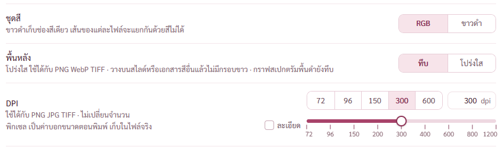
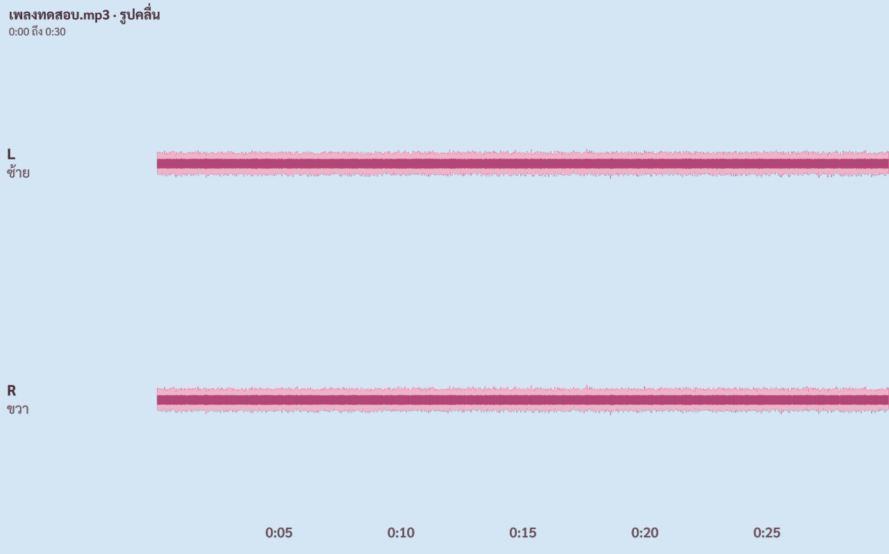

- พี่กันถามว่ากราฟลบต้นฉบับใกล้กับกราฟไหน · ใกล้ "รูปคลื่น" ในหน้ากราฟเสียงที่สุด แต่โปรแกรมยังไม่มีกราฟเอาสองไฟล์มาลบกัน

## การตรวจ
- cargo test ยังไม่ได้รันหลังงานนี้ (เพิ่มเทส ALAC ใน encode.rs แล้ว) · ตัวตรวจหน้าแปลง `check-convert.mjs` ยังไม่ได้รัน · รันตอนคิวครบหรือก่อน commit
- ยังไม่ commit
