# มอคอัปหน้าบิตเรตวิดีโอแบบใหม่ · 10 พ.ย. 2569

## คำสั่งพี่กัน
- *"หน้า bitrate viewers เราเอาแบบเดิมไว้ และเราให้เธอ re-designed ใหม่หมด ให้เข้ากับเว็บ และโทนสี และบางการตั้งค่าการเลือก ให้ภาษาไทย และคงคำศัพเฉพาะไว้ ทำมอคอัปมาเลย เปิดในโครมได้"*
- *"อย่าลืมว่า เรามี 4 โทนสีนะ"* · *"หมายถึง โปรแกรมมีตั้งค่าได้ 4 โทน"*
- *"เฉพาะตอนนี้ เธอรันในเบราเซอร์เธอก่อน และแคปภาพมา"*
- *"เส้นแบ่ง"* (ชี้แผงซ้าย)

## เปิดดูยังไง
- เปิดโปรแกรมโหมดพัฒนาไว้ (เซิร์ฟเวอร์พอร์ต 1420) แล้วเข้า `http://127.0.0.1:1420/docs/mockups/bitrate-redesign.html`
- ด้านบนมีปุ่มสลับแบบใหม่กับแบบเดิม การ์ดเลือกโทนครบ 5 โทน และปุ่มเปิดคลิปตัวอย่าง
- กรอบข้างล่างเป็นหน้าจอจริงของโปรแกรมทั้งหน้า (แถบชื่อ เมนูซ้าย เลขรุ่น) ขนาด 1280 × 800 เท่าหน้าต่างโปรแกรม
- ยังไม่ได้ลงโปรแกรม หน้าบิตเรตในโปรแกรมยังเป็นแบบเดิม

## ไฟล์
| ไฟล์ | หน้าที่ |
|---|---|
| `docs/mockups/bitrate-redesign.html` | หน้าครอบ ปุ่มสลับแบบ การ์ดโทน |
| `docs/mockups/bitrate-redesign-app.html` | หน้าจอจริงของโปรแกรม ยกจาก theme-live-app.html เพิ่มตัวแทน bitrate.rs ที่ส่งข้อมูลทีละช่วง |
| `docs/mockups/bitrate/data-ตัวอย่างหนัง.json` | ข้อมูลบิตเรตจริงของคลิปตัวอย่าง 2 นาทีครึ่ง อ่านด้วย ffprobe ทั้งแบบแพ็กเก็ตและแบบถอดภาพ |
| `src/mockups/bitrate/BitrateNew.tsx` | ตัวหน้าแบบใหม่ ใช้ bitrateApi กับเหตุการณ์ชุดเดียวกับหน้าเดิม ย้ายลงโปรแกรมได้ทั้งไฟล์ |
| `src/mockups/bitrate/bitrate-new.css` | สไตล์ ใช้ตัวแปรสีของโทนทุกจุด |
| `src/mockups/bitrate/main.tsx` | หน้าจอจริงทั้งหน้า สลับหน้าบิตเรตได้สองแบบ |

โค้ดหน้าใหม่อยู่ใน `src/mockups` เพราะเซิร์ฟเวอร์ทดสอบตั้งไว้ไม่เฝ้าไฟล์ใน `docs` แก้แล้วหน้าไม่เปลี่ยน · ไม่ได้ต่อเข้ากับโปรแกรมจริง ตัวโปรแกรมที่สร้างจึงไม่มีไฟล์นี้

## ที่เปลี่ยนจากแบบเดิม
- โครงหน้าเหมือนหน้ากราฟเสียง การ์ดชื่อไฟล์ด้านบน แถวตัวเลือก แผงข้อมูลซ้าย หัวกราฟพร้อมปุ่มซูม แถบภาพรวมทั้งไฟล์ คำอธิบายสีด้านล่าง เส้นแบ่งตำแหน่งเดียวกับหน้ากราฟเสียง
- ตัวเลือกเป็นภาษาไทย คำเฉพาะคงไว้
  - วิธีคิด ต่อวินาที · ต่อ GOP · GOP แบบถ่วง · ต่อเฟรม พร้อมปุ่ม ⓘ อธิบายแต่ละแบบ
  - สเกล ตามเพดาน · ตามข้อมูล พร้อมปุ่ม ⓘ
  - เส้น ค่าเฉลี่ย · สูงสุด · ต่ำสุด กดเปิดปิดทีละเส้น (แบบเดิมต้องกด Ctrl Shift Alt พร้อมคลิก)
  - ซูม ทั้งไฟล์ · 1 นาที · 10 วินาที กับปุ่มซูมเข้าออก
- สีกราฟมาจากโทนที่เลือก ความหมายสีเหมือนแบบเดิม อ่อนใต้ค่าเฉลี่ยสะสม เข้มเหนือค่าเฉลี่ยสะสม แดงเกินเพดาน
- บิตเรตตั้งแต่ 1,000 kbps แสดงเป็น Mbps แกนบอกหน่วย
- ชี้กราฟขึ้นกล่องบอกเวลา บิตเรต สูงหรือต่ำกว่าค่าเฉลี่ยกี่เปอร์เซ็นต์ และชนิดเฟรมในโหมดต่อเฟรม
- คลิกปักจุด แถบล่างบอกค่าตรงจุดนั้น โหมดต่อเฟรมมีปุ่มไป I เฟรมก่อนหรือถัดไป
- แผงซ้ายบอกค่าเฉลี่ย สูงสุดกับเวลาที่เกิด (กดแล้วปักจุดตรงนั้น) ต่ำสุด เพดาน จำนวนเฟรมกับคีย์เฟรม และโหมดต่อเฟรมนับ I P B พร้อมขนาดเฉลี่ย
- แบบเดิมเก็บไว้ครบ สลับได้จากปุ่ม "แบบ Bitrate Viewer"

## ภาพ (ถ่ายในหน้าต่างโปรแกรมโหมดพัฒนา ใช้ฝั่ง Rust ตัวจริงอ่านคลิปตัวอย่าง)

### หน้าว่าง
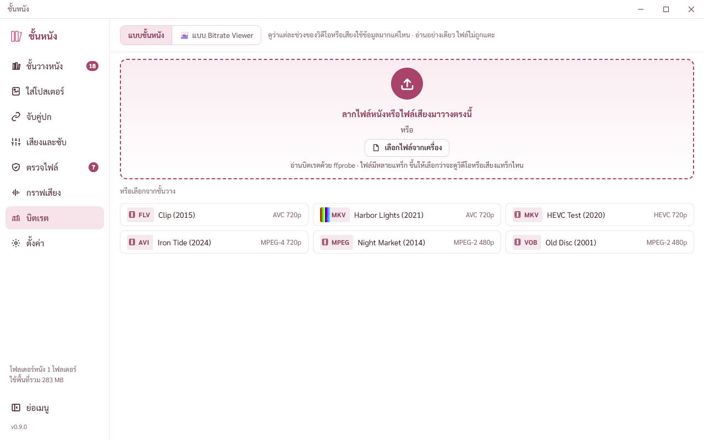

### กำลังอ่าน ไฟล์ 33 นาที กราฟขึ้นจากซ้ายไปขวา ปุ่มเป็นหยุดอ่าน
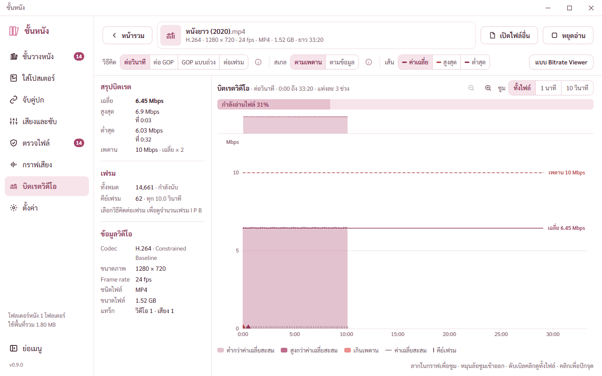

### ต่อวินาที ชี้ดูค่า
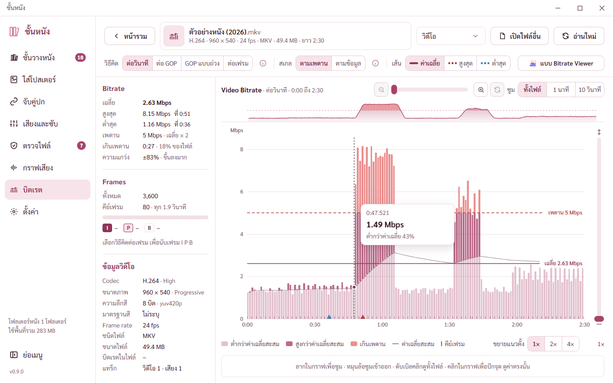

### ต่อเฟรม ปักจุดแล้วกดไป I เฟรมถัดไป
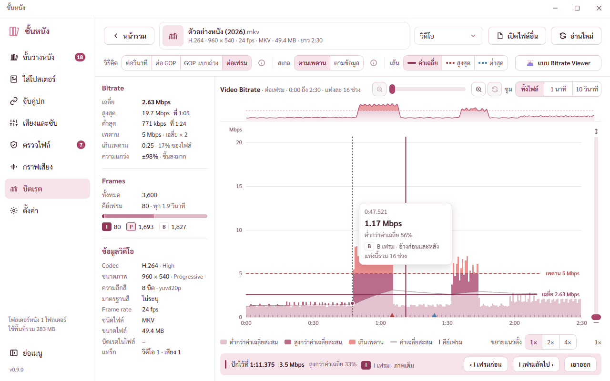

### ลากเลือกช่วง แล้วซูม เปิดเส้นสูงสุดกับต่ำสุด
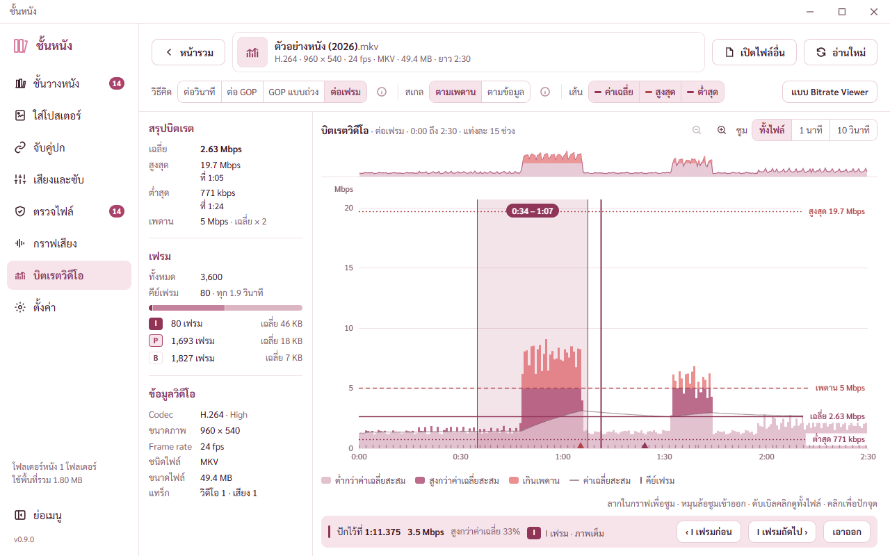
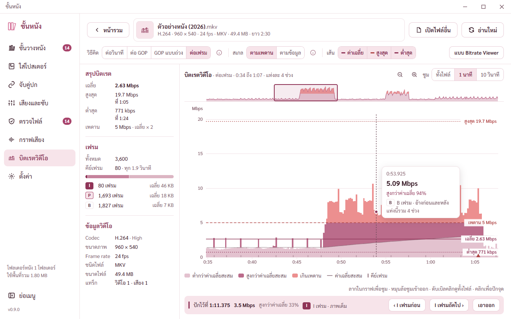

### 5 โทนในหน้าตั้งค่า
โรสควอตซ์กับบลัชกับเสจ สีเน้นใกล้กันมาก (`#a8436a` กับ `#b24a6c`) สีเขียวของเสจอยู่แค่สีบอกสถานะ หน้านี้จึงดูแทบเหมือนกัน

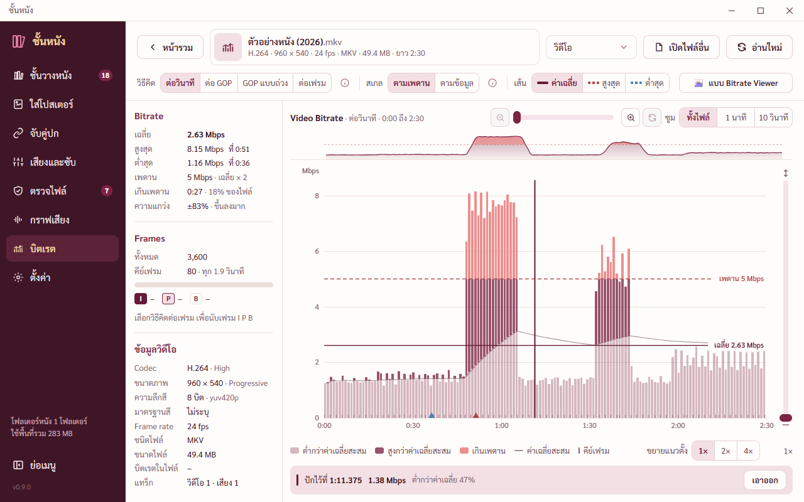
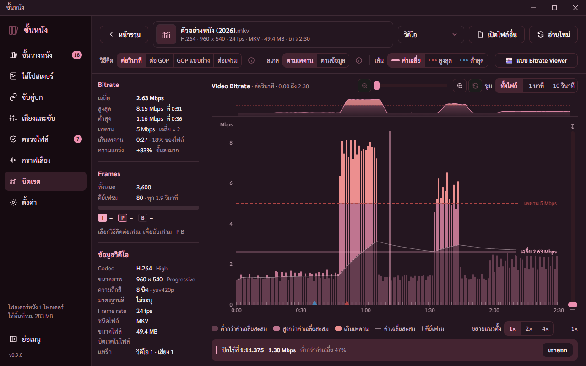
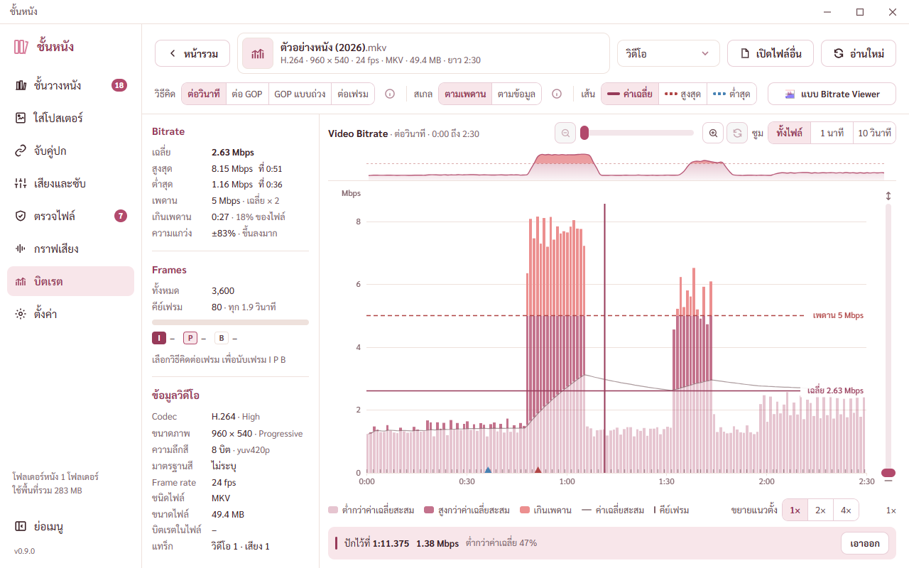
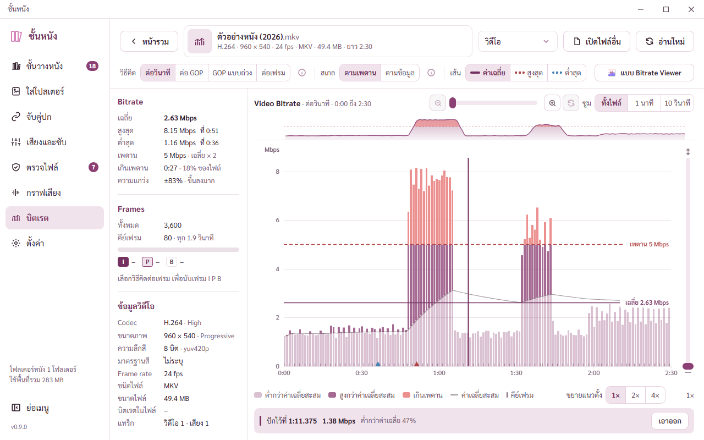

### อ่านไม่ได้
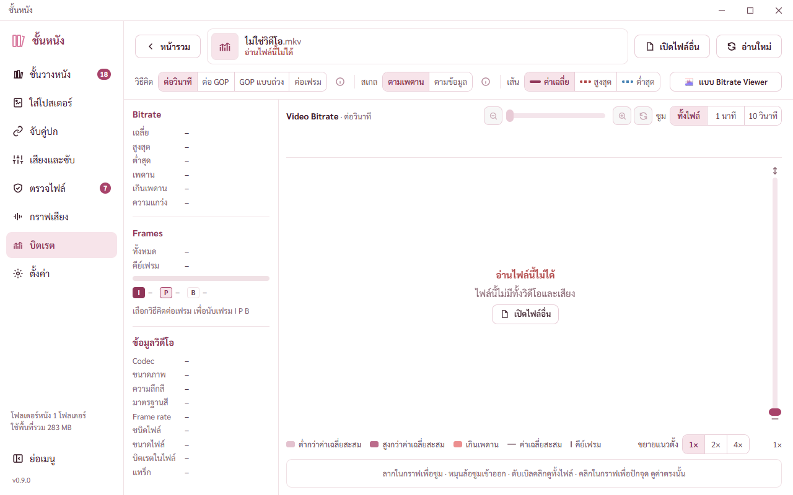

### แบบเดิมยังอยู่
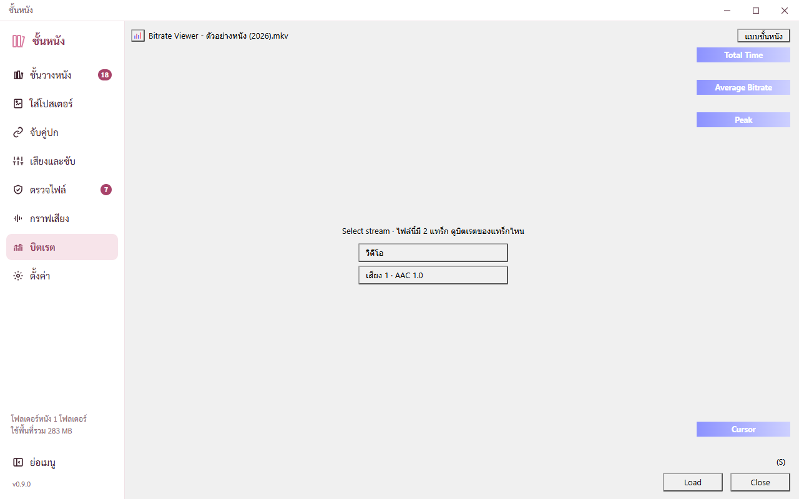

## เจอแล้วแก้ระหว่างตรวจภาพ
1. หน้าวาดใหม่ไม่จบ ตัวดักโทนของหน้าใหม่วนกับตัวแปลงโทนของโปรแกรม · แก้ให้วาดใหม่เฉพาะตอนสีของโทนเปลี่ยนจริง
2. ลากแล้วไม่ซูม ตอนปล่อยเมาส์หน้ายังจำช่วงเป็นค่าเก่า · คิดช่วงจากจุดกดกับจุดปล่อยตรง ๆ
3. เพดานขึ้น "5.00 Mbps" · ตัดศูนย์ท้าย
4. จุดลากไฟล์มีไอคอนซ้อนสองอัน · เอาอันที่ใส่เพิ่มออก ใช้ไอคอนกลางของโปรแกรม
5. ขอบบนจุดลากไฟล์โดนแถบด้านบนทับ แถบตั้งติดขอบตอนเลื่อน แต่หน้านี้ไม่ได้อยู่ในกล่องเลื่อน · ให้แถบอยู่ที่เดิม
6. แถบภาพรวมเป็นขีดห่าง ๆ แล้วเป็นฟันเลื่อย · เปลี่ยนเป็นพื้นทึบ ลากผ่านเฉพาะช่องที่มีข้อมูล
7. แกนบิตเรตไม่บอกหน่วย · เขียน Mbps กำกับหัวแกน
8. กล่องตอนชี้แคบ ชนิดเฟรมตกบรรทัด · กว้างขึ้นและคำสั้นลง
9. ป้ายเพดานกับค่าเฉลี่ยมีขีดค้างหลังป้าย · เส้นหยุดก่อนป้าย
10. "คอนเทนเนอร์" ยาวเกินช่อง · เปลี่ยนเป็น "ชนิดไฟล์"
11. เวลาที่เกิดค่าสูงสุดต่ำสุดตกบรรทัดแบบเยื้อง · เป็นบรรทัดเล็กใต้ค่า
12. ไม่มีเส้นแบ่งแบบหน้ากราฟเสียง (พี่กันทัก) · ใส่เส้นนอนใต้แถบบน เส้นตั้งคั่นแผงซ้าย เส้นคั่นหัวข้อในแผงซ้าย
13. ไฟล์ที่อ่านไม่ได้ ยังวาดแกนเปล่า ป้ายเวลามีจุดค้าง การ์ดชื่อไฟล์ขึ้นกำลังอ่าน · ขึ้นข้อความบอกเหตุพร้อมปุ่มเปิดไฟล์อื่นแทน

## ลงโปรแกรมแล้ว (พี่กันสั่ง *"เอามอคอัปเข้าโปรแกรมเลยนะ"*)
- หน้าเมนูบิตเรตวิดีโอเปิดแบบใหม่เป็นค่าตั้งต้น · แบบเดิมอยู่ที่ปุ่ม "แบบ Bitrate Viewer" (มีไอคอนของโปรแกรมนั้น) แบบเดิมมีปุ่ม "แบบชั้นหนัง" กลับ · จำว่าเลือกแบบไหนไว้ สลับแล้วไฟล์ที่เปิดอยู่ตามไปด้วย
- ลากไฟล์จาก Explorer มาวางในหน้าใหม่ได้แล้ว · ไฟล์ล่าสุดไม่ซ้ำกันจากเครื่องหมาย / กับ \
- โค้ด `src/pages/BitratePage.tsx` (แบบใหม่) `src/pages/BitrateClassic.tsx` (แบบเดิม) `src/styles/bitrate.css` · มอคอัปใช้หน้าจริงตัวเดียวกัน
- ตัวตรวจ `scripts/check-bitrate-new.mjs` 22 ข้อผ่าน · `scripts/check-bitrate.mjs` (แบบเดิม) 30 ข้อผ่าน · cargo test 161 ข้อผ่าน

## ปุ่มดูบิตเรตจากหน้าอื่น
- *"เพิ่ม สามารถกดดูบิตเรตได้จาก ชั้นหนัง หน้าโปรไฟล์"* · ปุ่ม "บิตเรตวิดีโอ" ในแผงขวาของชั้นวาง (กดไม่ได้เมื่อไฟล์หายหรือไม่มีวิดีโอ)

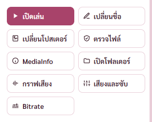

- *"เพิ่มดูบิตเรต จากดูกราฟเสียงได้ ไปหาที่ใส่"* · ปุ่ม "บิตเรต" ในหน้ากราฟเสียง ขึ้นเฉพาะไฟล์ที่มีวิดีโอ

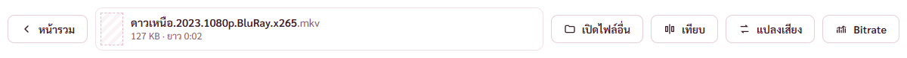
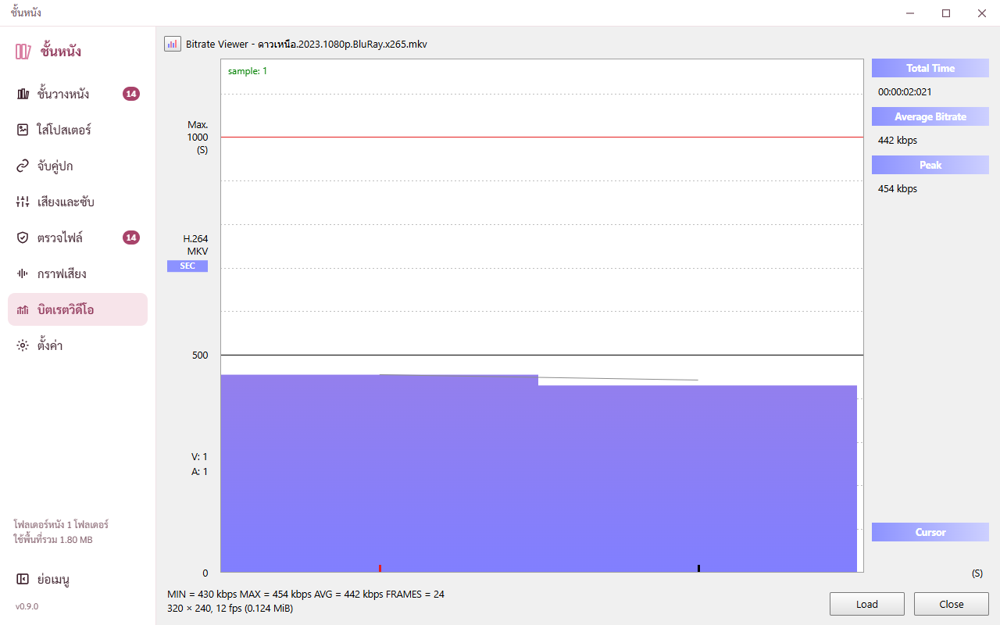

## แก้ตามที่พี่กันทักหลังลงโปรแกรม
- *"ขอเส้นซูมด้วย ทั้งแบบแนวตั้ง กับแนวนอน … และปุ่มรีเซ็ตด้วย"* · แถบซูมแนวนอนบนกราฟ แถบซูมแนวตั้งข้างขวา ปุ่มซูมออก ซูมเข้า รีเซ็ต แบบหน้ากราฟเสียง

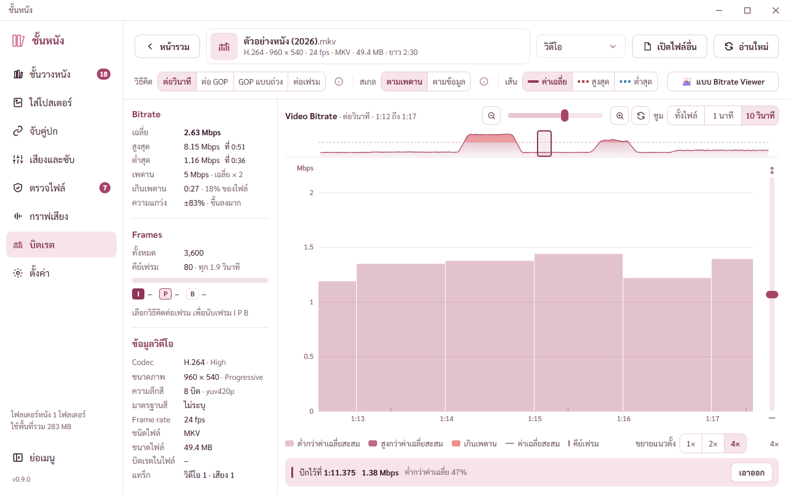
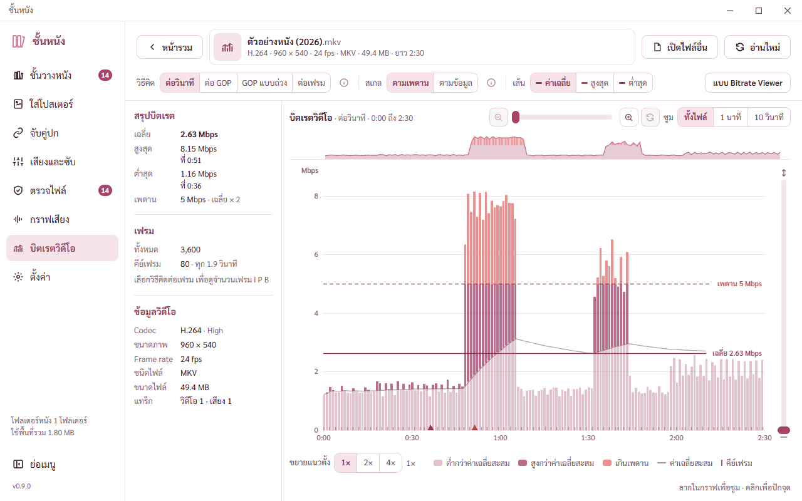

- *"สองรูป ใช้คำภาษาอังกฤษ รูปสามใส่ icon ด้วย"* · หัวข้อ Bitrate · Frames · Video Bitrate · ปุ่มสลับมีไอคอน Bitrate Viewer

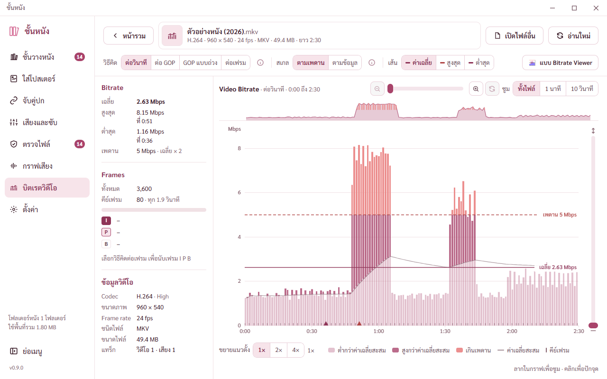

- *"จุดนี้ ตรึงเอาไว้ แม้มันไม่มีข้อมูล แต่หัวข้อจะยังอยู่ครบ"* · แผงซ้ายขึ้นหัวข้อกับแถวครบเสมอ ไม่มีค่าขึ้น –

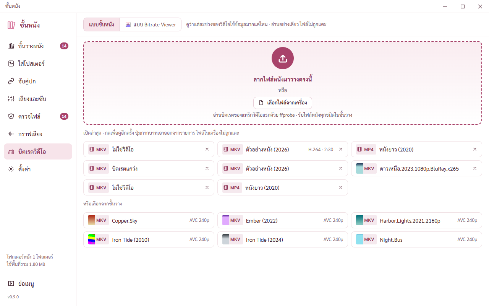

- *"อันนี้มันเด้งมาแล้วมันดันกราฟ … ไปหาที่ กันที่ไว้ให้มันหน่อย"* · *"มันยังขยับอยู่ นิด ๆ"* · แถบปักจุดสูง 46 จุดคงที่ ปักหรือไม่ปักกราฟสูงเท่ากัน (วัดได้เท่ากันทั้งสองแบบ)

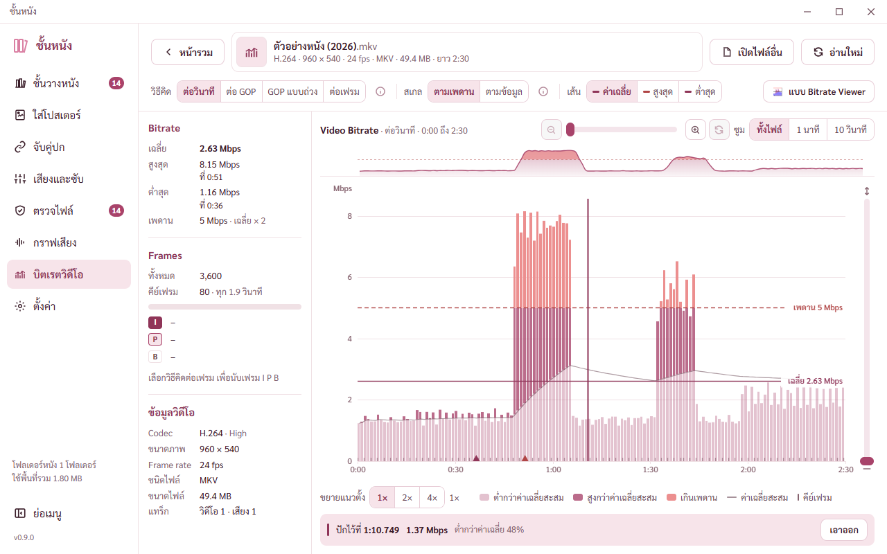
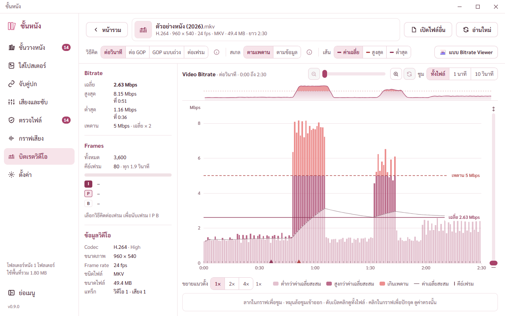

- *"กราฟตัวอย่าง ของสวยกว่านี้ได้มั้ยนะ"* · แถบภาพรวมเป็นเส้นโค้งเรียบ พื้นไล่สี ช่วงเกินเพดานเป็นพื้นแดงต่อกัน เส้นเพดานจาง
- *"เส้นตัวอย่างเล็กไปนะ แทบแยกสีไม่ออก"* · *"เอาแค่สามจุดพอ"* · ขีดสีบนปุ่มเส้นยาว 18 หนา 4 · ค่าเฉลี่ยเส้นทึบ สูงสุดกับต่ำสุดเส้นประสามขีด ต่ำสุดสีฟ้าเหล็ก
- *"มันตกสองบรรทัด"* · "ที่ 0:51" อยู่บรรทัดเดียวกับค่า

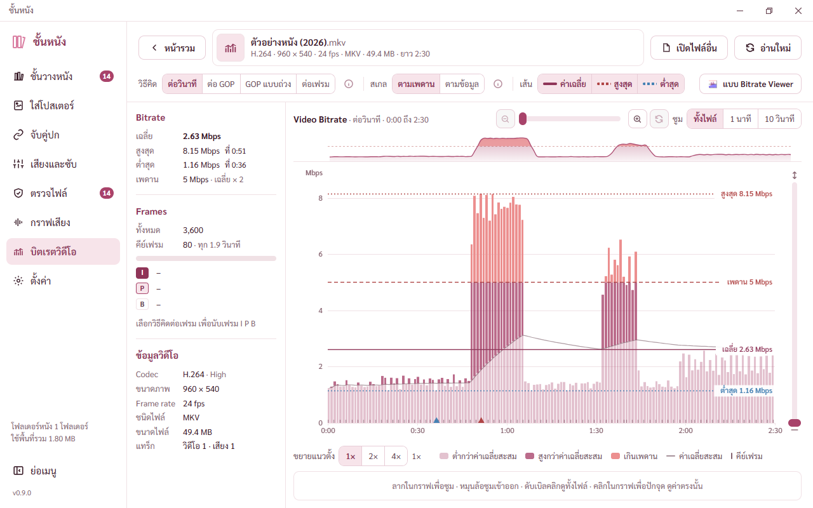
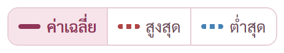

- *"ยาวเท่ากัน"* · ปุ่ม "แบบ Bitrate Viewer" กว้าง 181 เท่าปุ่มซูมทั้งไฟล์ 1 นาที 10 วินาที

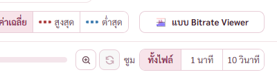

- *"เอาอันนี้ไปอยู่ฝั่งขวา ข้างเส้นซูม และกันที่ไว้ด้วย"* · ปุ่มขยายแนวตั้ง 1× 2× 4× ชิดขวาแถวล่าง ช่องตัวเลขจองที่ 46 จุด

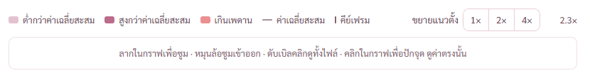

## ข้อมูลเพิ่มในแผงซ้าย
- พี่กันถาม *"มันยังมีที่ว่างด้านล่างอยู่เลย เธออยากใส่ข้อมูลอะไรอีกไหม"* · แคลร์เลือกใส่ (แคลร์ตั้ง)
  - Bitrate · **เกินเพดาน** เวลารวมที่บิตเรตเกินเพดานกับกี่เปอร์เซ็นต์ของไฟล์ · **ความแกว่ง** ส่วนเบี่ยงเบนมาตรฐานเทียบค่าเฉลี่ย ต่ำกว่า 15% นิ่ง · ถึง 45% ขึ้นลงพอควร · เกินนั้นขึ้นลงมาก
  - ข้อมูลวิดีโอ · **ความลึกสี** กับรูปแบบพิกเซล (8 บิต · yuv420p) · **มาตรฐานสี** BT.709 BT.2020 พร้อมบอก SDR HDR10 (PQ) HLG · **Progressive หรือ Interlaced** ต่อท้ายขนาดภาพ · **บิตเรตในไฟล์** ค่าที่ไฟล์เขียนไว้ เทียบกับค่าที่วัดได้จริง
  - แถว I P B รวมเป็นบรรทัดเดียว ขนาดเฉลี่ยของแต่ละชนิดอยู่ตอนชี้ เพื่อให้ทุกแถวอยู่ในแผงโดยไม่ต้องเลื่อน
- คลิปทดสอบไม่ได้เขียนมาตรฐานสีกับบิตเรตไว้ จึงขึ้น "ไม่ระบุ" กับ – · ยังไม่ได้ลองกับไฟล์ HDR จริง

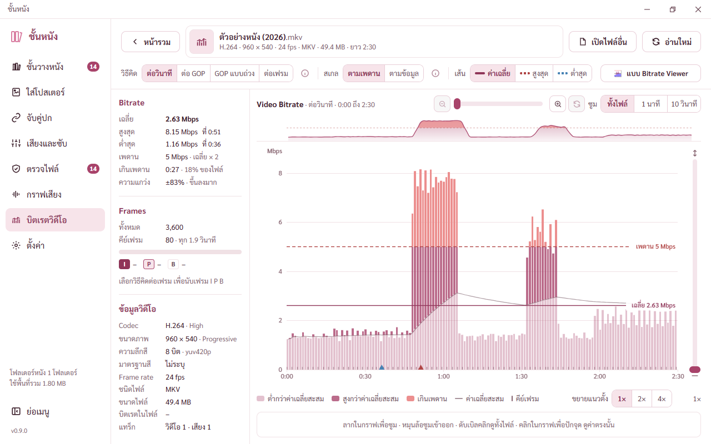

## แถว Codec ในหน้ากราฟเสียง
- พี่กันถาม *"รายละเอียดเสียง มันแสดงคำแบบนี้ยัง"* พร้อมภาพ MPEG-1 Layer 3 (LAME 3.99r) · ยังไม่มี ทำแล้ว อ่านจาก MediaInfo (`audio_codec_detail` ใน fileinfo.rs) อ่านไม่ได้ใช้ชื่อสั้นเดิม
- ไฟล์ทำด้วย LAME ขึ้น "MPEG-1 Layer 3 (LAME 4.0)" · ไฟล์ทำด้วย ffmpeg ขึ้น "MPEG-1 Layer 3 (Lavc 63.1)" (ตัดจุดค้างท้ายที่ไฟล์เขียนมา)

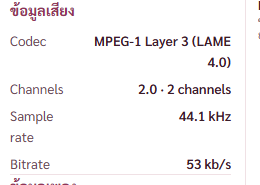
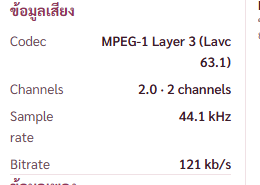

### ตัดบรรทัดแถว Codec
- พี่กันทัก *"แบ่งบรรทัดดี ๆ"* (ภาพ "(LAME" ตกบรรทัดแยกจาก "4.0)" และ "Sample rate" ตกสองบรรทัด) · ตัดบรรทัดได้เฉพาะหน้าวงเล็บ ชื่อตัวเข้ารหัสลงบรรทัดที่สองทั้งก้อน · หัวแถวไม่ตกบรรทัด

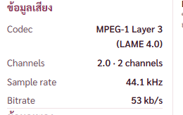

## ดูบิตเรตของเสียง
- พี่กันถาม *"ทำไมเราดูบิตเรตของเสียงไม่ได้"* · ต้นเหตุ ฝั่งอ่านบังคับแทร็กวิดีโอ ไฟล์เสียงล้วนขึ้น "ไฟล์นี้ไม่มีแทร็กวิดีโอ" และปุ่มในหน้ากราฟเสียงซ่อนตอนไฟล์ไม่มีวิดีโอ
- พี่กันสั่งต่อ *"ส่วนแถบซ้าย ต้องเปลี่ยนรายละเอียดด้วยนะ และถ้าไฟล์ที่มีทั้งเสียงและภาพ ตอนเอาเข้าหน้าบิตเรต ตอนกดดู จะให้เลือกก่อนว่าจะดูภาพ หรือเสียงตัวไหน และ … ไฟล์ที่มีหลายเสียง สามารถกดเลือกดูข้อมูลอื่นได้"*
- ไฟล์มีมากกว่าหนึ่งแทร็ก เปิดแล้วขึ้นหน้าเลือกก่อน วิดีโอ หรือเสียงแทร็กไหน · ไฟล์แทร็กเดียว (เช่นเพลง) เปิดเลยไม่ถาม

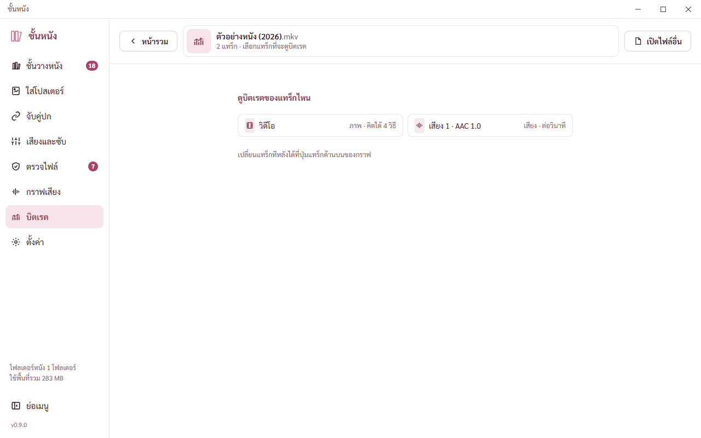

- ดูเสียงแล้ว หัวกราฟเป็น Audio Bitrate · แผงซ้ายเป็นข้อมูลเสียง Codec Channels Sample rate Bit depth ภาษา ชนิดไฟล์ ขนาดไฟล์ บิตเรตในไฟล์ แทร็ก · Frames บอกจำนวนเฟรมเสียงกับความยาวต่อเฟรม · วิธีคิดใช้ได้แค่ต่อวินาที (เสียงไม่มีคีย์เฟรมกับชนิดเฟรม I P B) ปุ่มอื่นจาง ชี้แล้วบอกเหตุ

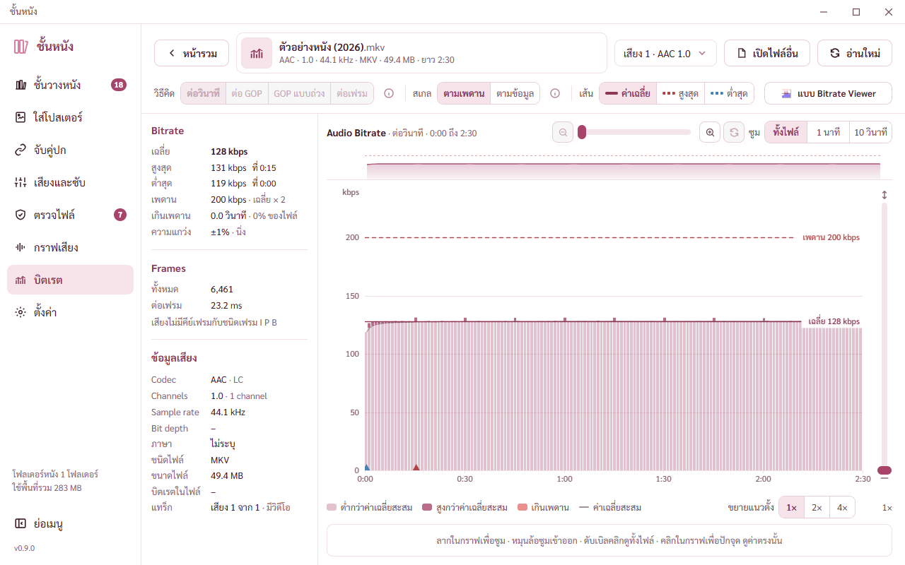

- ปุ่มแทร็กอยู่แถบบนแบบเดียวกับหน้ากราฟเสียง กดสลับวิดีโอกับเสียงแต่ละแทร็กได้

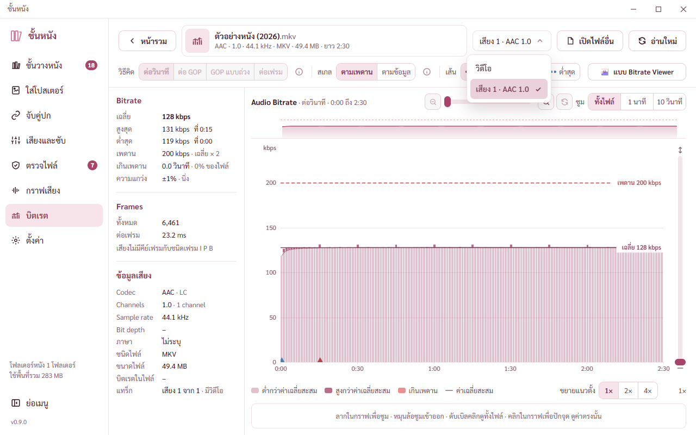
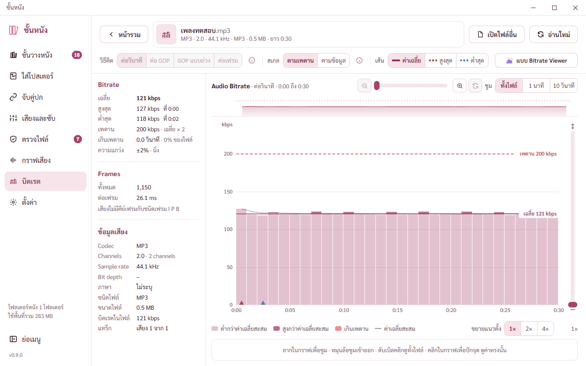

- หน้ากราฟเสียง ปุ่ม "บิตเรต" ขึ้นกับไฟล์เสียงล้วนด้วย กดแล้วเปิดบิตเรตของแทร็กเสียงที่ดูอยู่เลย ไม่ถามซ้ำ

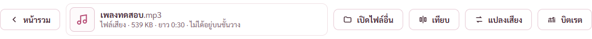

- เจอระหว่างตรวจภาพแล้วแก้ · ต่ำสุดขึ้น 62 kbps ที่ 2:30 ทั้งที่ ffprobe นับวินาทีท้ายได้ราว 128 · ต้นเหตุ เสียงไม่มีอัตราเฟรม โค้ดใช้ 1/25 วินาทีเป็นความยาวเฟรม และเวลาเริ่มของ AAC ติดลบ ข้อมูลล้นเป็นช่องวินาทีที่ยาว 0.05 วินาที · แก้ให้เสียงใช้ความยาวเฟรมเฉลี่ยจริง และรวมช่องท้ายไฟล์ที่สั้นกว่าครึ่งวินาทีเข้าช่องก่อนหน้า · หลังแก้ต่ำสุด 119 kbps ที่ 0:00
- ตัวตรวจ `check-bitrate-new.mjs` 31 ข้อผ่าน (เพิ่มข้อเสียง 10 ข้อ แก้ข้อนับ I P B ให้ตรงกับแถวบรรทัดเดียว) · `check-bitrate.mjs` (แบบเดิม) 30 ข้อผ่าน · cargo test 162 ข้อผ่าน (เพิ่มเทสไฟล์วิดีโอกับเสียงสองแทร็ก และไฟล์เสียงล้วน)

## ชื่อเมนูกับปุ่ม
- พี่กันสั่ง *"ปรับ"* (ชื่อเมนูซ้าย) · เมนูซ้ายเปลี่ยนจาก "บิตเรตวิดีโอ" เป็น "บิตเรต" เพราะดูได้ทั้งวิดีโอและเสียงแล้ว

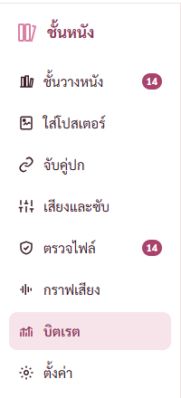

- *"บิตเรต ภาษาอังกฤษ"* (ภาพแถบบนหน้ากราฟเสียง) · ปุ่มเป็น "Bitrate" · ปุ่มเดียวกันในแผงขวาของชั้นวางเปลี่ยนจาก "บิตเรตวิดีโอ" เป็น "Bitrate" ด้วย และกดได้แม้ไฟล์ไม่มีวิดีโอ

## แบบ Bitrate Viewer เดิม ปรับตามเสียง
- พี่กันสั่ง *"ลองให้มันปรับตามเสียงด้วย แต่การตั้งค่า การแสดงผลยังหน้าเดิมนะ แค่ถ้าจุดไหนเสียงตั้งค่าไม่ได้ ก็ปิดจางไว้ เพราะเราจะไม่แตะ UXUI bitrate viewer"*
- หน้าตาเดิมทุกอย่าง ไม่เพิ่มปุ่มบนหน้า
  - ไฟล์มีหลายแทร็ก ขึ้นรายการเลือกกลางกราฟ ตรงที่เดิมเป็นข้อความลากไฟล์มาวาง · แกนซ้ายว่างจนกว่าจะเลือก
  - สลับแทร็กทีหลังได้ที่เมนูของหน้า หัวข้อ Stream
  - ดูเสียงแล้ว เมนู GOP based · GOP enhanced · Frame based จาง คีย์ลัด Ctrl+G Ctrl+X Ctrl+F ไม่ทำงาน · แถวล่างเปลี่ยนจากขนาดภาพกับ fps เป็น kHz กับจำนวนช่อง
  - ไฟล์เสียงล้วนเปิดเลยไม่ถาม · ปุ่ม Load เลือกไฟล์เสียงได้
  - แก้ช่องวินาทีท้ายไฟล์แบบเดียวกับหน้าใหม่

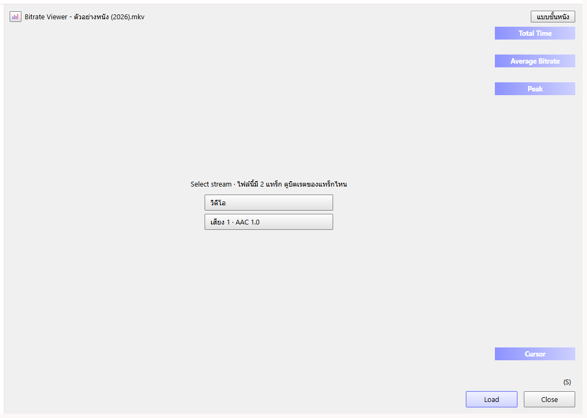
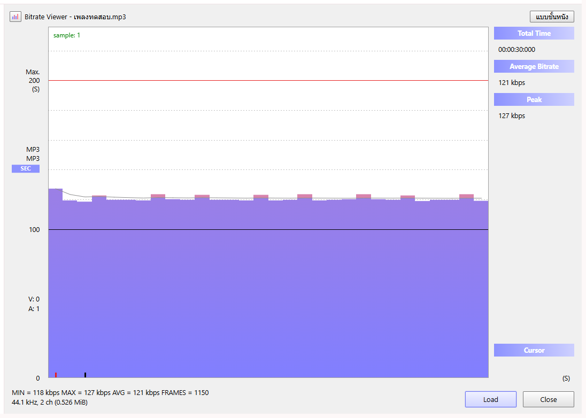

- ภาพเมนูตอนดูเสียง (`บิตเรต/12-เมนูตอนดูเสียง.png`) ติดชื่อไฟล์ในรายการเปิดล่าสุดของพี่กัน กันไว้ใน .gitignore ไม่ขึ้นที่เก็บ ส่งในแชทแทน
- ตัวตรวจ `check-bitrate.mjs` 36 ข้อผ่าน (เพิ่มข้อเสียง 6 ข้อ)

## ยังไม่ได้ตรวจ
- ไฟล์ที่มีเสียงหลายแทร็กจริง ๆ ในหน้าจอ (เทสฝั่ง Rust ลองไฟล์เสียงสองแทร็กแล้ว แต่ชุดทดสอบของตัวตรวจหน้าจอมีเสียงแทร็กเดียว)
- ไฟล์ HDR และไฟล์ Interlaced จริง ไม่มีในชุดทดสอบ
- ลากไฟล์จาก Explorer จริงมาวางหน้าบิตเรต พี่กันต้องลองเอง (ตัวตรวจส่งเหตุการณ์แทน)
- ยังไม่ commit
