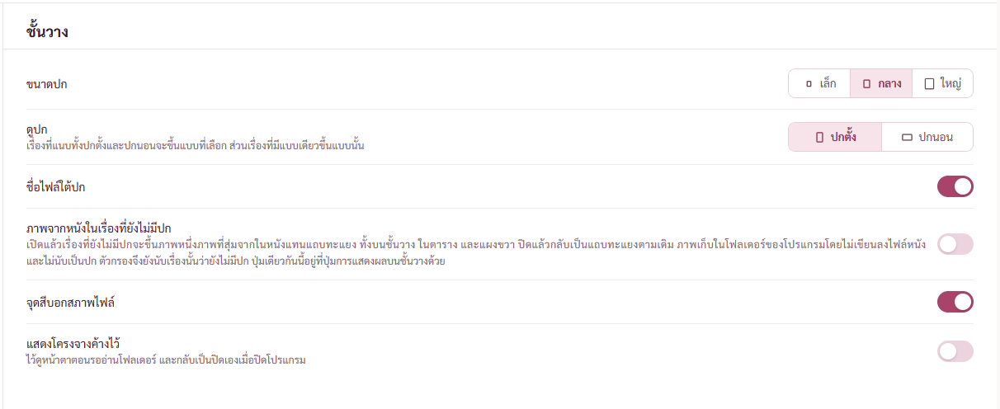
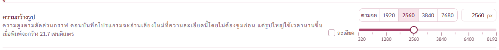
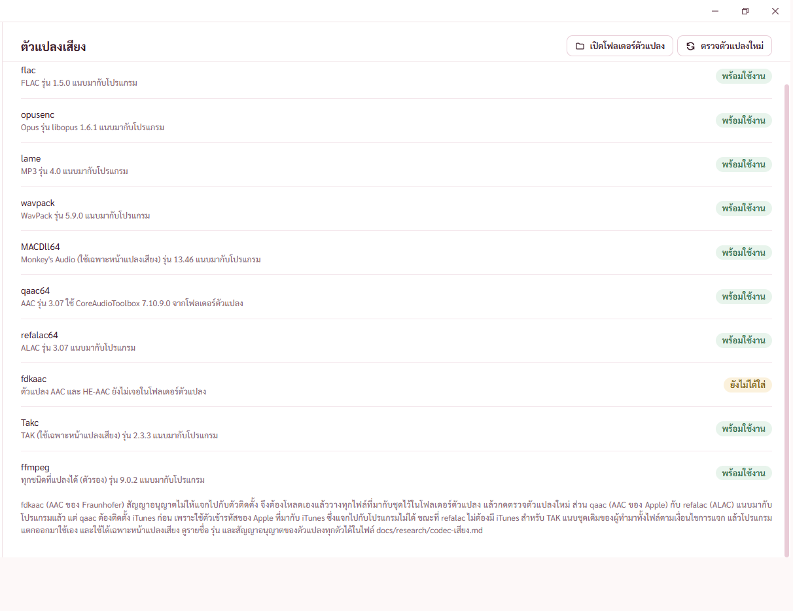
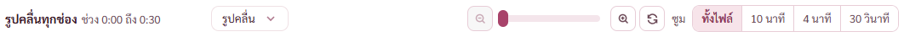
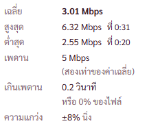
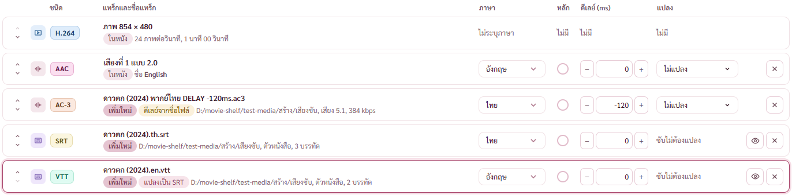
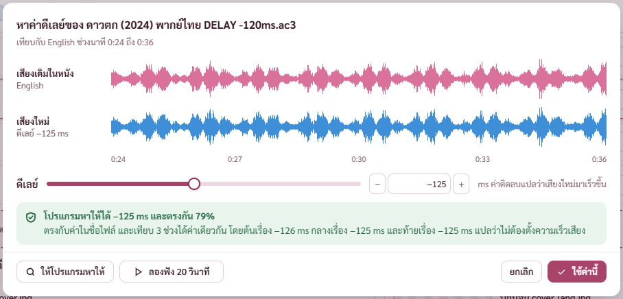

# รายงาน 11 พ.ย. 2569 เขียนข้อความบนจอใหม่ทั้งโปรแกรม

คำสั่งพี่กัน *"ไปไล่ดูทั้งเว็บ กระจายแบบไทย เท่านั้น"* *"มึงทำงานนี้ทั้งเว็บ"* *"เเก้อักษรพิเศษให้หมดด้วย"* *"ไป re write ใหม่ให้หมดด้วย"* *"เธอต้องอ่านทุกจุด เเละปรับเเมนนวลทุกจุดเท่านั้น"* *"ถ้่ามันปรับไม่ได้จริงๆ เกลาคำใหม่ได้"* *"ไปทำทั้โปรแกรม"*

ยังไม่ commit ตามที่พี่กันสั่งไว้ว่ารอคำสั่ง

## 1. เอาเครื่องหมายต้องห้ามออกทั้งโปรแกรม เขียนเป็นประโยคที่มีคำเชื่อม

- เครื่องหมาย · … — – → และ / ที่แปลว่า หรือ ในข้อความบนจอ เหลือศูนย์จุด (นับด้วยตัวนับที่ข้ามคอมเมนต์) ที่ยังเห็นในโค้ดเป็นตัวแยกข้อความที่ไม่ขึ้นจอ กับป้ายปุ่มลูกศรบนคีย์บอร์ดในตัวดูรูป
- **แก้ภายหลังในวันเดียวกัน** พี่กันบอกว่าให้เอาออกแค่จุดกลางที่คั่นวลี แล้วเลือก *"1 2 4 6 เอาคืน"* ลูกศร ขีดช่วงตัวเลข จุดสามจุดท้ายคำว่ากำลังทำ และทับ คืนแบบเดิมแล้ว รายละเอียดอยู่ [รายการอักษรที่เปลี่ยน](REPORT-2026-11-11-รายการอักษรที่เปลี่ยน.md)
- ไฟล์หน้าจอที่เขียนใหม่รอบนี้ หน้าตั้งค่า หน้าบิตเรตทั้งสองแบบ MediaInfo จับคู่ปก กระดานจับคู่ ตัวดูซับ หน้าต่างหาดีเลย์ ข้อมูลเพลง ตัวดูรูป หน้าครอป หน้าต่างกันปิด แผงเลือกสี ช่องเปลี่ยนชื่อ เมนูซ้าย แถบแจ้ง ปุ่มเต็มจอ ช่องเลือกภาษา หน้าใส่โปสเตอร์ หน้าตรวจไฟล์ หน้าเสียงและซับ
- ข้อความฝั่ง Rust 43 จุด เช่น ข้อผิดพลาดตอนเปลี่ยนชื่อไฟล์ ผลตรวจไฟล์ขาดท้าย คำบอกชนิดของตัวแปลง (AAC และ HE-AAC, TAK ใช้เฉพาะหน้าแปลงเสียง) ข้อความที่มีหลายท่อนใช้เว้นสองช่องเป็นรอยต่อประโยค หน้าจอแยกบรรทัดหรือแยกประโยคให้เอง
- ตัวเลขช่วงมีหน่วยกำกับ (ขีดช่วงคืนเป็น 6–512 kbps ตามที่พี่กันเลือกภายหลัง) ค่าที่ยังไม่มีเคยเขียนว่า ยังไม่มี หรือ ไม่ทราบ แทนขีด (ภายหลังพี่กันสั่งเอาออก เลือกคืนขีดแบบเดิม รายละเอียดใน [รายงานตรวจรวม](REPORT-2026-11-11-ตรวจรวม.md))
- คำย่อขยายเป็นคำเต็ม ซม. เป็น เซนติเมตร, น. หลังเวลาเป็น นาฬิกา, ยาว (วิ) เป็น ยาว (วินาที), ตัว/วิ เป็น ตัวต่อวินาที
- เนื้อหาที่เขียนผิดแก้ด้วย ย่อหน้าท้ายหน้าตัวแปลงเสียงเดิมเขียนว่า qaac แจกไปกับตัวติดตั้งไม่ได้ แต่ qaac แนบมากับโปรแกรมแล้ว ที่แจกไม่ได้คือ fdkaac กับไฟล์ของ Apple จาก iTunes

## 2. ตัดบรรทัดตามความหมาย

- ตัวตัดคำ (`thaiKeep` ใน `src/components/ui.tsx`) ผูกคำท้ายวลี แล้ว ด้วย เอง ก่อน ไว้ อยู่ ได้ นั้น นี้ กัน ไหม เข้ากับคำหน้าเสมอ และผูกคำนำ ไม่ การ ความ และ แต่ หรือ ถ้า จะ ที่ ซึ่ง ของ เมื่อ เพื่อ เข้ากับคำถัดไป ไม่ให้ค้างท้ายบรรทัด
- ตัวเชื่อมคำ `J` (U+2060) ใส่เฉพาะจุดที่อ่านภาพแล้วเจอวลีขาด ลองแล้วว่า WebView2 ไม่ตัดบรรทัดตรงตัวนี้ และตัวอักษรยังกระจายแบบไทยได้
- คำอธิบายในหน้าตั้งค่าห่อด้วยตัวตัดคำทั้งหมด 26 จุด

เดิม "และไม่นับ" ค้างท้ายบรรทัด "เป็นปก" ตกไปบรรทัดล่าง ตอนนี้ "และไม่นับเป็นปก" อยู่ด้วยกัน

เดิม "จะได้" กับ "กว้าง 21.7 ซม." แยกกัน แล้วลองแบบอื่นยังเจอ "ออก" กับ "มา" แยก ตอนนี้ "เมื่อพิมพ์จะกว้าง 21.7 เซนติเมตร" ขึ้นบรรทัดใหม่ทั้งก้อน

แถวตัวแปลงไม่มีจุดคั่นแล้ว ตัวที่ยังไม่ได้ใส่เขียนว่า "ตัวแปลง AAC และ HE-AAC ยังไม่เจอในโฟลเดอร์ตัวแปลง" (เดิมอ่านเหมือนบอกว่า AAC หาย) ย่อหน้าท้ายต่อประโยคด้วย ส่วน แต่ ขณะที่ สำหรับ

## 3. ข้อความที่ถูกตัดท้ายเป็นจุดสามจุด

หน้าต่างกว้าง 1280 หัวกราฟเดิมขึ้น "รูปคลื่นทุกช่อง ช่วง ..." ตอนนี้ขึ้นครบ "ช่วง 0:00 ถึง 0:30" (ปุ่มแบบกราฟเปลี่ยนเป็นดรอปดาวน์เร็วขึ้น จากหัวการ์ดแคบกว่า 1,040 เป็น 1,120 จุด) และถ้าที่ไม่พอจริง ช่วงเวลาจะหลบไปทั้งก้อนแทนการขึ้นจุดสามจุด ตรวจที่ 1100 1280 1600 ทั้งรูปคลื่นและความดัง ขึ้นครบทุกขนาด

แถบผลตรวจใต้กราฟความถี่เดิมบรรทัดเดียวแล้วตัดท้าย ตอนนี้ตัดบรรทัดได้

## 4. หน้าอื่นที่ตรวจภาพแล้ว

คอลัมน์สถิติแคบ เดิม "ค่า" กับ "เฉลี่ย" และ "ของ" กับ "ไฟล์" แยกบรรทัด ตอนนี้วงเล็บขึ้นบรรทัดใหม่ทั้งก้อน

เดิม "เสียง 1 2.0" อ่านกำกวม ตอนนี้ "เสียงที่ 1 แบบ 2.0" และ "เสียง 5.1" ป้ายสีไม่มีจุลภาคตามแล้ว

ผลเป็นประโยคเดียว "ตรงกับค่าในชื่อไฟล์ และเทียบ 3 ช่วงได้ค่าเดียวกัน โดยต้นเรื่อง −126 ms กลางเรื่อง −125 ms และท้ายเรื่อง −125 ms" ตัวตรวจเจอ "23.976แล้ว" ตัวเลขติดคำในกรณีเสียง PAL แก้แล้ว

## การตรวจ

- `tsc` ผ่านทุกครั้งที่แก้
- `check-av.mjs` ผ่าน 76 จาก 76 (ปรับตัวตรวจ 10 จุดให้หาข้อความใหม่) แล้วคืนภาพรายงานเก่าที่ตัวตรวจเขียนทับ
- ภาพทุกหน้าหลักตอนว่างและตอนมีไฟล์ หน้าตั้งค่าทุกหัวข้อ กราฟเสียงสี่มุมมอง แผงขวาของชั้นวาง หน้าเสียงและซับ หน้าบิตเรต MediaInfo หน้าต่างหาดีเลย์

## ยังไม่ได้ตรวจ

- `cargo test` ยังไม่ได้รัน เพราะต้องปิดโปรแกรมโหมดพัฒนา ข้อความ Rust ที่แก้เป็นข้อความล้วน สร้างโปรแกรมผ่านแล้ว และค้นแล้วไม่มีเทสที่อ้างข้อความเหล่านี้
- ภาพตารางจับคู่ปก กระดาน ตัวดูซับ หน้าเทียบสองไฟล์ ข้อมูลเพลง หน้าครอป ยังไม่ได้ไล่ทีละจุด
- ตัวตรวจชุดอื่นยังไม่ได้รัน ข้อความที่ตัวตรวจหายังเป็นแบบเดิมหลายไฟล์ จะปรับตอนรันชุดใหญ่ก่อน commit
- ทดสอบทุกหน้าตามขนาดจอ (1366 × 720, 1080p, 2K, 4K) ยังอยู่ในคิว

## ที่เจอแต่ยังไม่ได้แก้

- ชื่อไฟล์ยาวในแถวแคบตัดท้ายเป็นจุดสามจุดด้วย CSS ราว 30 จุด (ชิปไฟล์ล่าสุด แถวคิวแปลงเสียง ดรอปดาวน์) เป็นเรื่องหน้าตาว่าจะให้ตัดบรรทัดหรือตัดท้าย แคลร์ยังไม่แตะ
- คลังหนังที่อ่านไว้ก่อนวันนี้ยังเก็บคำบอกวิดีโอแบบ "854 × 480 · H.264" แผงขวาตัดจุดออกตอนแสดงแล้ว อ่านโฟลเดอร์ใหม่เมื่อไหร่ค่าในคลังก็เปลี่ยนเอง
- ตอนแก้ไฟล์ตัวตัดคำ หน้าโปรแกรมโหมดพัฒนาขาวไปหนึ่งครั้ง โหลดใหม่แล้วกลับมาปกติ เป็นตัวอัปเดตหน้าจออัตโนมัติค้าง ไม่ใช่โค้ดพัง ตัวที่ติดตั้งจริงไม่เกี่ยว
