# รายงาน 11 พ.ย. 2569 เติม ch คืนอักษร อ่านภาพหกหน้า และตรวจรวมทุกชุด

คำสั่งพี่กัน *"เติม ch หลังจำนวนช่องในหน้าเสียงและซับ เช่น "เสียง 5.1 ch""* *"อ่านภาพทุกจุดของหน้าที่ยังไม่ได้ไล่ คือตารางจับคู่ปก กระดาน ตัวดูซับ หน้าเทียบสองไฟล์ ข้อมูลเพลง และหน้าครอป"* *"รัน cargo test ตัวตรวจชุดอื่น และทดสอบทุกหน้าตามขนาดจอ"* แล้วระหว่างทำสั่งเพิ่ม *"1 2 4 6 เอาคืน"* *"เอาคำว่า ไม่ทราบ กับ ยังไม่มีออก ไม่สวยเลย เอาออกให้หมดในค่าที่ไม่มี"* (เลือกคืนขีดแบบเดิม) *"ย้ายขีด ไปฝั่งขวา ตอนนี้ฝั่งขวามันว่างไป และสีอักษรเหมือนกับหัวข้อเจ้าของข้อมูล"*

## 1. ช่องที่ไม่มีค่ากลับเป็นขีดแบบเดิม

พี่กันส่งภาพแผงซ้ายหน้าบิตเรตที่เขียนว่า ยังไม่มี กับ ไม่ทราบ ทุกแถว · คืนขีดแบบเดิมครบ 35 จุด เทียบทีละจุดกับก่อนงานข้อความ (fd6044c) ขีดในหน้าบิตเรตเท่าของเดิมพอดี 22 จุด · ขีดยาวกลางประโยคกับจุดกลางคั่นวลีไม่ได้คืน ค้นทั้งโปรแกรมแล้วไม่มีบนจอ

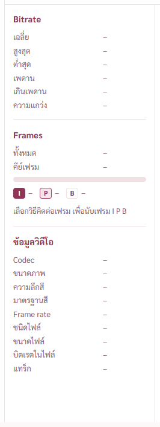
แผงซ้ายหน้าบิตเรตตอนอ่านไฟล์ไม่ได้ พี่กันสั่ง *"ย้ายขีด ไปฝั่งขวา ตอนนี้ฝั่งขวามันว่างไป และสีอักษรเหมือนกับหัวข้อเจ้าของข้อมูล"* แล้วสั่งต่อ *"ให้มองมันเป็น 2 คอลัมน์ แล้ว ขีด อยู่กึ่งกลางคอลัมน์ฝั่งขวาไง"* ขีดจึงอยู่กึ่งกลางคอลัมน์ค่าและเป็นสีเดียวกับชื่อแถว

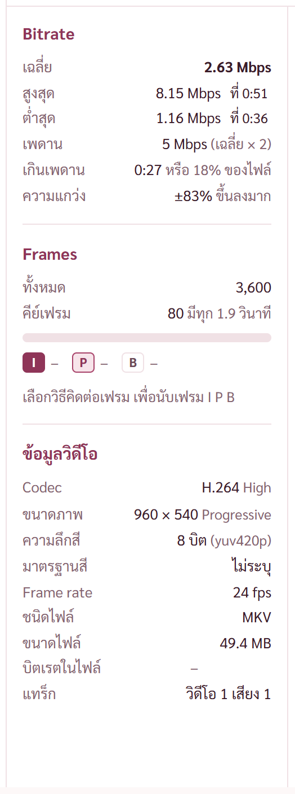
ตอนอ่านเสร็จ ตัวเลขชิดขวา ช่องที่ไฟล์ไม่ได้เขียนไว้ (บิตเรตในไฟล์) เป็นขีดกึ่งกลางคอลัมน์สีจาง · ระหว่างทาง พี่กันสั่ง *"ให้ย้ายเเค่ขีด อย่ามายุ่งกับตัวเลย ขีด คือการแสดงค่าว่าง ไม่นับเป็นค่า"* แคลร์คืนตัวเลขไปชิดซ้าย แล้วพี่กันดูภาพแล้วสั่ง *"เอากลับไปชิดขวา"* ตัวเลขจึงชิดขวาตามภาพนี้

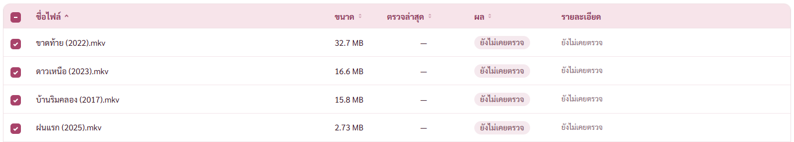
หน้าตรวจไฟล์ คอลัมน์ตรวจล่าสุดของเรื่องที่ยังไม่เคยตรวจ พี่กันสั่ง *"อยู่กึ่งกลาง"* ขีดจึงอยู่กึ่งกลางคอลัมน์

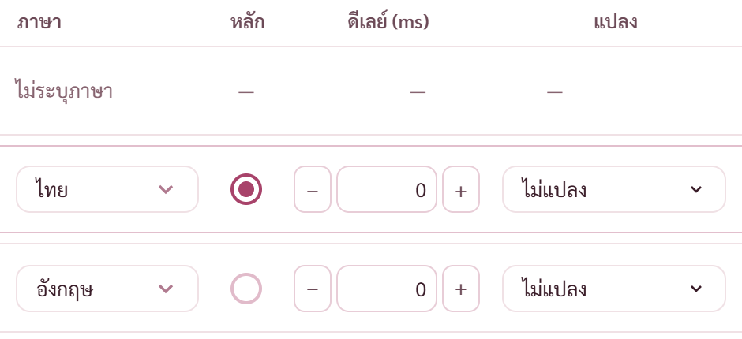
หน้าเสียงและซับ แถวภาพไม่มีช่องหลัก ดีเลย์ แปลง พี่กันสั่ง *"ตรงเลย 0 และอยู่กึ่งกลางคำว่า ไม่แปลง"* ขีดดีเลย์จึงวางตามโครงช่องดีเลย์ตรงเลข 0 ของแถวเสียง (ขอบขวาตรงกันที่ 1,310 จุด) และขีดแปลงอยู่กึ่งกลางคำว่าไม่แปลง (กึ่งกลางตรงกันที่ 1,386 จุด) ภาพละเอียดสองเท่า

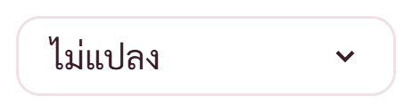
พี่กันทัก *"หัว ไ ขาด"* สองครั้ง · วัดแล้วกรอบไม่ได้ตัดตัวอักษร ต้นเหตุคือฟอนต์ Sarabun ออกแบบหัวสระไอเป็นปลายตัดตรงสองขา (Tahoma กับ Leelawadee UI เป็นตะขอโค้ง) · รอบแรกแคลร์ขยายตัวอักษรเป็น 13.5 จุด ไม่ตรงต้นเหตุ คืนเป็น 12.5 แล้ว · รอบสองแคลร์ให้สระไอใช้ Leelawadee UI เอง พี่กันสั่ง *"กูไม่ได้บอกมึงเปลี่ยนฟอนต์"* คืนเป็น Sarabun แล้ว และตั้งกฎห้ามเอาฟอนต์อื่นมาแทนจนกว่าพี่กันจะสั่ง · ต้นเหตุจริง ตัวสระไอของ Sarabun ยื่นเลยขอบซ้ายของตัวเองราว 0.8 จุด (เส้นโครงในไฟล์ฟอนต์ xMin −65 จาก 1,000) กล่องข้อความในปุ่มตั้งให้ตัดส่วนที่ล้นทิ้ง เส้นซ้ายของหัวสระไอจึงหาย · แก้ตามสกิล form-input ข้อ ⑧ ที่มีอยู่แล้ว (พี่กันทัก *"มึงไปดูสกิลลลลล"* หลังแคลร์คิดวิธีเว้นที่เอง) ตัวหนังสือในปุ่มดรอปดาวน์ไม่ตัดส่วนล้นเอง ปุ่มตัดที่ขอบปุ่มที่เดียว หัวสระไอยื่นเข้าไปในระยะซ้ายของปุ่ม · แก้ครบ 6 จุด ดรอปดาวน์กลาง ช่องเลือกภาษา ปุ่มแปลงในหน้าเสียงและซับ คิวแปลงที่ล็อก รายการไฟล์ล่าสุดหน้าบิตเรตกับหน้ากราฟ · ตัวตรวจในสกิลได้รายการว่าง · ข้อความยาวเกินปุ่มถูกขอบปุ่มตัดแทนจุดสามจุดตามที่สกิลบอก · ภาพนี้ขยายสามเท่าหลังแก้

หัวคอลัมน์ดีเลย์กับแปลงอยู่กลางคอลัมน์ตามที่พี่กันสั่ง *"คำว่า ดีเลย์ กับ แปลง หัวคอลัมน์ เอาไปกลาง"* (ภาพแถวแทร็กด้านบนเป็นภาพหลังแก้)

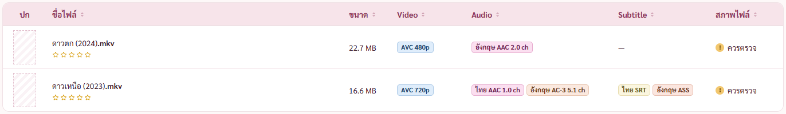
ตารางชั้นวาง เรื่องที่ไม่มีซับ (ป้ายเสียงมี ch แล้ว)

- จุดอื่นที่คืน หน้ากราฟเสียงค่าความดังที่ไม่มี ช่องบอกค่าใต้กราฟความถี่เฉลี่ย หน้าเทียบสองไฟล์ช่องความละเอียดกับบิตเรตที่ไม่มี และขนาดที่เทียบไม่ได้ · ชั้นวางช่อง Video ที่ไม่รู้ · หน้าตั้งค่าตอนกำลังนับแคช
- ความยาวที่ไม่รู้ (ตัวจัดรูปเวลา) เดิมขึ้น ไม่ทราบ มาก่อนงานข้อความ เปลี่ยนเป็นขีดตามคำสั่งให้หมด · ชื่อแทร็กภาพที่ไม่รู้ขนาดกับรุ่นตัวแปลงที่ไม่รู้ ไม่แสดงส่วนนั้นแทนการขึ้นขีดกลางประโยค
- ช่อง Audio Subtitle Attachment ของแผงขวาชั้นวางเดิมเขียน ไม่มี มาตั้งแต่ก่อน คงไว้
- ข้อ 5 (? เป็นคำ) กับข้อ 7 (คำย่อเขียนเต็ม) พี่กันเลือกไม่คืน

## 2. เติม ch และคืนอักษร 1 2 4 6

- ทุกที่ที่บอกผังช่องเสียง 5.1 7.1 2.0 1.0 บนจอมี ch ต่อท้าย (แทร็กในหน้าเสียงและซับ ชิปไฟล์ ดรอปดาวน์แทร็ก แผงข้อมูลเสียง หน้าเทียบ แผงตั้งค่าแปลงเสียง คิวแปลง บิตเรต ชั้นวาง) ค่าข้างในยังเป็น 5.1 เพราะฝั่ง Rust ใช้จับคู่ชื่อลำโพง
- คืนลูกศร ขีดช่วงตัวเลข จุดสามจุดท้ายคำว่ากำลังทำ และทับ ราว 128 จุด กับสองจุดที่ตกหล่นจากรายการรอบแรก (ตัวเลือกเรียง ชื่อ ก–ฮ และระดับ V0–V9 ของ MP3) รายละเอียด [รายการอักษรที่เปลี่ยน](REPORT-2026-11-11-รายการอักษรที่เปลี่ยน.md)
- รายการชนิดเสียงในคิวแปลง ตัวเลือกที่ชื่อบอก 5.1 ch อยู่แล้วไม่บอกซ้ำในวงเล็บ ตัวอื่นเหลือ 2.0 ch โดยไม่มีคำว่าเสียงนำหน้า เพราะเติม ch แล้วรายการกว้างเกินปุ่มตั้งค่า 37 จุด

## 3. อ่านภาพหกหน้า เจอแล้วแก้

หกหน้าที่ยังไม่ได้ไล่ คือตารางจับคู่ปก กระดาน ตัวดูซับ หน้าเทียบสองไฟล์ ข้อมูลเพลง และหน้าครอป · อ่านทุกจุดบนจอจากภาพของตัวตรวจ เจอตรงไหนแก้ทีละจุดด้วยมือ แล้วถ่ายใหม่ · กระดานกับข้อมูลเพลงไม่เจอจุดผิด

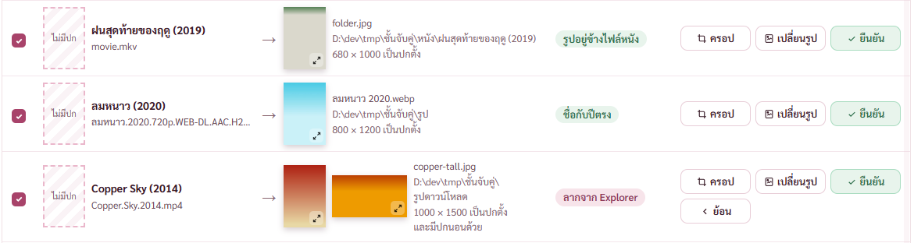
ตารางจับคู่ปก บรรทัดข้อมูลรูป (ที่อยู่ ขนาด ปกตั้งปกนอน) เดิมโดนจัดกระจายแบบไทย แถว Copper Sky ขึ้น "1 0 0 0 × 1 5 0 0 เ ป็ น ป ก ตั้ ง" ถ่างเต็มบรรทัด และที่อยู่โฟลเดอร์ตัดกลางคำ "ชั้นจับ|คู่" · บรรทัดพวกนี้เป็นข้อมูล ไม่ใช่ย่อหน้า จึงชิดซ้ายไม่กระจาย และที่อยู่ตัดบรรทัดได้เฉพาะหลังเครื่องหมาย \ ชื่อโฟลเดอร์ไม่ขาดกลางคำ

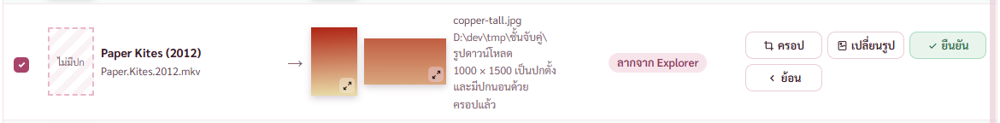
แถวเดียวกันหลังครอป ขึ้นว่าครอปแล้วบรรทัดของตัวเอง

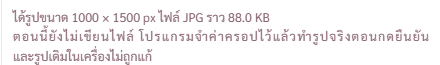
หน้าครอปตอนจับคู่ เดิมตัด "และรูปเดิม|ในเครื่องไม่ถูกแก้" ตอนนี้ "รูปเดิมในเครื่อง" เป็นคำที่ห้ามตัดกลาง ทั้งก้อนลงบรรทัดใหม่ตรงรอยประโยค

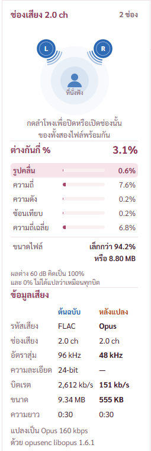
หน้าเทียบสองไฟล์ แผงซ้ายเจอสามจุด ① ใต้ลำโพงเดิมตัด "ของทั้ง|สองไฟล์" ตอนนี้ "ทั้งสองไฟล์" เป็นคำที่ห้ามตัดกลาง ② หมายเหตุผลต่างเดิมตัด "ไม่ได้|แปลว่า" ตอนนี้ขึ้นบรรทัดตรงรอยประโยค "ผลต่าง 60 dB คิดเป็น 100%" กับ "และ 0% ไม่ได้แปลว่าเหมือนทุกบิต" ③ หมายเหตุตัวแปลงเดิมถ่าง "แ ป ล ง เ ป็ น … ด้ ว ย" เพราะชื่อตัวแปลงยาวตกไปบรรทัดล่าง บรรทัดบนเหลือคำไทยไม่กี่ตัวแล้วโดนกระจายเต็มบรรทัด ตอนนี้ขึ้นบรรทัดตรง "แปลงเป็น Opus 160 kbps" กับ "ด้วย opusenc libopus 1.6.1" ช่องนี้แคบเป็นสองบรรทัดอยู่แล้ว ไม่ได้เพิ่มบรรทัด

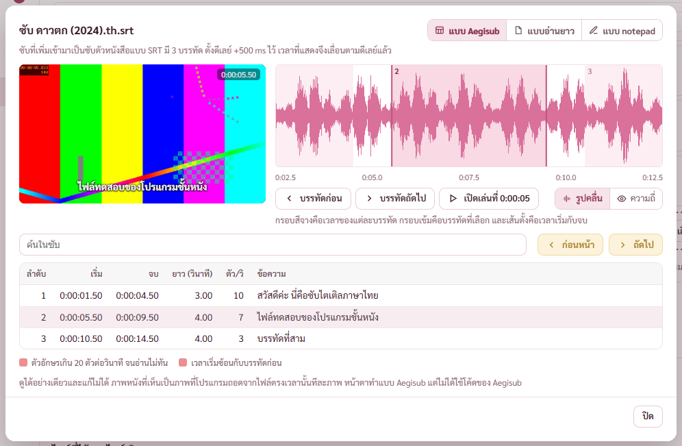
ตัวดูซับ บรรทัดใต้ชื่อเขียนเป็นประโยคเดียว "ซับที่เพิ่มเข้ามาเป็นซับตัวหนังสือแบบ SRT มี 3 บรรทัด ตั้งดีเลย์ +500 ms ไว้ เวลาที่แสดงจึงเลื่อนตามดีเลย์แล้ว" คำอธิบายสีและท้ายหน้าต่างเป็นประโยคเต็ม

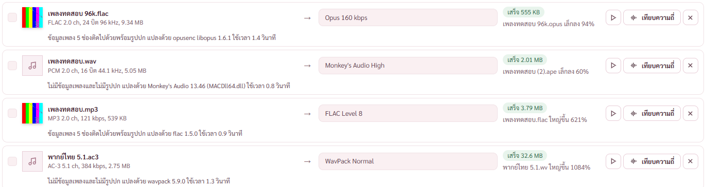
คิวแปลงเสียง แถวที่เสร็จบอกข้อมูลเพลงกับรูปปกเป็นประโยค "ข้อมูลเพลง 5 ช่องติดไปด้วยพร้อมรูปปก" "ไม่มีข้อมูลเพลงและไม่มีรูปปก"

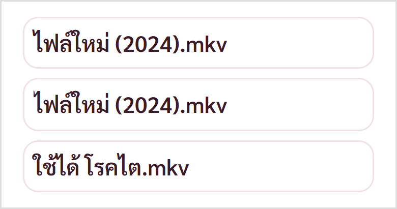
กล่องชื่อที่ตัดท้ายด้วยจุดสามจุด (ชิปไฟล์ แถวคิว ชื่อบนชั้นวาง) ใช้วิธีเดียวกับปุ่มดรอปดาวน์ เว้นที่ซ้าย 2 จุดให้หัวสระไอ · ภาพขยายสามเท่า กล่องบนกับกล่องล่างเป็นแบบหลังแก้ กล่องกลางเป็นแบบเดิมที่หัวสระไอขาด

## 4. บั๊กที่เจอจากการรันตัวตรวจทุกชุด

- **หน้ากราฟเสียงพังทั้งหน้าเมื่อเปิดไฟล์ 5.1** · ตัวปรับความสูงแถบลดค่าวนไม่จบเมื่อแถบถึงความสูงต่ำสุด (React ฟ้องอัปเดตซ้อนเกินกำหนด) เกิดตั้งแต่ชุดแก้ความสูงแถบ · แก้ให้ค่าปรับไม่ต่ำกว่าความสูงต่ำสุดของแถบทุกช่องรวมกัน ลองแปดขนาดหน้าต่างแล้วไม่พัง
- **แถวปุ่มหน้าบิตเรตตกขอบที่หน้าต่าง 1,280 จุด** · ชุด 7 เพิ่มปุ่มเต็มจอแล้วแถวยาวเกิน · หน้าต่างไม่เกิน 1,300 จุด ป้ายหน้าปุ่มซ่อน เหลือปุ่ม
- **รายการชนิดเสียงกว้างเกินปุ่มตั้งค่า** หลังเติม ch (ข้อ 2)
- **หน้าใส่โปสเตอร์ค้างรูปของเรื่องก่อน** · กดใส่โปสเตอร์จากชั้นวางเรื่องที่สองหลังเรื่องแรก รูปและค่าครอปของเรื่องแรกยังค้าง เกิดตั้งแต่ชุด 2 ที่เก็บหน้าที่เคยเปิดไว้ · มาจากชั้นวางแล้วล้างรูป ค่าครอป และข้อผิดพลาดของเรื่องก่อน

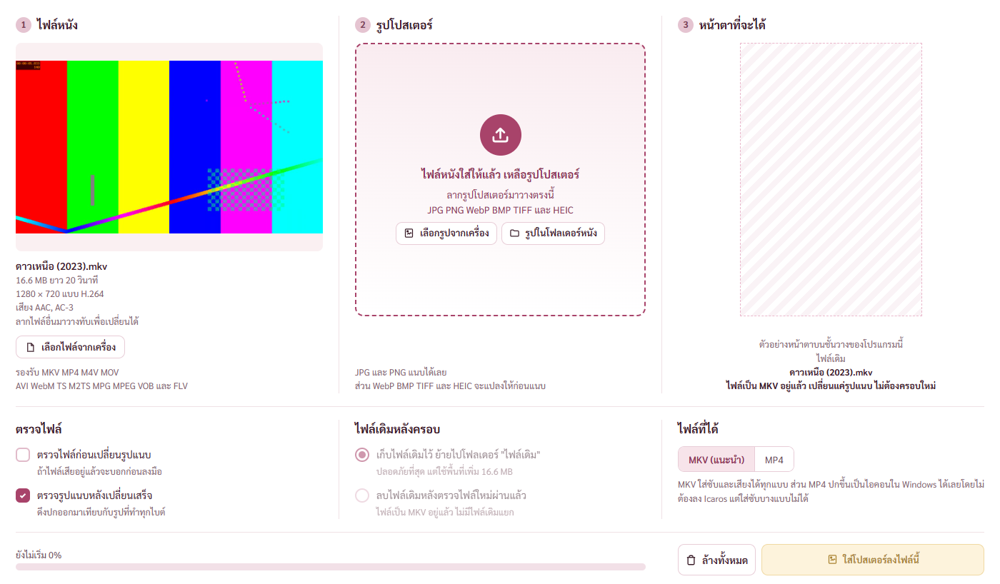
มาจากชั้นวางเรื่องที่สอง ช่องรูปว่างรอรูปใหม่ ไม่มีรูปของเรื่องก่อน

- **ลำโพงของไฟล์เสียงช่องเดียวเป็นปุ่มที่กดแล้วไม่เกิดอะไร** · ชี้แล้วขึ้นว่ากดเพื่อปิดช่อง แต่โปรแกรมไม่ให้ซ่อนช่องสุดท้าย · ไฟล์ช่องเดียวลำโพงไม่เป็นปุ่มแล้ว ชี้แล้วบอกชื่อช่อง
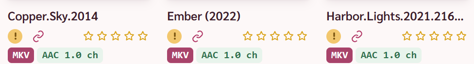
- **ชื่อเรื่องใต้ปกที่ไม่มีตัวไทยโดนตัดเงียบ ไม่ขึ้นจุดสามจุด** · เจอตอนทดสอบจอ 1366 "Harbor.Lights.2021.2160p.WEB-DL" ขึ้นแค่ "Harbor.Lights.2021.2160p" ไม่รู้ว่าชื่อยังมีต่อ · ตัวแบ่งวลีห่อชื่อที่ไม่มีตัวไทยเป็นกล่องก้อนเดียว กล่องตัดท้ายด้วยจุดสามจุดไม่ได้ · ชื่อใต้ปกเป็นบรรทัดเดียวอยู่แล้ว ก้อนวลีในนั้นจึงเป็นข้อความธรรมดา ตอนนี้ขึ้น "Harbor.Lights.2021.216…" (ภาพสองเท่า)

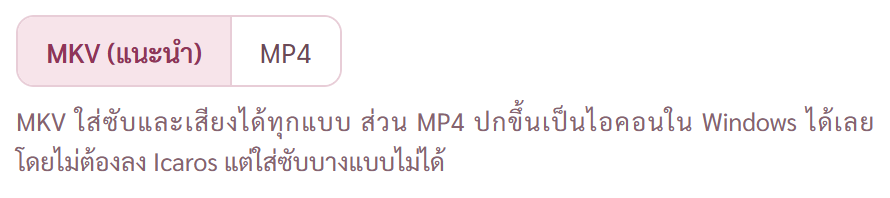
- หน้าใส่โปสเตอร์ คำอธิบายใต้ปุ่ม MKV กับ MP4 เดิมตัด "โดยไม่|ต้องลง Icaros" · ส่งผ่านตัวแบ่งวลีแล้วเพิ่ม "โดย" เป็นคำเชื่อมที่ห้ามค้างท้ายบรรทัด (กลุ่มเดียวกับ และ แต่ เพื่อ) ตอนนี้ "ได้เลย / โดยไม่ต้องลง Icaros"

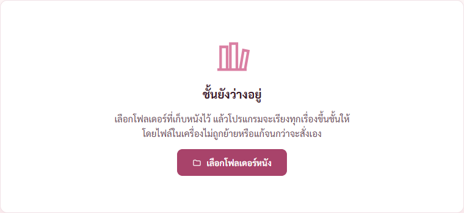
- หน้าชั้นว่าง เดิมตัด "จะเรียงทุกเรื่อง|ขึ้นชั้นให้" ตอนนี้ขึ้นบรรทัดตรงรอยประโยค "…เรียงทุกเรื่องขึ้นชั้นให้" กับ "โดยไฟล์ในเครื่อง…"

- ตัวตรวจที่ล้มที่เหลือเป็นที่ตัวตรวจตามหน้าที่เปลี่ยนในชุด 1 ถึง 8 ไม่ทัน แก้ตัวตรวจรวม 21 ไฟล์ (ข้อความใหม่ ปุ่มย้ายที่ หน้าที่เคยเปิดถูกเก็บไว้แบบซ่อน ผลตรวจความถี่เฉลี่ยเป็นแถบหลายข้อ หัวกราฟมีทศนิยมตอนช่วงสั้น ปุ่มเลือกช่องกลายเป็นดรอปดาวน์เมื่อกราฟแคบ) แก้ตัวตรวจให้ตรงกับหน้าแล้ว · check-stage3 ข้ออ่านโฟลเดอร์ จับจังหวะไม่ทันเพราะโฟลเดอร์ทดสอบอ่านจบเร็ว เปลี่ยนเป็นดักในหน้าตั้งแต่ก่อนกด

- เรื่องที่เห็นแต่ไม่ได้แก้ เพราะเป็นการจัดชั้นวางแบบเดิมที่รอบนี้ไม่ได้แตะ · ที่จอ 1366 เรื่องที่มีแต่ปกนอน (กว้างสามช่อง) ตกไปแถวถัดไป แถวก่อนหน้าจึงถูกกระจายเต็มความกว้าง ปกในแถวนั้นห่างกันกว่าแถวอื่น

## การตรวจ

- ตัวตรวจโหมดพัฒนา 40 ตัว 1,028 ข้อ ผ่านครบในรอบสุดท้ายของแต่ละตัว · ตัวที่ล้มแล้วแก้ รันซ้ำจนผ่าน
- check-stage1 53 · stage2 39 · stage3 17 · stage4 61 · stage5 17 · stage6 21 · stage7 13 · merge 20 · review 13 · wide 16
- check-graph 63 · av 76 · convert 41 · latest 11 · fonts 16 · link 154 · look 62 (ยังไม่ได้ตรวจ 2 ข้อ คือลากรูปจาก Explorer จริงกับปุ่มขยายภายใต้ CSP) · frames 12 · recent 16 · drop 13 · result 21 · spek 29 · stars 15 · nav 7 · bname 19 · table 30 · players 17 · statgo 4 · panel 3 · panel-states 3
- check-bitrate-new 31 · bitrate 36 · bugs1 17 · bugs2 7 · bugs3 5 · bugs4 11 · bugs5 10 · bugs6 12 · bugs7 11 · bugs8 6
- check-link ข้อ "สองปุ่มนับต่างกัน" ล้มหนึ่งในสามรอบ ปุ่มสองปุ่มคิดจากตัวเลขชุดเดียวกับบรรทัดท้ายตารางที่ผ่านในข้อก่อนหน้า น่าจะเป็นจังหวะที่ตัวตรวจอ่านปุ่มก่อนหน้าวาดใหม่ ยังไม่ได้พิสูจน์
- ทดสอบทุกหน้า 8 หน้าใน 7 ขนาดจอ (1366×720 ถึง 3840×2160 ทั้งสเกล 100 125 150) ไม่มีอะไรล้นขอบขวา ไม่มีแถบเลื่อนแนวนอน ที่ตัดท้ายมีแต่ชื่อไฟล์ยาวที่ออกแบบให้ขึ้นจุดสามจุด
- cargo test ผ่าน 163 จาก 163 (รอบนี้แก้ข้อความฝั่ง Rust ใน link.rs กับ extract.rs) · ปิดโปรแกรมโหมดพัฒนาก่อนรันแล้วเปิดกลับแบบอยู่หลังสุด
- โปรแกรมโหมดพัฒนาเปิดอยู่หลังสุด ถ่ายภาพผ่านพอร์ตดีบัก ไม่มีอะไรเด้งขึ้นจอ · โฟลเดอร์หนังเป็นชุดทดสอบ ไม่แตะไฟล์หนังจริง

## 5. สร้างตัวติดตั้งแล้วเทสการติดตั้ง

พี่กันสั่ง *"ลองบิ้ว แล้วเทสการติดตั้ง"* · สร้างตัวติดตั้งรุ่นจริง `src-tauri/target/release/bundle/nsis/ชั้นหนัง_0.9.1_x64-setup.exe` ขนาด 159,187,627 ไบต์ (151.81 MiB) SHA-256 `1FD59231385C5161DBEE565281ACAC4480108972473FFE7C633C4386CB47DAEB` · ตัวตรวจติดตั้งผ่าน 15 จาก 15 ในรอบที่สาม
แล้วพี่กันสั่ง *"เปลี่ยน 0.9.2 พุช"* · ขยับรุ่นแล้วสร้างใหม่ `ชั้นหนัง_0.9.2_x64-setup.exe` ขนาด 159,163,135 ไบต์ (151.79 MiB) SHA-256 `4E328DCA24816B47DDEA4CBF5CB3586075D85BF4B047F765A0D938CFEBE62096` · ตัวตรวจติดตั้งผ่าน 15 จาก 15

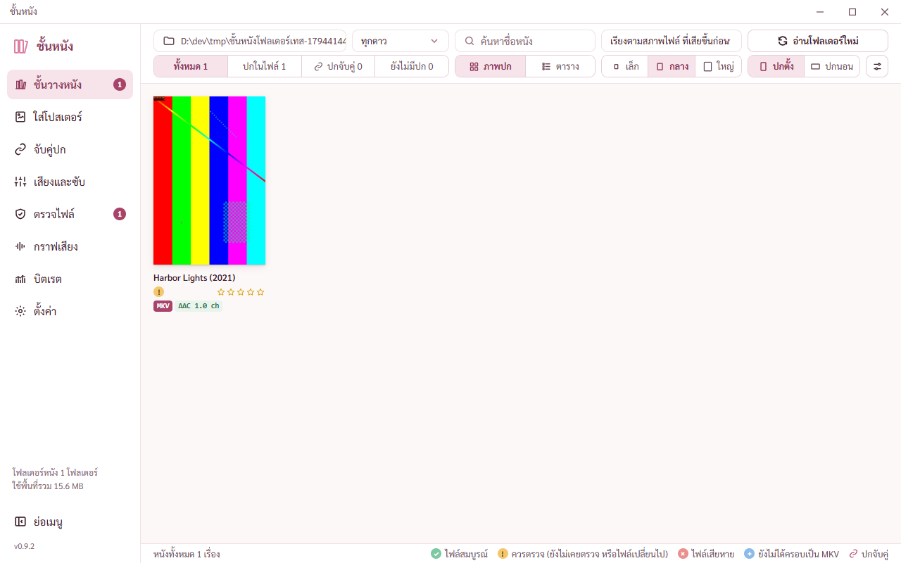
ตัวที่ติดตั้งจากตัวติดตั้ง 0.9.2 แบบเงียบลงโฟลเดอร์ทดสอบ เปิดแบบอยู่หลังสุด ขึ้น v0.9.2 ใต้ปุ่มย่อเมนู อ่านโฟลเดอร์หนังขึ้นชั้น ปกโหลดได้ภายใต้กติกาความปลอดภัยของตัวจริง

- ติดตั้งแบบเงียบ 23 วินาที เครื่องมือ 27 ไฟล์ค่า hash ตรง สัญญาอนุญาต 17 ไฟล์ เรียกเครื่องมือกับตัวแปลงเสียงที่แนบมาได้ครบพร้อมเลขรุ่น คำสั่งสำหรับเทสไม่มีในตัวจริง กดหยุดงานแล้วปิดระหว่างครอบไฟล์ 1.6 GB ไม่มีไฟล์ค้าง ถอนแบบเงียบแล้วไฟล์หนังไม่โดนแตะ
- **รอบแรกผ่าน 5 จาก 7 และแคลร์ทำพลาดสองเรื่อง** ① ตัว debug ที่แคลร์เปิดค้างไว้ตรวจชุด 2 ยังเปิดอยู่ ตัวกันเปิดซ้อนของโปรแกรมจึงส่งต่อให้ตัวนั้นแล้วดึงหน้าต่างขึ้นจอ ตัวที่ติดตั้งปิดตัวเองต่อพอร์ตดีบักไม่ได้ ② ทางลัดเมนูเริ่มของจริงของพี่กันหาย เพราะตัวถอนที่แยกไปรันลบทางลัดตามหลังตอนตัวตรวจคืนของไปแล้ว และตัวตรวจคืนกับตรวจจากในแพ็กเกจของ Claude ซึ่งมองไม่เห็นของจริง · คืนทางลัดจากไฟล์สำรองผ่านโปรเซสนอกแพ็กเกจแล้ว ค่า hash ตรงกับก่อนเทส ทางลัดบนเดสก์ท็อปกับรายการถอนโปรแกรมของพี่กันไม่โดน
- แก้ตัวตรวจ หยุดตั้งแต่ต้นเมื่อมีชั้นหนังตัวไหนเปิดอยู่ · รอตัวถอนจบจริงก่อนคืนของ · คืนและตรวจทางลัดผ่านโปรเซสนอกแพ็กเกจ · ผ่านครบแล้วลบโฟลเดอร์เทส (เดิมค้างรอบละ 1.6 GB)
- รอบสองผ่าน 14 จาก 15 ข้อปิดระหว่างครอบไฟล์ใหญ่ mkvmerge เขียนได้ 20 MiB ในราวหนึ่งนาทีแล้วนิ่ง โปรแกรมรอครบ 20 วินาทีแล้วปิด ไฟล์ .partial ค้าง · ต้นเหตุที่คิด ยังไม่พิสูจน์ ดิสก์ช้าผิดปกติตอนนั้น อาจเพราะ Windows สแกนไฟล์ 1.6 GB ที่ตัวตรวจเพิ่งสร้าง · โปรแกรมลบ .partial ที่ค้างจากรอบก่อนตอนเริ่มงานใหม่อยู่แล้ว · รอบสามผ่าน
