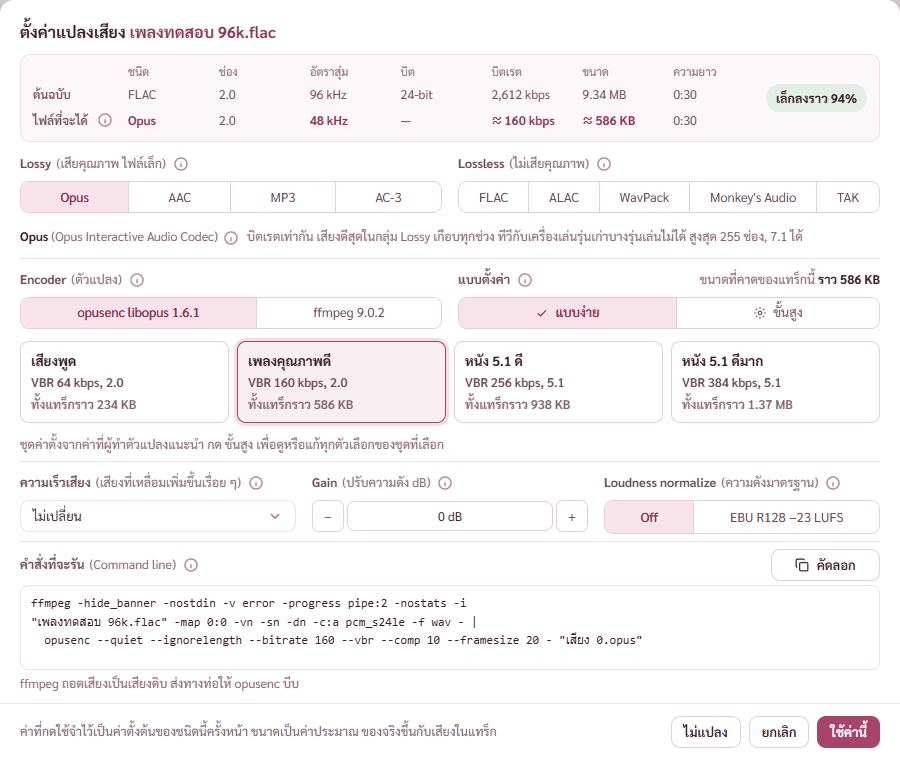
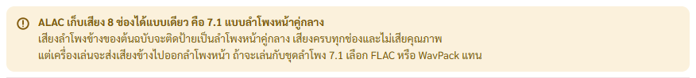
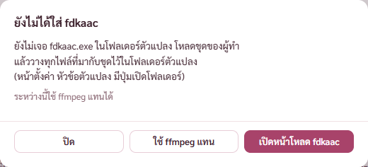
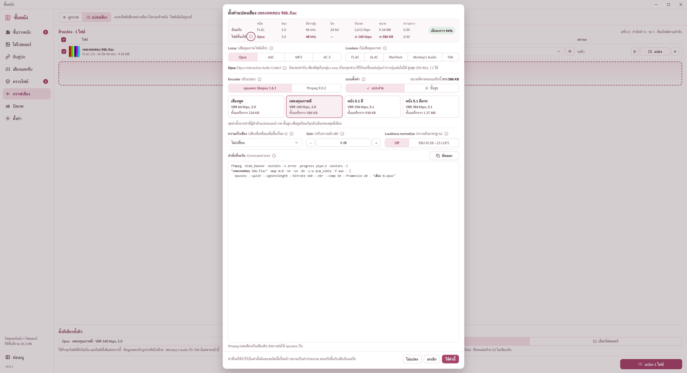
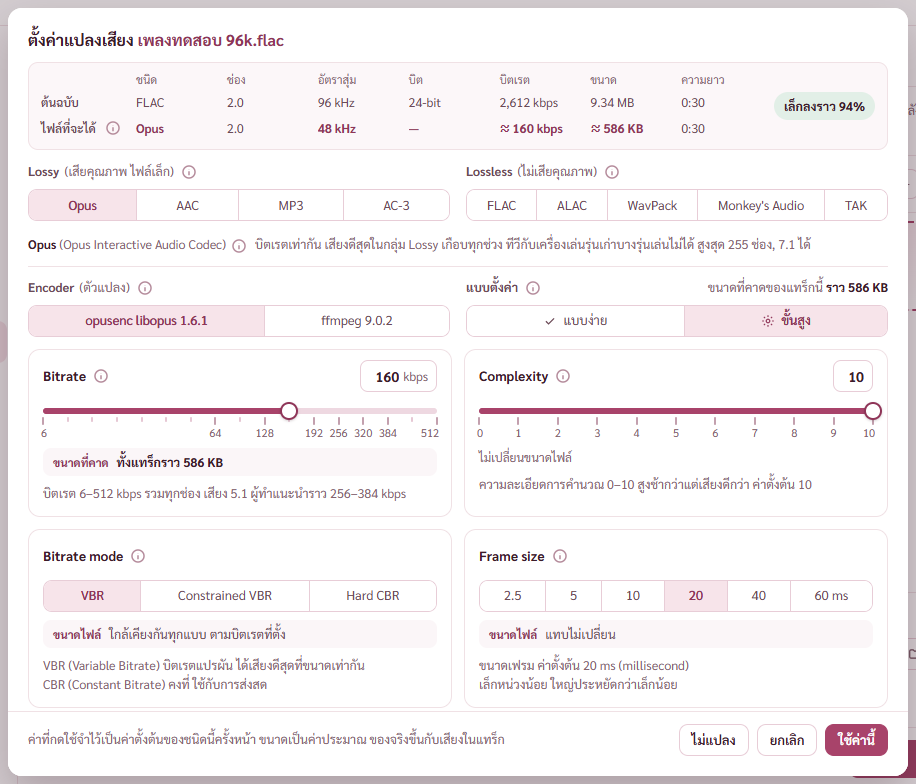
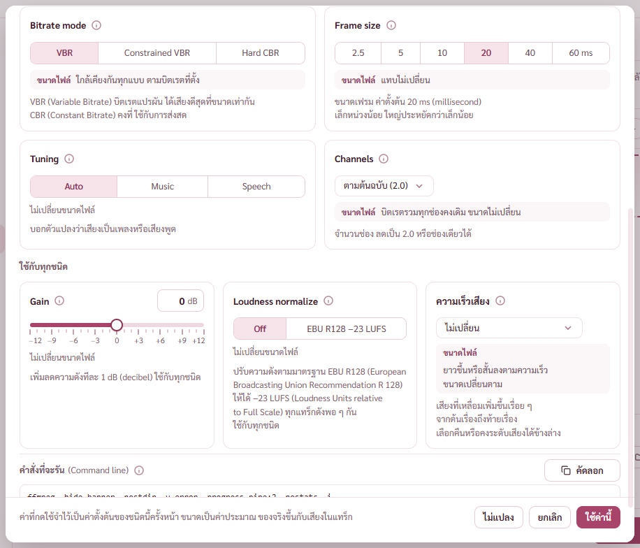

# รายงาน 11 พ.ย. 2569 หน้าต่างตั้งค่าแปลงเสียง การ์ดเทียบ และค่าของแต่ละ codec

ยังไม่ commit ตามที่พี่กันสั่ง *"อย่าเพิ่ commit อะไรจนกว่าเราจะสั่ง เฉพาะงานนี้"* · ภาพอยู่ `docs/report-2026-11-11/แผงแปลงเสียง/`

## 1. การ์ดเทียบต้นฉบับกับไฟล์ที่จะได้
พี่กันสั่ง *"อยากให้มันเป้นการ์ดฝั่งขวา เเล้วเทียยบต้นฉบับกับตัวที่กำลังจะแปลง ว่าอะไรเปลี่ยน"* · *"ทำจากเนื้อที่นี้จะ ไม่เพิ่ม"*
- การ์ดแทนบรรทัดต้นทางเดิม ช่องที่เปลี่ยนเน้นสี บิตเรตกับขนาดมีเครื่องหมาย ≈ ป้ายเล็กลงหรือใหญ่ขึ้นกี่เปอร์เซ็นต์

## 2. ค่าของแต่ละ codec ตามที่ตัวแปลงออกจริง
พี่กันสั่ง *"ไปดูดีๆนะ ค่ามันต้องปรับเป็นยังไ เอาให้ถูกต้อง ตามเเต่ละ codec"*
- แปลงไฟล์ทดสอบจริงด้วยคำสั่งชุดเดียวกับโปรแกรม ต้นทาง 96 88.2 48 44.1 32 22.05 192 kHz กับ 2 6 8 ช่อง แล้วอ่านไฟล์ที่ได้
- Opus ได้ 48 kHz เสมอ · MP3 ของ lame ลดอัตราสุ่มเองตามบิตเรต (V7 ได้ 32 kHz V8 ได้ 24 kHz CBR 64 ได้ 24 kHz) ของ ffmpeg ไม่ลด สูงสุด 48 kHz · AC-3 ได้ 48 44.1 หรือ 32 kHz สูงสุด 5.1 · AAC ของ Apple สูงสุด 48 kHz ของ ffmpeg ถึง 96 kHz · ALAC สูงสุด 8 ช่อง · TAK สูงสุด 6 ช่อง · WavPack ของ ffmpeg เขียน 24 บิตเป็น 32 บิต (เสียงตรงทุกตัวอย่าง ไฟล์เล็กกว่า)

## 3. บั๊กที่เจอระหว่างทดสอบแล้วแก้ (BUGS ข้อ 52 53)
พี่กันสั่ง *"แก้ด้ววย อะไรที่เจอต้องแก้หมด"*
- HE-AAC ของ Apple จากต้นทาง 96 หรือ 88.2 kHz ได้ไฟล์ว่าง · แก้ให้ ffmpeg ลดเป็น 48 kHz ก่อน · แปลงจริงผ่านโปรแกรม 64 กับ 96 kbps ได้ไฟล์ 48 kHz
- เสียง 7.1 แปลงเป็น ALAC ด้วย refalac ล้ม ด้วย ffmpeg ตัดเหลือ 7 ช่อง · แก้ให้ติดป้ายเป็น 7.1 ลำโพงหน้าคู่กลาง แบบเดียวที่ ALAC เก็บได้ · แปลงจริงทั้งสองตัวแปลงได้ 8 ช่อง ตัวอย่างเสียงตรงต้นทางทุกตัว · พี่กันถาม *"ต้องมีเตือนบอกไหม"* ใส่กล่องเตือนแล้ว

## 4. หน้าตา
- เส้นแบ่งสามเส้น *"เส้นเเบ่งหน่อย"* ระยะเหนือใต้เส้น 7 จุด *"ลดระยะห่างครึ่งนึง"*
- ใต้การ์ดถึงส่วนถัดไป 12 จุดเท่าจุดอื่น *"ลดช่อว่างให้เหมือนจุดอื่น"*
- ขอบบนล่าง 16 จุดคงที่ทุกขนาดจอ *"ขอบบนล่าง ลดกว่านี้ที เเละให้มัน fix ไว้"* · จำลองจอ 1080p (สเกล 125%) 2K (150%) 4K (150% และ 100%) ขอบ 16 จุดทุกจอ ไม่มีข้อความล้น
- จอใหญ่หน้าต่างสูงตามจอ กล่องคำสั่งยืดรับที่เหลือ พี่กันเคาะ *"เต็มจอแบบนี้"* (ไม่จำกัดความสูง)
- ชื่อไฟล์บนหัวเป็นสีหลักของโทน *"เปลี่ยนสีชื่อไฟล์"*
- ปุ่มสามปุ่มของกล่องตัวแปลงที่ยังไม่ได้ใส่แบ่งเต็มแถวเท่ากัน ปุ่มละ 155 จุด *"เเบ่งสามส่วนเท่ากัน"*
- เอาจุด · ? … ออกจากข้อความในหน้าต่างนี้ ใช้เว้นวรรคแบบประโยคไทย รายการค่าสั้นใช้จุลภาค · พี่กันตีตกการแยกบรรทัด *"มึงจะเเบ่งไปร้อยบรรทัดไปถึงไหนน ที่ว่างตั้งเยอะ"* แก้กลับเป็นบรรทัดเดียวแล้ว · บันทึกกฎลง CLAUDE.md

## 4.1 ตัดบรรทัดตามความหมาย
พี่กันทัก *"เเบ่งบรรทัดอะไรของเธอ"* · *"รวมทุกช่อง เเบ่งลงมาทำไม"* · สั่ง *"เเบ่งบรรทัด โดยดูจากบริบทเเละความหายโว้ย มึงไปตั้งกฎน claude"* (ตั้งกฎใน CLAUDE.md แล้ว)
- ข้อความตัดบรรทัดได้เฉพาะตรงเว้นวรรค ไม่ขาดกลางคำไทย · "เรื่อย ๆ" อยู่ด้วยกัน
- รอยต่อประโยค (ที่เดิมเป็น ·) เป็นเว้นวรรคสองช่อง ตัวแสดงข้อความจับแต่ละประโยคเป็นก้อน ไม่พอที่ย้ายลงทั้งก้อน ประโยคสั้นยังต่อกันบรรทัดเดียว
- คำเต็มในวงเล็บเป็นก้อนเดียว · พี่กันสั่ง *"ไม่วงเล็บตัวนี้"* เลิกวงเล็บคำเต็มของ kbps kHz Hz

## 4.2 การ์ดจับคู่เสียงซับบนชั้นวาง
- ตัวตรวจ check-av เจอว่าย้ายไฟล์ที่จับคู่ออกแล้ว การ์ดยังบอกเจอไฟล์ เพราะชุด 2 เก็บหน้าไว้ ผลเช็กค้าง · แก้ให้เช็กใหม่ทุกครั้งที่กลับมาหน้าชั้นวางและตอนกลับมาที่หน้าต่างโปรแกรม · check-av ผ่าน 76 จาก 76

## 5. หน้าต่างโปรแกรมตกขอบจอที่สอง
พี่กันส่งภาพ *"ตกขอบ"* · จอที่สอง 1366×768 ใช้ได้สูง 720 แต่หน้าต่างสูง 800 ส่วนล่างจมใต้แถบงาน
- โปรแกรมย่อหน้าต่างให้พอดีจอที่อยู่ ตอนเปิดและตอนลากไปจออื่น (รอหยุดลาก 0.4 วินาที) · ทดสอบย้ายหน้าต่างไปจอที่สอง สูง 809 เหลือ 720 อยู่ในพื้นที่ใช้ได้ โฟกัสไม่ถูกแย่ง

## ยังไม่ได้ตรวจ
- `cargo test` ยังไม่รัน (เพิ่มเทส HE-AAC กับ ALAC 7.1 ไว้แล้ว) ต้องปิดโปรแกรมโหมดพัฒนาก่อน
- fdkaac ไม่มีในเครื่อง ทดสอบจริงไม่ได้ การ์ดถือว่าสูงสุด 48 kHz
- คิวในหน้าแปลงเสียงของพี่กันหายตอนโปรแกรมโหมดพัฒนาสร้างใหม่ (สองรอบ) ไฟล์เพลงไม่ถูกแตะ ต้องลากเข้าคิวใหม่ · คิวเก็บแค่ในหน่วยความจำ ควรจำไว้แม้ปิดเปิดโปรแกรม
- ไล่ทุกหน้าตามขนาดจอ (1366×720 1080p 2K 4K) พี่กันถาม *"เธอต้องเทสทุกหน้าหม่มั้ยงั้น ตามขนาดจอ"* เป็นงานถัดไป
