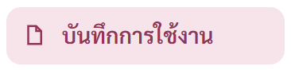
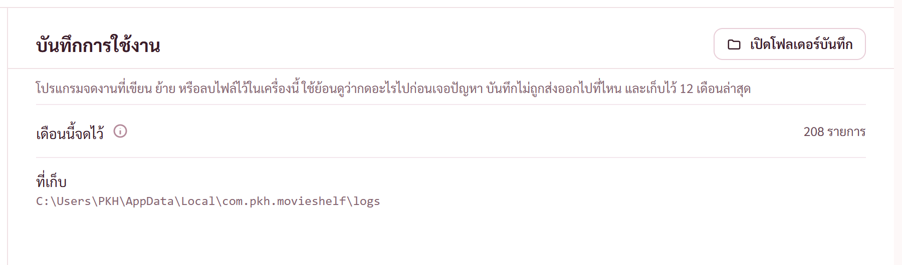
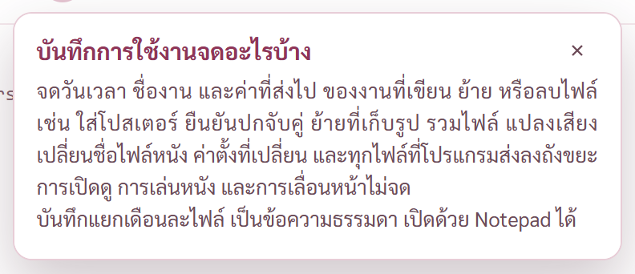

# รายงาน 12 พ.ย. 2569 · แก้ AUDIT ข้อ 1 และบันทึกการใช้งานของโปรแกรม

ทำบนรุ่น 0.9.2 ต่อจาก commit 341eb82 · ยังไม่ commit ยังไม่ขยับรุ่น · ทำตอนพี่กันลงเวร ทุกอย่างรันเบื้องหลัง ไม่ได้เปิดโครม

## 1. AUDIT ข้อ 1 · ย้ายที่เก็บรูปจับคู่แล้วปกลงถังขยะ

พี่กันถาม *"ข้อ 1 ร้ายแรง เล่าให้เราฟังหน่อย"* แล้วสั่ง *"ข้อนี้ แก้เลยนะ"*

**อาการ** ติ๊กที่เก็บทั้งข้างไฟล์หนังและในโปรแกรม แล้ววันหลังเอาติ๊กข้างไฟล์หนังออก แล้วกด "ย้ายมาแบบนี้ทีเดียว" ผลบอกว่าย้ายสำเร็จ และชั้นวางยังเห็นปก แต่ไฟล์ปกจริงทุกไฟล์อยู่ในถังขยะ

**ต้นเหตุ** ไฟล์ในโปรแกรมตั้งชื่อตามลายนิ้วมือของรูป รูปเดียวกันจึงได้ชื่อเดียวกัน ปกใหม่ใช้ไฟล์สำเนาเดิมเป็นไฟล์หลักของตัวเอง แต่ตัวกันลบตอนเก็บกวาดของจากแบบเดิมเทียบแค่ว่าเป็นสำเนาของปกอื่นไหม ไม่ได้เทียบว่าเป็นไฟล์หลักของปกใหม่ เลยส่งไฟล์นั้นลงถังขยะ · ทางรูปต้นฉบับหาย ปกใหม่ยังลอกช่องสำเนาของปกเก่าติดมา ขั้นเอาสำเนาออกจึงทิ้งไฟล์หลักซ้ำอีกทาง · มีอีกสองทางที่ต้นเหตุเดียวกันแต่ลบถาวร คือตอนบันทึกปกล้มกลางทาง

**แก้** ใน `src-tauri/src/link.rs` ที่เดียว
- ตัวกันลบเทียบไขว้ทุกช่อง ไฟล์ที่เก็บ รูปต้นทาง และสำเนาในโปรแกรม ใช้ทั้งตอนแทนปก ตอนเก็บกวาดหลังบันทึกล้ม และตอนเอาสำเนาออก
- ทางรูปต้นฉบับหาย ไม่พาสำเนาของปกเก่ามา ทำสำเนาแบบเดียวกับทางทำรูปใหม่
- บันทึกข้างไฟล์หนังไม่สำเร็จ ลบสำเนาเฉพาะไฟล์ที่เพิ่งทำในรอบนั้น
- แยกงานย้ายของหนังหนึ่งเรื่องเป็นฟังก์ชันของตัวเอง ให้เทสเรียกทางเดียวกับของจริงได้

**ตรวจ**
- cargo test เพิ่ม 4 ชุด แดงกับโค้ดก่อนแก้ทั้ง 4 ชุด ผ่านหลังแก้ · ทั้งโปรแกรม 172 จาก 172 (รวม 4 ชุดของบันทึกการใช้งาน)
- ตัวตรวจหน้าจับคู่ปก `check-link.mjs` เพิ่มข้อย้ายที่เก็บผ่านปุ่มจริงในโปรแกรม ทั้งเรื่องที่รูปต้นฉบับอยู่และหาย · กับโค้ดก่อนแก้ผ่าน 157 จาก 158 ข้อที่ตกคือ 11 เรื่องที่มีสำเนาชี้ไฟล์ปกที่ลงถังขยะแล้วทุกไฟล์ · กับโค้ดที่แก้แล้วผ่าน 158 จาก 158 · รอบสุดท้ายรวมข้อบันทึกผ่าน 159 จาก 159
- ยังไม่ได้ลองกับตัวจริงใต้ CSP เพราะข้อนี้เป็นเรื่องไฟล์ฝั่ง Rust

รายละเอียดเต็มอยู่ [AUDIT-2026-11-12.md](AUDIT-2026-11-12.md) ข้อ 1 · ข้อ 78 ครึ่งทาง ได้เทสย้ายที่เก็บเพิ่ม เหลือเรื่องเทสทิ้งไฟล์ลงถังขยะจริง

## 2. บันทึกการใช้งานของโปรแกรม

พี่กันเสนอหลังแคลร์บอกว่าดูไม่ได้ว่าเครื่องพี่กันเคยกดย้ายที่เก็บไหม *"ทำ log ของโปรแกรม ว่าเราทำอะไรในโปรแกรมมั่ง เอาไว้ตรวจทาน เธอว่าไง"* · แคลร์เห็นด้วยแล้วลงมือทำ ค่าทั้งหมดในข้อนี้แคลร์ตั้ง

**จดอะไร**
- งานที่เขียน ย้าย หรือลบไฟล์ ได้แก่ ใส่โปสเตอร์ รวมไฟล์ แยกแทร็ก แปลงเสียง เปลี่ยนชื่อไฟล์หนัง ยืนยันปกจับคู่ ย้ายที่เก็บรูป เอาปกออก บันทึกไฟล์ .sha256 บันทึกกราฟ ตรวจไฟล์ จับคู่เสียงซับ ให้ดาว ล้างกราฟที่เก็บไว้ ปิดโปรแกรมทั้งที่มีงานค้าง
- ค่าตั้งที่เปลี่ยน ทุกครั้ง พร้อมค่าใหม่
- ทุกไฟล์ที่โปรแกรมส่งลงถังขยะ ทั้งสำเร็จและไม่สำเร็จ
- ผลสรุปของงานยืนยันปกกับงานย้ายที่เก็บ ว่าสำเร็จกี่เรื่อง ไม่สำเร็จกี่เรื่องเพราะอะไร
- ตอนเปิดโปรแกรมพร้อมเลขรุ่น
- ไม่จด การเปิดดู การเล่นหนัง การเลื่อนหน้า และคำสั่งอ่านอย่างเดียว

**เก็บที่ไหน** ไฟล์ข้อความธรรมดาในโฟลเดอร์ `logs` ของโปรแกรม (`%LOCALAPPDATA%\com.pkh.movieshelf\logs`) แยกเดือนละไฟล์ ชื่อ `2026-11.log` เก็บ 12 เดือนล่าสุด ไม่ส่งออกเน็ต ไม่ขึ้น git

**ตัวอย่างบรรทัดจริงจากชุดทดสอบ**
```
2026-11-12 23:30:25  ย้ายที่เก็บรูปจับคู่  to: app
2026-11-12 23:30:33  ลงถังขยะ  C:\Users\PKH\AppData\Local\com.pkh.movieshelf\covers\fab21fad-000900000001e143-tall-39b0fc4997d0.jpg
2026-11-12 23:30:50  เปลี่ยนค่าตั้ง  patch {folders: [D:\dev\tmp\ชั้นจับคู่\หนัง]}
2026-11-12 23:32:22  ย้ายที่เก็บรูปจับคู่ เสร็จ  ไปแบบข้างไฟล์หนัง ไม่มีสำเนาที่สอง ย้ายแล้ว 0 เรื่อง ไม่สำเร็จ 0 เรื่อง
```

**ทำยังไง** `src-tauri/src/actlog.rs` ใหม่ · จดที่ทางเข้ากลางของคำสั่งจากหน้าจอใน `lib.rs` ทุกคำสั่งผ่านจุดนี้ จึงไม่ต้องแก้ทีละคำสั่ง · จดในตัวส่งลงถังขยะ `outfile.rs` ซึ่งเป็นทางเดียวทั้งโปรแกรม · เวลาเป็นนาฬิกาเครื่อง เพิ่มส่วนอ่านเวลาของ `windows-sys` ที่ใช้อยู่แล้ว ไม่เพิ่มห้องสมุดใหม่ · เขียนบันทึกไม่ได้ งานหลักไม่ล้ม

**หน้าตั้งค่า** กลุ่มเครื่องมือมีหัวข้อใหม่ "บันทึกการใช้งาน" มีปุ่มเปิดโฟลเดอร์บันทึก จำนวนรายการเดือนนี้ ปุ่ม ⓘ บอกว่าจดอะไรบ้าง และที่อยู่โฟลเดอร์ · ระหว่างอ่านขึ้นโครงจาง อ่านไม่ได้ขึ้นป้ายแดง







กล่อง ⓘ รอบแรกตัดบรรทัดกลางวลีสองจุด "ข้อความ / ธรรมดา" แล้ว "เดือนละ / ไฟล์" · แคลร์เจอจากภาพเอง แก้โดยให้ประโยคท้ายขึ้นบรรทัดของตัวเอง ภาพข้างบนเป็นหลังแก้

**ตรวจ**
- cargo test เพิ่ม 4 ชุด บรรทัดเดียว ตัดท้ายข้อความยาว ค่าอ่านง่าย ลบเฉพาะไฟล์บันทึกที่เกิน 12 เดือน รายการคำสั่งที่จดไม่มีคำสั่งอ่านอย่างเดียว · ผ่านครบ
- ในโปรแกรมจริง รันตัวตรวจหน้าจับคู่ปกหนึ่งรอบ บันทึกจด 103 รายการ ลงถังขยะ 42 เปลี่ยนค่าตั้ง 24 ยืนยันปก 9 ย้ายที่เก็บ 5 ใส่โปสเตอร์ 2 เปลี่ยนชื่อไฟล์หนัง 2 เลือกปกที่แสดง 2 เอาปกออก 1 ยกเลิกปกที่ยืนยันแล้ว 1 เปิดโปรแกรม 1 · `check-link.mjs` เพิ่มข้อตรวจว่าบันทึกจดงานย้าย บรรทัดสรุป และไฟล์ที่ลงถังขยะ
- ข้อความในการ์ดวัดที่หน้าต่าง 1280 × 800 ทุกประโยคพอดีช่อง ไม่มีแถบเลื่อนแนวนอน กล่อง ⓘ อยู่ในจอ
- ไม่ได้กดปุ่มเปิดโฟลเดอร์บันทึก เพราะจะเปิด Explorer ขึ้นจอ พี่กันลงเวรอยู่ ปุ่มใช้ทางเดียวกับปุ่มเปิดโฟลเดอร์ตัวแปลงที่ใช้ได้อยู่แล้ว
- ยังไม่ได้ลองกับตัวจริงใต้ CSP

**ข้อที่ต้องรู้** โปรแกรมที่แคลร์เปิดจากเครื่องมือของแคลร์เขียนบันทึกลงโฟลเดอร์ของแพ็กเกจ Claude ไม่ใช่ของจริงของพี่กัน (CLAUDE.md หัวข้อแอปแบบแพ็กเกจ) · บันทึกของพี่กันเริ่มจดตั้งแต่พี่กันลงรุ่นที่มีตัวนี้ งานก่อนหน้านั้นไม่มีบันทึก

## ยังไม่ได้ทำ
- ยังไม่ commit ทั้งสองงาน รอพี่กันสั่ง
- ตัวติดตั้งรุ่นใหม่ยังไม่ได้สร้าง พี่กันจะได้บันทึกการใช้งานเมื่อลงรุ่นถัดไป
