# รายงานชุด 9 · 12 พ.ย. 2569

งานชุด 9 ของ [BUGS.md](BUGS.md) กับข้อที่พี่กันแทรกระหว่างวัน · ทำบนโปรแกรมจริงโหมดพัฒนาที่เปิดอยู่หลังสุด ถ่ายภาพผ่าน CDP ที่หน้าต่าง 1280 × 800 · ยังไม่ commit (commit ตอนปิดชุดทั้งชุด)

พี่กันสั่งลำดับงาน *"มีหลามีหลายคำสั่งนะ ทำต่อจบ เเล้วส่งภาพรวมมาตอนจบ"* · *"เเต่เอาไปรันตอนท้าย คอมเรามันค้าง"* · *"ทำต่อยาวๆ ไม่มีสั่งละ"*

| ข้อ | เรื่อง | สถานะ |
|---|---|---|
| 29 | หน้า MediaInfo ที่ว่างขวา | ✅ |
| 30 | บันทึก .sha256 | ✅ |
| 33 | ส่วนตั้งค่าแทร็กอยู่ล่างไกล | รอพี่กันเลือกแบบในมอคอัป |
| 34 | แปลงเสียงในส่วนตั้งค่าแทร็ก | ทำต่อจากข้อ 33 |
| 35 กับแถวต่อ | แยกแทร็กในหน้าเสียงและซับ | ✅ |
| 54 กับแถวต่อ | เมนู MediaInfo ปกเพลง ไฟล์ที่ดูล่าสุด | ✅ |
| 55 กับแถวต่อ | การ์ดรูปที่ต้องแปลง หน้าครอป สีขอบ | ✅ |
| 56 | ปุ่มขยายดูรูปสามการ์ด | ✅ |
| 57 | คำเตือน MP4 ไม่ดันหกกรอบ | ✅ |
| 58 กับแถวต่อ | ปกตั้งกับปกนอนในหน้าใส่โปสเตอร์ | ✅ |
| 59 | สามปุ่มของการ์ดรูปเหมือนกันสองหน้า | ✅ |
| 60 | ปุ่ม MKV MP4 ใหญ่ขึ้น | ✅ |
| 61 | ป้าย ในหนัง เป็น ในไฟล์ | ✅ |
| 62 | หัวคอลัมน์ แปลง ตรงกับขีด | ✅ |

---

## ข้อ 29 หน้า MediaInfo ที่ว่างขวา

พี่กัน *"เราว่า มันยังมีที่วว่างฝั่งขวาเยอะจั"* แล้วเลือกในมอคอัป จอเล็กแบบ 2.1 จอขยายแบบ 3.2 และย่อแผงได้ · ต่อมา *"เลื่อนลงเเล้วภาพโดนตัด"* · *"ขอเส้นเเบ่งให้เราที"* · *"เเเบ่งเเนวนอนด้วย"* · *"กดไปแล้ว จุดนั้นจะสว่างวาบแวบนึงที"*

- แผงสรุปขวามีปก ตัวเลขหลัก และรายชื่อหมวด ตรึงใต้หัวหน้า เลื่อนในตัวเองได้ ปกไม่โดนตัดตอนเลื่อน
- หน้าต่างกว้างตั้งแต่ 840 px ข้อความแบ่งสองคอลัมน์ มีเส้นคั่นแนวตั้ง และเส้นแนวนอนคั่นหมวด หมวดที่ขึ้นหัวคอลัมน์ไม่มีเส้นบน
- กดชื่อหมวดแล้วเลื่อนไปถึงก่อน หมวดนั้นค่อยวาบหนึ่งที

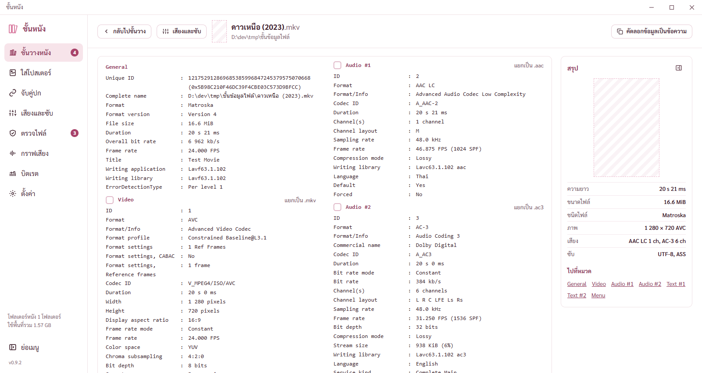

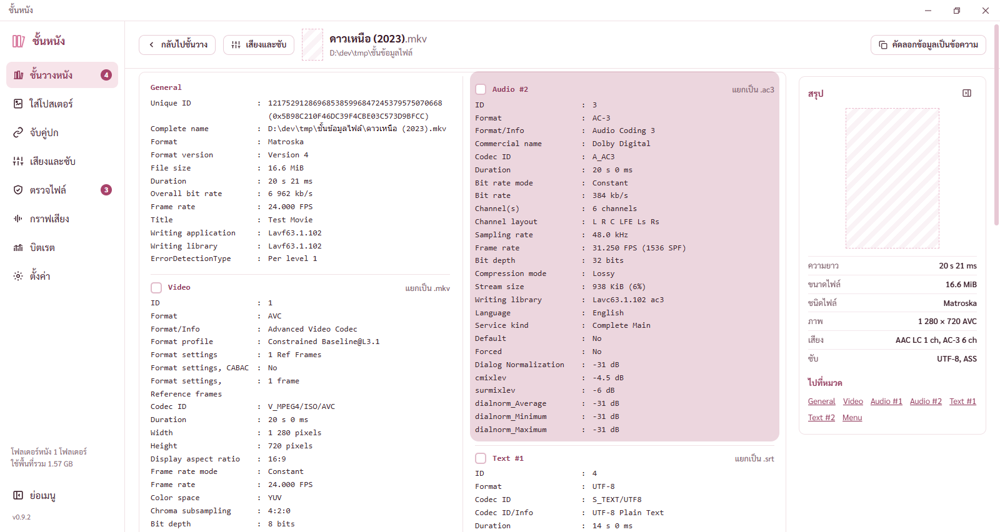

## ข้อ 30 บันทึก .sha256

พี่กัน *"กดบันทึกไม่ได้อ่ะ"* · *"ใช่ เรายังไม่เลือกที่อยู่ไฟล์เลย เลยตีความว่ามองไม่เห็น"*

- กดแล้วเปิดหน้าต่างเลือกที่บันทึก ตั้งต้นข้างไฟล์หนัง ชื่อ `ชื่อไฟล์.sha256` · หน้าตั้งค่ามีสวิตช์ ถามที่บันทึกไฟล์ .sha256 ทุกครั้ง
- ปุ่มบอกสถานะ บรรทัดใต้ปุ่มบอกที่อยู่พร้อมปุ่มเปิดโฟลเดอร์ · ค่าตรงกันมีอยู่แล้วไม่สร้างซ้ำ · ค่าไม่ตรงถามก่อนสร้างชื่อใหม่

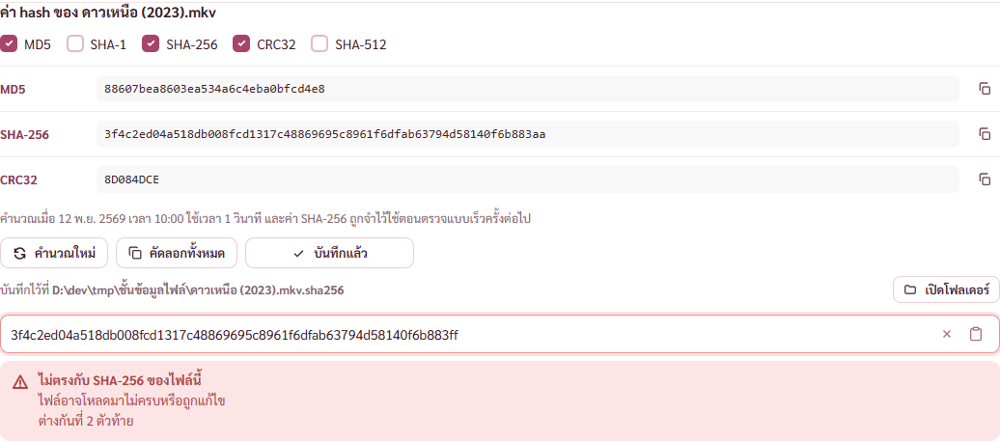
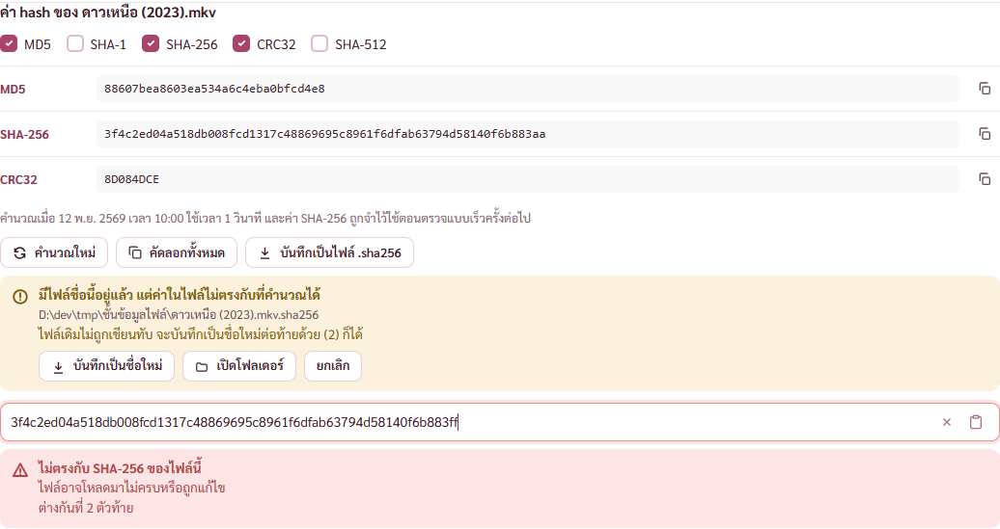
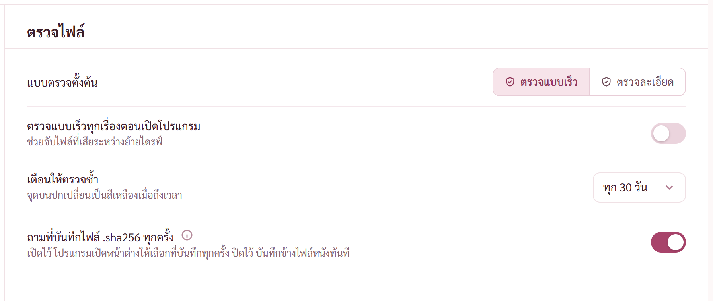

## ข้อ 35 แยกแทร็กในหน้าเสียงและซับ

พี่กัน *"ปุ่มเเยก กับรวม เอาที่เดียวกันในหน้นี้เลย"* · *"ขอเเถวเดียวกัน"* · *"มันสามารถเเยกเป้น h264 เดี่ยวๆได้นี่นา"* · *"ตัวนี้ควรอยู่ล่าสุดตลอด"* · *"วงเล็บภาษษอังกิดที่มันคล้ายกับ toolnix เเละขยายการฺดห้ใหญ่กว่านี้ เเยกสามปุ่ม ให้เด่น"* · *"ตอนกดรวม เเสดงทั้งหมด ตอนกดเเยก มันดันยุบขึ้นไป เราต้องการให้มันไม่ยุบ เท่าเดิม อันไหนไม่จำเป็น เอาปุ่มจางกดไม่ได้"* · *"อย่าลืม fix อันนี้ล่าสุด"*

- วิธีเป็นการ์ดใหญ่สามใบ รวมเข้าไฟล์หนัง (Merge) จับคู่ไว้ ไม่รวม (Pair) แยกออกจากหนัง (Extract) หัว วิธี อยู่แถวเดียวกับการ์ด
- วิธีแยก ติ๊กแทร็กในตาราง แถวภาพเลือกแยกเป็น .mkv หรือ .h264 (HEVC เป็น .h265) ได้ · ไฟล์แนบกับบทอยู่ในการ์ดใต้การ์ดวิธี
- ส่วนของงานรวมอยู่ที่เดิมแบบจาง กดไม่ได้ มีป้ายเหตุผล วัดตำแหน่งตอนรวมกับตอนแยกเท่ากัน ช่องลากไฟล์ 329 โปสเตอร์ 431 วิธี 583
- การ์ดแยกออกจากหนังตรึงล่างสุดของจอ ขอบล่าง 792 จาก 800
- กล่องอธิบายบอกชนิดสตรีมตามหนังจริง หนัง H.264 เขียน H.264 หนัง HEVC เขียน H.265 (เจอตอนดูภาพรวม เดิมเขียน H.264 ตายตัว)

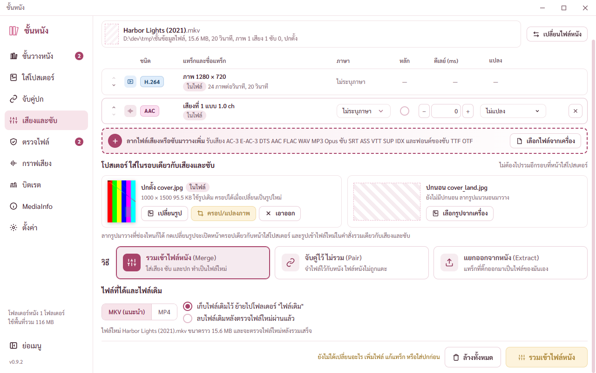
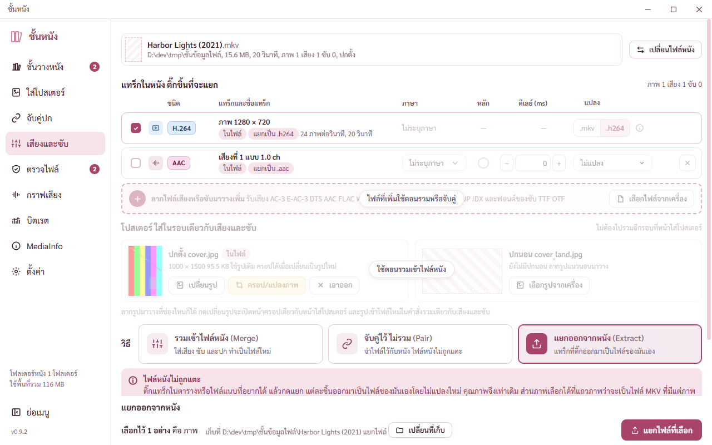
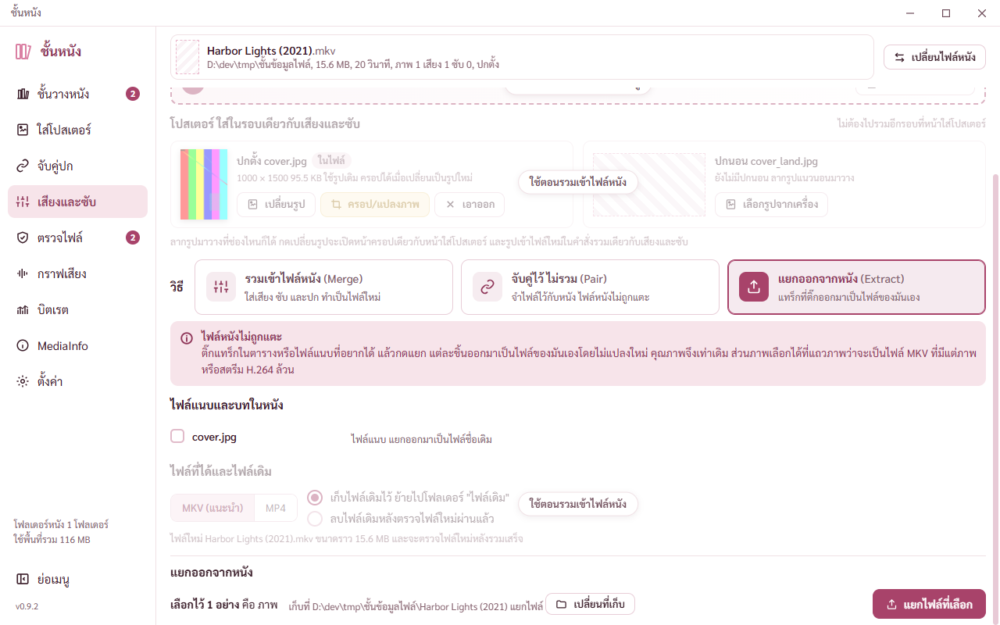

## ข้อ 54 เมนู MediaInfo

พี่กัน *"เราขออีกอันในชุดนี้ คือ สร้างเเถบเมนู media infor อันนี้"* · *"เอ่เพลงเข้า ก็ต้องเเดงปกด้วย"* · *"ไฟล์ที่ดูล่าสุดเเสดงด้วยสิ"*

- เมนู MediaInfo ต่อจากบิตเรต ลากหรือเลือกไฟล์หนังกับไฟล์เสียงได้ทุกไฟล์
- ไฟล์ที่ไม่อยู่ในชั้นวางอ่านปกที่ฝังในไฟล์ ขึ้นที่หัวหน้ากับแผงสรุป ทดสอบกับ FLAC ฝังปก 1000 × 1500 หัวหน้า 34 × 51 แผงสรุป 150 × 225
- ไฟล์ที่ดูล่าสุดใต้ช่องลากไฟล์ จำ 8 ไฟล์ กดเปิดซ้ำได้ เอาออกได้ ไฟล์หายขึ้นแดงว่าหาไฟล์ไม่เจอ

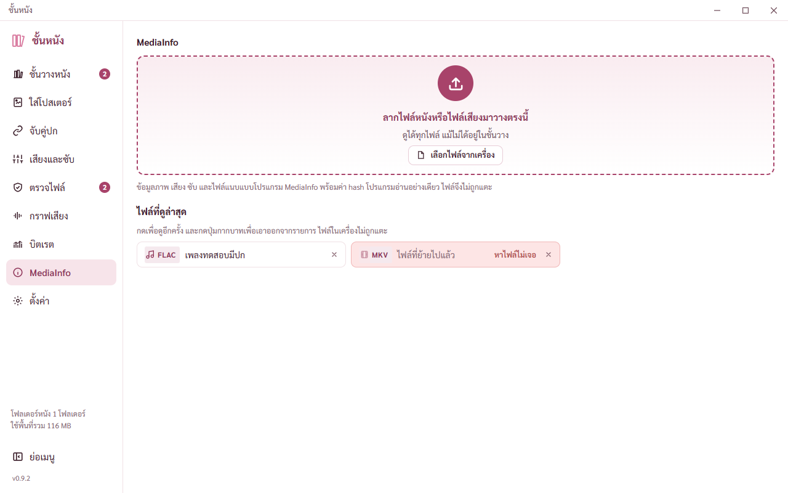
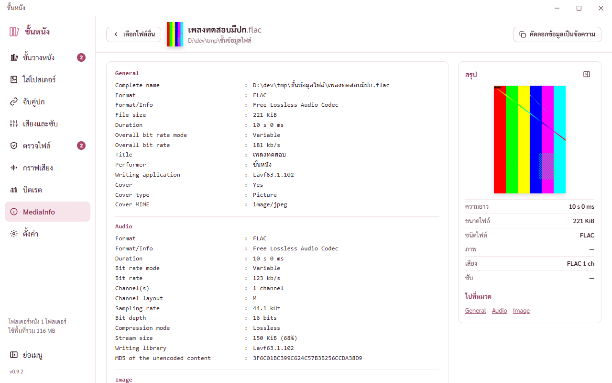

## ข้อ 55 การ์ดรูปที่ต้องแปลงกับหน้าครอป

พี่กัน *"ประโยคโดนตัด"* · *"เเถบล่าสุด โโนเเบ่ง เกลาห้มันเหลือ 1 เเถว"* · *"ไม่สิ มันมี popup ตอนครอบอยู่เเล้ว หน้านั้นก็บอกด้วยสิ ว่าเเนบ mkv ไม่ได้"* · *"บีบให้สวย"* · *"เอาปุ่มตั้งค่าภาพ ไปส่ในนี้เลย"* · *"มันซ้ำซ้อนนะ"* · *"เตือน สีเหลืองไหม"* · *"เลือกสีเอง เเละถ้าได้สีใมหม่เเล้ว ก็เเสดงสีนั้นด้วย"* · *"ขยายกว่านี้หน่อย"* · *"ให้ popup เลือกสี มันขนาดเท่ากันทั้งโปรแกรม"*

- ป้ายนามสกุลเคยตกบรรทัดเพราะชื่อคลาส `cv` ชนกับผืนกราฟ เปลี่ยนเป็น `extcv`
- การ์ดรูปเหลือสองบรรทัดสั้น หน้าครอปมีกล่องเตือนสีเหลือง แถวเดียว 300 จาก 368 px
- มุมซ้ายล่างหน้าครอปมีสวิตช์ย่อรูปที่ใหญ่เกิน 1000 × 1500 px อย่างเดียว ชนิดไฟล์กับคุณภาพใช้ช่องเดิม
- ปุ่ม เลือกสีเอง สีที่เลือกขึ้นเป็นช่องที่สี่ กล่องเลือกสีขนาดเดียวทั้งโปรแกรม พื้นที่เลือกสี 250 px ในหน้าครอปยกขึ้นให้อยู่ในหน้าต่าง ไม่มีแถบเลื่อน

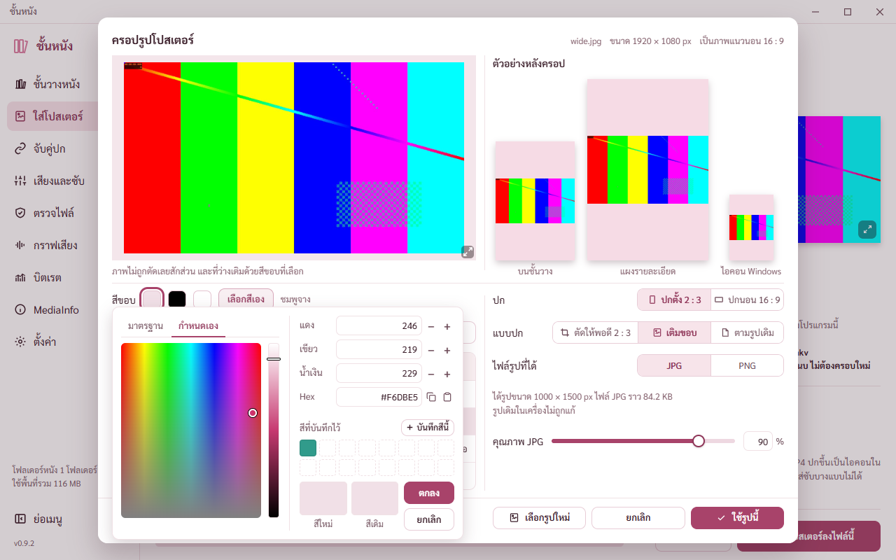
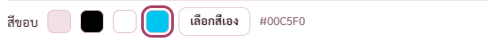

## ข้อ 56 ปุ่มขยายดูรูปสามการ์ด · ข้อ 59 สามปุ่มเหมือนกันสองหน้า

พี่กัน *"ทำต่อ ส่ปุ่มขยายดูรูปให้ครบทั้งสามอัน"* · *"ให้มันเหมือนกันหน่อย เอาสามอัน เปลี่ยนรูป ครอบ/แปลงภาพ เเละ เอาออก เเละใส่ icon ด้วย ทำทั้งหน้ารวมโปสเตอร์ เเละหน้ารวมเสียงซับ"*

- ปุ่มขยายมุมขวาล่างรูปทั้งสามการ์ด เปิดตัวดูรูปเต็มจอเดิม
- สามปุ่มมีไอคอนทั้งสองหน้า · ปกเดิมในไฟล์ครอปไม่ได้ ปุ่มครอปจาง บรรทัดเหนือปุ่มบอกว่า ครอปได้เมื่อเปลี่ยนเป็นรูปใหม่ แถวเดียว 302 จาก 343 px (เจอตอนดูภาพรวมว่าเหตุผลอยู่แค่ตอนชี้ ผิดกฎปุ่มกดไม่ได้ต้องบอกเหตุผลติดปุ่ม)
- เจอตอนดูภาพรวม บรรทัด ปกนอน แนบเป็น ตัวอักษรถ่างเพราะชื่อไฟล์ตกบรรทัด ข้อมูลรูปเป็นรายการทีละบรรทัด เปลี่ยนเป็นชิดซ้าย

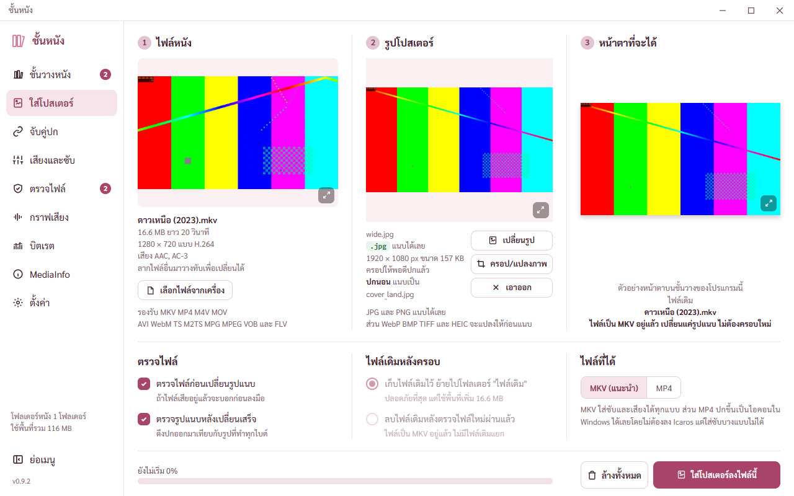
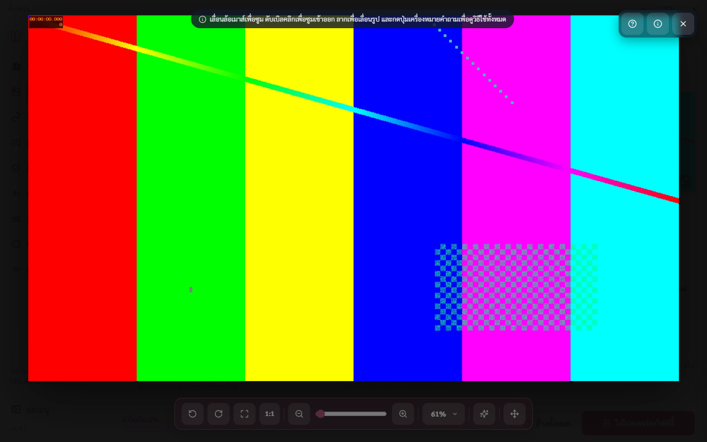
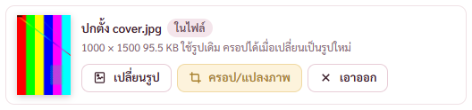

## ข้อ 57 คำเตือน MP4

พี่กัน *"เปลี่ยนเป็น mp4 เเล้วมันขึ้นเตือน ไปหาเตือนที่อื่น มันทำให้หน้าเพจมันเลื่อนหมดเลย เราบอกเเล้วว่า fix ห้ามเลื่อน มัน 6 กรอบ ต้องขนาดเท่ากันตลอด"*

- คำเตือนเป็นหน้าต่างถามตอนเลือก MP4 และตอนกดเริ่ม หกกรอบวัดก่อนกับหลังเลือก MP4 เท่ากันทุกกรอบ
- ที่ว่างใต้กล่องเตือนมาจากความสูงขั้นต่ำ 236 ของหน้าต่างซ้อนทุกบาน (ต้นแบบ หน้าต่างลบขั้น 1 กับขั้น 2 สูงเท่ากัน) ตรงตามกฎเดิม ไม่ได้แก้

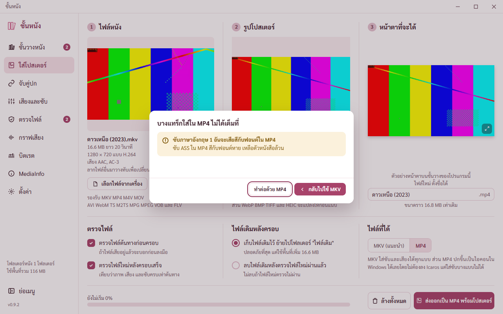

## ข้อ 58 ปกตั้งกับปกนอนในหน้าใส่โปสเตอร์

พี่กัน *"เอาใส่ ทำต่อจากนี้"* · *"เอาส่ก่อนเลือกแบบปก"* · *"เเนวนอนเธอเคยทำเเล้ว ตรงรวมไฟล์ เเล้เลือกปกเเนวนอน"* · *"ครอปเเนวนอนโดยเฉพาะตามหน้ารวมไฟล์ใส่เส้นเเบ่งให้เหมือนเพื่อน"*

- หน้าครอปของหน้าใส่โปสเตอร์มีแถว ปก เลือก ปกตั้ง 2 : 3 หรือ ปกนอน 16 : 9 เหนือแถวแบบปก
- เลือกปกนอนแล้วแนบเป็น cover_land ปกตั้งเดิมในไฟล์ยังอยู่
- หน้าครอปปกนอนของหน้าเสียงและซับมีเส้นเหนือแถวไฟล์รูปที่ได้ ตรงกับแบบปกตั้ง

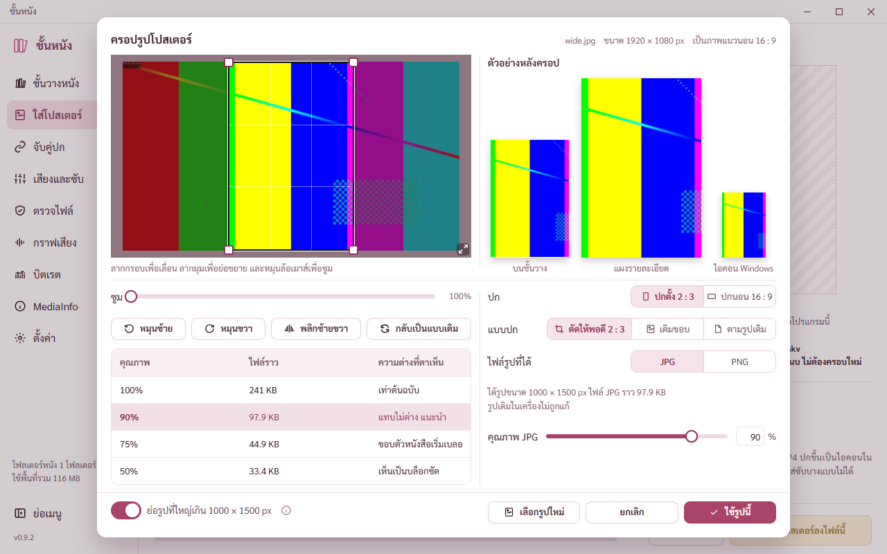
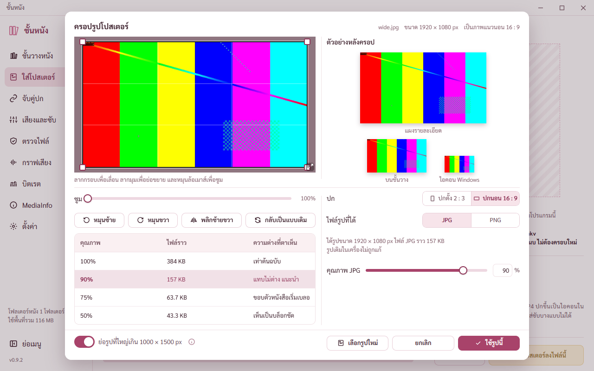

## ข้อ 60 61 62 หน้าเสียงและซับ

พี่กัน *"mkv mp4 ขอปุ่มใหญ่ขึ้นกว่านี้"* · *"เปลี่ยนเป็น ในไฟล์"* · *"เอาคำว่า แปลง อยู่ตรงกับ ขีด"*

- ปุ่ม MKV MP4 ขนาดเดียวกับหน้าใส่โปสเตอร์ (ภาพ 03 ข้างบน)
- ป้าย ในไฟล์ ทั้งสามจุด
- กึ่งกลางหัว แปลง กับขีดแถวภาพ 1064.5 เท่ากัน ต้นเหตุคือแถวหัวไม่มีขอบ แถวแทร็กมีขอบ 1 px แถวหัวเลยได้ขอบใสขนาดเดียวกัน

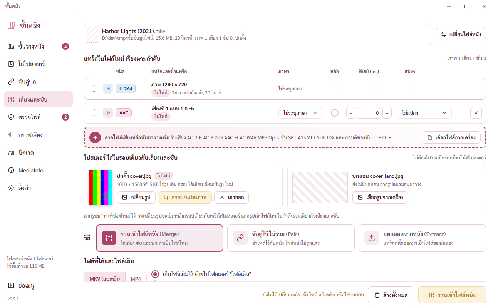

---

## ที่เจอตอนดูภาพรวมแล้วแก้

1. บรรทัด ปกนอน แนบเป็น ในการ์ดรูปหน้าใส่โปสเตอร์ตัวอักษรถ่าง แก้ให้ข้อมูลรูปชิดซ้าย
2. ปุ่มครอปที่กดไม่ได้ของปกเดิมบอกเหตุผลแค่ตอนชี้ ย้ายเหตุผลมาบรรทัดเหนือปุ่ม
3. แผงสรุปของ MediaInfo ไม่ขึ้นปกเพลง ต้นเหตุคือเซิร์ฟเวอร์ทดสอบส่งโค้ดรุ่นกลางทางที่ตัวเฝ้าไฟล์พลาดรอบเขียนล่าสุด โค้ดในไฟล์ถูกอยู่แล้ว บันทึกไฟล์โค้ดที่แก้ทั้ง 21 ไฟล์ซ้ำให้เซิร์ฟเวอร์อ่านใหม่ แล้วถ่ายภาพรวมทั้งชุดใหม่
4. กล่องอธิบายวิธีแยกเขียน H.264 ตายตัว เปลี่ยนให้ตามชนิดภาพของหนังเรื่องนั้น
5. ไฟล์เพลงทดสอบที่ฝังปกหายจากโฟลเดอร์ทดสอบ สร้างใหม่ด้วย ffmpeg (เสียงสังเคราะห์ 10 วินาทีกับรูปทดสอบ cover.jpg)

## การตรวจ

รันรอบสุดท้ายหลังแก้ทุกจุด บนโปรแกรมโหมดพัฒนาที่เปิดอยู่หลังสุด หน้าต่าง 1280 × 800 เช็กก่อนทุกตัวว่าหน้าต่างชั้นหนังไม่ได้อยู่หน้าสุด

| ตัวตรวจ | ผล |
|---|---|
| check-stage5 (MediaInfo ค่า hash แยกแทร็กรวมแยกเป็น .h264) | 24 จาก 24 |
| check-review | 14 จาก 14 |
| check-stage4 (ใส่โปสเตอร์ หน้าต่าง MP4 หกกรอบเท่าเดิม) | 62 จาก 62 |
| check-av (หน้าเสียงและซับ การ์ดวิธี สามปุ่มช่องปก) | 76 จาก 76 |
| check-bugs3 | 5 จาก 5 |
| check-bugs7 | 11 จาก 11 |
| cargo test (ปิดโปรแกรมโหมดพัฒนาก่อน แล้วเปิดกลับ) | 164 จาก 164 รวมเทสใหม่ raw_video_names_and_formats |
| ตรวจชนิดโค้ด tsc | ไม่มีข้อผิดพลาด |

- ภาพรวม 14 ภาพกับภาพ MediaInfo 2 ภาพถ่ายใหม่หลังเซิร์ฟเวอร์อ่านโค้ดล่าสุด ดูทุกภาพแล้ว
- ภาพรายงานเก่าที่ตัวตรวจถ่ายทับ (วันที่ 6 ถึง 11) คืนด้วย git checkout แล้ว
- ยังไม่ได้ตรวจ ข้อความกล่องอธิบายวิธีแยกกับหนัง HEVC (ไม่ได้เปิดหนัง HEVC ในรอบนี้ ตรรกะเลือกคำจากชนิดภาพเดียวกับช่องเลือก .h265) · ตัวติดตั้งกับตัวจริง (ทำตอนปิดชุด)

---

# รอบหลังภาพรวม (12 พ.ย. 2569 ช่วงเย็น)

พี่กันดูภาพรวมแล้วส่งมาเพิ่มทีละเรื่อง แคลร์จดเป็นข้อใน BUGS.md แล้วเรียงคิวตามลำดับที่ส่ง พี่กันสั่ง *"เราเจออะไร เราจะส่งไป เธอก็เรียงตามคิว"* · ข้อ 58 (ต่อ) แคลร์ทำแซงคิว พี่กันทัก *"เธอไปทำอันอื่นก่อนทำไม"* แคลร์ตอบต้นเหตุแล้วเรียงคิวต่อ

| คิว | ข้อ | คำพี่กัน | ผล |
|---|---|---|---|
| 1 | 59 (ต่อ) | *"เราเอาคำเดียว จะเอารูป หรือ ภาพ"* | ใช้คำว่า รูป ปุ่ม ครอป/แปลงรูป หัวหน้าครอป เป็นรูปแนวนอน 16 : 9 (แคลร์เลือก เพราะ ภาพ หมายถึงแทร็กวิดีโอ) |
| 2 | 58 (ต่อ) | *"คำเตือนตกขอบ"* · *"ลดระยะห่าง สักครึ่งนึ"* | ระยะระหว่างแถว 17 → 7 px กล่องเตือนอยู่ที่เดิม ขอบล่าง 705 ห่างแถบปุ่มล่าง 7 px |
| 3 | 35 (ต่อ) | *"เราอยากให้เเถว cover มันเเสดงที่เเทร็กเลย"* | ไฟล์แนบกับบทเป็นแถวในตาราง ติ๊กแยกจากแถวได้ การ์ดไฟล์แนบเดิมเอาออก |
| 4 | 63 | *"ตัวเลือกชนิดไฟล์ มันจะโดนดันลงล่าสุด"* | มอคอัปสามแบบ รอพี่กันเลือก |
| 5 | 35 (ต่อ) | *"จุดนี้ขางมากกกก ขอให้สื่อเเละเด่น"* | ช่องเลือกเต็มสี มีหัว แยกภาพเป็น ปุ่มที่เลือกสีหลัก |
| 6 | 55 (ต่อ) | *"จุดนี้ ใส่ในตั้งค่าด้วย"* | มีอยู่แล้ว ชื่อสองที่ตรงกัน ลองแล้วเปลี่ยนตามกันทั้งสองทาง |
| 7 | 55 (ต่อ) | *"ขอเเถบคุณภาพอยู่ใต้ ไฟล์ที่ได้"* | แถบคุณภาพอยู่ใต้แถว ไฟล์รูปที่ได้ |
| 8 | 64 | *"ขนาดภาพ เเละ codec ขอภาษษอังกิต ที่คำทั่วไป"* | Resolution 1280 × 720, Codec H.264 |
| 9 | 54 (ต่อ) | *"กรอบเลือกไฟล์ ขอเท่ากันกับเมนูอื่น"* | กรอบ 1044 × 219 px เท่าหน้ากราฟเสียง |
| 10 | 55 (ต่อ) | *"code เสียง ขอปุ่ม icon copy"* | ปุ่มคัดลอกข้างรหัสสีที่เลือกเอง |
| 11 | 59 (ต่อ) | *"เอารูปออก เปลี่ยนคำนี้"* | ปุ่ม เอารูปออก ทั้งสองหน้า |
| 12 | 35 (ต่อ) | *"บอกด้วยว่า เป็นปกตั้ง หรือนอน เเต่กดเเล้ว มันจะไปวาบที่ปกตั้ง"* | แถวขึ้น ปกตั้ง cover.jpg กดแล้วเลื่อนไปวาบที่ช่องปกตั้ง |
| 13 | 65 | *"ย้ายที่ลากไฟล์ ไปอยู่ด้านบนที"* | ช่องลากไฟล์อยู่ใต้แถบชื่อหนัง |
| 14 | 66 | *"ใส่ ปุ่มรายละเอียดหน่อย เพราะคนน่าจะสับสนกับปุ่มเลือก"* | ปุ่ม ⓘ ข้างคำว่า หลัก |

ภาพอยู่ `docs/report-2026-11-12/ชุด9/หลังภาพรวม/`

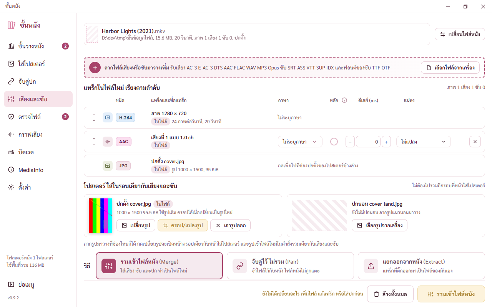
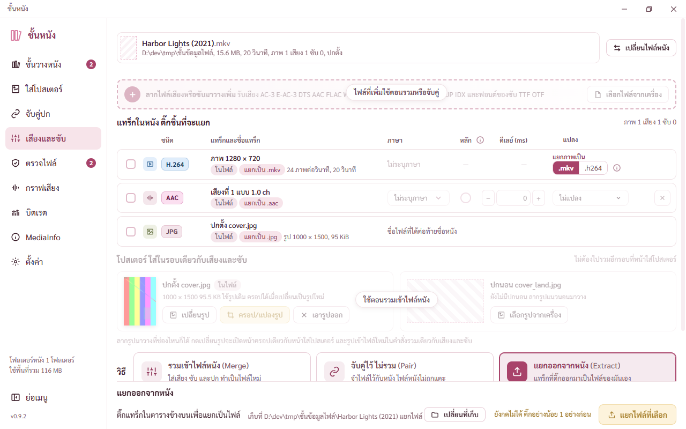
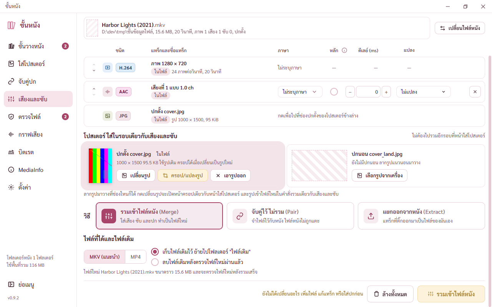
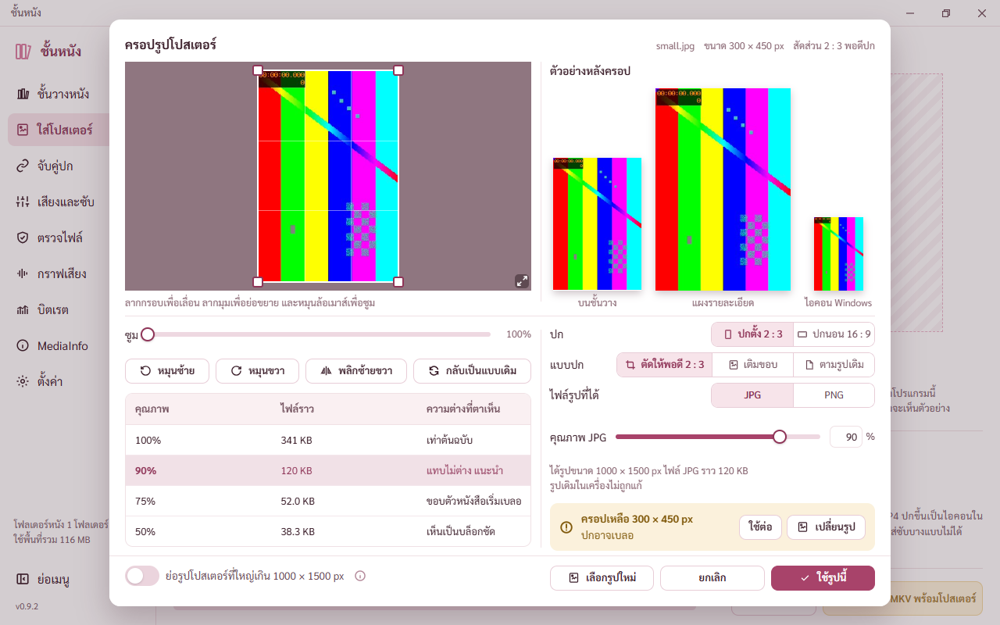
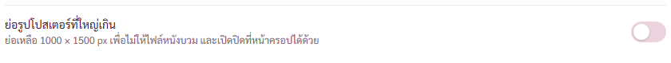
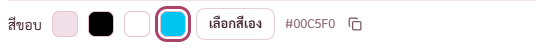
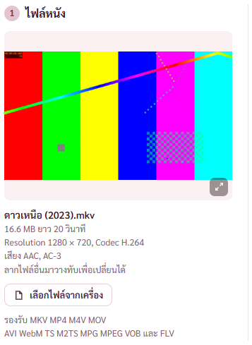
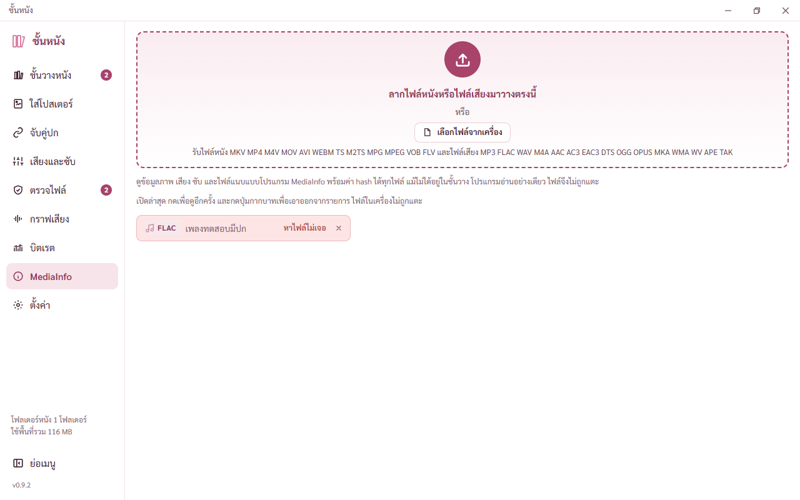
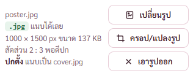

ที่เจอระหว่างทำแล้วแก้
- หัว แยกภาพเป็น ทำแถวภาพสูงขึ้น 9 px สลับวิธีแล้วหน้าขยับ ลดความสูงช่องเลือกจนแถวสูงเท่าเดิม
- เพลงทดสอบที่มีปกหายเพราะ check-stage5 ลบโฟลเดอร์ `D:\dev\tmp\ชั้นข้อมูลไฟล์` ทั้งโฟลเดอร์ทุกครั้ง แคลร์เคยตอบพี่กันว่า หาไฟล์ไม่เจอ เกิดเฉพาะในมอคอัป ซึ่งผิด แก้คำตอบแล้ว ย้ายเพลงทดสอบไป `D:\dev\tmp\ชั้นเพลงทดสอบ`
- แถวจำลองในมอคอัปข้อ 63 คัดลอกวงกลมแทร็กหลักติดมา แก้แล้ว

ผลตัวตรวจรอบนี้ (รันท้ายคิว บนโปรแกรมโหมดพัฒนาที่เปิดอยู่หลังสุด 1280 × 800)

| ตัวตรวจ | ผล |
|---|---|
| check-stage5 | 24 จาก 24 |
| check-review | 14 จาก 14 (รอบแรก 13 จาก 14 ดูข้างล่าง) |
| check-stage4 | 62 จาก 62 (รอบแรก 61 จาก 62 ดูข้างล่าง) |
| check-av | 76 จาก 76 |
| check-bugs3 | 5 จาก 5 |
| check-bugs7 | 11 จาก 11 |
| check-stage7 (สวิตช์ในหน้าตั้งค่า) | 13 จาก 13 |
| cargo test (หลังแก้ aspect_label) | 164 จาก 164 |
| ตรวจชนิดโค้ด tsc | ไม่มีข้อผิดพลาด |

- รอบแรก check-review กับ check-stage4 ล้มอย่างละหนึ่งข้อ ต้นเหตุคือสวิตช์ย่อรูปของโปรแกรมทดสอบปิดอยู่ตอนรัน (ค่าตั้งต้นคือเปิด) รูป wide.jpg จึงได้ขนาดเต็ม 1920 × 2880 แทน 1000 × 1500 ที่ตัวตรวจคาด และรูป PNG ใหญ่ขึ้นจนคิดขนาดไม่ทันเวลาที่ตัวตรวจรอ · check-stage7 คืนค่าตั้งต้นตอนจบ รันซ้ำสองตัวแล้วผ่านครบ · หาไม่เจอว่าขั้นไหนปิดสวิตช์ไว้ก่อนหน้า สวิตช์ปิดอยู่ตั้งแต่ภาพแรกหลังฝั่ง Rust สร้างใหม่ ตอนลองสวิตช์ (ข้อ 55 ต่อ) แคลร์คืนเป็นค่าที่เจอตอนเริ่ม คือปิด
- ภาพรายงานเก่าที่ตัวตรวจถ่ายทับ คืนด้วย git checkout แล้ว

---

# รอบสุดท้ายกับเทสชุดใหญ่ (12 พ.ย. 2569 ช่วงพี่กันลงเวร)

พี่กันสั่งต่อจากรอบหลังภาพรวม แล้วลงเวรพร้อมสั่ง *"เเละทำเสร็จ เทสครั้งใหญ่ เเล้ว commit เลย"* · ทั้งหมดทำเบื้องหลัง โปรแกรมเปิดอยู่หลังสุด ถ่ายและกดผ่าน CDP ไม่เปิดโครม ไม่มีหน้าต่างเด้ง

| ข้อ | คำพี่กัน | ผล |
|---|---|---|
| 64 (ต่อ) | *"เอา res ออก ใส่ px"* | บรรทัดเป็น 1280 × 720 px, Codec H.264 |
| 63 | *"มอคอัป เอาข้อสอง"* | การ์ดไฟล์ที่ได้เอาออก MKV MP4 กับเก็บหรือลบไฟล์เดิมอยู่แถบล่างที่ตรึงไว้ ปุ่ม ⓘ บอกความต่าง ข้างปุ่มรวมบอกขนาดไฟล์ใหม่ที่คาด |
| 65 (ต่อ) | *"เราให้เอาเเถบลากไฟล์เอามาอยู่ตรงขื่อนี้ เอาไง้ฝั่งขวา"* · *"ก็บอกว่าให้ขยาย"* | ช่องลากไฟล์อยู่ในแถบชื่อหนังฝั่งขวา กว้างราวครึ่งแถว สูงเท่าแถบ ข้อความบรรทัดเดียว ปุ่ม ⓘ ไม่ทับข้อความ |
| 67 | *"อันนี้ปิดเอาไว้ ต้องกดที่ข้อรูปก่อน หรือลากรูปไปใส่"* | การ์ดโปสเตอร์ไม่ขึ้นจนกว่าจะกดแถวรูปปกหรือลากรูปมาใส่ |
| 67 (ต่อ) | *"หกภาพ ควรขึ้นภา เสียงขึ้มาด้วยทำไม"* · *"เอาปุ่มย่อขยายปกออก"* | ขึ้นทีละส่วนกับตั้งค่าแทร็ก หัวการ์ดเป็นข้อความธรรมดา ไม่มีปุ่มลูกศร |
| 68 | *"ตรึงไว้ล่างสุด"* | แถววิธีกับแถบปุ่มอยู่กรอบเดียวที่ตรึงล่างสุด ชิดขอบล่างจอแม้แทร็กน้อย |
| 54 (ต่อ) | *"มันไม่เท่ากันนนนน แบบ media หาปุ่มอะไรใส่ไว้ข้างวันหน่อย ให้มันเท่ากัน"* | หน้า MediaInfo มีแถบด้านบน ปุ่ม เลือกจากชั้นวาง กับคำอธิบายหน้า กรอบเลือกไฟล์ระดับเดียวกับหน้าอื่น |

ภาพทั้งหมดที่หน้าต่าง 1280 × 800 ใช้ไฟล์ทดสอบ อยู่ `docs/report-2026-11-12/ชุด9/ลงเวร/`

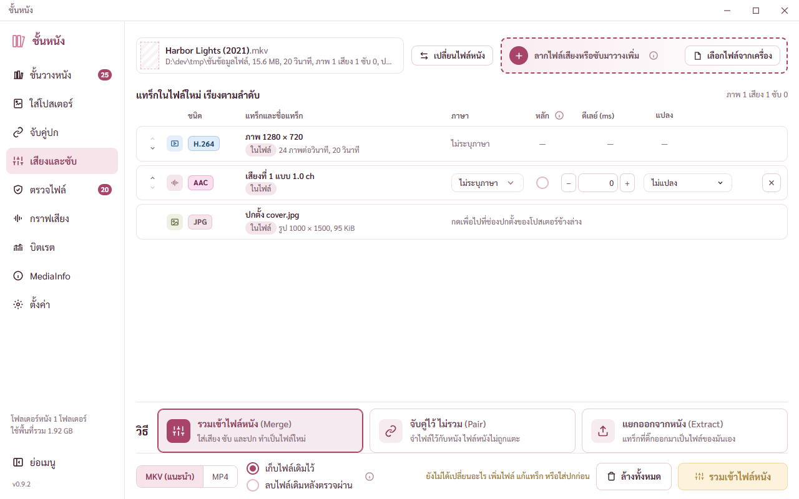
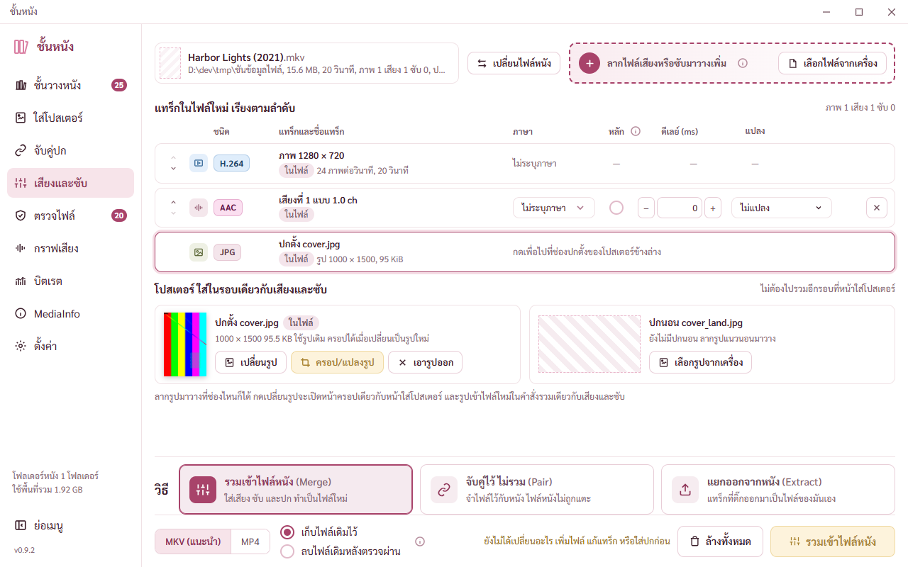
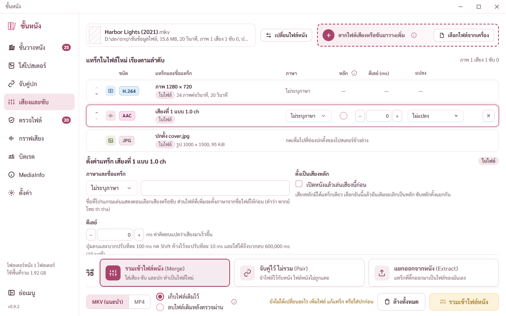
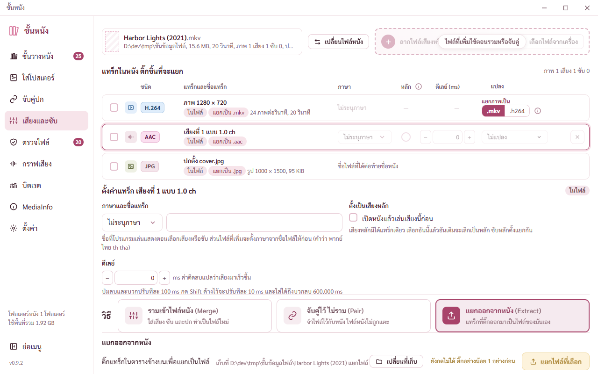
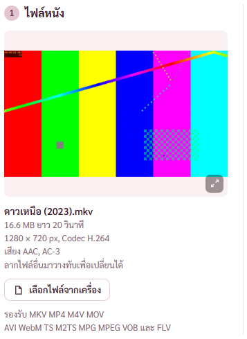
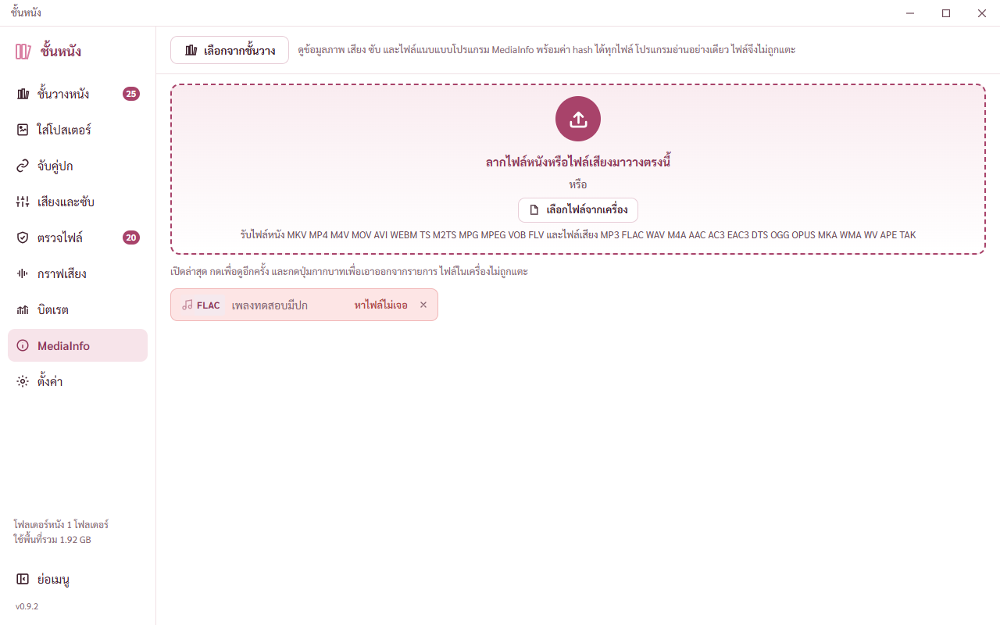

ที่เจอระหว่างทำแล้วแก้
- ปุ่ม ⓘ ทับข้อความในช่องลากไฟล์ เพราะกฎเดิมให้ข้อความหดได้ แก้ให้ข้อความไม่หด
- แถววิธีกับแถบปุ่มลอยกลางหน้าเมื่อแทร็กน้อย มีที่ว่างข้างใต้ แก้ให้หน้าสูงอย่างน้อยเต็มจอ กรอบตรึงชิดล่าง
- การ์ดโปสเตอร์ยังขึ้นในหน้าต่างที่เปิดหนังเรื่องเดิมค้างไว้ แก้ให้จำว่าเปิดไว้ของหนังเรื่องไหน

## เทสชุดใหญ่ 41 ตัวตรวจ

รันทีละตัวบนโปรแกรมโหมดพัฒนาที่อยู่หลังสุด หน้าต่างจำลอง 1280 × 800 เช็กก่อนทุกตัวว่าหน้าต่างชั้นหนังไม่ได้อยู่หน้าสุดของจอ

| ตัวตรวจ | ผล | ตัวตรวจ | ผล |
|---|---|---|---|
| check-stage1 | 53 จาก 53 | check-frames | 12 จาก 12 |
| check-stage2 | 39 จาก 39 | check-recent | 16 จาก 16 |
| check-stage3 | 17 จาก 17 | check-drop | 13 จาก 13 |
| check-stage4 | 62 จาก 62 | check-result | 21 จาก 21 |
| check-stage5 | 24 จาก 24 | check-spek | 29 จาก 29 |
| check-stage6 | 21 จาก 21 | check-stars | 15 จาก 15 |
| check-stage7 | 13 จาก 13 | check-nav | 7 จาก 7 |
| check-merge | 20 จาก 20 | check-bname | 19 จาก 19 |
| check-review | 14 จาก 14 | check-table | 30 จาก 30 |
| check-wide | 16 จาก 16 | check-players | 17 จาก 17 |
| check-graph | 63 จาก 63 | check-statgo | 4 จาก 4 |
| check-convert | 41 จาก 41 | check-panel | 3 จาก 3 |
| check-latest | 11 จาก 11 | check-panel-states | 3 จาก 3 |
| check-fonts | 16 จาก 16 | check-bugs2 ถึง check-bugs8 | ผ่านครบทุกตัว 7 5 11 10 12 11 6 ข้อ |
| check-link | 154 จาก 154 | check-bitrate-new | 31 จาก 31 |
| check-theme | 13 จาก 13 | check-bitrate | 35 จาก 35 |
| check-av | รอบแรก 75 จาก 76 รันซ้ำ 76 จาก 76 | check-look | รอบแรกไม่ผ่าน 1 รันซ้ำผ่าน 62 ไม่ผ่าน 0 |
| check-bugs1 | รอบแรกล้ม รันซ้ำ 17 จาก 17 | cargo test กับ tsc | 164 จาก 164 และไม่มีข้อผิดพลาด |

- สามตัวที่ไม่ผ่านรอบแรกเป็นตัวตรวจที่ยังคิดตามหน้าแบบเดิม ไม่ใช่บั๊กของโปรแกรม
  check-av อ่านจำนวนไฟล์ที่จับคู่จากแถววิธี ซึ่งย้ายไปการ์ดหมายเหตุแล้ว
  check-look ข้อแถบชื่อไฟล์ตรึงบนได้ 50 กล่อง 34 วัดซ้ำแล้วหน้าสูง 766 เท่ากรอบ 766 เลื่อนไม่ได้เลย แถบอยู่ที่ปกติ ตัวตรวจใหม่ใส่ที่ว่างชั่วคราวให้หน้าเลื่อนได้ แล้ววัดว่าแถบตรึงจริง ได้ 34 กล่อง 34 หลังเลื่อน 799 px
  check-bugs1 หาช่องปกนอนไม่เจอ เพราะการ์ดซ่อนตามข้อ 67 และไฟล์ทดสอบไม่มีแถวรูปปก ตัวตรวจใหม่ลากรูปลงที่ว่างให้การ์ดขึ้นก่อนตามทางที่พี่กันกำหนด
- ภาพรายงานเก่าที่ตัวตรวจถ่ายทับ คืนเป็นของเดิมแล้ว · ภาพที่ติดรายชื่อเพลงจริงหรือหน้าต่างตามที่เปิดค้าง 8 ภาพ ย้ายออกนอกโปรเจกต์ ไม่ขึ้น git
- ยังไม่ได้ตรวจ ตัวจริงใต้ CSP กับตัวติดตั้ง (ต้องสร้างโปรแกรมตัวจริง เครื่องหนัก) · check-window (กดย่อขยายหน้าต่างจริง หน้าต่างเด้งใส่คนที่ใช้คอม)

## ต่อไป

- งานค้าง ข้อ 34 แปลงเสียงในส่วนตั้งค่าแทร็ก ทำต่อจากข้อ 33 · ตัวจริงกับตัวติดตั้งยังไม่ได้เทสรอบนี้
- รอพี่กันเคาะ ข้อ 33 เลือกแบบในมอคอัป `http://127.0.0.1:1420/docs/mockups/batch9-pick.html` · แบบ 1 หน้าต่างซ้อนกลางจอ แบบ 2 กางใต้แถวที่กด แบบ 3 แผงขวา · ข้อ 63 พี่กันเลือกแบบ 2 ลงโปรแกรมแล้ว
- พี่กันต้องลองเอง ลากไฟล์จาก Explorer จริงลงหน้า MediaInfo กับช่องปกนอน ปุ่มเลือกไฟล์ และหน้าต่างเลือกที่บันทึก .sha256 (ตัวตรวจกดแทนไม่ได้ หน้าต่างจะเด้ง)
- หลังปิดชุด 9 วางแผนระบบ MediaInfo เต็มตามโรดแมป
