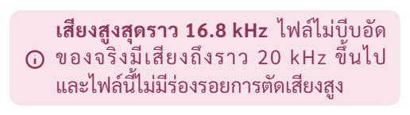
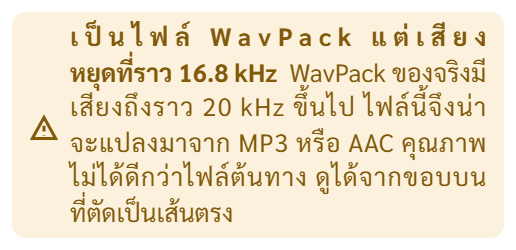
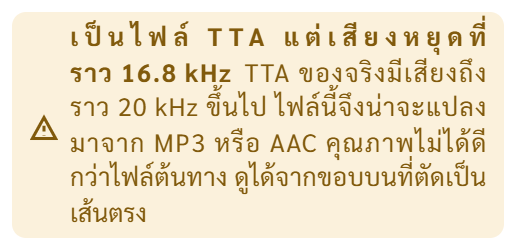
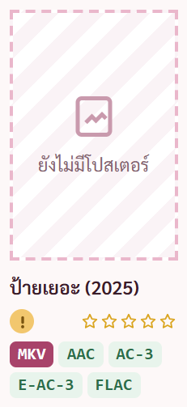
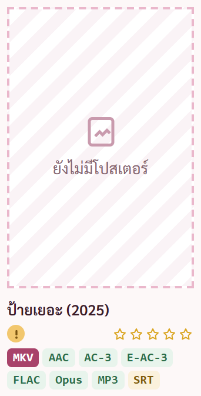
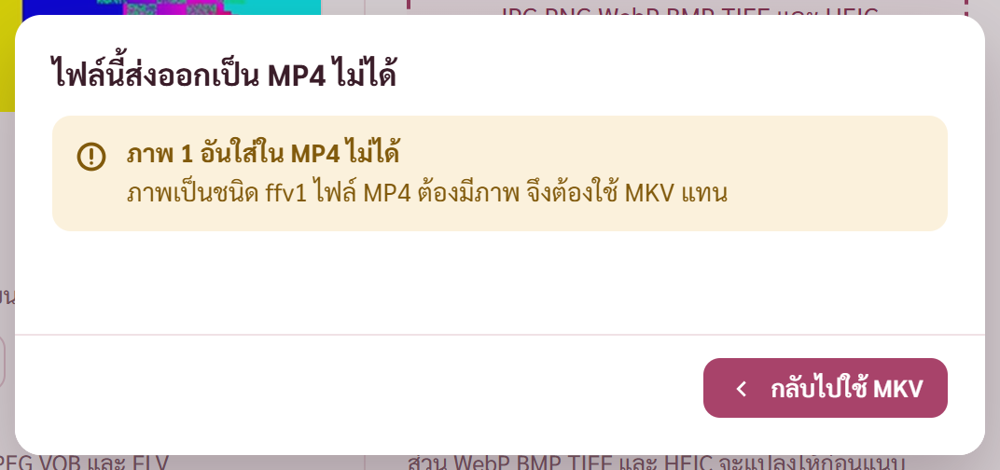
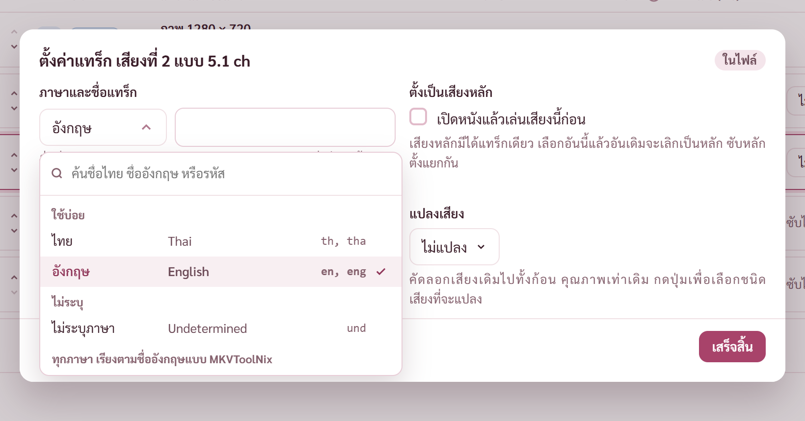

# รายงาน 13 พ.ย. 2569 · แก้ AUDIT ข้อ 2 · 3 · 4 · 7 · 18

พี่กันสั่ง 12 พ.ย. 2569 *"ข้อแดงอีก 2 ข้อ แก้ต่อเลย กับอีก 3 ข้อที่เธอเสนอ ข้อ 4 7 18"* · คอมดับกลางงาน ทำต่อวันนี้ตามที่พี่กันสั่ง *"เริ่มวันใหม่ เธอทำสิ่ที่สั่งเมื่อคืนต่อหน่อย"*
ทำบนรุ่น 0.9.2 ต่อจากงานข้อ 1 กับบันทึกการใช้งาน · ยังไม่ commit ยังไม่ขยับรุ่น · โปรแกรมทดสอบเปิดอยู่หลังสุด ถ่ายภาพผ่านพอร์ตดีบัก หน้าต่าง 1280 × 800

หลังคอมดับ เช็กไฟล์ที่ค้างแก้ 11 ไฟล์ครบ ไม่มีไฟล์เสีย · cargo test ผ่าน 172 จาก 172 เท่าก่อนดับ

## ข้อ 2 · หน้าความถี่บอกไฟล์ไม่บีบอัดที่แปลงมาจาก MP3 ว่าไม่มีร่องรอย

**อาการเดิม** ตัวตัดสินรู้จักไฟล์ไม่บีบอัดแค่บางชื่อ ไฟล์ WavPack TrueHD ที่แปลงจาก MP3 ขึ้นว่า "ไม่มีร่องรอยการตัดเสียงสูง" ทั้งที่เสียงหยุดที่ 16.8 kHz ส่วน TTA ไม่ถูกตรวจเลย

**แก้** `GraphPage.tsx` ไฟล์ไม่บีบอัดครบทุกชนิด (FLAC PCM ALAC TrueHD MLP DTS-HD MA WavPack APE TAK TTA) ใช้เกณฑ์ 19.5 kHz เท่ากัน · ชื่อบนจอเป็น WavPack กับ Monkey's Audio · ขอบตัดตรงแต่สูงกว่าเกณฑ์ ไม่บอกว่าไม่มีร่องรอยแล้ว

ภาพสองภาพบนขึ้นเตือนถูกแล้ว แต่หัวข้อตัวหนาบรรทัดแรกถ่าง และตัดบรรทัดกลางวลี ข้อความเตือนนี้ใช้รูปประโยคเดิมของไฟล์ FLAC ที่พี่กันผ่านแล้ว ไฟล์ FLAC ปลอมก็ถ่างแบบเดียวกันมาก่อน (ภาพ check-graph 19-FLAC-ปลอม) · แคลร์ลองผูกคำแล้วบรรทัดอื่นถ่างกว่าเดิม ลองเกลาคำหกแบบแล้ว ชื่อชนิดไฟล์ยาวไม่เท่ากัน จุดตัดเลื่อนทุกแบบ · จดเป็น BUGS ข้อ 70 ให้พี่กันเลือกทางแก้

ข้อความใหม่ของกรณีขอบตัดตรงแต่อยู่สูง แคลร์วัดแล้วตัดตรงความหมายทั้งสามบรรทัด

**ตรวจ** ไฟล์ทดสอบสร้างด้วย ffmpeg · โค้ดก่อนแก้ ไฟล์ปลอม WavPack TTA TrueHD ไม่ขึ้นเตือนทั้งสามไฟล์ หลังแก้ขึ้นครบ WavPack ของจริงไม่ขึ้นเตือน · check-graph เพิ่ม 3 ข้อ ผ่าน 66 จาก 66 รวมข้อที่ใช้สำเนาเพลงจริงของพี่กัน · APE กับ TAK ยังไม่ได้ลองกับไฟล์จริง ffmpeg สร้างไม่ได้ ใช้ทางเดียวกับ TTA

## ข้อ 3 · ตรวจแบบเร็วทับผลเสียหายของตรวจละเอียด

**อาการเดิม** ตรวจละเอียดเจอภาพแตก ขึ้นป้ายแดง แล้วตรวจแบบเร็วรอบถัดไป (รวมตรวจตอนเปิดโปรแกรม) ทับเป็นสมบูรณ์สีเขียว ประวัติช่วงที่เสียหาย

**แก้** `check.rs` ผลตรวจทุกครั้งจดขนาดไฟล์กับเวลาแก้ไฟล์ · ตรวจละเอียดเคยเจอที่เสีย และไฟล์ยังเป็นไฟล์เดิม ตรวจแบบเร็วคงผลเสียหาย ข้อความ และช่วงที่เสียไว้ · ผลเปลี่ยนเมื่อไฟล์ถูกแทน หรือตรวจละเอียดผ่าน · `fileinfo.rs` ปุ่มคิดค่า hash ในหน้า MediaInfo ไม่จดค่าอ้างอิงให้เรื่องที่ขึ้นเสียหาย

**ตรวจ** cargo test เพิ่มเทส 1 ชุด · ในโปรแกรมจริงกับชุดทดสอบ เรื่อง เสียกลางเรื่อง ตรวจละเอียดขึ้นเสียหาย ภาพแตกนาที 0:30 แล้วตรวจแบบเร็วซ้ำ ยังเสียหาย ช่วงที่เสียเท่าเดิม

## ข้อ 4 · ป้าย +จำนวน ใต้ปกไม่เคยขึ้น

**อาการเดิม** ป้ายเสียงกับซับล้นสองบรรทัด โปรแกรมซ่อนป้ายท้าย ๆ แต่ป้าย +จำนวน ที่บอกว่ายังมีอีกถูกโค้ดซ่อนตัวเองก่อน

**แก้** `ShelfPage.tsx` เลือกเฉพาะป้ายจริง ไม่เอาป้าย +จำนวน เข้ารายการที่ไล่ซ่อน

**ตรวจ** ตัวตรวจใหม่ `scripts/check-btmore.mjs` สร้างไฟล์ MKV เสียง 6 ชนิด ซับ 3 แบบ ในโฟลเดอร์ชั่วคราว ชี้ชั้นวางไปชั่วคราวแล้วคืน · ปกเล็กขึ้น +5 ปกกลางขึ้น +2 เท่าป้ายที่ซ่อน ผ่าน 2 จาก 2 · ถอยโค้ดกลับชั่วคราว ผ่าน 0 จาก 2 ตัวตรวจจับบั๊กนี้ได้จริง

## ข้อ 7 · เลือก MP4 แล้วได้ไฟล์ไม่มีภาพแต่ขึ้นตรวจผ่าน

**อาการเดิม** หนังที่ภาพใส่ MP4 ไม่ได้ หน้าต่างเตือนมีปุ่มทิ้งแทร็กที่ทิ้งแทร็กภาพไปด้วย ได้ MP4 ที่มีแต่เสียง การ์ดเขียวบอกตรวจผ่าน

**แก้** สองชั้น · หน้าต่างเตือนเหลือปุ่มกลับไปใช้ MKV อย่างเดียวเมื่อภาพใส่ไม่ได้ ปุ่มทิ้งแทร็กไม่ทิ้งแทร็กภาพ · ฝั่ง Rust ปฏิเสธงานถ้าทิ้งแทร็กแล้วไม่เหลือภาพ

รอบแรกหัวหน้าต่างกับหัวการ์ดซ้ำกันว่า "ส่งออกเป็น MP4 ไม่ได้" แคลร์เห็นจากภาพเอง แก้หัวการ์ดเป็น "ภาพ 1 อันใส่ใน MP4 ไม่ได้" แบบเดียวกับการ์ดเสียงและซับ

**ตรวจ** cargo test เพิ่มเทส 1 ชุด · ไฟล์ทดสอบภาพ FFV1 ในโปรแกรมจริง หน้าต่างเตือนไม่มีปุ่มทิ้งแทร็ก · check-stage4 ผ่าน 62 จาก 62 หน้าต่างเตือนซับ ASS ยังมีปุ่มทำต่อด้วย MP4 ตามเดิม

## ข้อ 18 · รายการภาษาในแผงขวาโดนตัดส่วนล่าง

**อาการเดิม** ตัววัดที่ว่างกลางวัดถึงขอบหน้าต่างโปรแกรมอย่างเดียว รายการภาษาในแผงขวากางลงเลยขอบแผง ส่วนล่างราว 200 px โดนตัด ดรอปดาวน์ในหน้าต่างซ้อนโดนตัดแบบเดียวกัน

**แก้** `popupFit.ts` ตัววัดหาขอบของกล่องที่ตัดของล้นที่ครอบอยู่ (แผงขวา หน้าต่างซ้อน กล่องเลื่อน) แล้วใช้ขอบที่แคบกว่า · ของที่ลอยบนสุดของหน้ายังวัดถึงขอบหน้าต่างเหมือนเดิม · ใช้กับทุกรายการที่กางออกผ่านตัววัดนี้ทั้งโปรแกรม

แบบหน้าต่างซ้อน หน้าต่างเตี้ย รายการเลยสั้นลงเหลือ 183 px เลื่อนในรายการหรือพิมพ์ค้นได้ ตามสกิล popup-fit ข้อ ④ (ไม่ต่ำกว่า 160)

**ตรวจ** วัดในโปรแกรมจริง แผงขวา รายการ 252 ถึง 581 อยู่ในกรอบ 129 ถึง 587 · หน้าต่างซ้อน 345 ถึง 574 อยู่ในกรอบ 220 ถึง 580 · check-av ผ่าน 76 จาก 76

## เจอระหว่างทาง จดลง BUGS.md แล้ว ยังไม่แก้
- **ข้อ 69** หน้ากราฟเสียงล้มทั้งหน้าเมื่อลากไฟล์ TrueHD แบบไฟล์เดี่ยว (.thd) มาวาง ไฟล์ที่ลากมาทีหลังก็เปิดไม่ได้จนกว่าจะกดเปิดหน้ากราฟใหม่ · ไฟล์เดียวกันห่อเป็น .mka เปิดได้
- **ข้อ 70** กล่องผลหน้าความถี่แคบ หัวข้อถ่างและตัดบรรทัดกลางวลี เป็นมาก่อนแล้วกับไฟล์ FLAC · รอพี่กันเลือก ① คงกระจายแบบไทย แคลร์เกลาข้อความ ② กล่องนี้จัดชิดซ้าย ③ ขยายกล่อง

## ยังไม่ได้ทำ
- ยังไม่ commit ทั้งชุด (ข้อ 1 บันทึกการใช้งาน และห้าข้อนี้)
- ยังไม่ได้รันชุดใหญ่ check-look กับตัวจริงใต้ CSP · ตัววัดที่ว่างกลางเปลี่ยน กระทบรายการที่กางทุกหน้า รันแล้วเฉพาะหน้าเสียงและซับกับหน้าใส่โปสเตอร์ · ควรรันชุดใหญ่ก่อน commit
