# รายงาน 13 พ.ย. 2569 · BUGS ชุด 11 หน้าตั้งค่า กับ AUDIT 8 ข้อ

พี่กันสั่ง *"เอาทั้ง 8 ข้อ"* หลังแคลร์เล่าว่าชุด 11 มีข้อ 7 ข้อเดียวและเสนอ AUDIT ของหน้าตั้งค่ามาทำพร้อมกัน · ระหว่างทำพี่กันแทรกเพิ่มข้อ 88 ถึง 108 · พี่กันสั่ง *"งานทั้งหมด ถ้าเสร็จ ยังไม่ comiit นะ เดี๋ยวเราสั่งเอง"* จึง**ยังไม่ commit**

ภาพทั้งหมดอยู่ `docs/report-2026-11-13/ชุด11/` · ถ่ายในหน้าต่างทดสอบ 1280 × 800 ผ่านพอร์ตดีบัก

## ผลตรวจ

| ตัวตรวจ | ผล |
|---|---|
| cargo test ทั้งหมด | 182 จาก 182 (เพิ่มใหม่ 8 ข้อ ค่าตั้งอ่านทีละช่อง ไฟล์ครึ่งไฟล์ยังใช้ไฟล์สำรอง คืนโฟลเดอร์จากคลัง ตัวกรองค่ารูปกราฟ จำหน้าต่าง ความจุไดรฟ์ ไดรฟ์เต็ม เลขรุ่น .0 กับที่อยู่ซ้ำ) |
| check-settings ใหม่ | 32 จาก 32 (เพิ่มแถบล่างสูงเท่ากันทุกวิธี กับที่ว่างไม่พอในการ์ดแยกไฟล์) · รอบก่อน 29 จาก 29 รวมปุ่มเปิดไดรฟ์ ป้ายแถบล่าง เปอร์เซ็นต์ และฝั่ง Rust ไม่เปิดไดรฟ์นอกรายการ · รันตอนหน้าต่างทดสอบอยู่หน้าสุดตามที่พี่กันสั่ง *"รันตรวจไปเลย"* |
| cargo test รอบที่สอง (หลังเพิ่ม Chapter) | 187 จาก 187 รวมเทสรวมไฟล์จริงที่แก้ Chapter ทั้ง MKV และ MP4 |
| check-subchap ใหม่ (ข้อ 98 ถึง 109) | 27 จาก 27 |
| check-sizes ทุกหน้าที่ 1280 1600 1920 2560 | 48 จาก 48 |
| check-bitrate-new | 37 จาก 37 |
| check-nav (เมนูมีซับไตเติลเพิ่ม) | 7 จาก 7 |
| check-settings รอบหลัง | 32 จาก 32 |
| tsc | ผ่าน |

## BUGS

### ข้อ 7 ปุ่มกลับค่าตั้งต้น (หัวข้อรูปกราฟ)
พี่กันสั่ง *"ตอนกดกลับค่าเดิม มันจะมี animation บอก เเล้วมีเครื่องหมายติ๊กถูก ว่าเสร็จเเล้ว ส่วนถ้าปรับเเล้ว มันจะกดไม่ได้ จางไว้เลย"*
- มีค่าที่ปรับไว้ กดได้ · กดแล้วติ๊กถูกเด้งขึ้น ขึ้นว่ากลับค่าแล้วพื้นเขียว · แล้วจางเป็น "เป็นค่าตั้งต้นแล้ว" กดไม่ได้ ข้อความบนปุ่มคือเหตุผล · กว้าง 165 จุดเท่ากันทุกสถานะ
- ทั้งโปรแกรมมีปุ่มกลับค่าตั้งต้นปุ่มเดียว

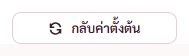 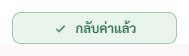 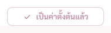

### ข้อ 88 ความจุไดรฟ์ (พี่กันแทรก)
พี่กันสั่ง *"อันนี้สำคัญเลย ต้องบอกด้วยว่าตอนนี้ไดรฟ์เต็ม เราขอเพิ่มที่หน้าตั้งค่า หัวข้อโฟลเด้อหนัง เเสดงความจุของไดรฟ์ที่โฟลเดอร์หนังใช้อยู่ด้วย เเละถ้าเนื้อที่เหลือ 10% ไปเตือนที่หน้าชั้นวาง หาที่ใส่ให้ที"* แล้วสั่งต่อ *"ถ้าเก็บไว้ในโปรแกรม เเล้วเนื้อที่ต่ำกว่า10% ต้องเตือนตรงนี้ด้วย"* · *"ให้กดเเล้วเปิดโฟลเด้อไดรฟ์ C เลย"* · *"เพิ่มปุ่มที่สาม"* · เสนอ *"เตือนจางๆข้างล่างดีมั้ย"* · *"เเล้วเหลือกี่% บอกด้วย"*
- ① บันทึกค่าตั้งไม่สำเร็จเพราะไดรฟ์เต็ม แถบแดงแถบเดียวบอกว่าไดรฟ์ไหนเต็ม ค่าเดิมยังอยู่ ให้ลบหรือย้ายไฟล์ก่อน · "ไดรฟ์ C ก่อน" ไม่ตัดบรรทัดกลางวลีแล้ว (พี่กันทัก *"ไดรฟ์ C เเล้วเเบ่งบรรทัด ก่อน"*)
- ② หัวข้อโฟลเดอร์หนังมีความจุไดรฟ์ทุกไดรฟ์ที่โฟลเดอร์หนังอยู่ กับไดรฟ์ที่โปรแกรมเก็บค่าตั้ง คลังหนัง และภาพปก · แถบใช้ไป · บอกเปอร์เซ็นต์ที่เหลือ · มี ⓘ
- ปุ่มในการ์ดแจ้งทุกใบ ไอคอนต่ำกว่าตัวหนังสือ 1.3 จุด (พี่กันทัก *"icon กับตัวอักษร ไม่เรียงกัน"*) ต้นเหตุกฎ `.stat svg` ดันไอคอนของการ์ดลง 3 จุดแล้วโดนไอคอนในปุ่มด้วย แก้ที่กฎกลาง ตอนนี้ต่างกันไม่ถึง 1 จุด โดนทุกปุ่มในการ์ดแจ้ง เช่นปุ่มทำต่อของจับคู่ปก
- คำอธิบายความจุไดรฟ์เป็นตัวเล็กใต้หัวข้อแบบแถวอื่น ไม่ซ่อนใน ⓘ (พี่กันทัก *"ปกติ หน้าตั้งค่า พวกคำอธิบาย มันอยู่ใต้หัวข้อนี่นา"*) สองประโยคอยู่บรรทัดเดียว 613 จาก 828 จุด
- ③ ชั้นวางเตือนที่เดียวกับการ์ดทำต่อ สามปุ่ม ดูความจุไดรฟ์ เปิดไดรฟ์ C ไว้ทีหลัง · ฝั่ง Rust เปิดได้เฉพาะรากไดรฟ์ในรายการความจุ · กดไว้ทีหลังแล้วแถบล่างขึ้นป้ายจาง ๆ "ไดรฟ์ C เหลือ 1.2%" กดแล้วการ์ดกลับมา แถบล่างไม่สูงขึ้น
- ④ ติ๊กเก็บสำเนาไว้ในโปรแกรม แล้วไดรฟ์ของโปรแกรมเหลือไม่ถึง 10% เตือนในการ์ดนั้น
- 🔴 **เจอของจริงบนเครื่องพี่กัน ไดรฟ์ C เหลือราว 2.1 GB จาก 169 GB (1.2%)**

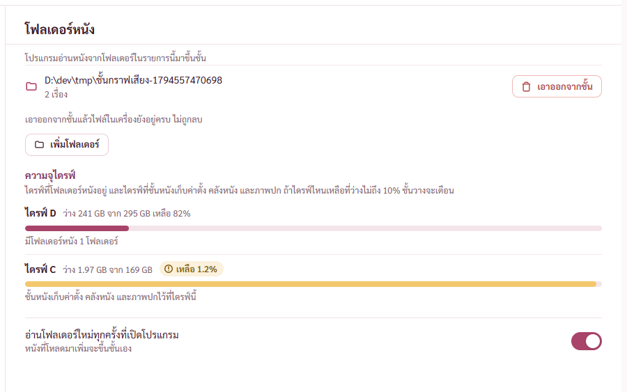
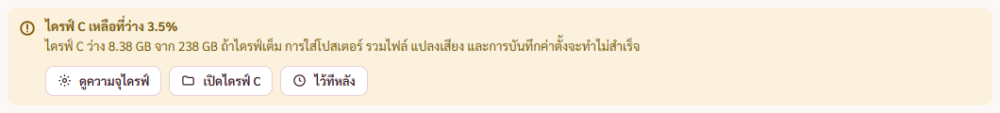
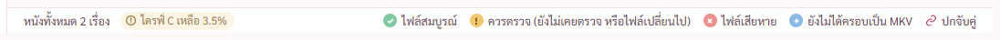
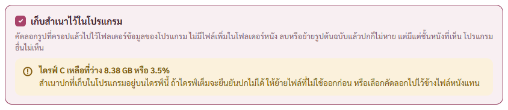
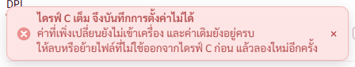

### ข้อ 89 จำหน้าต่างขยายเต็มจอ (พี่กันแทรก)
- กดปิดตอนขยายเต็มจอ โปรแกรมจำในไฟล์ตั้งค่า เปิดครั้งหน้าขยายก่อนแสดงหน้าต่าง · ปิดจากแถบงานตอนย่ออยู่คงค่าเดิม · ตัวทดสอบที่เปิดอยู่หลังสุดไม่ขยาย

### ข้อ 90 รูปตัวอย่างหน้าต่างซ้อนไม่อยู่กลาง (พี่กันแทรก)
- ต้นเหตุ หน้าต่างซ้อนอยู่กลางหน้าต่างทั้งบาน แต่รูปเดิมครอปตัดเมนูซ้าย หน้าต่างจึงอยู่ 41% ของรูป · ถ่ายใหม่โดยพับเมนูซ้ายแล้วครอปให้กลางรูปตรงหน้าต่าง ตอนนี้อยู่ 50% · ถ่ายรูปอีกสองแบบใหม่ด้วยให้เห็นปุ่มวงกลมของข้อ 91

### ข้อ 91 ปุ่มเสียงหลักวงกลม กับ ⓘ (พี่กันแทรก)
พี่กันสั่ง *"เอาปุ่มให้เหมือนกัน ถ้าจะวงกลม ก็วงกลม"* · *"ไม่ก็ใส่เครื่องหมายอธิบาย"*
- ส่วนตั้งค่าแทร็กใช้ปุ่มวงกลมแบบคอลัมน์หลัก · ⓘ บอกความหมายพร้อมตัวอย่างเสียงไทย และข้อยกเว้นโปรแกรมเล่นที่ตั้งให้เลือกตามภาษา ใช้คำเดียวกับหัวคอลัมน์หลัก

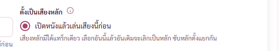

### ข้อ 92 ที่เก็บไฟล์แยก (พี่กันแทรก)
พี่กันสั่ง *"ขอที่เก็บ ข้างๆปุ่มเเยก เเละเด่นๆ"*
- กรอบสีโทนตัวหนาข้างปุ่มแยก บรรทัดเดียวสูง 34 จุด ที่อยู่ยาวย่อตรงกลาง ชี้แล้วเห็นเต็ม

### ข้อ 93 การ์ดวิธีที่ไม่ได้เลือก (พี่กันแทรก)
พี่กันสั่ง *"เลือกอันไหนเเล้ว อีกสออัน จางให้ด้วย"* · รอบแรกจางทั้งใบ พี่กันทัก *"เราจะกดเปลี่ยนยังไง ถ้ามันตั้งให้กดไม่ได้"* แคลร์เสนอหม่นแทน พี่กันเคาะ *"เอาตามเธอละกัน"*
- การ์ดทึบเต็มใบ ไอคอนหม่น ตัวหนังสืออ่อนลง ชี้แล้วกรอบกับไอคอนกลับสีเต็ม

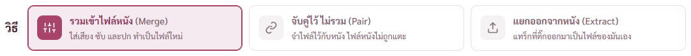 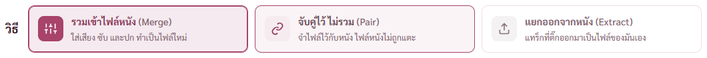

### แถบล่างหน้าเสียงและซับ (ต่อจากข้อ 92 กับ 93)
พี่กันทัก *"ก็บอกว่าให้ fix ไง"* · สั่ง *"ขยับ MKV ให้ตรงกับการ์ด"*
- เดิมแถบล่างวิธีรวม 74 วิธีจับคู่ 69 วิธีแยก 93 จุด สลับวิธีแล้วกล่องที่ตรึงล่างยืดหด · ตอนนี้ 74 จุดทุกวิธี กล่องสูง 156 จุดเท่ากัน · วิธีแยกเอาหัวข้อที่ซ้ำกับการ์ดวิธีออก
- ของชิ้นแรกในแถบล่างเริ่มที่ขอบซ้ายการ์ดวิธี 252 จุด

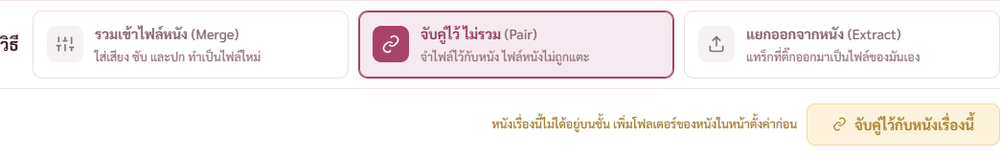
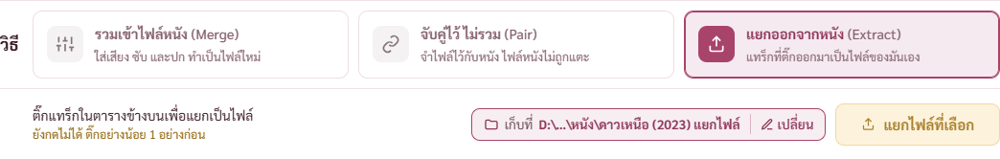

### ข้อ 94 เตือนก่อนกดเริ่มเมื่อไดรฟ์จะเต็ม (พี่กันแทรก)
พี่กันสั่ง *"ระบบจะต้องเตือนนะ ถ้าโฟลเด้อที่เลือก เเล้วระบบคำนวนเนื้อที่ไฟล์มาเเล้ว"* ต่อด้วย *ถ้ารันไฟล์ไปแล้วเนื้อที่เต็มแน่ ๆ ต้องบอกนะ* (พิมพ์ตอนแป้นเป็นอังกฤษ แคลร์แปลงกลับ) · แล้วสั่ง *"ทำเลย"*
- คำสั่งใหม่ drive_free อ่านที่ว่างของไดรฟ์ปลายทาง ใช้ตัวเดียวกับที่งานเช็กตอนเริ่ม · คิดขนาดด้วยสูตรเดียวกับฝั่ง Rust ของแต่ละงาน
- ไม่พอ ปุ่มเริ่มกดไม่ได้ คำสั้นบรรทัดเดียวข้างปุ่ม "ยังกดไม่ได้ ไดรฟ์ D ต้องใช้ราว X แต่เหลือ Y" แถบไม่สูงขึ้น
- ใช้ที่หน้ารวมไฟล์ การ์ดแยกไฟล์ หน้าใส่โปสเตอร์ และหน้าแปลงเสียง

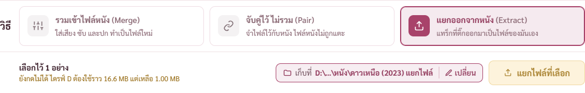
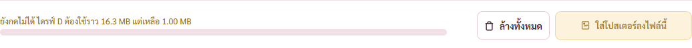
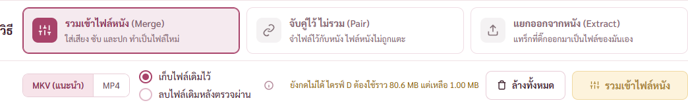

### ข้อ 95 กับ 96 การ์ดบันทึกการใช้งาน (พี่กันแทรก)
พี่กันทัก *"ปกติ หน้าตั้งค่า พวกคำอธิบาย มันอยู่ใต้หัวข้อนี่นา"* · *"กดไปไม่ได้อ่ะ"*
- คำอธิบายเดือนนี้จดไว้เป็นตัวเล็กใต้หัวข้อ ไม่ซ่อนใน ⓘ เกลาคำให้ตัดบรรทัดตรงรอยต่อประโยค
- ที่อยู่ที่เก็บบันทึกกดแล้วเปิดโฟลเดอร์ · ที่อยู่โฟลเดอร์ตัวแปลงกดได้แบบเดียวกัน

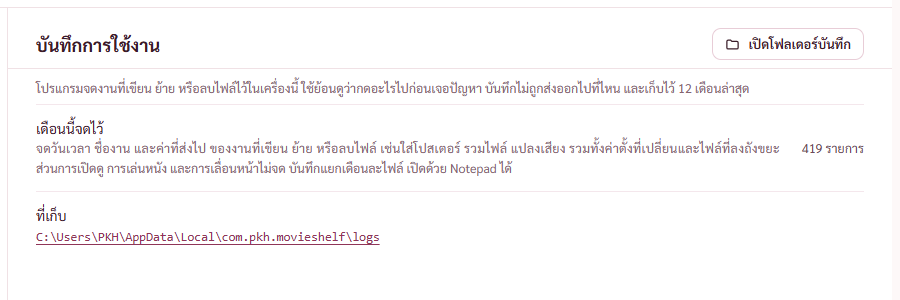

### ข้อ 97 คำอธิบายชนิดไฟล์ในหน้าเสียงและซับ (พี่กันแทรก)
พี่กันทัก *"มันยาวมาก ควรเป็นบูลเล็ตไหม"* · แยกเป็นหัวข้อละชนิด ความหมาย ข้อดี ข้อเสีย และแนะนำ ข้อที่ยาวขึ้นบรรทัดใหม่ตรงรอยต่อประโยค

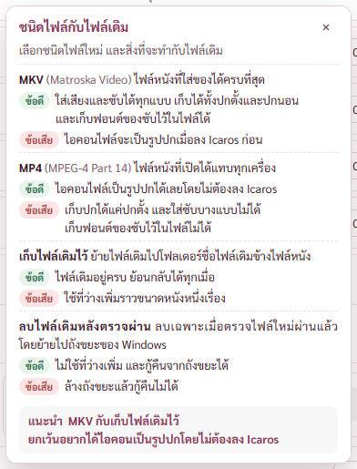

### ข้อ 98 ปุ่มดูซับ (พี่กันแทรก)
พี่กันถาม *"เราจะดูซํบยังไงงง มันมีหน้าซับ เเต่เราไม่รู้ต้องเปิดจากไหน"* · แถวซับมีปุ่มไอคอนตากับคำว่าดูซับ ในช่องเดียวกับช่องแปลงเสียงของแถวเสียง
- พี่กันสั่งต่อ *"ยาวเท่าเดิม เเต่สีอ่อนขึ้น"* แคลร์อ่านผิดเป็นคงความยาวปุ่ม 74 จุด แล้วทำสีจางเกิน พี่กันทัก *"เราบอกแล้วไงว่าเท่ากับปุ่มแปลง"* กับ *"ปุ่มมีสีเข้มกว่านี้ ให้มันเเตกต่างจาก ปุ่มแปลง"*
- ตอนนี้กว้าง 142 จุดเท่าช่องไม่แปลง พื้นชมพูอ่อน ขอบกับตัวหนังสือสีโทน ต่างจากช่องแปลงที่พื้นขาว ชี้แล้วเข้มขึ้น ปุ่มดูและแก้ Chapter แบบเดียวกัน

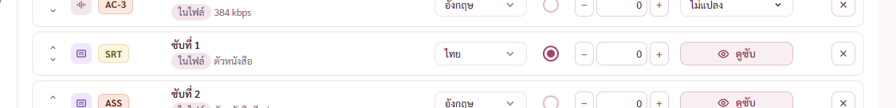

### ข้อ 99 ดูและแก้ Chapter (พี่กันแทรก)
พี่กันถาม *"เราจะ edit ยังไง เปิดดูยังไง"* แล้วสั่ง *"เปลี่ยนทบของหนังเป็น chater ของหนัง"*
- แถว Chapter ของหนังตอนรวมไฟล์มีคำบอกสถานะกับปุ่มดูและแก้ Chapter
- หน้าต่างอ่าน Chapter จากไฟล์ด้วย ffprobe แก้ชื่อ แก้เวลาเริ่ม เพิ่ม ลบ และกลับเป็น Chapter เดิมได้ หน้าต่างสูงคงที่ รายการยาวเลื่อนในหน้าต่าง
- เวลาผิดรูปแบบ ซ้ำกัน หรือไม่น้อยกว่าความยาวหนัง เตือนใต้แถวและปุ่มเสร็จสิ้นกดไม่ได้พร้อมบอกเหตุผล
- Chapter ที่เพิ่มใหม่ต่อจากอันสุดท้าย 1 นาที หนังเหลือไม่ถึงนั้นไปกึ่งกลางระหว่างอันสุดท้ายกับท้ายหนัง เป็นวินาทีเต็ม (รอบแรกได้เวลาท้ายหนังพอดีพร้อมเศษมิลลิวินาที เจอตอนดูภาพ แก้แล้ว)
- ช่องเวลากับช่องชื่อแถวเดียวกันสูง 36 เท่ากัน (รอบแรกช่องเวลาเตี้ยกว่า เจอตอนดูภาพ แก้แล้ว)
- ตอนรวม MKV ใส่ไฟล์ Chapter แบบ OGM ผ่าน mkvmerge ส่วน MP4 ใส่แบบ ffmetadata ผ่าน ffmpeg ลบหมดก็ได้ไฟล์ไม่มี Chapter ไฟล์หนังเดิมไม่ถูกแตะ · cargo test รวมไฟล์จริงทั้งสองชนิดผ่าน
- สร้าง Chapter ไปพร้อมดูวิดีโอจดลง ROADMAP แล้วตามที่พี่กันสั่ง *"ใส่ในโร๊ดเเมพ อนาคต เราจะให้มันสร้าง chapter จากวิดีโอ"*

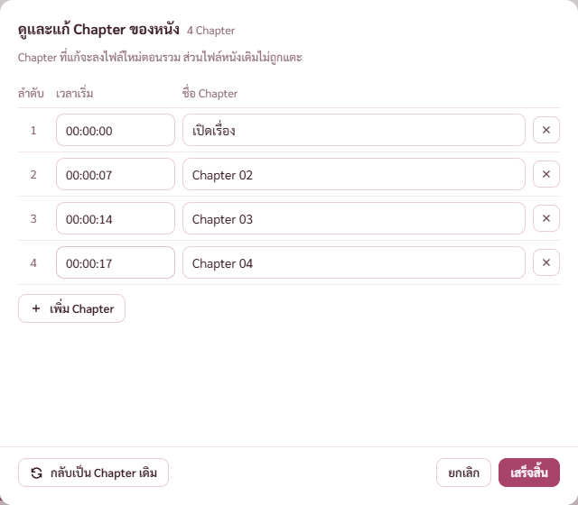
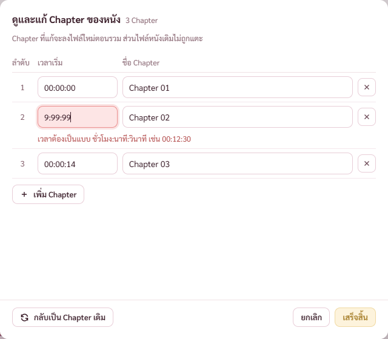

### ข้อ 100 ตัวดูซับสูงคงที่ (พี่กันแทรก)
พี่กันสั่ง *"หน้าจอซับทั้งสามแบบ ให้ popup ขนาดเท่ากันตลอด"* · สูง 704 จุดที่ตำแหน่งเดิมทั้งแบบ Aegisub แบบอ่านยาว และแบบ notepad

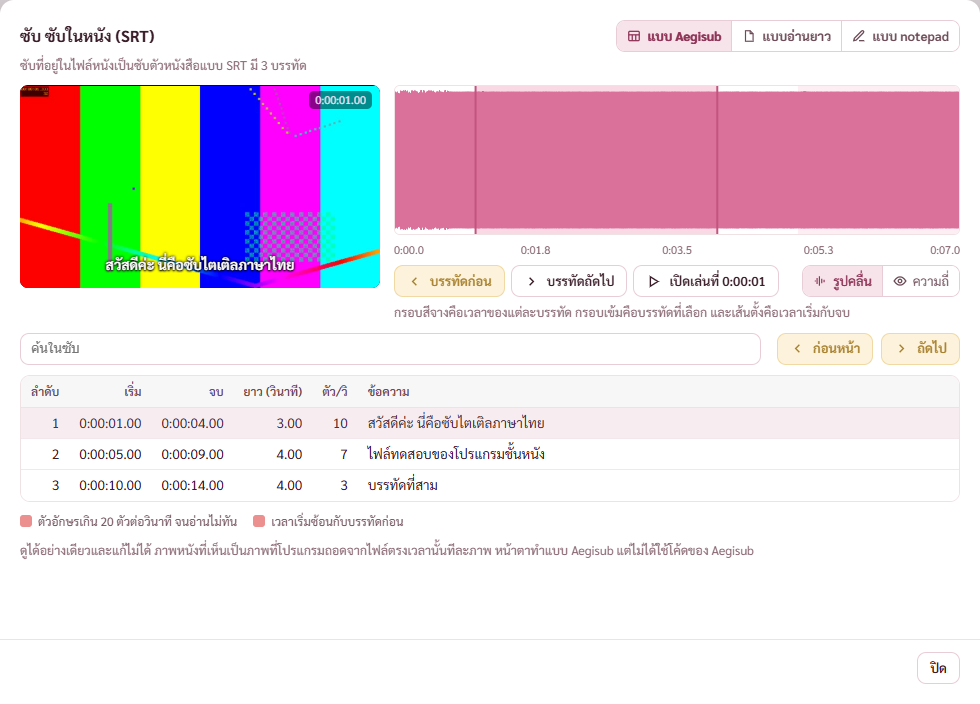
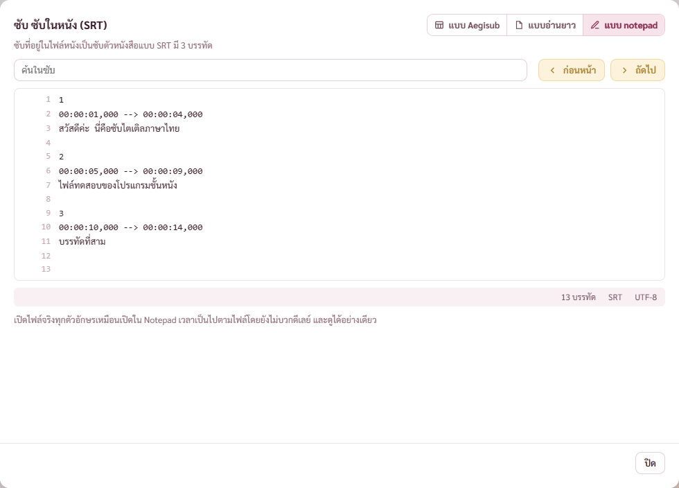

### ข้อ 101 104 107 108 หน้าซับไตเติล (พี่กันแทรก)
พี่กันสั่ง *"สร้าเมนู ซับไตเติลไว้รอด้วย"* แล้วสั่งต่อ *"ดูได้หน้านี้เลย"* · *"ทำปุ่มอัปไฟล์ เหมือนจุดอื่นเลย"* · *"ขอปุ่มเพิ่มวิดีโอมาด้วย"* (พิมพ์ตอนแป้นเป็นอังกฤษ แคลร์อ่านแล้วบอกพี่กันในแชท) · *"ขอปุ่ม export ไฟล์ซับด้วย"*
- เมนูซ้ายมีซับไตเติลต่อจากเสียงและซับ
- จุดลากไฟล์กับปุ่มเลือกไฟล์แบบหน้า MediaInfo รับไฟล์หนังกับไฟล์ซับ ไฟล์ชนิดอื่นขึ้นแดงว่าไม่ใช่ไฟล์หนังหรือไฟล์ซับ (สีแดงตัวเดียวกับจุดลากไฟล์ทุกหน้า พี่กันถาม *"เราใช้สีนี้เหรอ"* เพราะตัวตรวจทิ้งสถานะนี้ค้าง แก้ตัวตรวจให้ล้างหน้ากลับแล้ว)
- ตัวดูซับแสดงในหน้าเลย ไม่เด้งหน้าต่างซ้อน เริ่มที่ซับแรก กดแถวอื่นเพื่อสลับ · รอบแรกแคลร์ทำเป็นหน้าต่างซ้อน พี่กันทัก *"ตัวซับจะเปิดได้ที่หน้านี้เลย"*
- ไฟล์หนังที่ไม่มีซับในตัว หรือมีไฟล์ซับแยก กดเพิ่มไฟล์ซับมาดูคู่กับหนังได้
- ข้อ 107 ไฟล์ซับอย่างเดียวมีปุ่มเพิ่มไฟล์วิดีโอ ทั้งในกรอบภาพหนังและใต้รายการซับ ใส่แล้วเห็นภาพหนังกับคลื่นเสียงตรงแต่ละบรรทัด
- ข้อ 108 ซับในไฟล์หนังมีปุ่ม Export ได้ไฟล์ซับชนิดเดิมในโฟลเดอร์ ชื่อหนัง แยกไฟล์ ข้างไฟล์หนัง ปุ่มบอกกำลัง Export กว้างคงที่ สำเร็จขึ้นการ์ดเขียวพร้อมปุ่มเปิดโฟลเดอร์แล้วหายเอง ชื่อชนถามก่อน ตั้งชื่อใหม่หรือไม่ Export ไม่เขียนทับ
- รอบแรกแถวซับแบ่งสามคอลัมน์ ชื่อแถวที่สองตัดเป็น ซับที่ 2 อัง… เจอตอนดูภาพ แก้ให้แถวกว้างอย่างน้อย 460 จุด

- ข้อ 109 พี่กันสั่ง *"เราเปิดซับเเล้ว ย้่ายปุ่มอัปซับไปที่อื่น มันโคตรกินที่ หน้านี้คือหน้าที่เราจะเอาไว้ edit ซับ มันควรใช้งาน ไม่ใช่เเค่ดู ไปรีดีไซด์ใไม่"* · เปิดซับแล้วจุดลากไฟล์ใหญ่หายไป แถวบนแถวเดียวมีชื่อไฟล์ ปุ่มเพิ่มไฟล์ซับหรือเพิ่มไฟล์วิดีโอ และปุ่มเปิดไฟล์อื่น แถบแทร็กซับแถวเดียวพร้อมปุ่ม Export ตัวดูซับเริ่มที่ครึ่งบนของจอ · พี่กันสั่งต่อ *"ระยะห่างเยอะไป เอาปุ่มเลือกรูปแบบไปไว้ตรงปุ่มเพิ่มวิดีโอ"* ปุ่มเลือกแบบการดูขึ้นแถวบน เอาหัวข้อซ้ำในตัวดูซับออก ตัดขอบในด้านบน ตัวดูซับห่างแถวบน 12 จุด เดิม 30 จุด (กฎ .card ใน app.css ทับขอบในไว้ ต้องเพิ่มน้ำหนักกฎ)

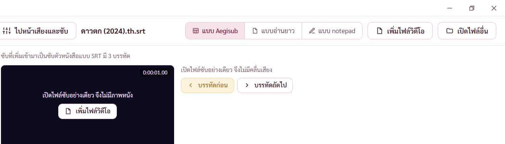

### ข้อ 109 ส่วนที่สอง มอคอัปหน้าแก้ซับ (รอพี่กันเลือก)
พี่กันสั่ง *"หน้านี้คือหน้าที่เราจะเอาไว้ edit ซับ มันควรใช้งาน ไม่ใช่เเค่ดู ไปรีดีไซด์ใไม่"* แล้วตอบ *"ทำมาเลย"*
- เปิด http://127.0.0.1:1420/docs/mockups/sub-editor-pick.html (เปิดในโครมของพี่กันแล้ว) ทุกกรอบเป็นหน้าจริง 1280 × 800 กรอบแรกเป็นหน้าตาตอนนี้
- ทุกแบบมีแถบเครื่องมือ เลิกทำ ทำซ้ำ เลื่อนเวลาทั้งไฟล์ ยืดเวลาตามความเร็วหนัง ค้นและแทนที่ บันทึกเป็นไฟล์ใหม่ บันทึก
- แบบ 1 ช่องแก้บรรทัดอยู่ระหว่างภาพหนังกับตาราง แบบ Aegisub · แบบ 2 ตารางยาวด้านซ้าย ภาพหนังกับช่องแก้ด้านขวา · แบบ 3 แก้ทั้งไฟล์แบบ notepad ภาพหนังกับรายการปัญหาด้านขวา
- วัดในโครมแล้ว ทั้งสี่กรอบจัดแบบสำเร็จ ไม่มีแถบเลื่อนแนวนอน แถบเครื่องมือไม่ล้น · ภาพข้างล่างถ่ายจากหน้าต่างทดสอบที่ใช้ไฟล์ทดสอบจริง 3 บรรทัด เพราะคำสั่งถ่ายภาพของโครมค้าง ในโครมใช้ซับตัวอย่าง 40 บรรทัด
- รอบแรกเจอสี่จุดตอนดูภาพแล้วแก้ ที่ว่างเกินใต้แถบเครื่องมือ ช่องแก้บรรทัดไม่ตรงแถวที่เลือก แบบ 2 ช่องแก้ตกขอบล่าง แบบ 3 ยังเขียนว่าดูได้อย่างเดียว

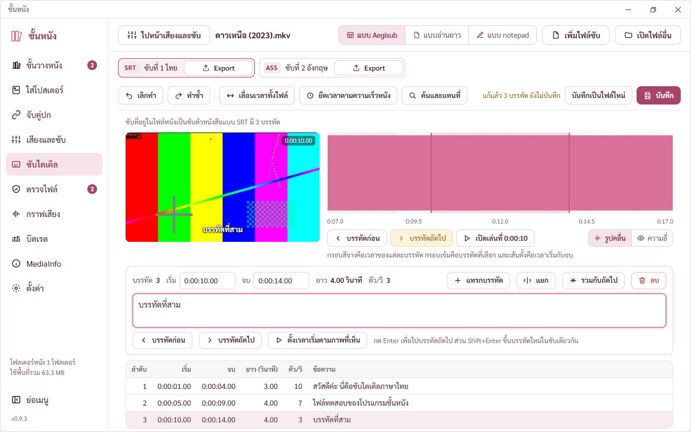
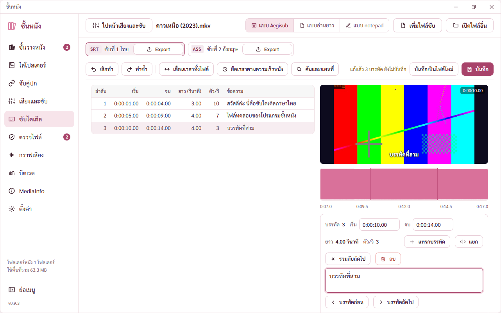
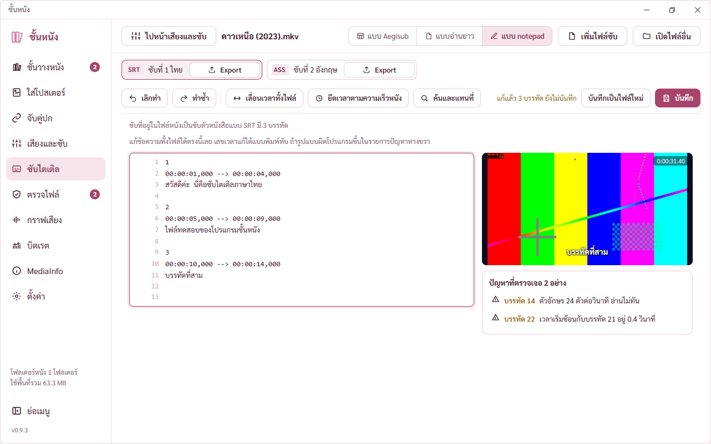

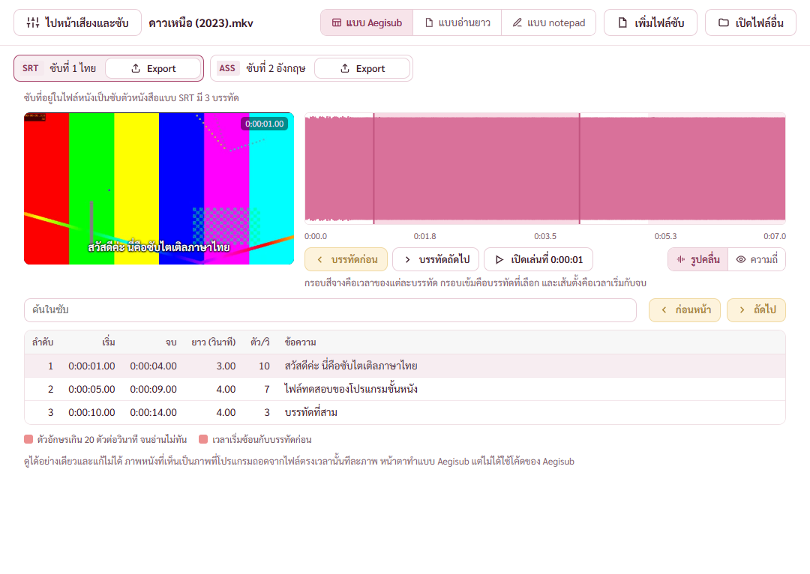
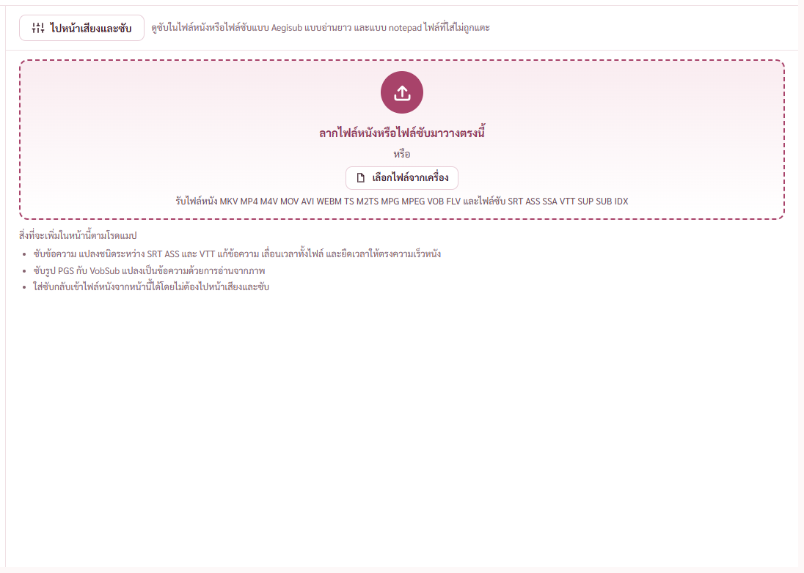
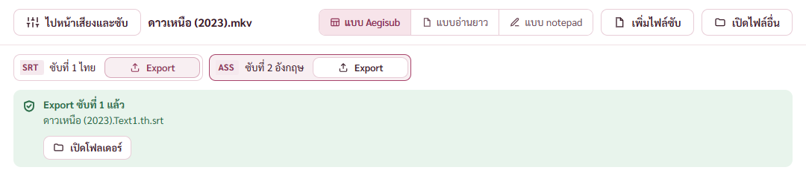
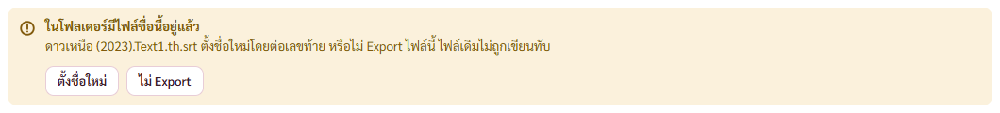

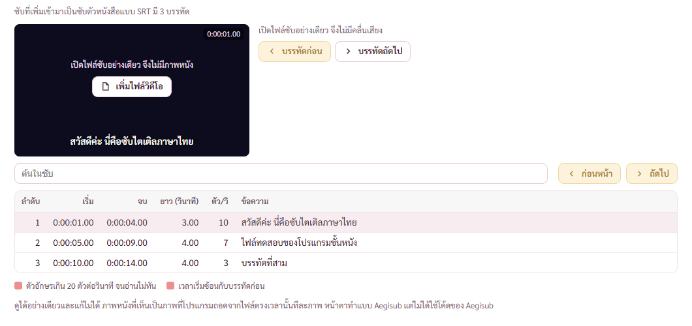
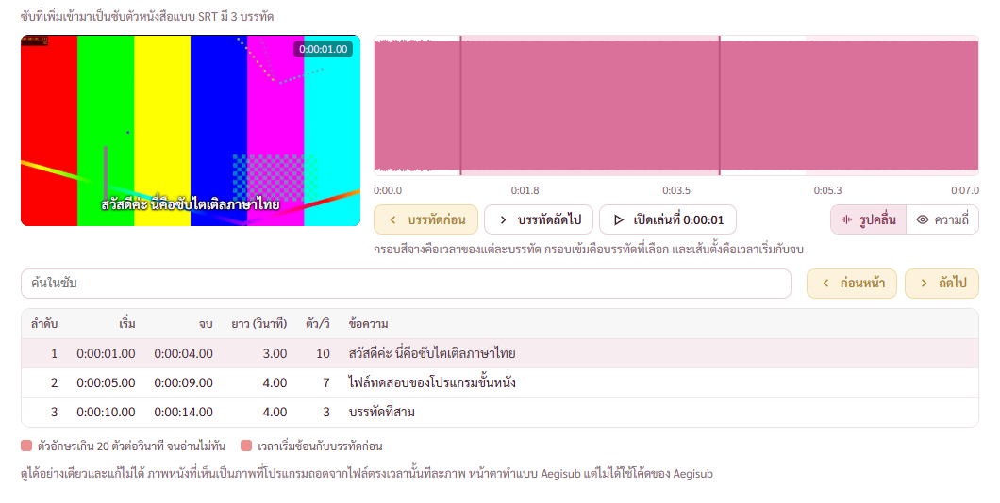

### ข้อ 102 หน้าความถี่เฉลี่ยขยายเต็มจอแล้วยังเป็นดรอปดาวน์ (พี่กันแทรก)
พี่กันทัก *"ขยายจอสุดเเเล้วทำไมมันยังเป็นดรอปดาว หน้านี้"*
- ต้นเหตุ กลุ่มขวาของหัวกราฟล็อกไม่ให้หด เส้นซูมจึงหดไม่ได้ ขยายเต็มจอ 1600 × 852 หัวกราฟกว้าง 1,120 แต่ต้องใช้ 1,144 ขาด 24 จุดก็สลับเป็นดรอปดาวน์
- แก้ให้กลุ่มขวาหดได้ตอนแสดงแบบเต็ม เส้นซูมหดจาก 200 ถึง 130 ก่อน ตัววัดนับว่าไม่พอเมื่อต่ำกว่า 130 เท่ากับเส้นซูมตอนเป็นดรอปดาวน์
- วัดแล้ว 1280 เป็นดรอปดาวน์เพราะไม่พอจริง 1600 กับ 1920 เป็นแถวปุ่ม ไม่มีชิ้นซ้อนกันทุกขนาด

### ข้อ 103 กับ 105 หัวกราฟหน้าบิตเรต (พี่กันแทรก)
พี่กันสั่ง *"ที่หน้าบิตเรต เธอยังไม่ปรับเรื่องปุ่มซูมเลยนะ เอาให้มันเหมือนกันสิ"* · *"ใส่ชื่อหน่อย แบบ ชนิดกราฟ หรืออะไรก็ได้ ตามที่เธอคิด"*
- แถบซูมเรียง คำว่าซูม ปุ่มแว่นขยายกับเส้นเลื่อน ปุ่มช่วงซูม เส้นแบ่ง ปุ่มรีเซ็ต แบบหน้ากราฟเสียง · เดิมปุ่มรีเซ็ตติดแว่นขยาย คำว่าซูมอยู่กลาง
- หัวกราฟแคบ ปุ่มช่วงซูมเป็นดรอปดาวน์ตามที่ว่างจริง 1280 ดรอปดาวน์ 1600 กับ 1920 แถวปุ่ม
- ใส่คำว่า รูปแบบกราฟ หน้าดรอปดาวน์ ตรงกับชื่อในปุ่ม ⓘ ข้างกัน
- แบบ Bitrate Viewer ลอกหน้าตาโปรแกรมเดิม ไม่มีแถบซูมแบบหัวกราฟ จึงไม่แตะ

### ข้อ 106 หน้าเลือกแทร็กในหน้าบิตเรต (พี่กันแทรก)
พี่กันสั่ง *"ทำแบ่งเป็นสองส่วเนเลย ภาพอยู่บน ขั้นด้วยขีด เเละก็เสียง"* · ส่วนภาพอยู่บน เส้นคั่น แล้วส่วนเสียง แต่ละส่วนมีหัวข้อ

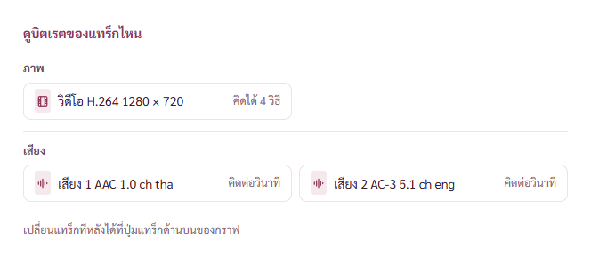

## AUDIT

| ข้อ | เรื่อง | แก้ |
|---|---|---|
| 33 | ปิดสวิตช์อ่านโฟลเดอร์ตอนเปิด ใต้ทุกโฟลเดอร์ขึ้น 0 เรื่อง | นับจากชั้นวางที่จำไว้ คลังยังไม่โหลดขึ้นขีด |
| 129 | ไฟล์ตั้งค่าผิดชนิดช่องเดียว ทิ้งทั้งไฟล์ โฟลเดอร์หาย | อ่านทีละช่อง ช่องย่อยด้วย ช่องที่เสียใช้ค่าตั้งต้นเฉพาะช่อง แถบแจ้งบอกว่าค่าอื่นอยู่ครบ · เสียทั้งสองชุด เอารายชื่อโฟลเดอร์คืนจากคลังหนัง |
| 130 | ค่ารูปกราฟไม่ผ่านตัวกรอง โฟลเดอร์ซ้ำได้ | กรองทุกช่อง · โฟลเดอร์ซ้ำเทียบทั้งรายการ ไม่สนตัวพิมพ์และ \ ท้าย ทั้งฝั่ง Rust และหน้าจอ |
| 131 | เช็กรุ่นถี่แล้ว GitHub ปฏิเสธ เลข .0 ท้ายขึ้นมีรุ่นใหม่ | ที่อยู่ซ้ำดึงครั้งเดียว (ถาม GitHub 4 ครั้งแทน 5) · ตัด .0 ท้ายก่อนเทียบ · GitHub ตอบ 403 หรือ 429 บอกให้รอราวหนึ่งชั่วโมง |
| 135 | บันทึกไม่สำเร็จ แถบแดงซ้อนสองแถบ และแถบเขียวว่าเพิ่มโฟลเดอร์แล้ว | แถบแดงที่ตัวบันทึกที่เดียว · เพิ่มหรือเอาโฟลเดอร์ออกทำต่อเฉพาะตอนบันทึกสำเร็จ · กระดานจับคู่ปกเป็นแบบเดียวกัน แก้พร้อมกัน |
| 136 | ลากแถบแล้วรีบกดค่าอื่น ค่าเด้งกลับ | ทุกการส่งรวมค่าที่ค้าง ค่าแถบที่ยังลากค้างไปด้วยในครั้งเดียว ตัวตั้งเวลาของแถบไม่ส่งซ้ำ |
| 137 | ชี้ไปไฟล์ docs ที่ไม่มีในเครื่องที่ติดตั้ง | ชี้หัวข้อขอบคุณ มีปุ่มไปหัวข้อขอบคุณ |
| 155 | ช่องที่ปิดอยู่ชี้แล้วเงียบ ปุ่มซูมที่กดไม่ได้ไม่เปลี่ยน | ไม่ตัดการรับเมาส์ ชี้แล้วขึ้นเหตุผล เคอร์เซอร์บอกกดไม่ได้ กันกดในโค้ด · ปุ่มซูมที่กดไม่ได้ชี้แล้วเปลี่ยนนิดเดียว |

## ที่แคลร์ทำพลาด
- พิมพ์ข้อความคั่นเป็นภาษาอังกฤษหลายครั้ง รอบหลังหลุด 6 ครั้งจนพี่กันทัก *"ตอบภาษษไทยยยยยยยยยย"* บอกเนื้อความเป็นภาษาไทยแล้วทุกครั้ง
- ข้อ 98 อ่านคำ *"ยาวเท่าเดิม"* ผิดเป็นคงความยาวปุ่ม ต้องแก้สามรอบ
- ข้อ 104 รอบแรกทำตัวดูซับเป็นหน้าต่างซ้อน ทั้งที่พี่กันสั่ง *"ดูได้หน้านี้เลย"*
- ตัวตรวจทิ้งจุดลากไฟล์สีแดงค้างในหน้าซับไตเติลให้พี่กันเห็น
- ข้อ 102 รอบแรกแก้แค่ตัววัด วัดซ้ำแล้วยังเป็นดรอปดาวน์ ต้องหาต้นเหตุจริงอีกรอบว่ากลุ่มขวาถูกล็อกไม่ให้หด
- รันตัวตรวจซ้ำรอบที่สองโดยไม่ผ่านด่านเช็กหน้าต่างหน้าสุด บอกพี่กันแล้ว
- ทำรูปตัวอย่างหน้าต่างซ้อนรอบก่อนโดยครอปตัดเมนูซ้าย หน้าต่างจึงไม่อยู่กลาง (ข้อ 90)

## ยังไม่ได้ตรวจ
- ปุ่มเปิดไดรฟ์ C กดจริงแล้ว Explorer เปิด ตัวตรวจใช้ทางลัดทดสอบแทน เพราะ Explorer จะเด้งขึ้นจอ พี่กันลองกดเองได้
- ข้อ 89 การเปิดมาแล้วขยายเต็มจอจริง พี่กันต้องลองเอง สั่งขยายในหน้าต่างทดสอบแล้ว Windows ดึงขึ้นมาบังจอ
- ข้อ 88 ไดรฟ์เต็มจริงตอนบันทึก จำลองด้วยทางลัดรุ่นทดสอบ ฝั่ง Rust ตรวจรหัสข้อผิดพลาด 112 กับ 39 ด้วยเทส
- ข้อ 131 ยังไม่ได้กดเช็กกับเว็บจริง
- ตัวจริงภายใต้ CSP ยังไม่ได้ตรวจ
- ข้อ 99 รวมไฟล์ที่แก้ Chapter ผ่านหน้าจอยังไม่ได้กดรวมจริง ตรวจด้วย cargo test ที่รวมไฟล์จริงทั้ง MKV และ MP4 แทน
- ข้อ 104 107 ลากไฟล์จาก Explorer จริงกับกล่องเลือกไฟล์ทดสอบอัตโนมัติไม่ได้ ตัวตรวจเปิดไฟล์ผ่านทางลัดทดสอบ พี่กันลองลากเองได้
- ข้อ 108 ปุ่มเปิดโฟลเดอร์หลัง Export ตัวตรวจกันไม่ให้ Explorer เด้ง ตรวจแค่ว่าชี้ไฟล์ที่ Export

## ต่อไป
- BUGS ข้อ 109 ส่วนที่สอง รอพี่กันเลือกแบบในมอคอัปหน้าแก้ซับ แล้วทำของจริง
- ที่เก็บรูปกราฟในหน้าตั้งค่ายังกดเปิดโฟลเดอร์ไม่ได้ ต้องเพิ่มคำสั่ง
- commit เมื่อพี่กันสั่ง
