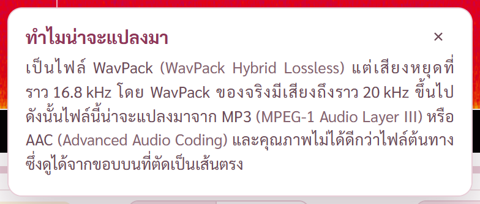
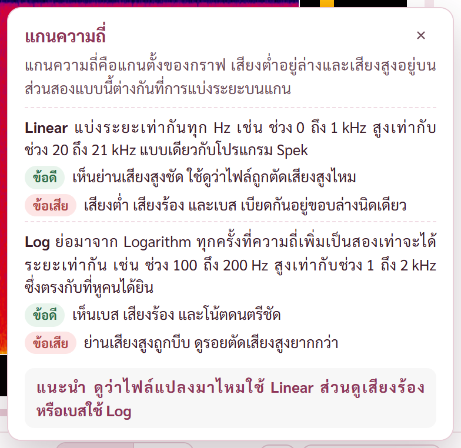
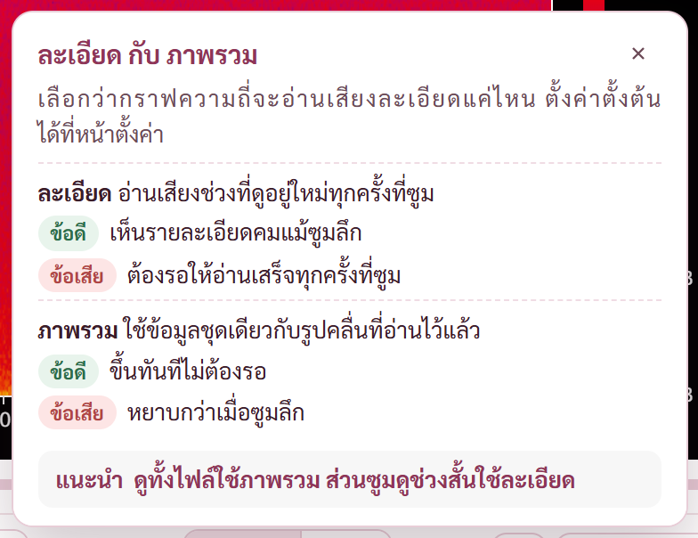
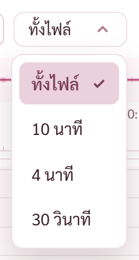
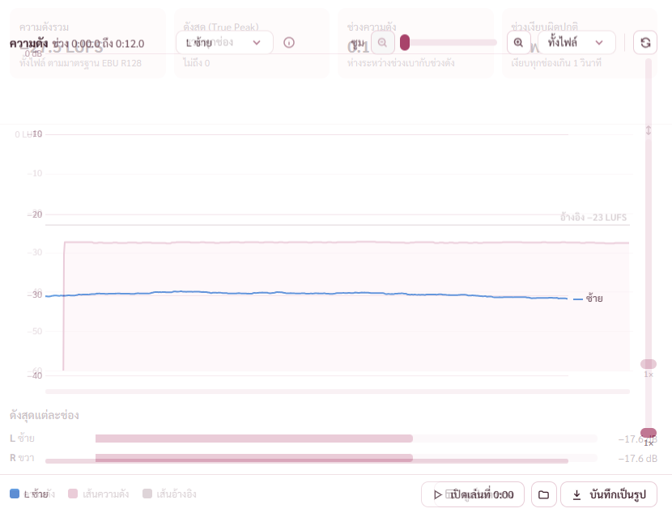
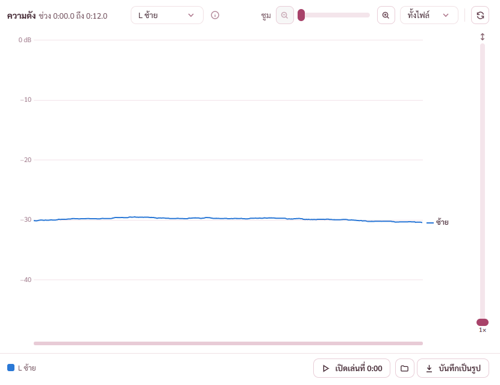
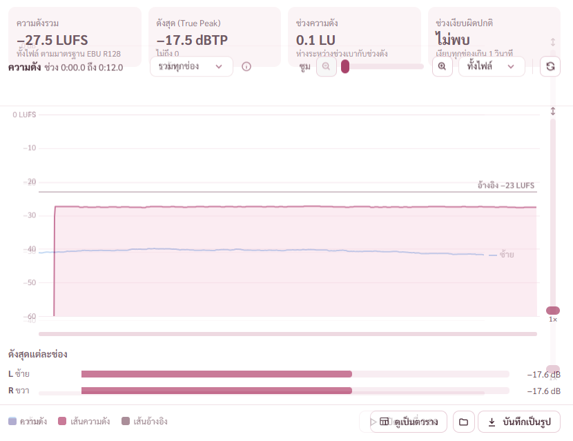

# รายงาน 13 พ.ย. 2569 · หน้ากราฟเสียง แถบผลตรวจ คำอธิบาย ⓘ แถบซูม และการสลับช่อง

ทุกภาพถ่ายจากโปรแกรมโหมดพัฒนาที่เปิดอยู่หลังสุด ผ่านพอร์ตดีบัก หน้าต่าง 1280 × 800 ไฟล์ทดสอบ `WavPack แปลงจาก MP3.wv` กับ `WavPack ของจริง.wv` (สร้างเองจากเพลงทดสอบ ไม่ใช่เพลงของพี่กัน) · ภาพอยู่ `docs/report-2026-11-13/หน้ากราฟ/` · ยังไม่ commit

## 1. กล่องผลตรวจในแถบล่างหน้าความถี่ เป็นคำสั้นบรรทัดเดียว กดปุ่ม ⓘ อ่านเพิ่ม

พี่กันสั่ง *"ทำบ้าอะไรเนี่ย มาสร้างกรอบคำเตือนที่ทำให้กรอบล่างมันใหญ่ทำไม ก็บอกว่าอย่ามาเืลื่อน"* · *"ก็เขียนคำย่อ เเล้วให้กดอ่านเพิ่มเติมเองสิ"* · *"บอกแบบนี้จะรู้เรื่องไหมว่าปกติหรือไม่ ก็บอกว่าปกติสิ"* · *"เเล้วมันจะปุ่มเตือนเหมือนกันทำไม"* · *"ขอเเนวเดียวกัน"*

- กล่องผลเหลือคำสั้น เช่น น่าจะแปลงมาจาก MP3 · ปกติ · ตรวจไม่ได้ · บอกแน่ไม่ได้ ข้อความเต็มอยู่ในปุ่ม ⓘ
- ผลปกติเป็นกล่องสีเขียวพร้อมเครื่องหมายถูก ผลเตือนเป็นสีเหลืองพร้อมสามเหลี่ยม ผลที่บอกไม่ได้เป็นสีกลาง กล่องทุกแบบหน้าตาเดียวกัน
- ที่ไม่พอวางคำ ซ่อนคำ เหลือไอคอนกับ ⓘ ไม่ตัดบรรทัด ไม่ตัดจุดสามจุด
- ปุ่ม ⓘ ในกล่องใช้สีเดียวกับกล่อง (พี่กันทัก *"สีมันดูตรงกันข้ามไหม ปุ่มอ่านหมายเหตุ"*)
- วัดความสูงแถบล่าง 57 จุดเท่ากันทุกผล ทั้งไฟล์แปลงมา ไฟล์ของจริง ไฟล์ที่ตรวจไม่ได้

ไฟล์ที่แปลงมา กล่องเหลืองคำสั้น

ไฟล์ของจริง กล่องเขียวว่าปกติ แถบล่างสูงเท่ากัน

## 2. ข้อความเต็มของผลตรวจ บอกที่มาของตัวเลข และมีคำเชื่อมหลังคำอังกฤษ

พี่กันทัก *"จะเขียนหยุดที่ 16.8 ทำไม เรารู้เรื่องไหน"* · *"โดย wevpack ต้องเชื่อมแบบนี้สิ"* · *"ซึ่ง wave pack ใส่คำเชื่อมสิ"* · *"ที่ ซึ่ง อัน ก็เสริมไป ไม่เอาคำภาษษอังกิดเขียนต่อกันถ้ามันคือวรรค"*

- ข้อความบอกว่าไฟล์ของจริงชนิดนี้มีเสียงถึงเท่าไร เทียบกับที่ไฟล์นี้หยุด แล้วสรุปด้วยคำว่า ดังนั้น
- คำอังกฤษตรงรอยต่อประโยคมีคำเชื่อม โดย ซึ่ง ดังนั้น · ตั้งเป็นกฎใน CLAUDE.md แล้ว · งานไล่ทั้งโปรแกรมอยู่ BUGS ข้อ 73

## 3. Linear กับ Log ใช้คำอังกฤษ คำอธิบายแยกหัวข้อละแบบ

พี่กันทัก *"ล็อก อะไร ล็อกกุญเเจเหรอ"* · *"log สิ"* · *"เส้นตรงก็ Linear ไหม"* · *"อันไหนคำอังกิด ไม่ต้อแปล"* · *"คำอธิบายไม่ได้บอกความหายของ เสนตรง กับ ล็อก เลย"* · *"แบ่งความหมายสองออันนี้ด้วย"*

- ปุ่มแกนเป็น Linear กับ Log ทั้งหน้าความถี่และหน้าความถี่เฉลี่ย
- กล่อง ⓘ แกนความถี่ ละเอียดกับภาพรวม และหน่วยความดัง แยกหัวข้อละแบบ บอกความหมาย ข้อดี ข้อเสีย แล้วมีคำแนะนำท้ายกล่อง
- ตั้งเป็นกฎใน CLAUDE.md แล้ว · งานไล่คำอังกฤษทั้งโปรแกรมอยู่ BUGS ข้อ 72

## 4. เส้นแบ่งกลุ่มปุ่มในแถบล่างและแถบซูม

พี่กันสั่ง *"ขอเส้นแบ่งเเยกปุ่มที"* (แถบล่าง) · *"ขอเส้นแบ่งเหมือนด้านล่าด้วย"* (แถบซูม)

- แถบล่างแบ่ง ความละเอียด · แกน · ปุ่มโฟลเดอร์กับบันทึกเป็นรูป (ภาพ 1 และ 2)
- แถบซูมดูข้อ 5

## 5. แถบซูมจัดกลุ่มใหม่ คำว่าซูมคลุมทั้งเส้นเลื่อนและปุ่มช่วง

พี่กันทัก *"แบ่งถูกละเหรอ ทำไปเเยำคำว่าซูมออก"* · *"อันไหนคอือซูมกันเเน่นะ เส้นซูม หรือนาทีที่เห็น"*

- ตอบ ทั้งสองอย่างคือซูมตัวเดียวกัน เส้นเลื่อนซูมทีละขั้น ปุ่มช่วงกระโดดไปความกว้างตายตัว กดปุ่มช่วงแล้วเส้นเลื่อนขยับตาม
- รอบก่อนแคลร์วางคำว่าซูมไว้หน้าปุ่มช่วง แล้วเอาเส้นแบ่งกั้นระหว่างเส้นเลื่อนกับคำว่าซูม ดูเหมือนเส้นเลื่อนเป็นของอีกอย่าง
- ตอนนี้เรียง คำว่าซูม ปุ่มแว่นขยายกับเส้นเลื่อน ปุ่มช่วง เส้นแบ่ง ปุ่มรีเซ็ต ทุกหัวกราฟ · ตั้งเป็นกฎใน CLAUDE.md แล้ว

## 6. หัวกราฟหน้าความดังเดิมปุ่มซ้อนกัน ตอนนี้ปุ่มเลือกช่องเป็นดรอปดาวน์เมื่อหัวกราฟแคบ

พี่กันทัก *"เราบอกแล้วไง ถ้าจอแคบ ตัวเลือกเสียงเปลี่ยนเป็นดรอปดาว"* (พิมพ์ตอนแป้นเป็นอังกฤษ)

- ต้นเหตุ ใส่เส้นแบ่งแล้วหัวกราฟต้องการราว 906 จุด ที่หน้าต่าง 1280 มี 800 จุด · แคลร์บีบเส้นเลื่อนซูมเหลือ 88 จุดแล้ววัดแค่ว่าหัวกราฟไม่มีแถบเลื่อน ไม่ได้วัดว่าชิ้นซ้อนกัน ปุ่มเลือกช่องจึงไปซ้อนใต้แถบซูม และคำว่าซูมโดนบีบเหลือ 16 จุด
- แก้ตามที่พี่กันสั่งไว้ 11 พ.ย. หัวกราฟแคบกว่า 1,120 จุด ปุ่มสี่ปุ่มเป็นดรอปดาวน์ช่องที่ดู ไฟล์ที่ไม่มีช่องซ้ายขวาแยก ดรอปดาวน์มีแค่รวมทุกช่องพร้อมคำบอกเหตุผลตอนชี้ · เส้นเลื่อนซูมกลับมายาว 130 จุดเท่ามุมมองอื่น
- จดบันทึกคำด่า และตั้งกฎใน CLAUDE.md ว่าหัวกราฟแคบแถวปุ่มทุกแถวเป็นดรอปดาวน์ และต้องวัดกรอบปุ่มทุกคู่ว่าไม่ซ้อน

ก่อนแก้ ปุ่มเทียบซ้ายขวาซ้อนใต้ปุ่มซูมออกกับเส้นเลื่อน

หลังแก้ รวมทุกช่อง

หลังแก้ เทียบซ้ายขวา

## 7. ปุ่มช่วงซูมเป็นดรอปดาวน์เมื่อหัวกราฟแคบ

พี่กันสั่ง *"ตัวนี้เปลี่ยนเป็นดรอปดาวด้วย ถ้าจอเล็ก"* (ปุ่มทั้งไฟล์ 10 นาที 4 นาที 30 วินาที)

- หัวกราฟแคบกว่า 1,120 จุด ปุ่มช่วงเป็นดรอปดาวน์ ทำที่ตัวสร้างแถบซูมที่เดียว ทุกมุมมองได้ด้วยกัน รวมช่วงที่เลือกของหน้าความถี่เฉลี่ย
- ซูมด้วยเส้นเลื่อนไปค่าที่ไม่ตรงปุ่มไหน ดรอปดาวน์ขึ้นความยาวช่วงที่ดูแบบเดียวกับเวลาบนหัวกราฟ เช่น 0:06.0 ชี้แล้วขึ้นว่า ช่วงที่ดูยาว 0:06.0 (แคลร์ตั้ง)
- วัดความกว้างปุ่ม 97.3 จุดเท่ากันทุกจังหวะ ทั้งทั้งไฟล์ 4 นาที 0:06.0 และ 0:03.0 · รายการกางอยู่ในหน้าต่างครบสี่ตัวเลือก
- มีที่พอแล้ว เวลาช่วงที่ดูกลับมาขึ้นบนหัวกราฟหน้ารูปคลื่นกับหน้าความดัง

## 8. ไล่หัวกราฟทุกมุมมองตามแบบแผน

ไล่ครบ รูปคลื่น ความดังทั้งสี่โหมด ความถี่ ความถี่เฉลี่ย และหน้าเทียบสองไฟล์ทุกแท็บ วัดกรอบปุ่มทุกคู่ ไม่ซ้อนกันทุกแบบ

- หน้าความถี่เฉลี่ยเดิมไม่มีคำว่าซูม ไม่มีเส้นแบ่ง ปุ่มรีเซ็ตอยู่กลางแถว · ตอนนี้เรียง ซูมแกนความถี่ เส้นแบ่ง ช่วงที่เลือก เส้นแบ่ง รีเซ็ต · เส้นเลื่อนยาว 130 จุดเท่ามุมมองอื่น (เดิมบีบเหลือ 96)
- หน้าเทียบสองไฟล์มีแถบซูมของตัวเองแยก ยังเป็นแบบเดิมทั้งหมด จัดให้เหมือนหน้าไฟล์เดียว · ปุ่มช่องของแท็บซ้อนเทียบ (ไฟล์ 5.1 7.1 มีหกถึงแปดปุ่ม) กับปุ่มช่องและช่วงที่เลือกของแท็บความถี่เฉลี่ย เป็นดรอปดาวน์เมื่อแคบ

## 9. สลับช่องในหน้าความดังแบบค่อย ๆ เปลี่ยน

พี่กันสั่ง *"หน้า ความดัน ตอนเราเปลี่ยนจากดูรวมทุกช่อง ไปดู L R ภาพมันแบบตัดไปอีกอันเลย เราขอ animation transition ลื่นๆที"*

- ต้นเหตุที่ดูตัด โหมดรวมทุกช่องมีการ์ดตัวเลขสี่ใบด้านบนกับแถบดังสุดแต่ละช่องด้านล่าง โหมด L R ไม่มี หัวกราฟกระโดดขึ้นบนสุด กราฟเปลี่ยนจากพื้นทึบเป็นเส้นในเฟรมเดียว
- ใช้ View Transitions ของเบราว์เซอร์ ราว 0.32 วินาที ภาพเก่าจางออก ภาพใหม่ค่อย ๆ ขึ้น ชื่อกราฟ ดรอปดาวน์ช่อง แถบซูม และแถบล่างเลื่อนไปที่ใหม่แบบลื่น · ตั้งในเครื่องให้ลดการเคลื่อนไหว สลับทันทีแบบเดิม
- รอบแรกตั้งชื่อที่ตัวหัวกราฟ ภาพกลางทางหัวกราฟซ้อนเหลื่อมสองชั้น เพราะหัวกราฟสองโหมดสูงไม่เท่ากัน (32 กับ 46 จุด) แก้เป็นตั้งชื่อชิ้นข้างใน ซึ่งอยู่แนวซ้ายเดียวกัน
- ตรวจ ชะลอแอนิเมชันสิบเท่าผ่านพอร์ตดีบัก ถ่ายระหว่างทาง การเปลี่ยนเกิดจริงทั้งไปและกลับ ใช้ 3.2 ถึง 3.3 วินาทีตอนชะลอ (ความเร็วจริงราว 0.33 วินาที)

กลางทางจากรวมทุกช่องไป L ซ้าย (ชะลอสิบเท่า) การ์ดตัวเลขกับกราฟพื้นทึบจางออก เส้น L ค่อย ๆ ขึ้น หัวกราฟเลื่อนขึ้น

จบที่ L ซ้าย

กลางทางตอนกลับไปรวมทุกช่อง หัวกราฟเลื่อนลงมาที่เดิม

## 10. check-look ข้อแถวปุ่มล่างหน้าความดัง

- เดิมไม่ผ่าน กรอบกราฟล้นขวา 2 จุดในหน้าความดัง ต้นเหตุคือหัวกราฟที่ล้นตามข้อ 6 · หลังแก้ ผ่าน

## ผลตรวจ

| ตัวตรวจ | ผล |
|---|---|
| ตรวจชนิดข้อมูล `tsc --noEmit` | ผ่าน |
| check-graph | ผ่าน 66 จาก 66 |
| check-bugs5 (หน้าความถี่) | ผ่าน 10 จาก 10 |
| check-bugs6 (ความถี่เฉลี่ย ความดัง) | ผ่าน 12 จาก 12 ทั้งก่อนและหลังใส่แอนิเมชัน |
| check-look | ผ่าน 62 ไม่ผ่าน 0 ยังไม่ได้ตรวจ 2 (ลากรูปจาก Explorer จริง กับปุ่มขยายภายใต้ CSP ตามเดิม) |
| check-convert (คิวแปลงเสียง หน้าเทียบสองไฟล์) | ผ่าน 41 จาก 41 |
| วัดหัวกราฟทุกมุมมองทุกโหมดช่อง รวมหน้าเทียบ | ไม่มีปุ่มซ้อน ไม่ล้น |

- ตัวตรวจที่กดปุ่มช่วงซูมด้วยพิกัด แก้เป็นกดผ่านโค้ด เพราะปุ่มแถวซ่อนเมื่อหัวกราฟแคบ (check-graph check-spek check-convert) · check-bugs6 หาปุ่มรีเซ็ตหน้าความถี่เฉลี่ยในหัวกราฟแทนกลุ่มเดิม
- ยังไม่ได้ตรวจ ตัวโปรแกรมที่สร้างจริง (CSP) กับตัวติดตั้ง · ความลื่นที่ความเร็วจริงดูได้เฉพาะตอนหน้าต่างอยู่หน้าจอ แคลร์ตรวจด้วยการชะลอและถ่ายภาพแทน พี่กันลองกดดูได้เลย

## ที่เจอแต่ไม่ได้แก้

- หน้าบิตเรต แถบซูมยังเรียงแบบเดิม ปุ่มรีเซ็ตอยู่กลาง คำว่าซูมอยู่หน้าปุ่มช่วง ไม่มีเส้นแบ่ง · ที่หน้าต่าง 1280 ไม่ซ้อน · ไม่ได้แก้เพราะกฎย้ายตำแหน่งของบนจอทำเฉพาะหน้าที่พี่กันชี้

- หน้าเทียบสองไฟล์ แท็บความถี่เฉลี่ย แถบซูมแกนความถี่ยังอยู่แถวล่าง ส่วนหน้าไฟล์เดียวอยู่หัวกราฟ (ย้ายขึ้นตาม BUGS ข้อ 15) · ไม่ได้ย้ายด้วยเหตุผลเดียวกัน
- กราฟเสียงตัวอย่าง พี่กันบอกว่าเคยสั่ง แคลร์ค้นเอกสารและบันทึกแชททุกไฟล์ไม่เจอ จดลง ROADMAP แล้ว ต้องถามพี่กันว่าใส่ตรงไหน
