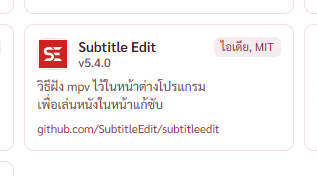
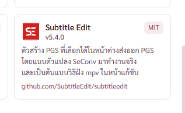
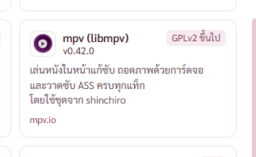
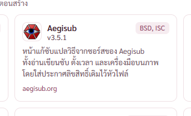

# รายงาน 14 พ.ย. 2569 · หัวข้อขอบคุณ เพิ่ม Subtitle Edit กับ mpv ย้าย Aegisub (BUGS ข้อ 122)

## ที่มา

- แคลร์เจอตอนแก้ README ก่อน push รุ่น 0.9.4 ว่าหน้าตั้งค่ายังเขียน Aegisub ว่าเป็นแค่ไอเดียตัวดูซับแบบตาราง ทั้งที่หน้าแก้ซับแปลวิธีจากซอร์ส Aegisub มาใช้จริง และยังไม่มีแถว mpv ที่แนบมาตั้งแต่ commit 7e618cb
- ตัวเล่น mpv ในหน้าแก้ซับเอาวิธีฝัง libmpv ไว้ในหน้าต่างโปรแกรมมาจาก Subtitle Edit พี่กันสั่ง *"ก็ต้องเพิ่ม subtitles edit อยู่แล้ว ไม่ต้องถาม"*

## ที่แก้

| การ์ด | เดิม | ใหม่ |
|---|---|---|
| Subtitle Edit | ไม่มี | กลุ่มไอเดียและหน้าตา รุ่น 5.4.0 ป้ายไอเดียกับ MIT ไอคอนของจริงจากซอร์ส Subtitle Edit |
| mpv (libmpv) | ไม่มีในหน้าตั้งค่า (README มีแล้ว) | กลุ่มเครื่องมือที่แนบมาทำงานจริง รุ่น 0.42.0 ป้าย GPLv2 ขึ้นไป ไอคอนของจริงจากซอร์ส mpv |
| Aegisub | กลุ่มไอเดีย "ตัวดูซับแบบตารางบรรทัด" | กลุ่มใช้สร้างโปรแกรม ป้าย BSD กับ ISC บอกว่าหน้าแก้ซับแปลวิธีจากซอร์สและใส่ประกาศลิขสิทธิ์เดิมไว้หัวไฟล์ |

- เลขรุ่นกับสัญญาเช็กจากของจริง Subtitle Edit อ่านจากหน้ารุ่นบน GitHub (v5.4.0 ออก 6 พ.ย. 2569 สัญญา MIT) mpv อ่านจากในไฟล์ `libmpv-2.dll` ที่แนบมา (mpv v0.42.0-38-gbcde6b93c)
- ปุ่มลิงก์บนการ์ดเปิดได้เฉพาะที่อยู่ในรายการตายตัวฝั่ง Rust (`latest.rs` `THANK_LINKS`) เพิ่ม `mpv.io` กับ `github.com/SubtitleEdit/subtitleedit` แล้ว
- README แถวไอเดียเพิ่ม Subtitle Edit แถว mpv ใส่เลขรุ่น 0.42.0 และเอาหมายเหตุ "หน้าตั้งค่ายังเป็นของเดิม" ออก

### Subtitle Edit

> อัปเดต 15 พ.ย. 2569 (BUGS ข้อ 123) แนบตัวแปลง SeConv ของ Subtitle Edit มาเป็นตัวสร้าง PGS ตัวที่สาม การ์ดจึงย้ายไปกลุ่มเครื่องมือที่แนบมาทำงานจริง ป้าย MIT ทั้งในหน้าตั้งค่าและ README

### mpv

### Aegisub

## ที่เจอระหว่างทำแล้วแก้

- รอบแรกข้อความตัดบรรทัดผิดความหมายสามการ์ด คือ Subtitle Edit ตัด "เล่นหนัง | ในหน้าแก้ซับ" ส่วน mpv ตัด "ใช้ชุดจาก | shinchiro" และ Aegisub ยาวห้าบรรทัดตัดกลางคำ "เวลา | เฟรม" กับ "Rust กับ | TypeScript"
- เกลาคำให้สั้นลงแล้วขึ้นบรรทัดตรงรอยต่อความหมาย วัดก่อนว่าบรรทัดยาวสุด 226 จุด ส่วนช่องข้อความแคบสุด 229 จุดที่หน้าต่าง 2560 × 1392 (1280 ได้ 243 จุด 1600 ได้ 254 จุด 1920 ได้ 260 จุด) ทุกขนาดจึงตัดที่เดิม Aegisub เหลือสามบรรทัด

## ตรวจ

- `check-settings.mjs` ผ่าน 39 จาก 39 ข้อ มีข้อใหม่ของข้อ 122 เจ็ดข้อ คือ Aegisub อยู่กลุ่มใช้สร้างโปรแกรม การ์ด Subtitle Edit กับการ์ด mpv อยู่กลุ่มถูก รุ่นกับป้ายถูก ไอคอนโหลดขึ้น ข้อความไม่ล้นการ์ด และจุดตัดบรรทัดสามการ์ดตรงที่คาด
- พิสูจน์ข้อตรวจจุดตัดบรรทัดแดงกับของที่พัง คืนข้อความเดิมของการ์ด Subtitle Edit ชั่วคราวแล้วได้ "ที่ใช้เล่นหนัง ⏎ ในหน้าแก้ซับ" ไม่ตรงที่คาด
- `cargo test --lib latest::` ผ่าน 6 ข้อ มีเทสใหม่ `every_thanks_card_link_is_in_the_fixed_list` อ่านทุกลิงก์บนการ์ดจาก `SettingsPage.tsx` (37 ลิงก์) แล้วเช็กว่าอยู่ในรายการตายตัว พิสูจน์แล้วว่าแดงเมื่อเอา `mpv.io` ออกจากรายการ บอกชื่อลิงก์ที่หาย
- ไม่ได้กดปุ่มลิงก์จริง เพราะเบราว์เซอร์จะเด้งขึ้นจอ เทสฝั่ง Rust ตรวจแทน
- ตรวจในโปรแกรมโหมดทดสอบที่เปิดอยู่หลังสุด หน้าต่าง 1280 × 800 ภาพถ่ายผ่าน CDP

## สถานะ

- ยังไม่ commit (งานเล็ก รอพี่กันสั่ง)
