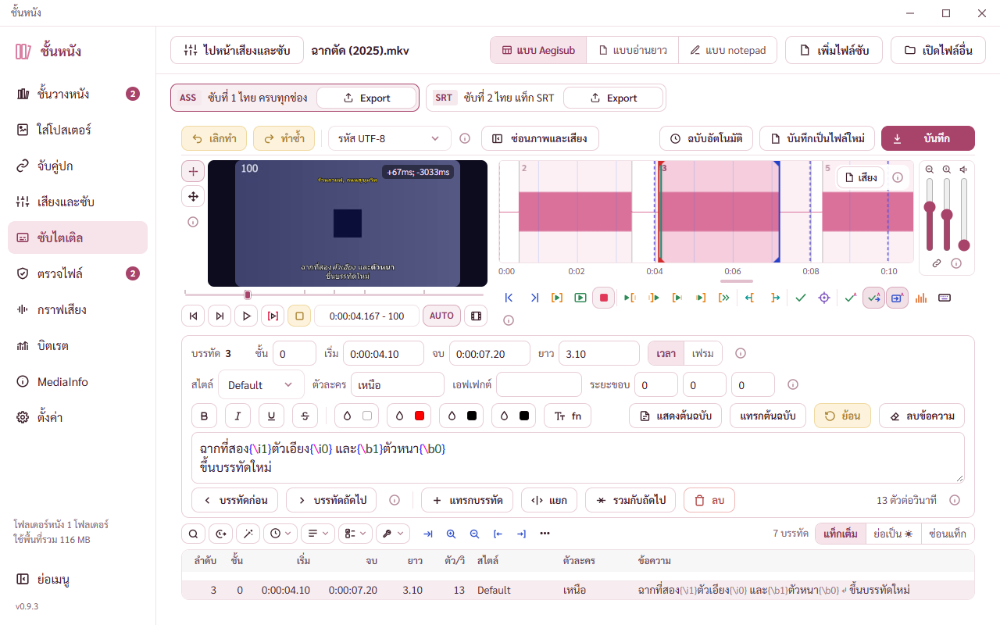

# รายงานชุด BUGS ข้อ 113 ถึง 121 (14 พ.ย. 2569)

พี่กันสั่งทำตามลำดับเดิม ข้อย่อยทำครบทั้งชุดแล้ว commit ทีเดียว *"ข้อย่อยๆนี้ ทำเสร็จเเล้ว commit ทีเดียว"* · เขียนโค้ดครบก่อนแล้วเทสตอนจบ *"เราขออเธอทำทีเดียว เเล้วเทสตอนจบได้มั้ย"* · เทสเสร็จรอสั่ง commit *"ถ้าเสร็จเเล้ว เทสได้เลยนะ อย่าเพิ่ง commit"* · ก่อน commit ขยับรุ่นเป็น 0.9.4 และสร้างตัวติดตั้ง

ภาพทั้งหมดอยู่ `docs/report-2026-11-14/ชุด113/` ถ่ายจากโปรแกรมทดสอบที่เปิดอยู่หลังสุด หน้าต่าง 1280 × 800 เว้นแต่บอกขนาด

## ข้อ 113 แถบปุ่มย่อกับแถบเลื่อนเวลาแบบ Aegisub

พี่กันสั่ง *"ปุ่มข้ามเวลาเเละเฟรม ปุ่มซูมเข้าออกที่มันจะไปลดเพิ่ม % ขนาดจอ ปุ่มเลื่อนวิดีโอ 4 แบบนี้ เเละปุ่มอื่นๆ"* · *"ทำปุ่มย่อ เเล้วใส่เข้าไปในโปรแกรมเลย"* · *"มีปุ่มลากดูวิดีโอด้วยนะ ปุ่มหยุด ปุ่มเล่น ปุ่มเล่นเฉาพในซับด้วย"*

- **แถบปุ่มย่อ** 18 ปุ่มตามแถบหลักของ Aegisub (default_toolbar.json) เรียงกลุ่มเดิม ข้ามปุ่มที่โปรแกรมนี้ไม่มี (ซับใหม่ เปิด บันทึก ไฟล์แนบ รวบรวมฟอนต์ ออโตเมชัน ผู้ช่วยสไตล์ คันจิ ตรวจคำผิด)
  - กลุ่มภาพ ข้ามไปยัง ซูมเข้า ซูมออก ภาพไปเวลาเริ่ม ภาพไปเวลาจบ · กลุ่มเวลา สอดเวลาเริ่มกับภาพ สอดเวลาจบกับภาพ เลือกบรรทัดที่ขึ้นบนภาพ สอดเวลาไปยังฉาก เลื่อนไปยังเฟรมปัจจุบัน · กลุ่มสไตล์ จัดการสไตล์ คุณสมบัติสคริปต์ · กลุ่มเครื่องมือ เลื่อนเวลา ตัวช่วยแปล เปลี่ยนความละเอียด ปรับเวลาทั้งไฟล์ · ตั้งค่า สลับการแสดงแท็ก
  - วางในแถวคำสั่งเหนือตาราง ไม่เพิ่มความสูงของหน้า ปุ่มที่ไม่พอที่ไปอยู่ในเมนูปุ่มอื่น (จุดสามจุด) ทีละกลุ่ม กดถึงทุกปุ่ม
  - แถวแคบจนปุ่มย่อขึ้นไม่ถึงสองกลุ่ม ปุ่มคำสั่งเดิม (ค้นหา เลื่อนเวลา ปรับเวลา เมนูสี่เมนู) เหลือไอคอนแบบแถวปุ่มเสียงแบบ 1 ชื่ออยู่ในคำอธิบายตอนชี้
  - ไอคอนสีตามหน้าที่ชุดเดียวกับแถวปุ่มเสียง (น้ำเงินภาพ ส้มเวลา ม่วงสไตล์ เขียวอมฟ้าเครื่องมือ)
- **หน้าต่างคุณสมบัติสคริปต์** ใหม่ แบบ dialog_properties.cpp ช่องข้อความ 8 ช่อง ความละเอียดของสคริปต์กับ Layout พร้อมปุ่มจากวิดีโอ YCbCr Matrix พร้อมปุ่มจากวิดีโอ (อ่านชนิดสีของหนังแล้วเลือกแบบ Aegisub) การตัดบรรทัด ขนาดเส้นขอบและเงา · ต่างจาก Aegisub ที่เดียว เขียนเฉพาะช่องที่แก้ (Aegisub เขียนค่าตั้งต้นทุกช่องแม้ไม่ได้แก้) · ทั้งหน้าต่างเลิกทำได้ทีเดียว
- **แถบเลื่อนเวลา** ใต้ภาพ แปลวิธีจาก video_slider.cpp คลิกหรือลาก ภาพไปเฟรมนั้น Shift ดูดไป keyframe ที่ใกล้ที่สุด หมุนล้อทีละเฟรม Shift หมุนไป keyframe ขีดบนแถบคือ keyframe
  - ต่างจาก Aegisub ที่เดียว (แคลร์ตั้ง) ซอร์สของ Aegisub เขียนบรรทัดเทียบระยะพลาด `(*pos + 1) - clickedFrame` แทน `*(pos + 1)` เงื่อนไขไม่มีวันจริง Aegisub ของจริงจึงดูดไป keyframe ตัวแรกที่ตรงหรือหลังจุดคลิกเสมอ คลิกเลย keyframe ไปนิดเดียวก็กระโดดไปตัวถัดไปไกล ๆ ทั้งที่คอมเมนต์ในซอร์สบอกว่าตั้งใจดูดตัวที่ใกล้ ของเราทำตามที่ตั้งใจ ดูดตัวที่ใกล้จริงทั้งก่อนและหลังจุดคลิก ห่างเท่ากันเลือกตัวหลัง · ตัวตรวจรอบแรกที่ยังแปลตรงตามซอร์สแดง (คลิกหลัง keyframe 96 ไปสามเฟรมได้ 192)
- **ปุ่มเล่น เล่นเฉพาะบรรทัด (วงเล็บแดง) หยุด** แยกสามปุ่มแบบ Aegisub · เล่นเฉพาะบรรทัดแบบ VideoController::PlayLine เริ่มเฟรมแรกของบรรทัด หยุดก่อนเฟรมถัดจากเฟรมสุดท้าย ใช้ได้ทั้งตัวเล่น mpv และแบบ Aegisub
- กรอบภาพพอดีกรอบกว้างอย่างน้อยพอให้แถบใต้ภาพวางปุ่มครบแถวเดียว ขนาดภาพเท่าเดิม มีแถบดำข้างภาพ
- แก้ของเดิมที่เจอระหว่างทำ ปุ่มรหัสอักษรสูง 38 ไม่เท่าปุ่มอื่น (ตัวเลือกในไฟล์สไตล์ชี้ผิดชิ้น) แถวบนจึงสูง 44 ตอนนี้ 38

## ข้อ 114 ใส่ซับกลับเข้าหนัง ภาษาแบบละเอียด ป้ายพิเศษ ฟอนต์

พี่กันสั่ง *"ส่วน mp4 มันมีข้อจำกัด ก็ต้องบอกด้วยว่าอะไรจะหายไปบ้าง"* · *"เอาเท่าที่ได้ ถ้าเป็น mp4 ส่วน mkv ต้องจัดการได้ทั้งภาษษที่หลากหลาย ป้ายพิเศษ เรื่อฟอนต์"*

- งานรวมไฟล์อ่านภาษาแบบละเอียด (zh-Hant es-419) กับป้ายพิเศษห้าป้าย (คนหูหนวก คนตาบอด คำบรรยายภาพ ภาษาต้นฉบับ เสียงบรรยาย) ของทุกแทร็ก แล้วส่งกลับให้ mkvmerge ครบ · เดิมส่งรหัสสามตัวทุกแทร็ก ภาษาแบบละเอียดหายทั้งไฟล์ · ใช้ร่วมกับหน้าเสียงและซับ ถ้าหน้าจอเปลี่ยนภาษาของแทร็ก ใช้รหัสสามตัวที่เลือก
- แทร็กซับที่แก้แล้วใส่กลับได้ภาษาแบบละเอียดกับป้ายของแทร็กเดิม
- ฟอนต์ที่ซับเรียกแต่หนังยังไม่มี หาไฟล์ข้างหนัง ฟอนต์ของผู้ใช้ ฟอนต์ของ Windows แล้วฝังเพิ่ม ชื่อฟอนต์ในหนังอ่านจากไฟล์ฟอนต์จริง · หน้าต่างบอกฟอนต์ที่ฝังเพิ่มกับที่หาไม่เจอ
- ตัวตรวจไฟล์ใหม่เช็กภาษาแบบละเอียดกับป้ายด้วย
- ไฟล์ใหม่เป็น MP4 หน้าต่างบอกทีละแทร็กว่าอะไรจะหาย (ภาษาแบบละเอียด ป้ายพิเศษ ธงซับบังคับ) พร้อมปุ่ม ⓘ

## ข้อ 115 คลื่นเสียงตรงเฟรมแรกของภาพ

พี่กันสั่ง *"มีระบบเหมือน aegi"* · ทำแบบ FFMS_DELAY_FIRST_VIDEO_TRACK เสียงในหนังเลื่อนให้เวลา 0 ตรงเฟรมแรกของภาพ ทั้งคลื่นเสียง เล่นเสียง และบันทึกเสียงของบรรทัด · ช่วงที่เสียงยังไม่เริ่มเติมเงียบ · ไฟล์เสียงแยกนับจากต้นไฟล์ตามเดิม · ยังอ่านเวลาเฟรมไม่เสร็จ นับจากต้นไฟล์ไปก่อน แล้ววาดใหม่เมื่ออ่านเสร็จ

## ข้อ 116 คำอังกฤษใต้ไอคอนเมนูซ้ายตอนพับ

พี่กันสั่ง *"เพิ่มคำภาษษอังกิดตัวเล็กๆ ใต้ icon ที เเค่ 1 คำ"* · Shelf Poster Link Tracks Subtitle Check Audio Bitrate Info Settings และปุ่มขยายเมนู Expand · ปุ่มสูงเท่าตอนกาง 42 จุด กดย่อขยายแล้วไม่กระโดด ไอคอนเลื่อนขึ้น 4 จุดแบบค่อย ๆ เปลี่ยน คำไม่ทับจุดตัวเลข ตอนกางเมนูซ่อนคำ

## ข้อ 117 ไอคอนตั้งค่าเป็นฟันเฟือง

พี่กันสั่ง *"เปลี่ยน icon ตั้งค่าเป็นฟันเฟือง เหมือนโปรแกรมอื่น เปลี่ยนทั้งโปรแกรม"* · วาดฟันเฟือง 8 ซี่ใหม่ใน icons.tsx ทุกจุดที่ใช้ไอคอนตั้งค่าเปลี่ยนตาม (7 จุด) · มอคอัป 5 ไฟล์ที่ลอกไอคอนเดิมเปลี่ยนตาม

## ข้อ 118 ส่งออกซับเป็น PGS

พี่กันสั่ง *"เพิ่มระบบส่งออกเป็นซับ PGS ได้ ส่งจาก ass นี่เเหละ"* · *"เราต้องการสิ่งที่ดีที่สุด … มันมีข้อจำกัดก็ต้องเตือนด้วย"*

- ffmpeg ที่แนบมามีแค่ตัวเขียนไฟล์ .sup ไม่มีตัวสร้างภาพ PGS จึงเขียนตัวทำเองฝั่ง Rust (pgs.rs) วาดซับด้วย libass ตัวเดียวกับตอนเล่น
  - จุดที่ภาพเปลี่ยนคือเวลาเริ่มจบของทุกบรรทัด บรรทัดเคลื่อนไหว (\move \fad \fade \t คาราโอเกะ) วาดทุกเฟรม
  - ซับคนละที่แยกเป็นสองกรอบตามมาตรฐาน Blu-ray ลดสีไม่เกิน 255 สีต่อภาพ สี YCbCr แบบ BT.709 (HD) หรือ BT.601
  - ภาพที่เหมือนภาพก่อนหน้าไม่เขียนซ้ำ ช่วงไม่มีซับเขียนชุดล้างจอ
- หน้าต่างส่งออกเปิดจากเมนูเครื่องมือหรือชนิดไฟล์ PGS ในหน้าต่างบันทึกเป็นไฟล์ใหม่ · ขนาดภาพกับอัตราเฟรมตามหนัง · เตือนข้อจำกัดที่เจอในซับจริง (เอฟเฟกต์เคลื่อนไหว ขอบเบลอหรือสีโปร่งใส ซับพร้อมกันเกินสอง SRT ไม่มีสไตล์ ขนาดที่ไม่ใช่ของ Blu-ray) · ความคืบหน้า หยุดได้ · ชื่อชนไม่เขียนทับ
- เรื่องลองหลายเครื่องมือตามที่พี่กันอนุญาต ดูหัวข้อการตรวจ

## ข้อ 119 หน้าบิตเรตตอนดูไฟล์เสียง

ข้อเสนอของเพื่อนแคลร์ที่พี่กันส่งมา · พี่กันเสริม *"อยากให้สามารถกดไปดูกราฟเสียงได้เลย"*

- ไฟล์เสียงแบบไม่เสียคุณภาพ เส้นเพดานเป็นบิตเรตของเสียงดิบ อัตราสุ่ม × บิต × จำนวนช่อง ป้ายบนกราฟขึ้นว่าเสียงดิบ แผงข้างบอกบีบเหลือกี่เปอร์เซ็นต์ของเสียงดิบ พร้อมปุ่ม ⓘ อธิบายเส้นเพดานสองแบบ
- ปุ่มดูกราฟเสียงท้ายการ์ด Bitrate ไปหน้ากราฟเสียงกับไฟล์และแทร็กเสียงเดียวกัน

## ข้อ 120 ป้ายขนาดที่คาดตอนแปลงเสียง

- แผงตั้งค่าเสียงลองแปลงจริง 4 ช่วง ช่วงละ 10 วินาที แล้วคูณขยาย (เพลงไม่เกิน 1 นาทีแปลงทั้งเพลง) ระหว่างรอใช้สูตรที่คิดจากขนาดต้นทางจริง
- คำเตือนแปลงจากแบบเสียคุณภาพเป็นแบบไม่เสียคุณภาพบอกใหญ่ขึ้นราวกี่เท่า (ข้อเสนอของเพื่อนแคลร์)

## ข้อ 121 ติ๊กเขียวหลังแปลงเสียง

แปลงแบบไม่เสียคุณภาพเสร็จ ถอดเสียงของไฟล์เดิมกับไฟล์ใหม่เป็นเสียงดิบแล้วเทียบ MD5 ตรงกันขึ้นติ๊กเขียวว่าเสียงเหมือนต้นฉบับทุกบิต ไม่ตรงขึ้นสีแดงค้างไว้ · ตั้งให้เปลี่ยนบิต อัตราสุ่ม ช่อง ความดัง ความเร็ว หรือต้นฉบับเสียคุณภาพ บอกว่าไม่ได้เทียบเพราะอะไร

## ที่เจอและแก้ระหว่างตรวจ

- **แผงแปลงเสียงขึ้นสองตัวเลขสำหรับค่าตั้งเดียวกัน** หัวแผงใช้ผลลองแปลงจริง แต่การ์ดชุดค่ายังใช้สูตร (หัวแผง 3.79 MB การ์ดชุดเดียวกัน 4.01 MB) · การ์ดชุดค่ากับการ์ดขั้นสูงคูณอัตราส่วนผลลองแปลงต่อสูตร และ "ขนาดที่คาดของแทร็กนี้" เป็นขนาดเสียงล้วนเหมือนการ์ด ส่วนตารางเทียบด้านบนเป็นขนาดไฟล์รวมรูปปก
- **ผลส่งออก PGS ขึ้นขนาด 0 MB** ไฟล์เล็กกว่า 1 MB บอกเป็น KB และต่อประโยคด้วยคำเชื่อม "5 ภาพ ขนาด 29 KB โดยลดสี 4 ภาพที่มีสีเกิน 255 สี"
- **ป้าย รายละเอียดการอัปเดต ในหน้าต่างคุณสมบัติตกบรรทัดแล้วตัวอักษรถ่าง** ป้ายยาว 118 จุด ช่อง 104 · ช่องป้ายทั้งหน้าต่างเป็น 122 จุด
- **กรอบภาพที่กว้างกว่าภาพทำให้ขยายเนื้อภาพแล้วจุดที่ชี้เคลื่อน** รอบแรกขยายตัวกรอบภาพเพื่อให้แถบใต้ภาพวางปุ่มครบแถว (check-subvtools ไม่ผ่าน 10 ข้อ) · กรอบภาพกลับเท่าภาพ วางกลางพื้นดำที่กว้างพอแทน หน้าตาเหมือนเดิม
- **Shift คลิกแถบเลื่อน** แปลตรงจากซอร์สแล้วดูดไป keyframe ถัดไปเสมอ เพราะซอร์ส Aegisub เขียนพลาด เปลี่ยนเป็นตัวที่ใกล้จริง (รายละเอียดในหัวข้อข้อ 113)
- **ของเดิม คลื่นเสียงแคบกว่าที่ตั้งใจตอนขนาดภาพ 100% และเมนูซ้ายกาง** ได้ 302 จุดแทน 360 เพราะตัวกันที่รวมแผงซูมกับความดังข้างคลื่น (78 จุด) ไว้ด้วย · กัน 360 บวกแผงข้างคลื่น
- **ของเดิม หัวกราฟหน้าความถี่เฉลี่ย จอ 1600 กับหนังเสียง 5.1** ปุ่ม 10 วินาทีทับเส้นแบ่ง 4 จุด กลุ่มช่วงที่เลือกถูกบีบจาก 313 เหลือ 295 จุด · กลุ่มนี้กับปุ่มรีเซ็ตไม่หด แถบเลื่อนซูมหดแทน · ตอนแรกใช้ตัวเลือก `:has()` แล้วเจอข้อความเตือนตามข้อถัดไป เปลี่ยนเป็นคลาส `zfix`
- **ของเดิม ข้อความเตือน ResizeObserver loop ทุกครั้งที่เข้าหน้าชั้นวาง** ตัวคิดจำนวนเรื่องต่อแถวจำความกว้าง 0 ตอนหน้าถูกซ่อน กลับมาหน้าชั้นวางเฟรมแรกเรียงแถวละเรื่อง (ตารางสูง 4,471) แล้วจัดใหม่ทั้งหมดในเฟรมเดียว · ข้ามความกว้าง 0 ทั้งตัวคิดเรื่องต่อแถวและตัวจัดแถบใต้ปก · พิสูจน์แล้ว คืนแบบเดิมเกิด 3 ครั้งต่อการเข้าหน้า 3 รอบ แบบแก้เกิด 0 · เดิมโผล่ไม่ทุกรอบตามจังหวะ check-look เจอในรอบนี้

## การตรวจ

ตรวจกับโปรแกรมโหมดพัฒนาที่เปิดอยู่หลังสุด ทุกตัวผ่านด่านหน้าต่างหน้าสุดก่อนกด (พี่กันลงเวร) หน้าต่าง 1280 × 800 เว้นแต่ตัวตรวจขนาดจอ

| ตัวตรวจ | ตรวจอะไร | ผล |
|---|---|---|
| cargo test | ฝั่ง Rust ทั้งหมด รวมเทสใหม่ PGS ส่งออกจริงเทียบภาพกับ libass ภาษาแบบละเอียดและป้ายตอนใส่ซับกลับ เวลาเฟรมแรกของภาพ ลองแปลงจริง MD5 ของเสียง | 227 จาก 227 |
| check-q113 (ใหม่) | ทุกข้อของชุด 113 ถึง 121 ผ่านหน้าจอ | 70 จาก 70 |
| check-subvideo | กรอบภาพ ขนาดภาพ keyframe | 51 จาก 51 |
| check-subvtools | เครื่องมือบนภาพ พิกัด ขยายเนื้อภาพ | 55 จาก 55 |
| check-subtools | สไตล์ เปลี่ยนความละเอียด ตัวช่วยแปล เมนูเครื่องมือ 5 คำสั่ง | 72 จาก 72 |
| check-vidplay / check-mpvplay | เล่นหนังแบบ Aegisub และ mpv หลังเปลี่ยนกรอบภาพ | 13 จาก 13 / 29 จาก 29 |
| check-subchap check-subedit check-subaudio check-subcmds check-subpad check-subremux check-subsyntax check-review-fixes | หน้าแก้ซับทุกขั้น | 27 63 52 123 22 18 34 34 ผ่านครบทุกตัว |
| check-nav | เมนูซ้ายย่อขยาย | 7 จาก 7 |
| check-bitrate-new | หน้าบิตเรต | 37 จาก 37 |
| check-convert | หน้าแปลงเสียง | 41 จาก 41 |
| check-av | หน้าเสียงและซับ | 76 จาก 76 |
| check-merge | งานรวมไฟล์ | 20 จาก 20 |
| check-look | หน้าตาทั้งโปรแกรม ไม่มีข้อผิดพลาดในหน้า | 62 ไม่ผ่าน 0 |
| check-bname check-table check-stars | ชั้นวางหลังแก้ตัวจัดแถบใต้ปก | 19 30 15 ผ่านครบ |
| check-sizes | ทุกหน้าที่ 1280 × 800, 1600 × 852, 1920 × 1032, 2560 × 1392 หน้ากราฟเปิดหนังเสียง 5.1 | 61 จาก 61 |
| check-subedit-built / check-subvtools-built | หน้าแก้ซับกับเครื่องมือบนภาพในตัวจริงใต้ CSP (สร้างแบบ debug) | 16 จาก 16 / 8 จาก 8 |

- **ข้อตรวจใหม่ที่พิสูจน์แล้วว่าจับของพังได้** Shift คลิกแดงกับโค้ดที่แปลตรงตามซอร์ส (ได้ 192 แทน 96) · การ์ดชุดค่าแดงตอนหัวแผงรวมรูปปก (3.83 กับ 3.74) · ป้ายหน้าต่างคุณสมบัติแดงเมื่อแปะความกว้าง 104 แบบเดิม (ป้ายสูง 42 ยาว 118 เกินช่อง) · ผลส่งออกแดงกับข้อความเดิม "0 MB" · check-sizes แดงกับหัวกราฟเดิม · check-look แดงกับหน้าชั้นวางเดิม · เทส PGS เทียบภาพแดงตอนสลับช่องสี Cr กับ Cb ชั่วคราว (ต่างเฉลี่ย 2.16)
- **ตัวตรวจเดิมที่แก้ให้ตรงของใหม่** check-subtools นับเมนูเครื่องมือ 5 คำสั่ง · check-av ตั้งการ์ดตั้งค่าแทร็กแบบกางใต้แถวชั่วคราว (ค่าที่ค้างในโปรแกรมทดสอบเป็นแบบหน้าต่างซ้อน หัวการ์ดอยู่หัวหน้าต่าง) แล้วคืนค่าเดิม · check-sizes เปิดหนังเสียง 5.1 ในหน้ากราฟทุกครั้ง
- **เลขรุ่น** 0.9.3 เป็น 0.9.4 ตามที่พี่กันสั่ง ขยับห้าไฟล์ (package.json package-lock.json tauri.conf.json Cargo.toml Cargo.lock) · ตัวติดตั้งกับผล check-install อยู่หัวข้อตัวติดตั้งข้างล่าง · ยังไม่ commit รอพี่กันสั่ง
- **ตัวติดตั้ง** `src-tauri\target\release\bundle\nsis\ชั้นหนัง_0.9.4_x64-setup.exe` ขนาด 186.67 MiB (195,740,306 ไบต์ ใหญ่กว่า 0.9.3 ราว 34 MiB เพราะมี libmpv สำหรับเล่นหนังในหน้าแก้ซับที่เพิ่มหลัง 0.9.3) · SHA-256 `6EC5AF4290A07FB3CC25D80F5A0DF185B33C41B02D9B1E12F94AEF4782669D51` · check-install 15 จาก 15 (ติดตั้งเงียบไม่มีหน้าต่าง เครื่องมือ 28 ไฟล์ค่า hash ตรง เปิดตัวที่ติดตั้งแบบอยู่หลังสุด ปกโหลดใต้ CSP หยุดงานแล้วปิดระหว่างครอบไฟล์ 1.6 GB ถอนเงียบ ไฟล์หนังเท่าเดิม คืนทางลัดกับค่าตั้งของตัวที่ติดตั้งไว้) · ผ่านครบตัวตรวจลบโฟลเดอร์ทดสอบเอง
- **ยังไม่ได้ตรวจ** ตัวจริงใต้ CSP รันเฉพาะสองตัวของหน้าแก้ซับ ชุด run-built-all ทั้งหมดไม่ได้รันรอบนี้ · ส่งออก PGS ยังไม่ได้ลองเปิดกับเครื่องเล่น Blu-ray จริงหรือโปรแกรม PGS ตัวอื่น (ffmpeg ถอดได้และภาพตรงกับ libass) · เครื่องมือ PGS ตัวอื่น (Subtitle Edit, SUPer) ต้องโหลดจากเน็ต ต้องขออนุญาตพี่กันก่อนจึงยังไม่ได้ลองเทียบ · ใส่ซับกลับเข้าหนังจริงของพี่กันกับฟอนต์ที่ฝังเพิ่ม พี่กันต้องลองเอง · เสียงที่ได้ยินตอนเล่นเฉพาะบรรทัดตัวตรวจฟังไม่ได้
