# ประเมินหน้าตาและการใช้งาน หน้าแก้ซับ

เริ่ม 14 พ.ย. 2569 ระหว่างทำแผนหน้าแก้ซับขั้น 6 ถึง 10 (BUGS ข้อ 109)
พี่กันสั่ง *"ระหว่างทำ เราอยากให้เธอประเมิน UXUI ไปด้วยนะ ว่ามันเหมาะสม สวย ใช่งานง่ายจริงๆไหม ที่ว่างยังเหลือเยอะไหม"*

ประเมินจากภาพจริงของโปรแกรมทดสอบ (โหมดพัฒนา) หน้าต่าง 1280 × 800 (ไม่กดขยาย ทุกจอเท่ากัน) กับ 1920 × 1032 (จอ 1080 กดขยาย) ด้วยหนังทดสอบ ฉากตัด (2025).mkv

สถานะ ✅ แก้แล้ว · 🔨 ทำในขั้นถัดไปของแผน · ⬜ รอพี่กันเคาะ · 💬 ข้อสังเกต ไม่ต้องแก้

## ภาพรวมทั้งหน้า

| ข้อ | สถานะ | เรื่อง |
|---|---|---|
| U1 | ✅ ⬜ | **หน้าต่าง 1280 × 800 ตารางบรรทัดสูงแค่ 81 จุด เห็นหัวตารางกับราวสองแถว** ไล่ซับยาว ๆ ในตารางแทบไม่ได้ ต้องใช้ปุ่มบรรทัดถัดไปหรือคีย์ลัดแทน · ที่กินความสูงไปคือ แถบบน แถบแทร็ก แถบเครื่องมือ (รวมราว 150 จุด) ภาพหนังกับคลื่นเสียง (ราว 210 จุด) ช่องแก้บรรทัดสี่แถว (ราว 230 จุด) · ขั้น 8 ใส่ปุ่มซ่อนภาพและเสียงแล้ว ตารางสูง 79 เป็น 281 จุด (ข้อ U20) · ทางเพิ่มที่เสนอให้เลือก ข้อ U2 กับ U3 ยังรอพี่กันเคาะ |
| U2 | ⬜ | **ช่องแก้บรรทัด แถวเวลากับแถวสไตล์ ฝั่งขวาว่างเกือบครึ่งแถว** ทั้งที่ 1280 (ว่างราว 330 จุด) และ 1920 (ว่างราว 950 จุด) · เสนอ ตอนหน้าต่างกว้างตั้งแต่ราว 1600 จุด รวมสองแถวเป็นแถวเดียว ประหยัดราว 40 จุด ตารางได้เพิ่มหนึ่งแถว · ที่ 1280 รวมไม่พอ ของสองแถวยาวรวมราว 1,500 จุด |
| U3 | ⬜ | **แถบชื่อแทร็ก (ASS ซับที่ 1 ไทย ครบทุกช่อง Export) ใช้ทั้งแถวแต่มีของแค่ครึ่งซ้าย** · เสนอย้ายไปอยู่แถวเดียวกับปุ่มเลิกทำ ทำซ้ำ รหัสอักษร ตอนมีแทร็กไม่เกินสองแทร็ก ประหยัดราว 44 จุด · ต้องลองว่าแถบเครื่องมือยังไม่ล้นตอนเมนูซ้ายกาง |
| U4 | 💬 ⬜ | **ปุ่มที่กดไม่ได้เป็นสีเหลืองอ่อน เด่นกว่าปุ่มที่กดได้** เช่น เลิกทำตอนยังไม่มีอะไรให้เลิก ย้อน ขนาดในไฟล์ ย้ายขึ้น · ตาไปหาปุ่มที่ใช้ไม่ได้ก่อน · เป็นแบบเดียวกันทั้งโปรแกรม ไม่แก้เฉพาะหน้านี้ เสนอให้พี่กันพิจารณาว่าจะเปลี่ยนเป็นสีจางลงไหม |
| U5 | 💬 | หน้าต่าง 1920 × 1032 ตารางเห็นครบ 7 บรรทัดพร้อมที่ว่าง แถวปุ่มเสียงแบบ 2 มีชื่อใต้ไอคอน อ่านง่าย · ภาพหนังยังเล็ก 288 × 162 ทั้งที่จอกว้าง ที่ว่างไปอยู่กับคลื่นเสียงที่ยาวขึ้นแทน ซึ่งเหมาะกับการลากเวลา |

## แถบเหนือตารางกับเมนู (ขั้น 6)

| ข้อ | สถานะ | เรื่อง |
|---|---|---|
| U6 | ✅ | ปุ่มสูง 32 จุดดันแถบให้สูงขึ้น ตารางที่ 1280 × 800 เหลือความสูงขั้นต่ำ หน้าเลื่อนได้ 3 จุด แก้ให้ปุ่มสูง 26 เท่าปุ่มแท็ก (commit 941ca22 บั๊ก B1) |
| U7 | ✅ | เมนูบรรทัด 22 คำสั่งเรียงทีละแถวยาว 607 จุด ต้องเลื่อนในเมนู จัดคำสั่งที่เป็นคู่ไว้แถวเดียวซ้ายขวา เหลือ 467 จุด ไม่ต้องเลื่อน |
| U8 | ✅ | เมนูวิดีโอกางทับเมนูซ้ายของโปรแกรม (พี่กันส่งภาพ *"ทับ"*) ใส่ตัววัดแนวนอนให้ของที่กางทุกตัว 9 จุดทั้งโปรแกรม  |
| U9 | 💬 | ที่ว่างของแถบเหนือตาราง เมนูซ้ายย่อเหลือราว 240 จุดระหว่างเมนูเครื่องมือกับตัวนับบรรทัด เมนูซ้ายกางเหลือราว 100 จุด ใส่ปุ่มเพิ่มได้อีกไม่เกินหนึ่งปุ่ม · ข้อความผลของคำสั่งขึ้นแทนที่ตัวนับบรรทัดชั่วคราว แถบจึงไม่แน่นขึ้น  |
| U10 | 💬 | เมนูบรรทัดยังยาว 22 คำสั่ง แต่แบ่งเป็นสี่กลุ่มด้วยเส้นคั่น (แทรก · แยก รวม · ย้าย · คัดลอก วาง ลบ) และมีคีย์ลัดชิดขวา ใกล้เคียงเมนูแก้ไขของ Aegisub  |

## หน้าต่างคำสั่ง (ขั้น 6)

| ข้อ | สถานะ | เรื่อง |
|---|---|---|
| U11 | ✅ | ปุ่ม ⓘ ทับท้ายคำป้ายแถว (ช่องป้ายแคบ 84 จุด) ขยายเป็น 104 จุด |
| U12 | ✅ | หน้าต่างปรับเวลาทั้งไฟล์ แถว keyframe สี่ช่องล้นขอบขวา แยกเป็นแถวเวลาเริ่มกับเวลาจบ มีหน่วย ms ตามหลังตัวเลขทุกช่อง  |
| U13 | ✅ | เปิดหน้าต่างแล้วโฟกัสไปอยู่ปุ่ม ⓘ มีวงสีเข้ม ย้ายเคอร์เซอร์ไปช่องแรกที่ต้องพิมพ์ พิมพ์ได้ทันที |
| U14 | ⬜ | **ค้นและแทนที่เป็นหน้าต่างบังกลางจอ** บังช่องแก้บรรทัด ยังเห็นแถวที่เจอในตารางข้างล่าง · Aegisub เป็นหน้าต่างลอยที่กดตารางต่อได้ · เสนอทำเป็นแถบค้นหาเหนือตารางแบบไม่บัง ภายหลัง  |

## เครื่องมือของซับ (ขั้น 7)

| ข้อ | สถานะ | เรื่อง |
|---|---|---|
| U15 | ✅ | ตัวช่วยแปล ปุ่มหลักใส่คำแปลแล้วไปต่อตกไปแถวที่สองคนเดียว ย้ายไปแถบล่างขวาแบบหน้าต่างอื่น · ข้อความผล (เป็นท่อนแรกแล้ว) ย้ายไปแถวเดียวกับเลขบรรทัด หน้าต่างไม่สูงขึ้นตอนมีข้อความ  |
| U16 | ✅ | หน้าต่างแก้สไตล์ แถวสีสี่สีตัดบรรทัดเหลือสีเงาตัวเดียว จัดเป็นสองคูณสอง · ป้าย ระยะ กำกวมกับระยะขอบ เขียนเต็มว่าระยะตัวอักษร  |
| U17 | ✅ | หน้าต่างเปลี่ยนความละเอียด ปุ่มขนาดสำเร็จรูปตัวสุดท้ายตกแถว เหลือสี่ขนาดแถวเดียว · ข้อความล่างตัดบรรทัดกลางคำ รูปวาด เกลาให้สั้นบรรทัดเดียว รายละเอียดย้ายไปใน ⓘ · แถวระยะขอบแบบกำหนดเองล้น แยกสวิตช์ลงแถวใหม่ |
| U18 | 💬 | ตัวจัดการสไตล์ รายการสูง 320 จุด เห็นราว 7 สไตล์โดยไม่เลื่อน ไฟล์ทั่วไปมีไม่เกินนี้ · บอกจำนวนบรรทัดที่ใช้แต่ละสไตล์ ช่วยตัดสินใจก่อนลบ  |
| U19 | 💬 | ตัวอย่างสไตล์วาดด้วย CSS ไม่ใช่ตัววาดซับของโปรแกรมเล่น ขอบ เงา กล่องทึบใกล้เคียงแต่ไม่ตรงทุกจุด บอกไว้ใต้ตัวอย่างแล้ว · ตัวอย่างจริงทีละเฟรมรอระบบดูวิดีโอในแอป (ROADMAP) |

## ปุ่มซ่อนภาพและเสียงกับแบบ notepad (ขั้น 8)

| ข้อ | สถานะ | เรื่อง |
|---|---|---|
| U20 | 💬 | ปุ่มซ่อนภาพและเสียงอยู่แถบเครื่องมือข้างรหัสอักษร กดแล้วตารางที่ 1280 × 800 สูง 79 เป็น 281 จุด ไฟล์ทดสอบเห็นครบ 7 บรรทัด ไฟล์ยาวเห็นราว 8 แถว · ปุ่มเปลี่ยนชื่อเป็นแสดงภาพและเสียงพร้อมสีกดค้าง จำไว้หลังปิดเปิด · คีย์ลัดที่ใช้เฟรมของหนัง เช่น Ctrl+3 ยังใช้ได้ตอนซ่อน 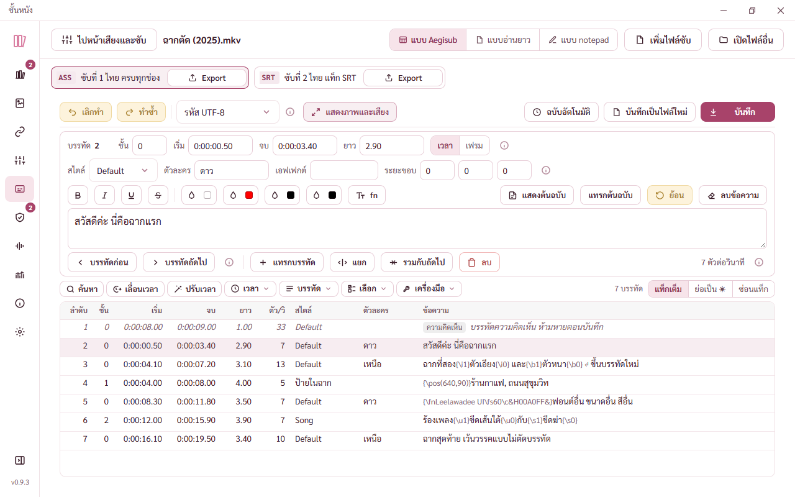 |
| U21 | ✅ | กรอบ notepad เดิมคิดความสูงจากเลขหักขอบตายตัว 24 จุด หน้าเลื่อนเกิน 8 จุด แล้วรอบแก้แรกค้างที่ 420 จุดไม่ขยายตามจอ · เปลี่ยนเป็นวัดแบบเดียวกับตารางของหน้าแก้ซับ ได้ 547 จุดที่ 1280 × 800 กับ 779 จุดที่ 1920 × 1032 หน้าไม่เลื่อนทั้งสองขนาด 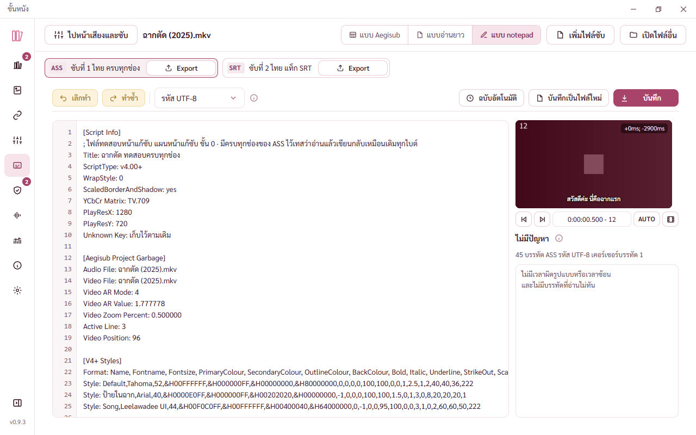 |
| U22 | ✅ | ข้อความตอนไม่มีปัญหายาวเกินช่อง 300 จุดนิดเดียว ตกบรรทัดแล้วบรรทัดบนโดนกระจายแบบไทยจนตัวอักษรถ่าง แบ่งเป็นสองประโยคบรรทัดละประโยคแทน |
| U23 | ✅ | รายการปัญหาเวลาผิดรูปแบบ ข้อความตัดบรรทัดกลางตัวเลขเวลา (0:00: ตกไปบรรทัดล่าง) แยกเป็นหัวข้อปัญหาบรรทัดแรก เวลาที่อ่านได้บรรทัดที่สอง เวลาแต่ละค่าเป็นก้อนเดียว 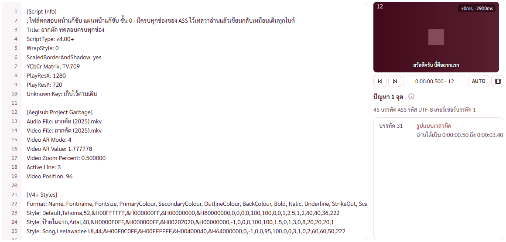 |
| U24 | 💬 | หน้าต่าง 1920 × 1032 ลองขยายแผงขวาเป็น 420 จุด แต่ภาพหนังยังกว้าง 288 จุดตามขนาดภาพที่ตั้งไว้ เหลือที่ว่างข้างภาพ จึงคืนเป็น 300 จุด ที่ว่างไปอยู่กับช่องพิมพ์ ซึ่งเห็นบรรทัด Format ยาว ๆ ได้ครบ 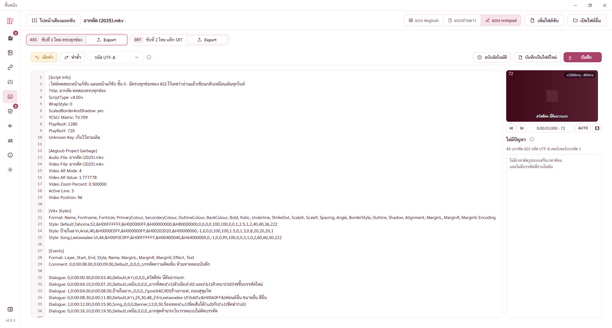 |
| U25 | 💬 | ช่องพิมพ์ไม่ตัดบรรทัดยาวเหมือน Notepad บรรทัดสไตล์ที่ยาวต้องเลื่อนแนวนอน เลขบรรทัดด้านซ้ายจึงตรงกับบรรทัดจริงในไฟล์ ใช้อ้างกับรายการปัญหาได้ |

## ใส่ซับกลับเข้าหนัง (ขั้น 9)

| ข้อ | สถานะ | เรื่อง |
|---|---|---|
| U26 | ✅ | หน้าต่างถามสองทาง เปิดแล้วโฟกัสไปตกที่ปุ่ม ⓘ มีวงสีเข้ม ย้ายโฟกัสไปปุ่มบันทึกเป็นไฟล์ข้างหนัง ซึ่งเป็นทางที่ไม่แตะไฟล์หนัง กด Enter แล้วไม่สร้างหนังใหม่โดยไม่ตั้งใจ |
| U27 | ✅ | แถวแทร็กซับเดิมขึ้นรหัสดิบ แทร็กที่ 2 tha ครบทุกช่อง ass เขียนใหม่เป็น แทร็กที่ 2 ครบทุกช่อง ภาษาไทย แบบ ASS · คำนำ ชื่อไฟล์ บันทึกซับที่แก้ได้สองทาง อ่านสะดุด เขียนใหม่เป็นประโยคบอกสองทาง แล้วแยกชื่อหนังเป็นแถวของตัวเอง 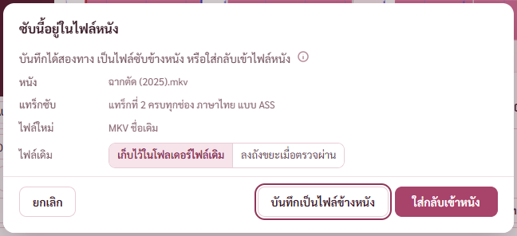 |
| U28 | 💬 | ปุ่มสามปุ่มเรียงจากทางที่ปลอดภัยไปทางที่แตะหนัง ยกเลิกชิดซ้าย บันทึกเป็นไฟล์ข้างหนัง ใส่กลับเข้าหนังเป็นปุ่มหลักขวาสุด ตัวเลือกไฟล์เดิมตั้งต้นตามหน้าตั้งค่า ⓘ บอกข้อดีข้อเสียของสองทาง · ระหว่างรวมไฟล์มีแถบความคืบหน้ากับปุ่มหยุด ปิดหน้าต่างไม่ได้จนจบ |

## ทุกขนาดจอกับตัวจริง (ขั้น 10)

| ข้อ | สถานะ | เรื่อง |
|---|---|---|
| U29 | 💬 ⬜ | **หน้าต่าง 1600 × 852 (จอเครื่องที่ รพ. กดขยาย) ตารางเห็นราว 3 บรรทัด** อาการเดียวกับ U1 เพราะความสูงต่างจาก 1280 × 800 แค่ 52 จุด ปุ่มซ่อนภาพและเสียงช่วยได้ ข้อเสนอ U2 กับ U3 ช่วยทั้งสองขนาด 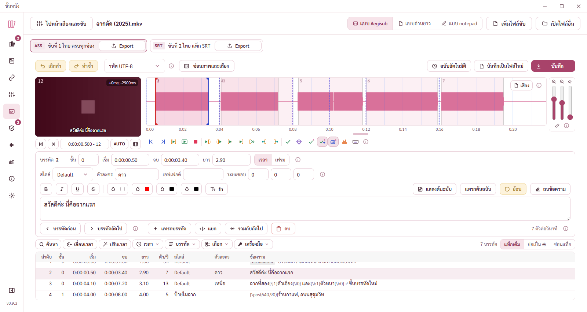 |
| U30 | 💬 ⬜ | **จอ 1080 กับ 2K ภาพหนังยังเล็ก 288 × 162 จุดเท่าจอเล็ก** ที่ว่างไปอยู่กับคลื่นเสียงที่ยาวขึ้นและตาราง ซึ่งเหมาะกับลากเวลา แต่ดูหน้าคนในฉากยาก · เสนอให้ขนาดภาพตั้งต้นขยายตามความสูงหน้าต่าง ตอนนี้ปรับเองได้ 12.5% ถึง 300% ในเมนูวิดีโอ 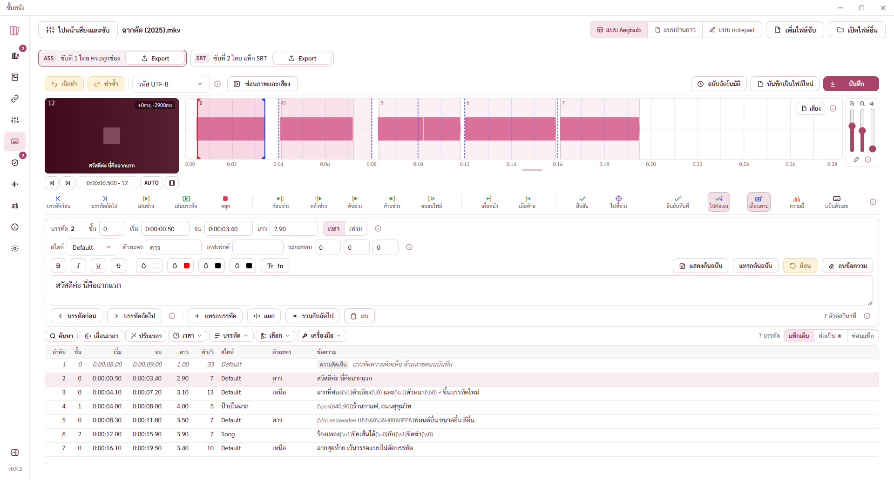 |
| U31 | 💬 | ทุกขนาด 1280 × 800 ถึง 2560 × 1392 ทั้งหน้าหลัก ซ่อนภาพและเสียง notepad ไม่ล้นขวา ปุ่มในแถบเครื่องมือ แถบเหนือตาราง ช่องแก้บรรทัด แถวปุ่มเสียงไม่ซ้อนกัน หน้าไม่เลื่อนแนวตั้ง (ตัวตรวจขนาดจอ 12 จาก 12 ข้อ) |
| U32 | ✅ | **ตัวจริงกด Ctrl+S กับ Ctrl+Shift+S ในหน้าแก้ซับไม่มีอะไรเกิดขึ้น** ตัวกันคีย์ลัดของเบราว์เซอร์ในตัวจริงกันไว้ก่อน โหมดพัฒนาไม่มีตัวกันจึงไม่เจอ แก้แล้ว ปุ่มบันทึกบนจอใช้ได้มาตลอด |

## สรุปข้อใหญ่ให้พี่กันเคาะ

1. **ตารางเตี้ยที่หน้าต่าง 1280 × 800 กับ 1600 × 852** (U1 U29) ตอนนี้มีปุ่มซ่อนภาพและเสียงแล้ว ทางเพิ่มสองทาง
   - U2 ตอนหน้าต่างกว้างตั้งแต่ราว 1600 จุด รวมแถวเวลากับแถวสไตล์ของช่องแก้บรรทัดเป็นแถวเดียว ตารางได้เพิ่มหนึ่งแถว
   - U3 ย้ายแถบชื่อแทร็ก (ASS ซับที่ 1 ไทย และปุ่ม Export) ไปแถวเดียวกับปุ่มเลิกทำ ตอนมีแทร็กไม่เกินสองแทร็ก ตารางได้เพิ่มราวหนึ่งแถวครึ่ง
2. **ปุ่มที่กดไม่ได้เป็นสีเหลืองอ่อน เด่นกว่าปุ่มที่กดได้** (U4) เป็นแบบเดียวกันทั้งโปรแกรม จะให้เปลี่ยนเป็นสีจางลงไหม
3. **ค้นและแทนที่เป็นหน้าต่างบังกลางจอ** (U14) ทำเป็นแถบค้นหาเหนือตารางที่ไม่บังไหม
4. **ภาพหนังเล็กเท่าเดิมทุกจอ** (U30) ให้ขนาดภาพตั้งต้นขยายตามความสูงหน้าต่างไหม
5. ทางที่แคลร์เลือกในแผนที่พี่กันยังไม่ได้เคาะ
   - กดบันทึกซับที่เป็นไฟล์ เขียนทับไฟล์เดิม ไฟล์เดิมลงถังขยะ
   - กดบันทึกซับที่อยู่ในหนัง ถามสองทาง บันทึกเป็นไฟล์ข้างหนัง หรือใส่กลับเข้าหนัง (U26 ถึง U28)
   - แถวปุ่มเสียงสลับเป็นแบบไอคอนอย่างเดียวเมื่อหน้าต่างสูงไม่ถึง 950 จุด

6. **ตัวเลขระยะห่างมุมขวาบนของภาพถูกภาพของ mpv บังตอนเล่น** (U34) Aegisub ยังเห็นตัวเลขนี้ตอนเล่น เสนอย้ายตัวเลขไปไว้ในแถบใต้ภาพ (แบบ Aegisub ที่มีช่องระยะห่างอยู่ในแถบ) ซึ่งตรงกับงานแถบปุ่มย่อ BUGS ข้อ 113

ข้อสังเกตเพิ่มจากภาพตัวจริง

| ข้อ | สถานะ | เรื่อง |
|---|---|---|
| U33 | 💬 | ซับบนภาพหนังวาดทุกบรรทัดที่เห็นซ้อนกันด้านล่าง ป้ายที่มี `\pos(640,90)` ซึ่งโปรแกรมเล่นวางไว้ด้านบนก็ขึ้นด้านล่างด้วย เพราะเป็นตัวอย่างข้อความ ไม่ใช่ตัววาดซับจริง ตำแหน่งจริงกับเครื่องมือจัดตำแหน่งรอระบบดูวิดีโอในแอป (ROADMAP) 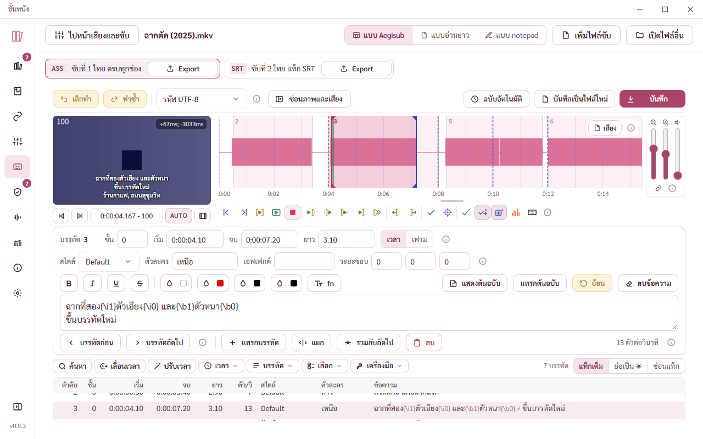 |

## เล่นหนังด้วย mpv (BUGS ข้อ 111)

| ข้อ | สถานะ | เรื่อง |
|---|---|---|
| U34 | 💬 ⬜ | **ตอนเล่นด้วย mpv ตัวเลขมุมขวาบนของภาพ (เช่น +0ms; -2900ms) ถูกภาพบัง** เพราะ mpv วาดในหน้าต่างของตัวเองที่วางทับกรอบภาพ ของในหน้าจอโปรแกรมที่อยู่บนภาพจึงไม่เห็นระหว่างเล่น · ตัวเลขกลับมาเมื่อหยุด · Aegisub เห็นตัวเลขนี้ตอนเล่น เพราะช่องระยะห่างอยู่ในแถบใต้ภาพ ไม่ได้ลอยบนภาพ · เสนอย้ายไปแถบใต้ภาพพร้อมงานข้อ 113 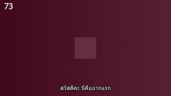 |
| U35 | 💬 | ภาพที่ mpv วาดตรงกรอบภาพพอดีทุกจุด ซับขึ้นพร้อมสี ตำแหน่ง และฟอนต์จริงของ ASS เลขเฟรมที่พิมพ์ในหนังทดสอบ (73) ตรงกับช่องเวลาใต้ภาพ (73) · ซูม 200% ภาพขยายตรงกับภาพนิ่งที่ซูมเท่ากัน · หนัง HEVC เล่นด้วยการ์ดจอ (d3d11va) · ข้อ U33 ซับซ้อนด้านล่างจึงเหลือเฉพาะตอนภาพนิ่ง ตอนเล่นด้วย mpv ป้ายที่มี `\pos` ขึ้นตรงตำแหน่งจริง 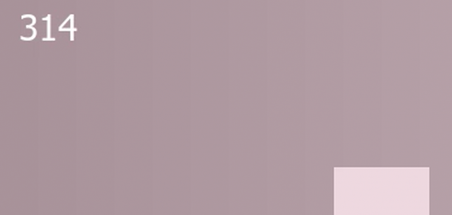 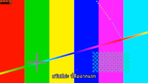 |
| U36 | 💬 | มีเมนู กล่องอธิบาย หรือหน้าต่างซ้อนเปิดทับกรอบภาพ ภาพของ mpv ซ่อนไว้ก่อน หนังเล่นต่อ ปิดแล้วภาพกลับมา (ไม่งั้นหน้าต่างของ mpv บังเมนู) ระหว่างนั้นเห็นภาพนิ่งเฟรมที่กดเล่น |
| U37 | ✅ | กล่อง ⓘ ของแถวตัวเล่นในหน้าตั้งค่า รอบแรกตัดบรรทัดกลางวลี "ถอด / ภาพ" "หรือกด / Ctrl+P" และบรรทัดข้อดีตัวอักษรถ่าง เกลาคำและขึ้นบรรทัดตรงจุดที่ตัดอยู่แล้ว ทุกบรรทัดตัดตรงรอยต่อของความหมาย กล่องพอดีไม่ต้องเลื่อน 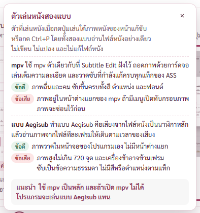 |

## เครื่องมือบนภาพกับเมนูคลิกขวา (BUGS ข้อ 111 ส่วนที่สองและสาม)

| ข้อ | สถานะ | เรื่อง |
|---|---|---|
| U38 | ⬜ | **กรอบภาพแบบพอดีกรอบเล็กคงที่ 288 × 162 ทุกขนาดจอ** จอ 1920 × 1032 คลื่นเสียงได้ที่ไปเกือบหมด ภาพยังเล็กเท่าจอ 1280 × 800 ซับที่ libass วาดตัวเล็กมาก จุดจับของสองบรรทัดอยู่ชิดตัวอักษร ลากได้แต่ต้องเล็งนาน ตอนจัดตำแหน่งต้องเลือกขนาดภาพเองจากเมนูวิดีโอหรือ Ctrl กับล้อเมาส์ · ทางที่เสนอ ให้พอดีกรอบขยายตามที่ว่างของจอ เช่นสูงตามแถวคลื่นเสียงที่ขยายแล้ว หรือมีขนาดภาพแบบใหญ่ตอนเลือกเครื่องมือลาก 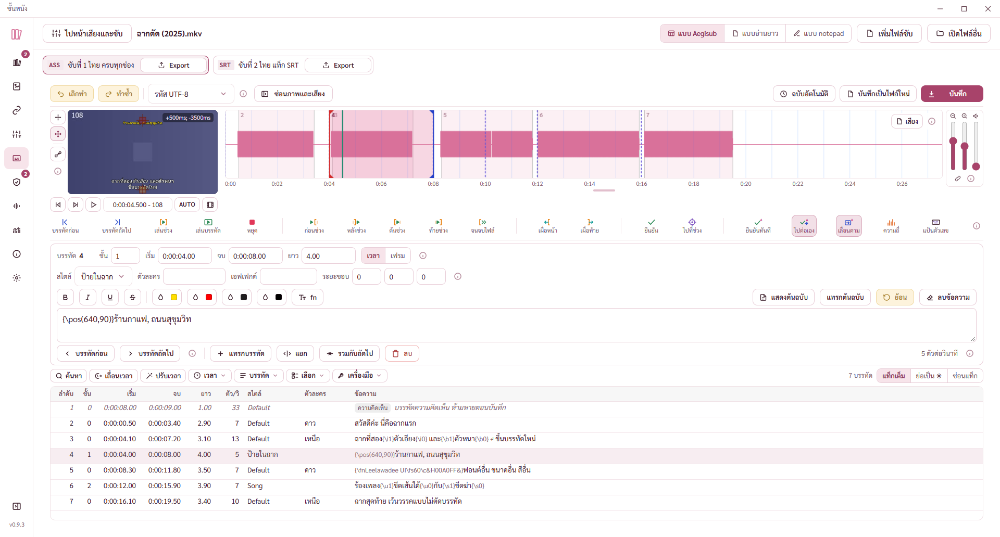 |
| U39 | 💬 | ซับบนภาพนิ่งวาดด้วย libass ตัวเดียวกับ mpv ตำแหน่งจาก \pos สี ตัวเอียง ตัวหนา และการตัดบรรทัดตรงกับตอนเล่น เดิมเป็นข้อความธรรมดาอยู่กลางล่างเสมอ ป้ายที่จัดไว้ด้านบนจึงไม่เคยขึ้นตรงที่  |
| U40 | 💬 | แถบเลือกเครื่องมือตั้งอยู่ซ้ายของภาพแบบ Aegisub กว้าง 34 จุดรวมช่องห่าง เอาที่จากคลื่นเสียง ที่ 1280 × 800 คลื่นเสียงยังกว้างพอ ปุ่มสลับ \move กับ \pos ขึ้นเฉพาะตอนเลือกเครื่องมือลาก 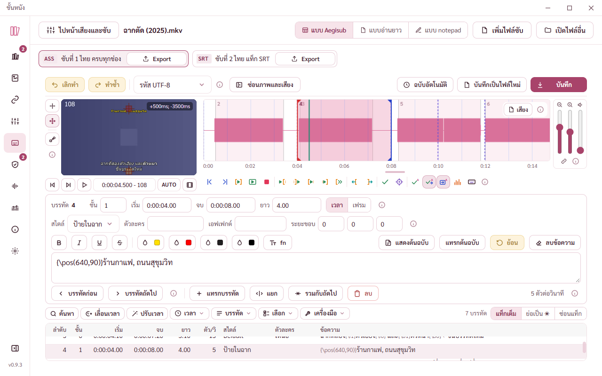 |
| U41 | 💬 | พิกัดของกากบาทตัวขาวขอบดำ อ่านได้ทั้งบนภาพมืดและสว่าง วางที่มุมของกากบาทที่ใกล้กลางภาพแบบ Aegisub เมาส์ซ่อนตอนชี้ภาพ 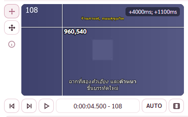 |
| U42 | 💬 | จุดจับใช้สีของ Aegisub เส้นขอบน้ำตาลเข้มบนภาพมืดเห็นไม่ชัดนัก แต่พื้นสีส้มกับแดงของจุดที่เลือกเห็นชัด จุดเริ่มกับจุดปลายของ \move ที่ห่างกันไม่ถึง 30 จุดไม่วาดลูกศร (แบบ Aegisub) 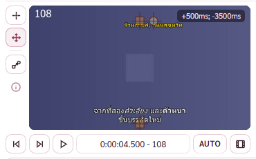 |
| U43 | 💬 | เมนูคลิกขวาแบ่งกลุ่มตาม Aegisub คำสั่งที่ยังกดไม่ได้บอกเหตุผลตอนชี้ (รีเซ็ตการเลื่อนภาพตอนภาพอยู่กลางกรอบอยู่แล้ว) วางที่เมาส์ ขวาหรือล่างไม่พอกางกลับทาง 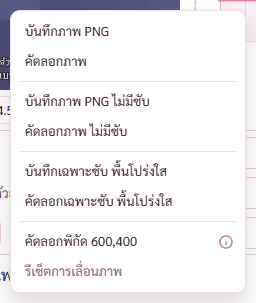 |
| U44 | 💬 | แจ้งผลของเมนูลอยทับล่างซ้ายของภาพ บังซับล่างอยู่ 4 วินาทีแล้วหายเอง ไม่วางด้านบนเพราะชนตัวเลขระยะห่างมุมขวาบนเมื่อชื่อไฟล์ยาว 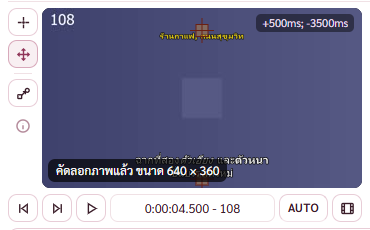 |
| U45 | ⬜ | **ของเดิม เจอระหว่างตรวจรอบนี้** หน้าต่าง 1280 × 800 เลือกขนาดภาพใหญ่กว่าพอดีกรอบ (เช่น 50% ของหนัง 640 × 360 ได้ภาพสูง 180) หน้าแก้ซับเลื่อนแนวตั้งได้ 17 จุด ผิดกฎหน้าแก้ซับห้ามเลื่อนทั้งหน้า · กรอบภาพยอมสูงได้ถึง 45% ของหน้าต่าง แต่หน้า 800 จุดไม่มีที่เหลือ · ทางที่เสนอ จำกัดความสูงกรอบตามที่ว่างจริงของหน้า ภาพที่สูงกว่าเลื่อนในกรอบแทน (ไปพร้อม U38) |

## สีอักษรในช่องพิมพ์ (BUGS ข้อ 112)

| ข้อ | สถานะ | เรื่อง |
|---|---|---|
| U46 | 💬 | แท็กในช่องพิมพ์แยกสีตาม Aegisub วงเล็บปีกกาน้ำเงิน ทับกับวงเล็บม่วงชมพู ชื่อแท็กเทาหนา ค่าเขียวเข้ม ข้อความปกติสีตัวหนังสือของโทน อ่านแท็กยาวง่ายขึ้นมาก เคอร์เซอร์กับแถบเลือกตรงตัวอักษร 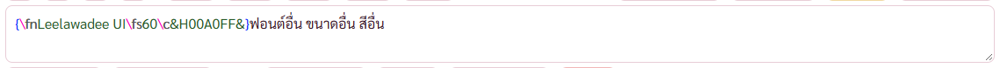 |
| U47 | 💬 | โทนกลางคืน สีเข้มของ Aegisub ถูกตัวแปลงโทนปรับเป็นสีอ่อน อ่านได้ทุกสี ความต่างกับพื้น 7 ถึง 15 เท่า ส่วนทับสีม่วงชมพูราว 5 เท่า 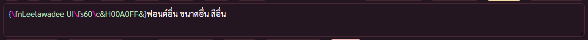 |
| U48 | 💬 | ไฟล์ SRT ยังเป็นตัวอักษรสีเดียว (แท็กแบบ <i> ไม่ใช่ไวยากรณ์ของ ASS) Aegisub แปลง SRT เป็น ASS ก่อนแสดง ของเราแสดงแท็กแบบ SRT ตามไฟล์ |
