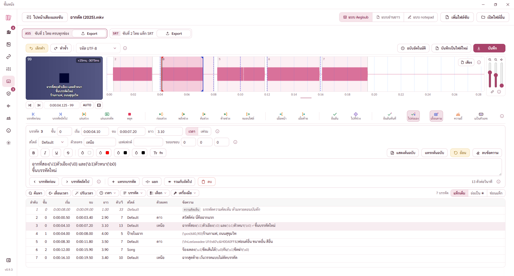
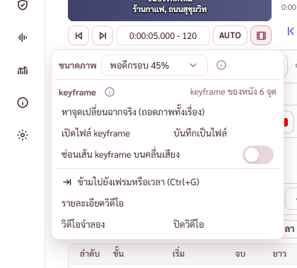
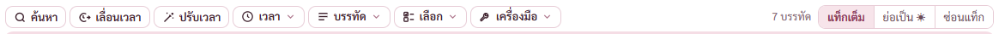
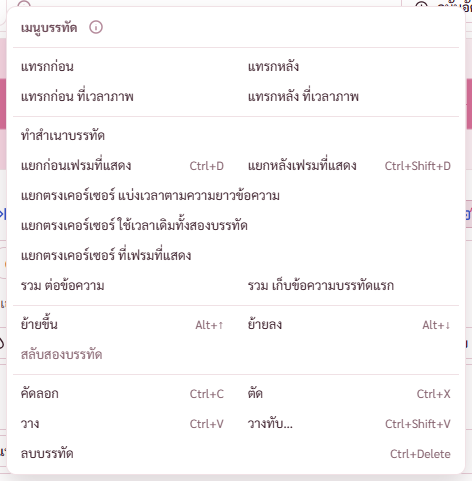
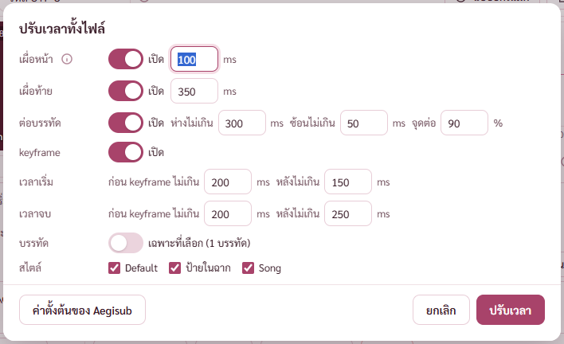
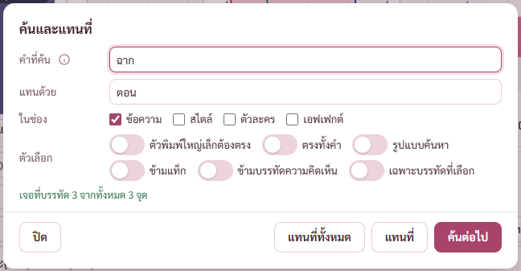
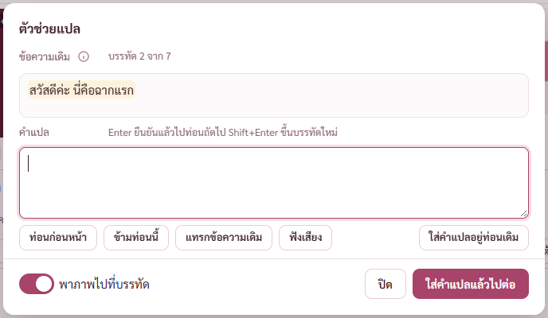
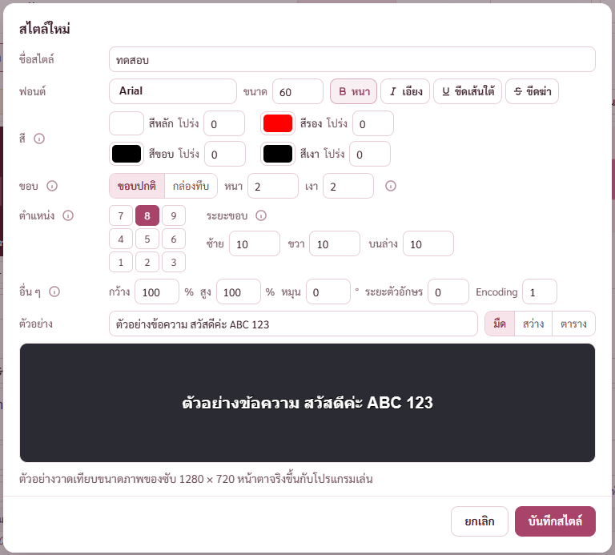
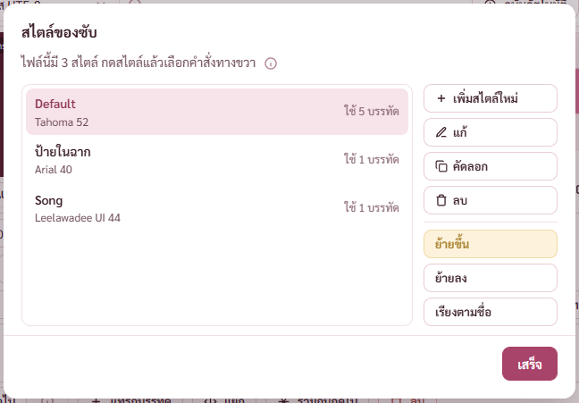

# ประเมินหน้าตาและการใช้งาน หน้าแก้ซับ

เริ่ม 14 พ.ย. 2569 ระหว่างทำแผนหน้าแก้ซับขั้น 6 ถึง 10 (BUGS ข้อ 109)
พี่กันสั่ง *"ระหว่างทำ เราอยากให้เธอประเมิน UXUI ไปด้วยนะ ว่ามันเหมาะสม สวย ใช่งานง่ายจริงๆไหม ที่ว่างยังเหลือเยอะไหม"*

ประเมินจากภาพจริงของโปรแกรมทดสอบ (โหมดพัฒนา) หน้าต่าง 1280 × 800 (ไม่กดขยาย ทุกจอเท่ากัน) กับ 1920 × 1032 (จอ 1080 กดขยาย) ด้วยหนังทดสอบ ฉากตัด (2025).mkv

สถานะ ✅ แก้แล้ว · 🔨 ทำในขั้นถัดไปของแผน · ⬜ รอพี่กันเคาะ · 💬 ข้อสังเกต ไม่ต้องแก้

## ภาพรวมทั้งหน้า

| ข้อ | สถานะ | เรื่อง |
|---|---|---|
| U1 | 🔨 ⬜ | **หน้าต่าง 1280 × 800 ตารางบรรทัดสูงแค่ 81 จุด เห็นหัวตารางกับราวสองแถว** ไล่ซับยาว ๆ ในตารางแทบไม่ได้ ต้องใช้ปุ่มบรรทัดถัดไปหรือคีย์ลัดแทน · ที่กินความสูงไปคือ แถบบน แถบแทร็ก แถบเครื่องมือ (รวมราว 150 จุด) ภาพหนังกับคลื่นเสียง (ราว 210 จุด) ช่องแก้บรรทัดสี่แถว (ราว 230 จุด) · ทางแก้ที่มีในแผนแล้วคือปุ่มยุบภาพหนังกับคลื่นเสียง (ขั้น 8) ได้ตารางเพิ่มราว 7 แถว · ทางเพิ่มที่เสนอให้เลือก ข้อ U2 กับ U3 |
| U2 | ⬜ | **ช่องแก้บรรทัด แถวเวลากับแถวสไตล์ ฝั่งขวาว่างเกือบครึ่งแถว** ทั้งที่ 1280 (ว่างราว 330 จุด) และ 1920 (ว่างราว 950 จุด) · เสนอ ตอนหน้าต่างกว้างตั้งแต่ราว 1600 จุด รวมสองแถวเป็นแถวเดียว ประหยัดราว 40 จุด ตารางได้เพิ่มหนึ่งแถว · ที่ 1280 รวมไม่พอ ของสองแถวยาวรวมราว 1,500 จุด |
| U3 | ⬜ | **แถบชื่อแทร็ก (ASS ซับที่ 1 ไทย ครบทุกช่อง Export) ใช้ทั้งแถวแต่มีของแค่ครึ่งซ้าย** · เสนอย้ายไปอยู่แถวเดียวกับปุ่มเลิกทำ ทำซ้ำ รหัสอักษร ตอนมีแทร็กไม่เกินสองแทร็ก ประหยัดราว 44 จุด · ต้องลองว่าแถบเครื่องมือยังไม่ล้นตอนเมนูซ้ายกาง |
| U4 | 💬 ⬜ | **ปุ่มที่กดไม่ได้เป็นสีเหลืองอ่อน เด่นกว่าปุ่มที่กดได้** เช่น เลิกทำตอนยังไม่มีอะไรให้เลิก ย้อน ขนาดในไฟล์ ย้ายขึ้น · ตาไปหาปุ่มที่ใช้ไม่ได้ก่อน · เป็นแบบเดียวกันทั้งโปรแกรม ไม่แก้เฉพาะหน้านี้ เสนอให้พี่กันพิจารณาว่าจะเปลี่ยนเป็นสีจางลงไหม |
| U5 | 💬 | หน้าต่าง 1920 × 1032 ตารางเห็นครบ 7 บรรทัดพร้อมที่ว่าง แถวปุ่มเสียงแบบ 2 มีชื่อใต้ไอคอน อ่านง่าย · ภาพหนังยังเล็ก 288 × 162 ทั้งที่จอกว้าง ที่ว่างไปอยู่กับคลื่นเสียงที่ยาวขึ้นแทน ซึ่งเหมาะกับการลากเวลา |

## แถบเหนือตารางกับเมนู (ขั้น 6)

| ข้อ | สถานะ | เรื่อง |
|---|---|---|
| U6 | ✅ | ปุ่มสูง 32 จุดดันแถบให้สูงขึ้น ตารางที่ 1280 × 800 เหลือความสูงขั้นต่ำ หน้าเลื่อนได้ 3 จุด แก้ให้ปุ่มสูง 26 เท่าปุ่มแท็ก (commit 941ca22 บั๊ก B1) |
| U7 | ✅ | เมนูบรรทัด 22 คำสั่งเรียงทีละแถวยาว 607 จุด ต้องเลื่อนในเมนู จัดคำสั่งที่เป็นคู่ไว้แถวเดียวซ้ายขวา เหลือ 467 จุด ไม่ต้องเลื่อน |
| U8 | ✅ | เมนูวิดีโอกางทับเมนูซ้ายของโปรแกรม (พี่กันส่งภาพ *"ทับ"*) ใส่ตัววัดแนวนอนให้ของที่กางทุกตัว 9 จุดทั้งโปรแกรม  |
| U9 | 💬 | ที่ว่างของแถบเหนือตาราง เมนูซ้ายย่อเหลือราว 240 จุดระหว่างเมนูเครื่องมือกับตัวนับบรรทัด เมนูซ้ายกางเหลือราว 100 จุด ใส่ปุ่มเพิ่มได้อีกไม่เกินหนึ่งปุ่ม · ข้อความผลของคำสั่งขึ้นแทนที่ตัวนับบรรทัดชั่วคราว แถบจึงไม่แน่นขึ้น  |
| U10 | 💬 | เมนูบรรทัดยังยาว 22 คำสั่ง แต่แบ่งเป็นสี่กลุ่มด้วยเส้นคั่น (แทรก · แยก รวม · ย้าย · คัดลอก วาง ลบ) และมีคีย์ลัดชิดขวา ใกล้เคียงเมนูแก้ไขของ Aegisub  |

## หน้าต่างคำสั่ง (ขั้น 6)

| ข้อ | สถานะ | เรื่อง |
|---|---|---|
| U11 | ✅ | ปุ่ม ⓘ ทับท้ายคำป้ายแถว (ช่องป้ายแคบ 84 จุด) ขยายเป็น 104 จุด |
| U12 | ✅ | หน้าต่างปรับเวลาทั้งไฟล์ แถว keyframe สี่ช่องล้นขอบขวา แยกเป็นแถวเวลาเริ่มกับเวลาจบ มีหน่วย ms ตามหลังตัวเลขทุกช่อง  |
| U13 | ✅ | เปิดหน้าต่างแล้วโฟกัสไปอยู่ปุ่ม ⓘ มีวงสีเข้ม ย้ายเคอร์เซอร์ไปช่องแรกที่ต้องพิมพ์ พิมพ์ได้ทันที |
| U14 | ⬜ | **ค้นและแทนที่เป็นหน้าต่างบังกลางจอ** บังช่องแก้บรรทัด ยังเห็นแถวที่เจอในตารางข้างล่าง · Aegisub เป็นหน้าต่างลอยที่กดตารางต่อได้ · เสนอทำเป็นแถบค้นหาเหนือตารางแบบไม่บัง ภายหลัง  |

## เครื่องมือของซับ (ขั้น 7)

| ข้อ | สถานะ | เรื่อง |
|---|---|---|
| U15 | ✅ | ตัวช่วยแปล ปุ่มหลักใส่คำแปลแล้วไปต่อตกไปแถวที่สองคนเดียว ย้ายไปแถบล่างขวาแบบหน้าต่างอื่น · ข้อความผล (เป็นท่อนแรกแล้ว) ย้ายไปแถวเดียวกับเลขบรรทัด หน้าต่างไม่สูงขึ้นตอนมีข้อความ  |
| U16 | ✅ | หน้าต่างแก้สไตล์ แถวสีสี่สีตัดบรรทัดเหลือสีเงาตัวเดียว จัดเป็นสองคูณสอง · ป้าย ระยะ กำกวมกับระยะขอบ เขียนเต็มว่าระยะตัวอักษร  |
| U17 | ✅ | หน้าต่างเปลี่ยนความละเอียด ปุ่มขนาดสำเร็จรูปตัวสุดท้ายตกแถว เหลือสี่ขนาดแถวเดียว · ข้อความล่างตัดบรรทัดกลางคำ รูปวาด เกลาให้สั้นบรรทัดเดียว รายละเอียดย้ายไปใน ⓘ · แถวระยะขอบแบบกำหนดเองล้น แยกสวิตช์ลงแถวใหม่ |
| U18 | 💬 | ตัวจัดการสไตล์ รายการสูง 320 จุด เห็นราว 7 สไตล์โดยไม่เลื่อน ไฟล์ทั่วไปมีไม่เกินนี้ · บอกจำนวนบรรทัดที่ใช้แต่ละสไตล์ ช่วยตัดสินใจก่อนลบ  |
| U19 | 💬 | ตัวอย่างสไตล์วาดด้วย CSS ไม่ใช่ตัววาดซับของโปรแกรมเล่น ขอบ เงา กล่องทึบใกล้เคียงแต่ไม่ตรงทุกจุด บอกไว้ใต้ตัวอย่างแล้ว · ตัวอย่างจริงทีละเฟรมรอระบบดูวิดีโอในแอป (ROADMAP) |
