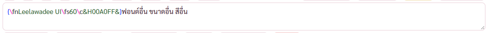
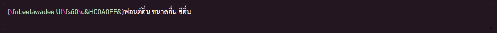

# รายงาน สีอักษรในช่องพิมพ์ของหน้าแก้ซับแบบ Aegisub (BUGS ข้อ 112)

14 พ.ย. 2569 · ทดสอบในโปรแกรมทดสอบ (โหมดพัฒนา) หน้าต่าง 1280 × 800 ด้วยหนังทดสอบ ฉากตัด (2025).mkv

## คำสั่งของพี่กัน

- *"สีอักษร ให้เหมือน aegi"* พร้อมภาพช่องพิมพ์ของ Aegisub ข้อความ `{\pos(960,1070)\frz0.7541}` ที่วงเล็บปีกกา ชื่อแท็ก และตัวเลขแยกสีกัน
- ช่องพิมพ์ของหน้าแก้ซับเดิมเป็นตัวอักษรสีเดียว

## ที่ทำ

### 1. ตัวแยกส่วนข้อความแบบ Aegisub (src/lib/subSyntax.ts)

แปลจากซอร์ส Aegisub ทีละฟังก์ชัน สัญญา BSD ใส่ประกาศลิขสิทธิ์เดิมหัวไฟล์

- กติกาแยกส่วน 5 สถานะ ข้อความ กลุ่มแท็ก ค่าของแท็ก ต้นแท็ก ชื่อแท็ก (parser.cpp dialogue_tokens) กติกาที่ยาวกว่าชนะ ยาวเท่ากันกติกาที่เขียนก่อนชนะ
- ภาพวาด \p กับ \clip แบบเวกเตอร์ แยกคำสั่งกับพิกัด x y ปลายเส้นโค้งขีดเส้นใต้ (MarkDrawings SplitDrawing)
- กลุ่มแท็กที่ไม่ปิดเป็นข้อความทั้งหมด เพราะ VSFilter อ่านแบบนั้น
- บรรทัดแม่แบบคาราโอเกะ (บรรทัดความเห็นที่เอฟเฟกต์ขึ้นต้นด้วย template) ขึ้นสี !…! กับ $ตัวแปร
- ไม่ได้แปลส่วนแยกคำของตัวตรวจคำผิด (โปรแกรมยังไม่มีตัวตรวจคำผิด สีเท่ากับข้อความปกติอยู่แล้ว)

### 2. ชั้นสีใต้ช่องพิมพ์ (SubEditBox.tsx · subedit.css)

- ชั้นสีวางใต้ช่องพิมพ์ ตัวอักษรของช่องพิมพ์โปร่งใส เคอร์เซอร์ การเลือก การพิมพ์ คีย์ลัด ยังเป็นของช่องพิมพ์เดิมทั้งหมด
- ระยะใน ขอบ ฟอนต์ ขนาด ความสูงบรรทัด การตัดบรรทัด ที่เผื่อแถบเลื่อน เท่าช่องพิมพ์ทุกค่า ข้อความยาวตัดบรรทัดตรงกัน เลื่อนตามกัน
- ตัวหนาของ Aegisub (ชื่อแท็ก ขึ้นบรรทัด ความเห็น) ทำด้วยเงาตัวอักษร เพราะตัวหนาจริงกว้างกว่าแล้วตัวอักษรเลื่อนจากเคอร์เซอร์
- สีค่าตั้งต้นของ Aegisub (Colour/Subtitle/Syntax) วงเล็บปีกกาน้ำเงิน ทับกับวงเล็บม่วงชมพู ชื่อแท็กเทา ค่าเขียวเข้ม ข้อผิดแดงพื้นแดงอ่อน ขึ้นบรรทัดเทาอ่อน ข้อความปกติใช้สีตัวหนังสือของโทน
- โทนกลางคืนตัวแปลงโทนปรับสีเข้มเป็นสีอ่อนให้เอง สีม่วงชมพูของทับเขียนเป็นชื่อสีกับ color-mix ไม่ให้ตัวแปลงเปลี่ยนเป็นสีเน้นของโทน
- เฉพาะไฟล์ ASS กับ SSA · ไฟล์ SRT ยังเป็นสีเดียว

## บั๊กที่เจอระหว่างทำ

- ชื่อคลาสของกล่องครอบ (hl) ชนกับคลาสไฮไลต์คำค้นของทั้งโปรแกรม ช่องพิมพ์แคบลง 2 จุดกับตัวอักษรกลายเป็นตัวหนา เปลี่ยนชื่อเป็น se-hlon แล้ว ตัวตรวจมีข้อตรวจตัวไม่หนาและความกว้างเท่ากัน ใส่คลาสชนกลับชั่วคราวแล้วแดง 3 ข้อ

## ผลตรวจ

| ตัวตรวจ | ผล |
|---|---|
| check-subsyntax (ใหม่) | 34/34 · ตรรกะ 21 ข้อเทียบกติกาของ Aegisub · หน้าจอ 13 ข้อ |
| check-subedit | 63/63 |
| check-review-fixes | 34/34 |
| check-sizes หน้าซับไตเติล | 12/12 |
| check-subvtools (เพิ่มข้อตรวจกล่อง ⓘ สามกล่อง) | 55/55 |

## ยังไม่ได้ตรวจ

- พิมพ์ภาษาไทยด้วยแป้นจริงแล้วดูว่าเคอร์เซอร์ตรงตัวอักษรตลอด (ตัวตรวจวัดตำแหน่งกับความสูงของสองชั้นเท่ากัน แต่ไม่ได้พิมพ์ด้วยแป้นจริง) พี่กันลองเองได้
