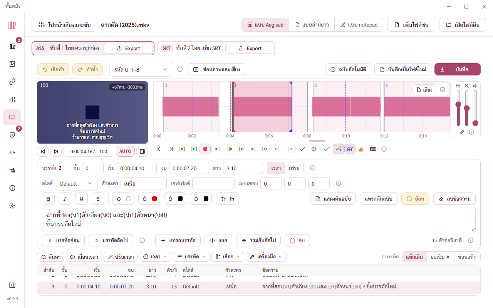
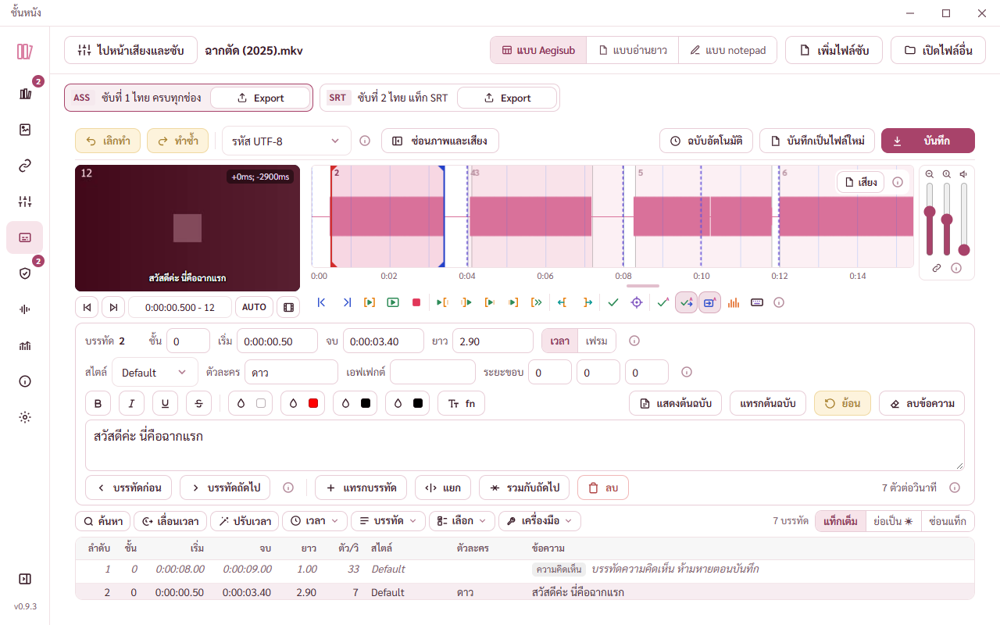
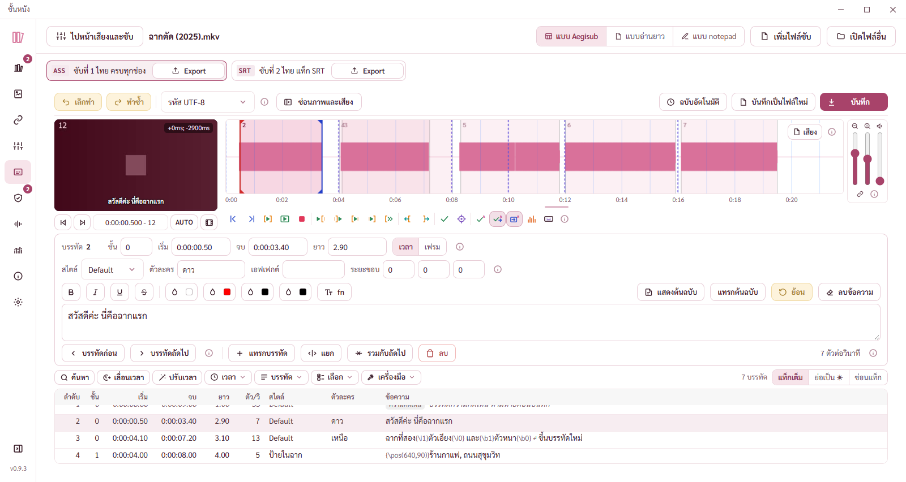
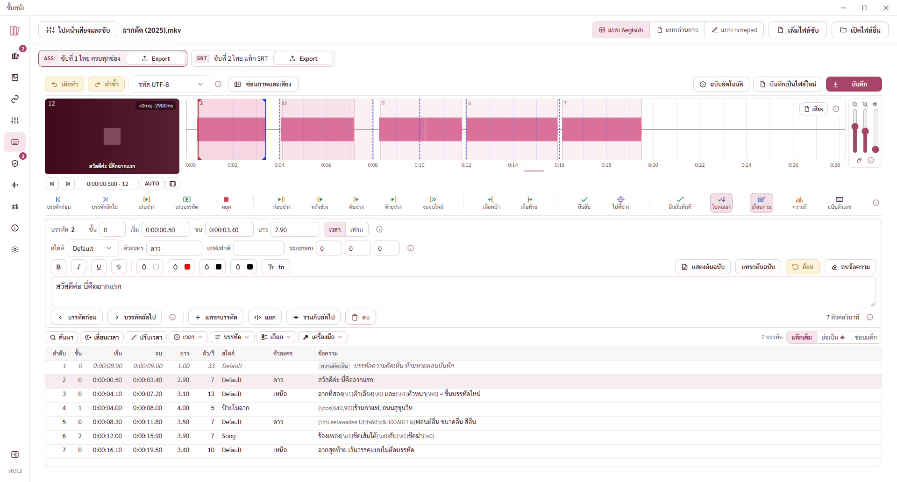
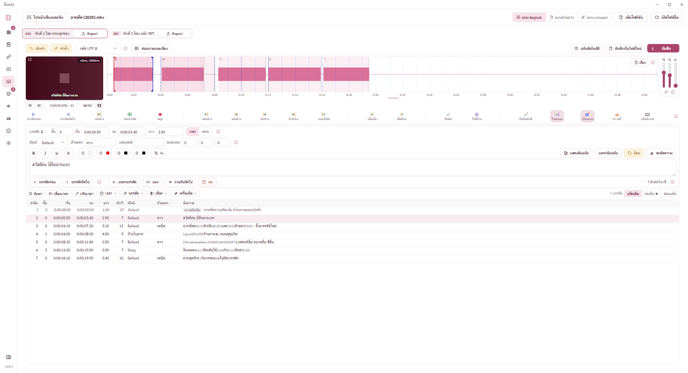
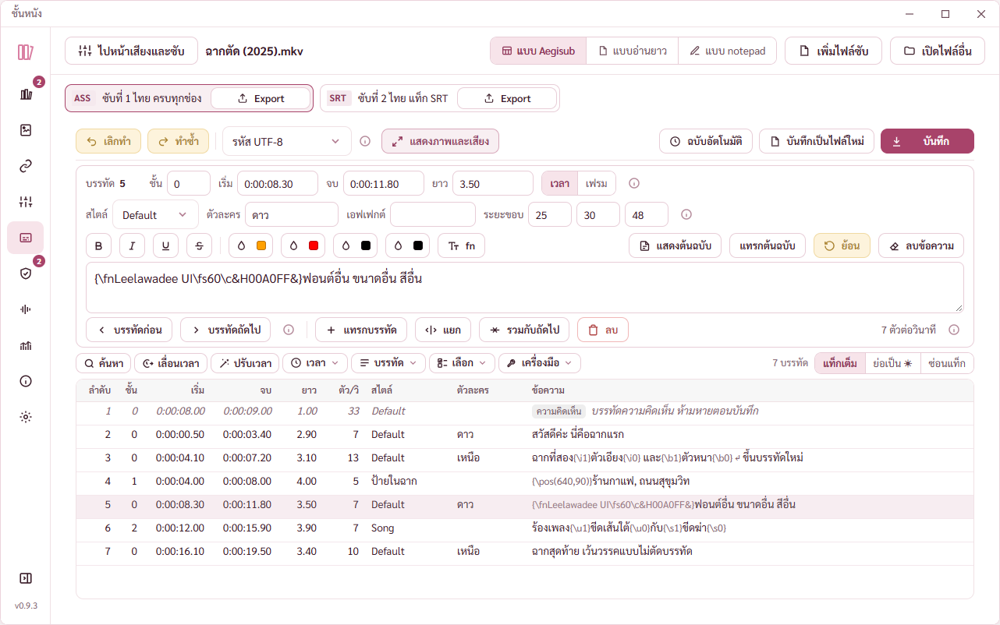

# รายงาน แผนหน้าแก้ซับ ขั้น 10 เทสรวม (14 พ.ย. 2569)

พี่กันสั่ง *"ทำต่อเลย จนเสร็จตามแผน commit ทุกชั้น เเละตอนเสร็จเราให้รันเอเจ้น 2 ตัวตรวจทานระบบซับอีกรอบ"*
แผน `C:\Users\PKH\.claude\plans\harmonic-beaming-wreath.md` ขั้น 10 ตัวตรวจทุกตัวของแผนนี้ check-subchap check-sizes (เพิ่มหน้าแก้ซับ) ตัวจริงใต้ CSP cargo test อัปเดตมอคอัปให้เหมือนของจริง รายงานพร้อมภาพ

ผลประเมินหน้าตาทุกขั้นกับข้อที่รอพี่กันเคาะอยู่ [REPORT-2026-11-14-ประเมินหน้าแก้ซับ.md](REPORT-2026-11-14-ประเมินหน้าแก้ซับ.md)

## ผลตรวจ

ตรวจบนเครื่องพี่กัน โปรแกรมทดสอบแบบเปิดอยู่หลังสุด สั่งผ่าน CDP

| ตัวตรวจ | ตรวจอะไร | ผล |
|---|---|---|
| check-subchap | ปุ่มดูซับ หน้าต่าง Chapter Export | 27 จาก 27 |
| check-subedit | ขั้น 2 กับ 3 แก้ทุกช่อง เลิกทำ บันทึกจริงลงสำเนา | 63 จาก 63 (รอบแรก 62 ดูบั๊กข้อ 2) |
| check-subvideo | ขั้น 4 ภาพตรงเฟรม keyframe วิดีโอจำลอง | 51 จาก 51 |
| check-subaudio | ขั้น 5 ลากเวลา ดูดติด เล่นเสียง | 52 จาก 52 |
| check-subcmds | ขั้น 6 ทุกคำสั่งเวลาและแก้ไข | 123 จาก 123 |
| check-subtools | ขั้น 7 สไตล์ เปลี่ยนความละเอียด ตัวช่วยแปล | 72 จาก 72 |
| check-subpad | ขั้น 8 ซ่อนภาพและเสียง notepad | 22 จาก 22 |
| check-subremux | ขั้น 9 ใส่ซับกลับเข้าหนังจริง | 18 จาก 18 |
| check-sizes | ทุกหน้า 4 ขนาดจอ รวมหน้าแก้ซับสามสภาพ | รอบเต็ม 58 จาก 60 แล้วหน้าแก้ซับรอบแก้ 12 จาก 12 (ดูบั๊กข้อ 3) |
| check-subedit-built (ใหม่) | ตัวจริงใต้ CSP | 16 จาก 16 (รอบแรก 14 จาก 15 ดูบั๊กข้อ 1) |
| cargo test | ฝั่ง Rust ทั้งหมด | 204 จาก 204 (รันตอนขั้น 9) |

รันทุกตัวของแผนต่อกันได้ด้วย `bash scripts/run-subedit-all.sh` (ตอนพี่กันทำงานอยู่ส่ง `NOGATE=1`)

## บั๊กที่เจอในขั้นนี้

1. **โปรแกรมที่ติดตั้งกด Ctrl+S กับ Ctrl+Shift+S ในหน้าแก้ซับไม่มีอะไรเกิดขึ้น** ตัวกันคีย์ลัดของเบราว์เซอร์ (กันไม่ให้ Ctrl+S บันทึกหน้าเว็บ มีเฉพาะตัวจริง) ติดป้ายแป้นไว้ก่อน ตัวคีย์ลัดของหน้าแก้ซับเห็นป้ายแล้วข้าม โหมดพัฒนาไม่มีตัวกันจึงไม่เจอมาตลอดขั้น 2 ถึง 9 · แก้ให้ตัวกันจดว่าแป้นไหนกันเพื่อเบราว์เซอร์ ตัวคีย์ลัดของโปรแกรมยังทำงาน (`src/lib/browserKeys.ts`) · ตัวตรวจตัวจริงตกข้อนี้ก่อนแก้ ผ่านหลังแก้ · ปุ่มบันทึกบนจอใช้ได้มาตลอด
2. ตัวตรวจขั้น 3 คาดว่าบรรทัดที่แทรกยาว 3 วินาทีเสมอ ขั้น 6 เปลี่ยนให้ตัดที่เวลาเริ่มของบรรทัดถัดไปแบบ Aegisub แก้ตัวตรวจให้ตรงกับพฤติกรรมใหม่ (ไม่ใช่บั๊กของโปรแกรม)
3. ตัวตรวจขนาดจอนับช่องพิมพ์ notepad ที่เลื่อนแนวนอนได้ว่าล้น ช่องนี้ตั้งใจไม่ตัดบรรทัดยาวแบบ Notepad แก้ตัวตรวจให้ไม่นับช่องนี้

## ตัวจริงใต้ CSP

ภาพหนังทีละเฟรมขึ้น เดินหน้าหนึ่งเฟรมได้ คลื่นเสียงวาดได้ กดเล่นบรรทัดแล้วเสียงเล่นจริง (ตั้งความดังศูนย์ ไม่มีเสียงออกลำโพง) แบบ notepad รายชื่อฟอนต์ในเครื่อง 256 ตัว หน้าต่างถามสองทางอ่านแทร็กของหนังได้ ไม่มีการละเมิด CSP สักครั้ง

ความเร็วแบบ notepad กับไฟล์ซับ 2,000 บรรทัด วาดข้อความทั้งไฟล์ 202 ms พิมพ์แก้แล้วเอกสารเปลี่ยนใน 616 ms (รวมพักพิมพ์ 500 ms) งานที่ค้างนานสุด 99 ms

## หน้าแก้ซับทุกขนาดจอ

ไม่ล้นขวา ปุ่มไม่ซ้อน หน้าไม่เลื่อนแนวตั้ง ทั้ง 4 ขนาดจอ 3 สภาพ

ภาพสภาพซ่อนภาพและเสียงกับ notepad ทุกขนาดอยู่ `docs/report-2026-11-14/ขนาดจอ-หน้าแก้ซับ/`

## มอคอัปที่อัปเดตให้เหมือนของจริง

- [sub-editor-pick.html](mockups/sub-editor-pick.html) กรอบบนสุดเป็นหน้าแก้ซับจริงสามสภาพ แบบ 1 ถึง 3 เหลือชื่อกับคำบรรยาย บอกว่าลงโปรแกรมเป็นอะไร (หน้าที่เคยวาดทับไม่มีแล้ว)
- [sub-audio-toolbar.html](mockups/sub-audio-toolbar.html) แถวปุ่มเสียงแบบ 1 ที่ 1280 × 800 กับแบบ 2 ที่หน้าต่างสูง 1032 เป็นของจริง ตารางปุ่มท้ายหน้าคงเดิม
- [theme-live-app.html](mockups/theme-live-app.html) เพิ่มข้อมูลตัวอย่างหน้าแก้ซับ ให้มอคอัปเปิดในโครมได้ หนังตัวอย่าง ฉากตัด (2025).mkv ซับ ASS 42 บรรทัด สไตล์ 3 ตัว

ลิงก์เปิดในโครม `http://127.0.0.1:1420/docs/mockups/sub-editor-pick.html` กับ `http://127.0.0.1:1420/docs/mockups/sub-audio-toolbar.html`
ภาพข้างบนถ่ายในหน้าต่างทดสอบที่อยู่หลังสุด ซึ่งใช้ฝั่ง Rust ตัวจริงกับไฟล์ทดสอบ ส่วนที่เปิดในโครมใช้ข้อมูลตัวอย่าง ลองเรียกข้อมูลตัวอย่างทุกคำสั่งด้วย node แล้ว แต่ยังไม่ได้เปิดดูในโครม

## พี่กันต้องลองเอง

- ลากเวลาบนคลื่นเสียงและฟังเสียงกับหนังจริง (ขั้น 5)
- ใส่ซับกลับเข้าหนังจริงหนึ่งเรื่อง แล้วเปิดในโปรแกรมเล่นดูว่าซับที่แก้ขึ้น (ขั้น 9)
- ปุ่มสีของตัวหนังสือ (หน้าต่างเลือกสีของ Windows เปิดจากตัวตรวจไม่ได้)
- พิมพ์ในแบบ notepad ด้วยแป้นพิมพ์จริง
