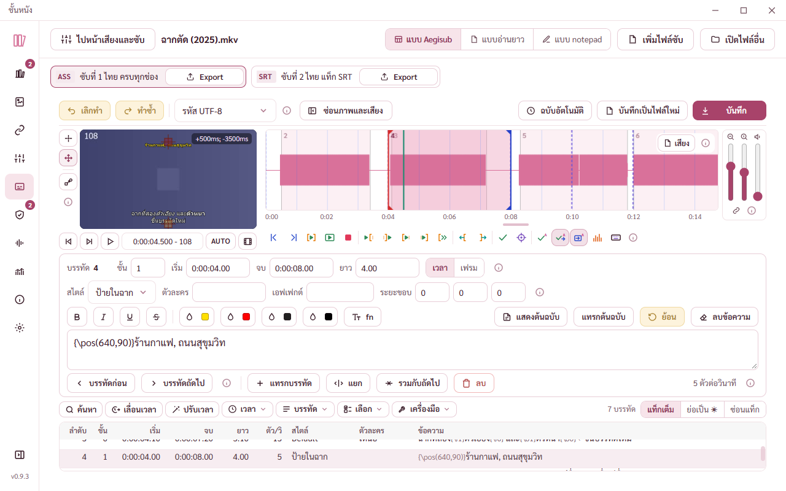
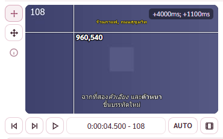
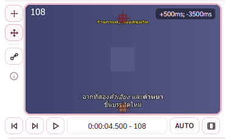
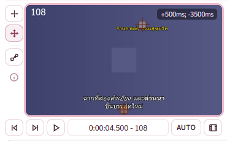
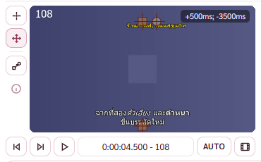
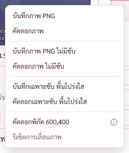
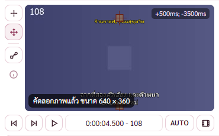
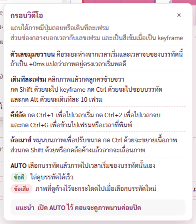
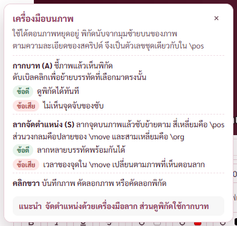

# รายงาน เครื่องมือบนภาพ เมนูคลิกขวา และล้อเมาส์ของหน้าแก้ซับ (BUGS ข้อ 111 ส่วนที่สองและสาม)

14 พ.ย. 2569 · ทดสอบในโปรแกรมทดสอบ (โหมดพัฒนา) กับตัวจริงใต้กติกาความปลอดภัย หน้าต่าง 1280 × 800 ด้วยหนังทดสอบ ฉากตัด (2025).mkv (ภาพ 640 × 360 ซับ ASS ความละเอียด 1280 × 720)

## คำสั่งของพี่กัน

- ส่วนที่สอง *"ลากจัดตำแหน่งคำบรรยาย (S)"* เครื่องมือลากจัดตำแหน่งแบบ Aegisub
- ส่วนที่สาม เมนูคลิกขวาบนภาพ บันทึกภาพ PNG กับคัดลอกภาพ แบบมีซับ ไม่มีซับ เฉพาะซับ คัดลอกพิกัด รีเซ็ตการเลื่อนภาพ และเส้นกากบาทพร้อมพิกัดสคริปต์
- สั่งเพิ่มระหว่างทำ *"ตรงนี้ ใน aegi มันสโคลเมาส์ปรับขนาดได้ เราอยากได้ด้วย"*
- ทุกส่วนยกวิธีจากซอร์ส Aegisub (visual_tool.cpp visual_tool_cross.cpp visual_tool_drag.cpp video_display.cpp command/video.cpp default_menu.json default_config.json) สัญญา BSD ใส่ประกาศลิขสิทธิ์เดิมไว้หัวไฟล์ subVisual.ts

## 1. ซับบนภาพนิ่งเป็นซับจริงที่ libass วาด

เดิมภาพนิ่งขึ้นซับเป็นข้อความธรรมดากลางล่างเสมอ ป้ายที่ใส่ \pos ไว้ด้านบนไม่เคยขึ้นตรงที่ ตอนนี้วาดด้วย libass ตัวเดียวกับ mpv และ Aegisub ตำแหน่ง สี ตัวเอียง ตัวหนา การตัดบรรทัด และฟอนต์ที่ฝังในหนัง MKV ตรงกับตอนเล่น

- วาดเฉพาะซับบนพื้นโปร่งใสขนาดภาพบนจอ แล้ววางทับภาพหนังที่เก็บไว้ ไม่ต้องถอดภาพหนังใหม่ทุกครั้งที่แก้ซับ ใช้เวลาราว 0.1 ถึง 0.3 วินาทีต่อภาพ
- เวลาที่วาดคือเวลาของเฟรมลบดีเลย์ของซับ แบบ Aegisub ที่ใช้เวลาของเฟรม (TimeAtFrame)
- ลากซับหรือพิมพ์เร็ว ๆ วาดทีละภาพ เก็บไว้เฉพาะคำขอล่าสุด ไม่สั่ง ffmpeg ซ้อนกัน · เดินเฟรมกลับไปมาใช้ภาพที่เก็บไว้ 40 ภาพ
- ระหว่างเล่นด้วย mpv ซับมาจาก mpv เอง ระหว่างเล่นแบบ Aegisub ยังเป็นข้อความแบบเดิม (วาดทุกเฟรมไม่ทัน)
- วาดด้วย libass ไม่สำเร็จ กลับไปขึ้นข้อความแบบเดิม

## 2. แถบเลือกเครื่องมือซ้ายของภาพ

แบบ Aegisub ที่วางแถบเครื่องมือภาพแนวตั้งข้างภาพ มีกากบาท (A) ลากจัดตำแหน่ง (S) ปุ่มสลับ \move กับ \pos (ขึ้นเฉพาะตอนใช้เครื่องมือลาก) และปุ่ม ⓘ · กด A หรือ S ตอนคลิกภาพไว้ ใช้ได้ทั้งแป้นไทยและอังกฤษ · ไฟล์ SRT ไม่มีแท็กตำแหน่ง ปุ่มเครื่องมือลากบอกเหตุผลว่าต้องเปลี่ยนเป็น ASS ก่อน

## 3. เครื่องมือกากบาท

- เส้นกากบาทเต็มภาพกับพิกัดสคริปต์ข้างเมาส์ วางที่มุมของกากบาทที่ใกล้กลางภาพ เมาส์ซ่อนตอนชี้ภาพ
- ภาพบนจอใหญ่กว่าความละเอียดสคริปต์ขึ้นทศนิยม 3 ตำแหน่ง ไม่งั้นเป็นจำนวนเต็ม · กด Shift พิกัดนับจากมุมขวาล่าง
- ดับเบิลคลิก ย้ายบรรทัดที่เลือกทุกบรรทัด ให้ตำแหน่งของบรรทัดที่กำลังแก้มาอยู่ตรงที่คลิก (\move ย้ายทั้งสองจุด คงเวลา \org ย้ายด้วย) เป็นการแก้ขั้นเดียว

## 4. เครื่องมือลากจัดตำแหน่ง

- จุดจับของทุกบรรทัดที่ขึ้นบนเฟรมนั้น สี่เหลี่ยมคือ \pos หรือจุดเริ่มของ \move วงกลมคือจุดปลายของ \move สามเหลี่ยมคือ \org เส้นเชื่อมลูกศรกับเส้นประ สีตามค่าตั้งต้นของ Aegisub
- ตำแหน่งของบรรทัดที่ไม่มี \pos คิดจากการจัดวาง ระยะขอบของบรรทัดหรือของสไตล์ และ \an \a แบบ Aegisub
- คลิกจุดเลือกบรรทัดนั้นในตาราง Ctrl คลิกเพิ่มหรือเอาออก จุดที่เลือกหลายจุดลากไปด้วยกัน กด Shift ลากแกนเดียว ทั้งการลากเป็นการแก้ขั้นเดียว
- ลากจุดของ \move แล้วเวลาของจุดนั้นเป็นเวลาของภาพที่เห็นลบเวลาเริ่มของบรรทัด แบบ Aegisub
- ปุ่มสลับ มี \move เปลี่ยนเป็น \pos ที่จุดเริ่ม ไม่มี ใส่ \move อยู่กับที่ เวลาปัดเข้าขอบเฟรมตามสูตรของ Aegisub (เวลาปลายติดลบได้ เช่น -42 ms เหมือน Aegisub)
- แก้แท็กเฉพาะในกลุ่มแท็กแรกตามตัวอักษรเดิม แท็กอื่นของบรรทัดไม่ถูกจัดรูปใหม่ (Aegisub จัดรูปทั้งบรรทัดใหม่)

## 5. เมนูคลิกขวาบนภาพ

8 คำสั่งเรียงและแบ่งกลุ่มตาม default_menu.json ของ Aegisub

- บันทึกภาพ PNG กับคัดลอกภาพ แบบมีซับ ไม่มีซับ และเฉพาะซับพื้นโปร่งใส ขนาดเต็มของหนัง (คิดอัตราส่วนภาพแล้ว)
- บันทึกในโฟลเดอร์ของหนัง ชื่อ ชื่อหนัง_ลำดับ_เลขเฟรม.png นับลำดับ 001 ขึ้นไปจนชื่อไม่ชน สร้างแบบห้ามทับ ไม่เขียนทับไฟล์เดิม · วิดีโอจำลองบันทึกในโฟลเดอร์ของไฟล์ซับ ชื่อขึ้นต้น dummy
- คัดลอกภาพใส่คลิปบอร์ดสองแบบพร้อมกัน PNG (เก็บพื้นโปร่งใส) กับ DIB สำหรับโปรแกรมเก่า
- คัดลอกพิกัดตรงที่คลิกขวา · รีเซ็ตการเลื่อนภาพ คืนการขยายเนื้อภาพแล้ววางภาพกลางกรอบ คำสั่งที่ยังกดไม่ได้บอกเหตุผลตอนชี้
- วางที่เมาส์ ขวาหรือล่างไม่พอกางกลับทาง ไม่ทับแถบด้านบน · Esc หรือคลิกข้างนอกปิด
- แจ้งผลลอยล่างซ้ายของภาพ สำเร็จหายเองใน 4 วินาที ผิดพลาดอยู่จนกดปิด · บันทึกการใช้งานจดทุกครั้งที่บันทึกหรือคัดลอกภาพ

## 6. ล้อเมาส์แบบ Aegisub

ตามค่าตั้งต้นของ Aegisub (Video Scroll Action) เดิมต้องกด Ctrl ถึงปรับขนาดภาพได้

- หมุนเปล่า ปรับขนาดภาพทีละ 12.5% ได้ 12.5% ถึง 1000% นับเป็นรอบล้อ ทัชแพดสะสมจนครบรอบ
- Ctrl ขยายเนื้อภาพ 0.125 ถึง 10 เท่าในกรอบเดิม จุดที่ชี้อยู่ใต้เมาส์ที่เดิม (content zoom) ภาพที่ขยายดึงภาพความละเอียดสูงขึ้นเอง
- Shift เลื่อนภาพขึ้นลง 5 จุดต่อรอบล้อ · กดล้อเมาส์ค้างแล้วลากเลื่อนภาพ

## 7. กล่อง ⓘ

กล่องกรอบวิดีโอกับกล่องเครื่องมือบนภาพ เขียนเป็นหัวข้อละเรื่อง เนื้อความสั้นมีคำเชื่อม ตัดบรรทัดตรงรอยต่อของความหมาย (รอบแรกแคลร์แตกเป็นบรรทัดละวลี พี่กันตีตก แก้แล้ว)

## ผลตรวจ

| ตัวตรวจ | ผล |
|---|---|
| check-subvtools (ใหม่) | 52/52 · ทำตัวใส่แท็กพังชั่วคราวแล้วแดง 11 ข้อ คืนแล้วเขียว |
| check-subvtools-built (ใหม่ ตัวจริงใต้ CSP) | 8/8 · ภาพซับ data:image/png ขึ้น บันทึกภาพสามแบบได้ ไม่มีการละเมิด CSP |
| check-subvideo | 51/51 (ข้อล้อเมาส์เปลี่ยนเป็นหมุนเปล่า) |
| check-vidplay | 13/13 |
| check-mpvplay | 29/29 |
| check-sizes หน้าซับไตเติล | 12/12 ทุกขนาดจอ |
| cargo test | 213/213 (เทสใหม่ของ subshot.rs 4 ข้อ) |

## ยังไม่ได้ตรวจ พี่กันต้องลองเอง

- คัดลอกภาพลงคลิปบอร์ดจริงแล้ววางในโปรแกรมอื่น (ตัวตรวจไม่แตะคลิปบอร์ดของคนที่ใช้คอม)
- ลากซับบนภาพกับหนังจริงที่มีซับหลายบรรทัดและฟอนต์ที่ฝังในหนัง

## ข้อที่รอพี่กันเคาะ

อยู่ในรายงานประเมินหน้าแก้ซับ ข้อ U38 กรอบภาพแบบพอดีกรอบเล็กคงที่ทุกขนาดจอจนลากยาก และ U45 หน้าแก้ซับเลื่อนแนวตั้งได้ตอนเลือกขนาดภาพใหญ่ที่หน้าต่าง 1280 × 800 (ของเดิม)
